# Bitacora de creación del frontned en Angular

## ISS-00 · Requisitos previos

**Objetivo**

- Dejar el equipo listo para construir el frontend: Node, npm, Angular CLI, navegador, backend Express corriendo y base de datos sembrada. Al terminar este ISS no se ha escrito código de Angular todavía; solo se comprueba el entorno.


### 0.1 Versiones del laboratorio

| Herramienta | Versión usada | Verificación |
|-------------|---------------|--------------|
|Node.js |	22 LTS o superior (lab: 24.x)|	node -v|
|npm |	10 o superior	|npm -v|
|Angular CLI |	22.x	|npx @angular/cli version|
|Backend |Express 5 + Sequelize 6	|curl http://localhost:4000/api/sesion/perfil|
|Navegador |Chrome / Edge / Firefox actual|	Abrir http://localhost:4200|

```bash
node -v
npm -v
npx @angular/cli@22 version
```


### 0.2 Backend en marcha

El frontend no funciona solo: consume la API en `http://localhost:4000/api`. Levanta el backend correcto:

```bash
cd ~/ia-lab/dw-2026-alberto-orozco21/projects/app-enlace-express/backend-express/
npm run db:seed
npm run dev
```


### Comprobación de la matriz de permisos>

```bash
curl -i http://localhost:4000/api/companies
```

- 401 Unauthorized → el backend está protegido (estado final). Correcto.
- 200 con { "clients": [...] } → backend en Fase I (sin middlewares).
- ECONNREFUSED → el backend no está escuchando en el puerto 4000.


### 0.3 Login y permisos

El login del backend devuelve solo el par de tokens. El perfil y los permisos se piden aparte:

1. **Login (OPEN)**

```bash
curl -s -X POST http://localhost:4000/api/sesion/login \
  -H "Content-Type: application/json" \
  -d '{"identifier":"admin","password":"Admin123!"}'
```


2. **Perfil (JWT)**
curl -s http://localhost:4000/api/sesion/perfil \
  -H "Authorization: Bearer $TOKEN"


3. **Permisos efectivos (JWT)**
curl -s http://localhost:4000/api/permisos \
  -H "Authorization: Bearer $TOKEN"


### 0.4 Credenciales del seeder

|Usuario| Password |Rol	|Permisos |
|-------|----------|----|---------|
|admin|	Admin123! |ADMIN |110 recursos |
|operador| Operador123	|OPERADOR	|0 recursos |

### 0.5 Navegador y herramientas

- Abre DevTools (F12) → Console y Network. En cada ISS comprobarás que las peticiones llevan Authorization: Bearer ....
- Instala Angular DevTools (opcional) para inspeccionar componentes y signals.
- Desactiva bloqueadores que intercepten localhost si el login falla sin motivo.

### 0.6 Estructura de trabajo

El proyecto se crea dentro de la carpeta existente:

```
~/ia-lab/dw-2026-alberto-orozco21/projects/app-enlace-express/
```

No se debe crear una subcarpeta adicional. En ISS-01 se explica el comando exacto (`ng new frontend-enlace-express --directory .`) y porque `ng new .` falla en Angular CLI 22.

### Criterios de aceptación (ISS-00)

- [X] node -v ≥ 22 y npm -v ≥ 10.

- [X] npx @angular/cli@22 version muestra Angular CLI 22.x.

- [X] npm run db:seed && npm run dev del backend app-storelab-express-ii deja el puerto 4000 escuchando.

- [X] POST /api/sesion/login con admin / Admin123! devuelve access_token y refresh_token.

- [X] GET /api/permisos con ese token devuelve permissions (58 para admin).

- [X] La carpeta front-storelab-express-ii existe y está vacía (o solo contiene archivos de configuración del repositorio).

### Comprobación final

```bash
# 1. Versiones
node -v && npm -v && ng version

# 2. Backend vivo
curl -s -o /dev/null -w "HTTP %{http_code}\n" http://localhost:4000/api/companies

# 3. Login + permisos
TOKEN=$(curl -s -X POST http://localhost:4000/api/sesion/login \
  -H "Content-Type: application/json" \
  -d '{"identifier":"alberto","password":"12345678"}' \
  | grep -o '"access_token":"[^"]*' | cut -d'"' -f4)

curl -s http://localhost:4000/api/permisos \
  -H "Authorization: Bearer $TOKEN" | head -c 300
```


## ISS-01 · Bootstrap Angular 22 con CLI, Tailwind y PrimeNG

**Objetivo**

- Crear el proyecto Angular 22 sin una carpeta adicional, integrar Tailwind CSS 4, instalar PrimeNG 22 y dejar el tema Aura funcionando. Al final, ng serve debe mostrar la pantalla inicial sin errores.

### 1.1 Crear el proyecto en la carpeta actual

Desde la carpeta del proyecto:

```bash
cd ~/ia-lab/dw-2026-alberto-orozco21/projects/app-enlace-express/
npx @angular/cli@22 new frontend-enlace-express \
  --style=tailwind \
  --ssr=false \
  --routing \
  --zoneless \
  --skip-git \
  --package-manager=npm
```


### 1.2 Instalar PrimeNG compatible con Angular

**Criterios de este sub-ítem**

- [X] primeng, @primeuix/themes, primeicons y @angular/cdk instalados
- [X] Las versiones instaladas declaran compatibilidad con Angular 22
- [X] package-lock.json actualizado y conservado

El tema moderno no se importa desde `primeng/resources/themes`. El preset Aura vive en `@primeuix/themes`.

Consulta primero las peer dependencies:

```bash
ng version
npm view primeng version peerDependencies --json
npm install primeng @primeuix/themes primeicons @angular/cdk
```


Verifica versiones:

```bash
npm ls primeng @primeuix/themes primeicons @angular/cdk --depth=0
```


### 1.3 Estilos globales

**Criterios de este sub-ítem**

- [X] src/styles.css declara @layer theme, base, primeng, utilities;
- [X] Importa tailwindcss
- [X] Importa primeicons/primeicons.css
- [X] No contiene selectores .p-*, ::ng-deep ni clases de aplicación

**Crea/reemplaza src/styles.css:**

```bash
cat > src/styles.css <<'EOF'
@layer theme, base, primeng, utilities;
@import 'tailwindcss';
@import 'primeicons/primeicons.css';
EOF
```

El orden de capas es lo que permite que las utilidades de Tailwind ganen sobre el tema de PrimeNG sin !important. Es la única hoja global del proyecto.

### 1.4 Configurar PrimeNG en app.config.ts

**Criterios de este sub-ítem**

- [X] providePrimeNG registra preset: Aura
- [X] darkModeSelector: '.app-dark'
- [X] cssLayer declara name: 'primeng' y order: 'theme, base, primeng, utilities'
- [X] MessageService y ConfirmationService registrados
- [X] provideRouter incluye withComponentInputBinding() y withInMemoryScrolling

**Reemplaza src/app/app.config.ts:**

```bash
cat > src/app/app.config.ts <<'EOF'
import {
  ApplicationConfig,
  provideBrowserGlobalErrorListeners,
} from '@angular/core';
import {
  provideRouter,
  withComponentInputBinding,
  withInMemoryScrolling,
} from '@angular/router';
import { ConfirmationService, MessageService } from 'primeng/api';
import { providePrimeNG } from 'primeng/config';
import Aura from '@primeuix/themes/aura';
import { environment } from '../environments/environment';

import { routes } from './app.routes';

export const appConfig: ApplicationConfig = {
  providers: [
    provideBrowserGlobalErrorListeners(),

    provideRouter(
      routes,
      withComponentInputBinding(),
      withInMemoryScrolling({ scrollPositionRestoration: 'top' }),
    ),

    // PrimeNG 22: tema Aura. El modo oscuro se activa con la clase .app-dark.
    providePrimeNG({
      license: environment.primeUiLicense || undefined,
      ripple: true,
      inputVariant: 'outlined',
      theme: {
        preset: Aura,
        options: {
          darkModeSelector: '.app-dark',
          cssLayer: { name: 'primeng', order: 'theme, base, primeng, utilities' },
        },
      },
    }),

    MessageService,
    ConfirmationService,
  ],
};
EOF
```

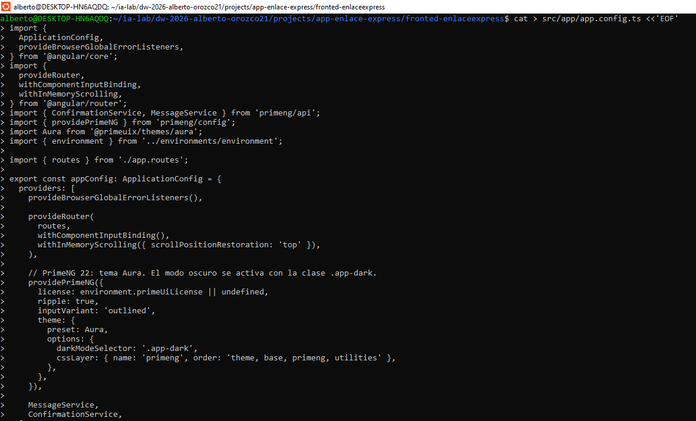

En ISS-02 se añade `provideHttpClient()`. Los interceptores se generan e incorporan en ISS-08, cuando sus servicios ya existen.

### 1.4.1 Licencia de PrimeNG 22 (obligatoria para la entrega limpia)

**Criterios de este sub-ítem**

- [X] Se identifica [PrimeUI] No license key configured en la consola como aviso de licencia, no un error de código
- [X] La clave Community se pega en primeUiLicense (environment*.ts, ISS-02 §2.1) y el aviso desaparece
- [X] La clave no se publica en el repositorio si es comercial

Desde la versión 22, PrimeNG es parte de PrimeUI, una familia comercial. El paquete incluye @primeui/license-manager, que verifica la clave sin conexión al arrancar (providePrimeNG). Si no hay clave o no es válida:

|Dónde|	Qué aparece|
|-----|------------|
|Consola|	[PrimeUI] No license key configured for primeui.|
|Consola|	[PrimeUI] PrimeUI license is not configured.|
|Esquina inferior derecha|	Banda roja Invalid PrimeUI License (Shadow DOM, pointer-events: none)|


**La aplicación funciona igual:** los componentes se dibujan y el tema Aura se aplica. El aviso es de licencia, no un fallo de Angular. Para una entrega profesional y para capturas de evidencia limpias hay que registrar la clave.

Cómo obtenerla (gratuita para el laboratorio):

1. Entra a https://primeui.dev/licenses y revisa los requisitos de la Community License: menos de 1 M USD de ingresos anuales, menos de 5 desarrolladores, menos de 10 empleados y menos de 3 M USD de financiación. Los estudiantes y el uso académico califican.

2. Solicítala en https://primeui.dev con tu correo.

3. Recibes la clave por correo. Pégala en src/environments/environment.development.ts (primeUiLicense) para ng serve, y en environment.ts para ng build (misma clave en ambos en el laboratorio).

4. Recarga: el aviso desaparece y la consola no vuelve a registrar el mensaje.

```
// src/environments/environment.development.ts (y el mismo valor en environment.ts)
export const environment = {
  // ...
  primeUiLicense: '', // clave personal; no uses una cadena de ejemplo del manual
};
```

`app.config.ts` ya enlaza la licencia: `license: environment.primeUiLicense || undefined`. Los pasos detallados del campo están en ISS-02 §2.1.

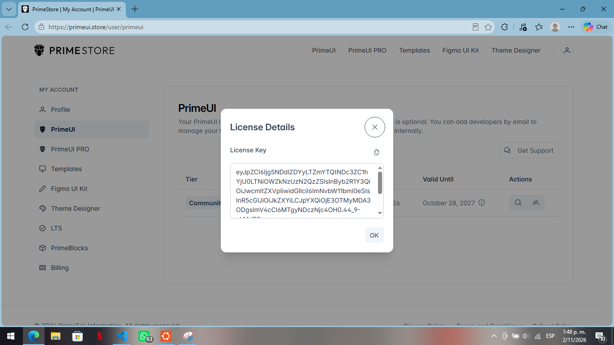

### 1.5 Pantalla de arranque: App compone el componente demo/ejemplo

**Criterios de este sub-ítem**

- [X] src/app/app.ts importa el componente Ejemplo y lo declara en imports
- [X] src/app/app.html contiene `<app-ejemplo />` dentro de un `<main>` con utilidades Tailwind
- [X] src/app/app.css queda vacío: el aspecto viene de Tailwind y del tema Aura
- [X] src/app/app.spec.ts prueba que app-ejemplo se pinta, en lugar del `<h1>` por defecto
- [X] src/app/app.routes.ts sigue vacío: en ISS-01 no hay rutas
- [X] Existe src/app/demo/ejemplo/ con ejemplo.ts, ejemplo.html, ejemplo.css y ejemplo.spec.ts
- [X] Al abrir http://localhost:4000 se ve la tarjeta del producto con su precio y sus botones

La plantilla que genera el CLI es una página de bienvenida de Angular llena de enlaces. Se reemplaza, pero no por una pantalla vacía: el resultado de ISS-01 es una pantalla mínima que se ve y que sirve de ejemplo de todo lo que explica 1.9.

La pantalla vive en un componente aparte, `demo/ejemplo`, para que la explicación no se mezcle con App. App se queda con una sola responsabilidad: poner la etiqueta. No se usa el router todavía: en ISS-01 el objetivo es entender qué es un componente, y eso se ve con una etiqueta en la plantilla. El router aparece en ISS-01B, cuando hay una pantalla de negocio que mostrar.

```
index.html → <app-root> → App (composición) → <app-ejemplo /> → demo/ejemplo
```

La regla mental que queda de esta sección: un componente es una etiqueta HTML que se escribe en la plantilla de otro componente. La etiqueta es el selector de su @Component.

`src/app/app.ts`

```bash
cat > src/app/app.ts <<'EOF'
import { Component } from '@angular/core';
import { Ejemplo } from './demo/ejemplo/ejemplo';

/**
 * Componente principal (`<app-root>`).
 *
 * Es el primero que Angular dibuja. En ISS-01 solo compone el componente de
 * ejemplo, para que se vea en pantalla con una etiqueta. Las rutas llegan en
 * ISS-01B, cuando existe una pantalla de negocio que mostrar.
 */
@Component({
  host: { class: 'block' },
  selector: 'app-root',
  imports: [Ejemplo],
  templateUrl: './app.html',
  styleUrl: './app.css',
})
export class App {}
EOF
```

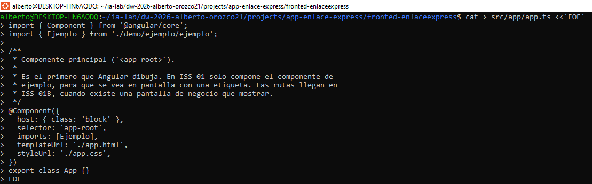

`src/app/app.html`

```bash
cat > src/app/app.html <<'EOF'
<!-- Marco de la aplicación: fondo, ancho máximo y padding con utilidades Tailwind. -->
<main class="min-h-dvh bg-slate-50 p-6 text-slate-900">
  <div class="mx-auto w-full max-w-4xl">
    <!-- Composición: una etiqueta en la plantilla pinta el componente Ejemplo. -->
    <app-ejemplo />
  </div>
</main>
EOF
```

`<app-ejemplo />` es una etiqueta normal de HTML: Angular la reconoce porque Ejemplo declara selector: 'app-ejemplo' y está en el imports de App. No hay nada más. Si quitáramos Ejemplo de imports, la etiqueta no se pintaría.

`src/app/app.routes.ts`

```bash
cat > src/app/app.routes.ts <<'EOF'
import { Routes } from '@angular/router';

/**
 * Rutas de la aplicación.
 *
 * Vacío a propósito: en ISS-01 la pantalla se compone con etiquetas en `app.html`
 * (`<app-ejemplo />`). El router se presenta en ISS-01B, con una pantalla real.
 */
export const routes: Routes = [];
EOF
```

`provideRouter(routes)` ya está en app.config.ts desde que el CLI creó el proyecto; el arreglo vacío es válido y no impide arrancar. No se rellena hasta ISS-01B.

`src/app/app.css`

```bash
cat > src/app/app.css <<'EOF'
/*
 * Estilos propios del componente App.
 *
 * Queda VACÍO a propósito: el aspecto se resuelve con utilidades Tailwind en el
 * HTML y con el tema Aura de PrimeNG (PATRON-VISUAL). Angular mantiene el archivo
 * porque `styleUrl` lo referencia y solo afecta a `<app-root>`.
 */
EOF
```


**PARCHE** — prueba del componente. La prueba generada por el CLI busca el `<h1>` de la plantilla por defecto y falla después de reemplazar app.html. Reemplázala por pruebas de la composición. El componente `demo/ejemplo` tiene su propia prueba (`ejemplo.spec.ts`), que se explica en 1.9.

```bash
import { TestBed } from '@angular/core/testing';
import { App } from './app';

describe('App', () => {
  beforeEach(async () => {
    await TestBed.configureTestingModule({
      imports: [App],
    }).compileComponents();
  });

  it('should create the app', () => {
    const fixture = TestBed.createComponent(App);
    expect(fixture.componentInstance).toBeTruthy();
  });

  it('should render the example component', async () => {
    const fixture = TestBed.createComponent(App);
    await fixture.whenStable();
    const compiled = fixture.nativeElement as HTMLElement;
    expect(compiled.querySelector('app-ejemplo')).toBeTruthy();
  });

  it('should show the product loaded by the example component', async () => {
    const fixture = TestBed.createComponent(App);
    await fixture.whenStable();
    const compiled = fixture.nativeElement as HTMLElement;
    expect(compiled.textContent).toContain('Café molido 500 g');
  });
});
```

### 1.6 Personalizar index.html
Criterios de este sub-ítem

- [X] lang="es"
- [X] `<title>StoreLab Express II · Angular 22</title>`
- [X] `<body class="m-0 bg-slate-100 font-sans text-slate-900">`
- [X] `meta description` presente

```bash
cat > src/index.html <<'EOF'
<!doctype html>
<html lang="es">
<head>
  <meta charset="utf-8">
  <title>StoreLab Express II · Angular 22</title>
  <base href="/">
  <meta name="viewport" content="width=device-width, initial-scale=1">
  <meta name="description" content="Frontend Angular 22 con Signals, PrimeNG y Tailwind para StoreLab Express.">
  <link rel="icon" type="image/x-icon" href="favicon.ico">
</head>
<body class="m-0 bg-slate-100 font-sans text-slate-900">
  <app-root></app-root>
</body>
</html>
EOF
```


Las clases del `<body>` son utilidades Tailwind: fondo, fuente y color de texto. No se redefinen fuentes ni colores del tema con CSS propio.

### 1.7 Ajustar el presupuesto de build

**Criterios de este sub-ítem**

- [ ] En projects → … → architect → build → configurations → production → budgets, el presupuesto initial es maximumWarning: "750kB" y maximumError: "1MB"

El bundle inicial con PrimeNG supera los 500 kB por defecto. En angular.json, dentro de projects → ... → architect → build → configurations → production → budgets, cambia el primer presupuesto:

```json
{
  "type": "initial",
  "maximumWarning": "750kB",
  "maximumError": "1MB"
}
```

### 1.8 Primera ejecución

**Criterios de este sub-ítem**

- [X] npm start compila sin errores
- [X] http://localhost:4200 responde 200 y muestra el componente de ejemplo
- [X] Se ve la tarjeta del producto con nombre, precio, estado y botones
- [X] Pulsar +1000 cambia el precio y el «Precio final con IVA» sin recargar la página
- [X] Cambiar estado cambia la etiqueta (Activo/Inactivo) y el mensaje inferior
- [X] Escribir en Nombre actualiza el texto «Vista previa»
- [X] Console muestra [ejemplo] … en cada cambio (lo escribe effect())
- [X] Network carga styles.css, main.js y los chunks con estado 200
- [X] El `<title>` de la pestaña es StoreLab Express II · Angular 22

```bash
npm start
```


Abre http://localhost:4200. Debe verse la pantalla de 1.5: la tarjeta Objeto producto, las dos tarjetas de explicación y las utilidades Tailwind que lo centran. Al pulsar +1000 el precio base sube y el valor con IVA se recalcula; Cambiar estado alterna la etiqueta y el aviso; Reiniciar vuelve al objeto inicial.

No hay URL por pantalla: en ISS-01 el router está configurado pero sin rutas, así que cualquier dirección muestra la misma composición.

Sin este ajuste, ng build termina con un warning (no error). En ISS-11 se explica por qué no conviene subirlo más allá de 1 MB.

### 1.9 Anatomía del componente demo/ejemplo y signals

**Criterios de este sub-ítem**

- [X] Explica en qué orden arranca la aplicación y qué archivo hace cada paso
- [X] Identifica los cuatro archivos de un componente y la función de cada uno
- [X] Relaciona cada parte de la pantalla con la línea de ejemplo.ts o ejemplo.html que la produce
- [X] Distingue signal (estado), computed (valor derivado) y effect (efecto secundario)
- [X] Explica cómo se actualiza un objeto guardado en un signal sin mutarlo
- [X] Explica por qué no hace falta Zone.js ni llamar a ChangeDetectorRef
- [X] Explica cómo el selector: 'app-ejemplo' produce la etiqueta `<app-ejemplo />` de app.html

Esta sección explica el mismo código que ya está en pantalla: `src/app/demo/ejemplo/`. Es un componente pequeño y completo: un objeto, cuatro operaciones y tres tarjetas. No hay un ejemplo aparte que borrar después.

```
src/app/demo/ejemplo/
├── ejemplo.ts       ← la clase: estado, derivados, efecto y métodos
├── ejemplo.html     ← la plantilla: tarjetas, campos y botones
├── ejemplo.css      ← la excepción: una clase para explicar el aislamiento
└── ejemplo.spec.ts  ← la prueba: crea el componente y comprueba el cambio de estado
```

### 1.9.1 De index.html a la pantalla

Cuando el navegador carga http://localhost:4200, Angular recorre siempre estos pasos:

```
index.html
   └─ <app-root></app-root>                  ← el HTML solo tiene esta etiqueta
         │
         ├─ src/main.ts                      bootstrapApplication(App, appConfig)
         ├─ src/app/app.config.ts            providers globales (router, PrimeNG, …)
         └─ src/app/app.ts                    clase App + @Component(...)
               ├─ app.html                    plantilla: <main> + <app-ejemplo />
               ├─ app.css                     estilos propios (vacío)
               ├─ app.spec.ts                 pruebas de App
               └─ app.routes.ts               rutas (vacío en ISS-01)
                     │
                     │  <app-ejemplo />  ← la etiqueta de app.html encuentra este componente
                     ▼
               src/app/demo/ejemplo/
                     ├─ ejemplo.ts            clase Ejemplo + @Component(...)
                     ├─ ejemplo.html          plantilla: las tres tarjetas
                     ├─ ejemplo.css           una clase de demostración
                     └─ ejemplo.spec.ts       4 pruebas
```

**La idea central:** index.html solo tiene una etiqueta. Angular la sustituye por App, y App pinta demo/ejemplo porque escribió su etiqueta en la plantilla. El componente de ejemplo declara su estado en ejemplo.ts y lo dibuja con ejemplo.html. Todo lo demás del curso son componentes dentro de componentes.

De selector a etiqueta: por qué `<app-ejemplo />` funciona
app.html contiene una sola referencia al componente:

```html
<main class="min-h-dvh bg-slate-50 p-6 text-slate-900">
  <div class="mx-auto w-full max-w-4xl">
    <app-ejemplo />
  </div>
</main>
```

Si el selector es 'app-ejemplo', la etiqueta es <app-ejemplo>. Si se quita Ejemplo de imports, Angular no reconoce la etiqueta y la deja como un elemento HTML inerte (sin error de compilación, porque el nombre es válido). Ese es el primer error del curso: el componente «no se ve» porque falta el import.

En el DOM, el elemento conserva su etiqueta y recibe las clases de host:

```
div.mx-auto.w-full.max-w-4xl
└── <app-ejemplo class="block" _ngcontent-…>   ← la etiqueta que escribiste en app.html
      └── <div class="flex flex-col gap-6">     ← ejemplo.html
```
Ese `class="block"` no está escrito en app.html: sale de host: { class: 'block' } en la metadata de Ejemplo. Es la forma de dar clases al elemento anfitrión sin envolverlo en otro div.

> El router llega después. Preguntar «¿y si quiero que la URL decida qué componente se pinta?» es correcto, pero es otra lección: ISS-01B introduce RouterOutlet cuando ya hay una pantalla de negocio. En ISS-01 el router está configurado (provideRouter) pero sin rutas.

### 1.9.2 Los cuatro archivos de un componente
Un componente Angular es una clase TypeScript + una plantilla + unos estilos + una prueba:

```
src/app/demo/ejemplo/
├── ejemplo.ts        ← la clase (estado y lógica) + @Component(...)
├── ejemplo.html      ← la plantilla (lo que se ve)
├── ejemplo.css       ← los estilos de ESTE componente
└── ejemplo.spec.ts   ← la prueba
```

La metadata es lo que convierte una clase normal en un componente:

```typescript
@Component({
  host: { class: 'block' },              // clases del elemento anfitrión <app-ejemplo>
  selector: 'app-ejemplo',               // etiqueta HTML que lo representa
  imports: [ButtonModule, CardModule, InputTextModule, MessageModule, TagModule],
  templateUrl: './ejemplo.html',         // vista externa
  styleUrl: './ejemplo.css',             // estilos externos
})
export class Ejemplo {}
```

> Nombres en Angular 22: el CLI ya no genera app.component.ts ni AppComponent. Genera app.ts con la clase App. Ambos estilos funcionan, pero el material usa el actual: el sufijo .component se omite porque la carpeta y el @Component ya lo dicen.

### 1.9.3 Leer ejemplo.ts línea a línea

```typescript
// 1. Se importan solo las piezas que se usan.
import { Component, computed, effect, signal } from '@angular/core';
import { ButtonModule } from 'primeng/button';
import { CardModule } from 'primeng/card';
import { InputTextModule } from 'primeng/inputtext';
import { MessageModule } from 'primeng/message';
import { TagModule } from 'primeng/tag';

// 2. El objeto que se muestra y se modifica.
export interface Producto {
  nombre: string;
  precio: number;
  activo: boolean;
}

// 3. @Component describe CÓMO se pinta la clase.
@Component({
  host: { class: 'block' },              // <app-ejemplo> se comporta como bloque
  selector: 'app-ejemplo',               // se usa como <app-ejemplo></app-ejemplo>
  imports: [ButtonModule, CardModule, InputTextModule, MessageModule, TagModule],
  templateUrl: './ejemplo.html',
  styleUrl: './ejemplo.css',
})
export class Ejemplo {
  // 4. ESTADO: el signal guarda un objeto completo.
  protected readonly producto = signal<Producto>(productoInicial());

  // 5. DERIVADOS: se calculan desde `producto()`, nunca se asignan.
  protected readonly precioFinal = computed(() =>
    Math.round(this.producto().precio * 1.19),
  );
  protected readonly estadoTexto = computed(() =>
    this.producto().activo ? 'Activo' : 'Inactivo',
  );

  // 6. EFECTO: se ejecuta al crear y en cada cambio del objeto.
  private readonly registro = effect(() => {
    const { nombre, precio, activo } = this.producto();
    console.log(`[ejemplo] ${nombre} · precio ${precio} · ${activo ? 'activo' : 'inactivo'}`);
  });

  // 7. Métodos que la plantilla llama desde los eventos.
  protected cambiarNombre(event: Event): void {
    const nombre = (event.target as HTMLInputElement).value;
    this.producto.update((actual) => ({ ...actual, nombre }));
  }

  protected variarPrecio(delta: number): void {
    this.producto.update((actual) => ({
      ...actual,
      precio: Math.max(0, actual.precio + delta),
    }));
  }

  protected alternarEstado(): void {
    this.producto.update((actual) => ({ ...actual, activo: !actual.activo }));
  }

  protected reiniciar(): void {
    this.producto.set(productoInicial());
  }
}
```

La función auxiliar evita compartir el mismo objeto entre el estado inicial y el reinicio:

```typescript
function productoInicial(): Producto {
  return { nombre: 'Café molido 500 g', precio: 18000, activo: true };
}
```

Las piezas de la plantilla que producen lo que se ve:

```html
<!-- 1. Interpolación: muestra un campo del objeto. -->
<p class="text-2xl font-bold text-slate-900">{{ producto().precio }}</p>

<!-- 2. Property binding + event binding sobre un campo editable. -->
<input pInputText [value]="producto().nombre" (input)="cambiarNombre($event)" />

<!-- 3. Event binding con argumento: el botón llama al método con 1000. -->
<button pButton type="button" (click)="variarPrecio(1000)">
  <span pButtonLabel>+1000</span>
</button>

<!-- 4. Property binding booleano: el tag cambia de color según `activo`. -->
<p-tag [value]="estadoTexto()" [severity]="producto().activo ? 'success' : 'danger'" />
```

`{{ producto().precio }}` no es una función de la plantilla: es la lectura del signal (producto()) y, sobre el objeto, la propiedad (precio). Sin el primer paréntesis Angular mostraría la función en lugar del valor.

> Qué pasa con app.routes.ts. Sigue vacío (export const routes: Routes = [];). provideRouter(routes) está configurado, pero sin rutas no hay navegación: la pantalla se compone con etiquetas. El router se presenta en ISS-01B con una pantalla real.

### 1.9.4 Las cuatro formas de conectar la clase con el HTML

> [(ngModel)] requiere FormsModule y se usa en formularios sencillos. En este curso los formularios de negocio usan Reactive Forms (FormGroup y formControlName), que se presentan en ISS-03. El ejemplo escribe el binding a mano ([value] + (input)) para que se vea de dónde sale el valor nuevo.

Y el flujo de control moderno, que reemplaza a *ngIf y *ngFor. El ejemplo lo usa para elegir el mensaje según el estado del producto:

```typescript
@if (producto().activo) {
  <p-message severity="success" variant="simple">
    Producto activo: la API lo devolvería en <code>GET /api/productos</code>.
  </p-message>
} @else {
  <p-message severity="warn" variant="simple">
    Producto inactivo: el borrado lógico lo oculta de las listas.
  </p-message>
}

<!-- El mismo bloque aplica a una lista del negocio. -->
@if (clients().length === 0) {
  <p>No hay clientes activos.</p>
} @else {
  <ul>
    @for (client of clients(); track client.id) {
      <li>{{ client.name }}</li>
    }
  </ul>
}
```

track le dice a Angular cómo identificar cada elemento de la lista; con él evita volver a dibujar filas que no cambiaron. @for exige track en Angular 22.

### 1.9.5 Signals: el estado que avisa a la vista

Un signal es una caja con un valor que notifica a quien lo lee cuando cambia. Se crea con signal(valorInicial), se lee con () y se modifica con .set() o .update().

Dónde está en Ejemplo. El estado es un objeto Producto; la plantilla lee sus campos y los botones lo cambian:

```typescript
// ejemplo.ts — declaración y cambios del estado
protected readonly producto = signal<Producto>(productoInicial());

protected variarPrecio(delta: number): void {
  this.producto.update((actual) => ({
    ...actual,                              // conserva nombre y activo
    precio: Math.max(0, actual.precio + delta),
  }));
}

protected reiniciar(): void {
  this.producto.set(productoInicial());     // valor nuevo, no depende del anterior
}
```

```html
<!-- ejemplo.html — lectura del signal: siempre con paréntesis -->
<p class="text-2xl font-bold text-slate-900">{{ producto().precio }}</p>
<p class="text-sm text-slate-500">
  Precio final con IVA (19 %): <strong>{{ precioFinal() }}</strong>
</p>
<p-tag [value]="estadoTexto()" [severity]="producto().activo ? 'success' : 'danger'" />
```

**Actualizar un objeto dentro de un signal**

Este es el punto que más se equivoca al empezar. Un signal compara referencias, no campos: si se modifica el objeto en el sitio, el signal sigue apuntando al mismo objeto y la vista no se entera.

```typescript
// MAL: muta el objeto y conserva la misma referencia.
const actual = this.producto();
actual.precio = actual.precio + 1000;   // el signal no notifica: nadie llamó a set/update

// BIEN: crea un objeto nuevo y entrégaselo al signal.
this.producto.update((actual) => ({ ...actual, precio: actual.precio + 1000 }));
```

Al pulsar +1000, el signal cambia, Angular repinta el precio base y el valor con IVA, y la etiqueta de estado sigue igual porque producto().activo no cambió. Nadie llamó a ChangeDetectorRef.

> Comprobado en este workspace: la pantalla arranca con 18000 y IVA 21420; +1000 deja 19000 y 22610, -1000 vuelve a 18000, y Reiniciar restaura el objeto completo. Esas cuatro transiciones están en ejemplo.spec.ts y se ejecutan con npm test -- --watch=false.

Si el número no cambia, revisa que leíste producto() con paréntesis y que el método devuelve un objeto nuevo dentro de .update(), no una mutación.

### 1.9.6 computed y effect: derivar y reaccionar

- computed calcula un valor a partir de otros signals. No guarda estado propio: se recalcula cuando cambia una dependencia y solo se recalcula si alguien lo lee.

- effect ejecuta un efecto secundario (guardar, registrar, enfocar) cuando cambian los signals que lee. No se usa para calcular estado.

```typescript
// ejemplo.ts — dos valores derivados y un efecto secundario
protected readonly precioFinal = computed(() =>
  Math.round(this.producto().precio * 1.19),
);

protected readonly estadoTexto = computed(() =>
  this.producto().activo ? 'Activo' : 'Inactivo',
);

private readonly registro = effect(() => {
  const { nombre, precio, activo } = this.producto();
  console.log(`[ejemplo] ${nombre} · precio ${precio} · ${activo ? 'activo' : 'inactivo'}`);
});
```

```html
<!-- ejemplo.html — los derivados se leen igual que un signal -->
<p class="text-sm text-slate-500">
  Precio final con IVA (19 %): <strong>{{ precioFinal() }}</strong>
</p>
<p-tag [value]="estadoTexto()" [severity]="producto().activo ? 'success' : 'danger'" />
```

**Regla del curso:** si un valor se puede calcular a partir de otros signals, es computed. Si hay que hacer algo cuando cambia, es effect. Guardar en un signal lo que ya se deduce de otro signal crea dos fuentes de verdad que se desincronizan. Aquí precioFinal no existe como signal propio: se deriva de producto().precio. Si se guardara el IVA en el objeto, habría que acordarse de recalcularlo en cada cambio de precio.

### 1.9.7 Zoneless: por qué la vista se actualiza sin Zone.js

Angular 22 arranca sin Zone.js por defecto. Antes, Angular parcheaba todas las APIs asíncronas para saber cuándo revisar la vista; ahora el propio código avisa:

Por eso el estado del curso se declara con signal. Una propiedad public total = 0 funciona al inicio, pero al cambiarla desde una promesa el HTML puede quedarse con el valor viejo. Con signal, el cambio siempre llega a la vista.

### 1.9.8 Estilos globales y estilos del componente

**Regla del curso:** el aspecto de la aplicación se construye con PrimeNG (controles) y Tailwind (espaciado, tipografía, color). No se escribe CSS de negocio. La única excepción es la caja de la tarjeta «Estilos» del ejemplo, porque su propósito es explicar cómo funciona el CSS del componente:

```css
/* src/app/demo/ejemplo/ejemplo.css — únicamente demostrativo. */
.ejemplo-alcance {
  border: 2px dashed #0f766e;
  border-radius: 0.75rem;
  padding: 0.75rem 1rem;
  background-color: #f0fdfa;
}
```

```html
<!-- La misma caja, con el resto del contenido en Tailwind. -->
<div class="ejemplo-alcance mt-4 text-sm text-slate-700">…</div>
```

**Qué es el encapsulamiento**: Angular compila el CSS del componente con `ViewEncapsulation.Emulated`: agrega un atributo como `_ngcontent-ng-c4132172110` a los elementos de la plantilla y escribe la regla calificada (`.ejemplo-alcance[_ngcontent-…]`). Por eso una clase definida en ejemplo.css no afecta a otro componente, aunque se llame igual. El atributo se ve al inspeccionar el DOM y es normal.

```html
<div class="ejemplo-alcance mt-4 …" _ngcontent-ng-c4132172110>…</div>
```

**Consecuencia práctica:** si dos componentes necesitan el mismo borde, no se copia la clase en los dos `.css`; se resuelve con una utilidad Tailwind o con un componente compartido. En el curso ganan Tailwind y PrimeNG porque el estilo queda en el HTML, junto a la estructura, y el tema Aura mantiene la coherencia entre controles.

## Verificación del ISS

```bash
# 1. El servidor debe compilar
ng build

# 2. Debe imprimir la configuración de Tailwind/PrimeNG
grep -R "providePrimeNG\|@import 'tailwindcss'" src | head

# 3. Versiones compatibles
npm ls primeng @primeuix/themes primeicons @angular/cdk --depth=0

# 4. Presupuesto y estilos
node -e "const a=require('./angular.json');const p=a.projects[Object.keys(a.projects)[0]];console.log(p.architect.build.configurations.production.budgets[0])"
cat src/styles.css

# 5. La composición y el componente de ejemplo declaran signals
grep -n "imports: \[Ejemplo\]" src/app/app.ts
grep -n "app-ejemplo" src/app/app.html
grep -n "signal(\|computed(\|effect(" src/app/demo/ejemplo/ejemplo.ts
```

```bash
# 6. Pruebas de App y del componente de ejemplo
npm test -- --watch=false
```


## Fase I: Frontend — ISS-01A — Esqueleto Header / Aside / contenido / Footer

**Objetivo:** construir primero la pantalla. Al terminar, http://localhost:4200 muestra Header arriba, Aside a la izquierda del contenido y Footer abajo a todo el ancho, con datos fijos y sin llamadas a la API.

**Bloqueado por:** ISS-01.

**Criterios de aceptación (ISS-01A) — consolidados**

- [X] 1.1 Explica por qué un componente generado no aparece hasta que el padre lo declara en imports y usa su selector
- [X] 1.2 Existen src/app/layout/header/, src/app/layout/aside/ y src/app/layout/footer/, cada una con .ts, .html y .css
- [X] 1.3 header.ts declara title y header.html lo muestra con {{ title }}
- [X] 1.3 Los tres .css de layout/ no contienen reglas: solo un comentario que explica por qué están vacíos
- [X] 1.4 app.ts importa Header, Aside y Footer y los declara en imports
- [X] 1.4 app.html compone las cuatro regiones: `<app-header />`, `<aside>`con `<app-aside />`, `<main>` con el contenido y `<app-footer />`
- [X] 1.4 app.html ya no contiene `<app-ejemplo />`: demo/ejemplo no forma parte de la aplicación
- [X] 1.5 Se ven las cuatro regiones, el Footer queda abajo y no hay desplazamiento horizontal
- [X] 1.5 En Network no aparece ninguna petición /api
- [X] ng build termina con código 0 y las pruebas pasan

> **demo/ejemplo** no se usa en ningún ISS posterior. Fue la introducción a Angular de ISS-01. No está en el menú, no tiene ruta, no se compone en el layout y no se reutiliza. Al reemplazar app.html en 1.4 deja de verse; el componente y su prueba siguen en el proyecto solo como material de consulta de ISS-01.

### 1.1 Qué es un componente y por qué el padre debe importarlo

Un componente reúne una clase TypeScript (datos y lógica), una plantilla HTML (lo que se ve) y un archivo de estilos. `@Component` relaciona esos archivos:

|Campo	|Pregunta que responde	|Ejemplo en este ISS|
|-------|-----------------------|-------------------|
|selector	|¿Con qué etiqueta se usa en otra plantilla?	|selector: 'app-header' → <app-header />|
|imports|	¿Qué usa su plantilla?|	[] en Header de ISS-01A|
|templateUrl	|¿Dónde está el HTML?|	./header.html|
|styleUrl|	¿Dónde están los estilos privados?	|./header.css|
|host|	¿Qué clases lleva el elemento anfitrión?	|host: { class: |'block' }|

**Regla que resuelve el error más común:** un componente generado existe, pero no se ve hasta que otro componente lo declara en su imports y escribe su etiqueta en su plantilla. Son dos pasos, no uno:

```typescript
// app.ts — paso 1: declarar el componente para que la plantilla lo reconozca
imports: [Header, Aside, Footer],
```

```html
<!-- app.html — paso 2: usar su selector como etiqueta -->
<app-header />
```

**PARCHE** — standalone: true ya no hace falta. El CLI de Angular 22 genera componentes standalone por defecto. Escribir standalone: true es válido y no rompe nada, pero la plantilla del proyecto lo omite. Si copias ejemplos antiguos que lo incluyen, no hay conflicto: simplemente es redundante.

Usamos `layout/` para conservar la organización del curso. El Header de la aplicación es distinto de `shared/ui/page-header`, que titula una pantalla de negocio.

### 1.2 Generar las tres piezas de layout/
Criterios de este sub-ítem


```bash
ng generate component layout/header --skip-tests --defaults
ng generate component layout/aside --skip-tests --defaults
ng generate component layout/footer --skip-tests --defaults
```

En una reconstrucción desde cero, el CLI crea además un `header.spec.ts` si no usas `--skip-tests`. En este curso esas pruebas no se necesitan: el comportamiento de la pantalla se comprueba desde `app.spec.ts`.

### 1.3 Contenido de cada componente
Criterios de este sub-ítem


Los tres componentes son de presentación: no inyectan servicios, no consultan la API y no conocen permisos. Esa frontera es la que permite reutilizar el layout en ISS-02 sin duplicarlo.

**Header**

`src/app/layout/header/header.ts`

```typescript
import { Component } from '@angular/core';

/**
 * Barra superior de la aplicación.
 *
 * ISS-01A: solo muestra el nombre. En ISS-01B recibe datos por `input()`, emite
 * `menuRequested` y añade el menú de usuario. No consulta la API.
 */
@Component({
  host: { class: 'block' },
  selector: 'app-header',
  templateUrl: './header.html',
  styleUrl: './header.css',
})
export class Header {
  readonly title = 'EnlaceExpress';
}
```

`src/app/layout/header/header.html`

```html
<header
  class="flex h-16 items-center border-b border-slate-200 bg-white px-6 font-semibold"
>
  <!-- Interpolación: `title` es una propiedad de la clase Header. -->
  <p class="truncate text-sm font-semibold text-slate-900">{{ title }}</p>
</header>
```

`{{ title }}` es interpolación: Angular lee la propiedad de la clase y escribe su texto. Cambia el valor en header.ts y comprueba que cambia el encabezado sin tocar el HTML. Ese es el primer enlace entre clase y plantilla.

h-16 fija la altura, border-b dibuja la separación y truncate evita que un texto largo rompa la barra. Todo es Tailwind: no hay CSS propio.

**Aside**

`src/app/layout/aside/aside.ts`

```typescript
import { Component } from '@angular/core';

/**
 * Menú lateral de la aplicación.
 *
 * ISS-01A: solo el contenedor. En ISS-01B recibe `items` por `input()` y pinta
 * `p-panelmenu`. No conoce rutas ni permisos: eso llega en ISS-02/ISS-08.
 */
@Component({
  host: { class: 'block h-full' },
  selector: 'app-aside',
  templateUrl: './aside.html',
  styleUrl: './aside.css',
})
export class Aside {}
```

`src/app/layout/aside/aside.html`

```html
<nav aria-label="Navegación principal" class="h-full bg-slate-950 p-6 text-white">
  <p class="text-xs font-medium uppercase tracking-wider text-slate-400">Navegación</p>
  <p class="mt-2 text-sm">Menú de EnlaceExpress</p>
  <p class="mt-4 text-xs text-slate-400">
    En ISS-01B este bloque pasa a ser un <code>p-panelmenu</code>.
  </p>
</nav>
```

`aria-label` no es decorativo: nombra la región de navegación para lectores de pantalla y permite localizarla en las pruebas. El ancho no se decide aquí: lo fija el padre en app.html, porque el Aside debe poder ocultarse en móvil (ISS-01B) sin cambiar el componente.

**Footer**

`src/app/layout/footer/footer.ts`

```typescript
import { Component } from '@angular/core';

/**
 * Pie de página de la aplicación.
 *
 * Presentación pura: no tiene estado ni depende de servicios.
 */
@Component({
  host: { class: 'block' },
  selector: 'app-footer',
  templateUrl: './footer.html',
  styleUrl: './footer.css',
})
export class Footer {}
```

`src/app/layout/footer/footer.html`

```html
<footer
  class="border-t border-slate-200 bg-white px-4 py-4 text-center text-xs text-slate-500 sm:px-6"
>
  EnlaceExpress · Gestión de clientes, productos y ventas
</footer>
```

**Los tres** `.css`

Cada archivo contiene solo un comentario. No hay reglas:

```
/*
 * Estilos del Header.
 *
 * Vacío a propósito: la apariencia se resuelve con utilidades Tailwind en
 * `header.html` y con el tema Aura de PrimeNG (PATRON-VISUAL).
 */
```

`aside.css` y `footer.css` siguen el mismo criterio. El archivo existe porque styleUrl lo referencia y Angular lo necesita para el encapsulamiento (ISS-01, 1.9.8); si algún día se escribe una regla, solo afectará a ese componente.

### 1.4 Componer las cuatro regiones en App
Criterios de este sub-ítem


`src/app/app.ts`

```typescript
import { Component } from '@angular/core';
import { Header } from './layout/header/header';
import { Aside } from './layout/aside/aside';
import { Footer } from './layout/footer/footer';

/**
 * Componente principal (`<app-root>`).
 *
 * Es el primero que Angular dibuja. Compone las cuatro regiones de la pantalla:
 * Header arriba, Aside a la izquierda, el contenido del centro y Footer abajo.
 * El contenido del centro todavía es fijo; en ISS-01B pasa a cambiar con el menú
 * y en ISS-02 llega el router.
 */
@Component({
  host: { class: 'block' },
  selector: 'app-root',
  imports: [Header, Aside, Footer],
  templateUrl: './app.html',
  styleUrl: './app.css',
})
export class App {
  /** Título de la pantalla inicial. En ISS-01B cambia al elegir el menú. */
  protected readonly title = 'Inicio';
}
```

`src/app/app.html`

```html
<!-- Contenedor de las cuatro regiones: Tailwind para el alto y la dirección. -->
<div class="flex min-h-screen flex-col bg-slate-100">
  <app-header />

  <div class="flex flex-1">
    <!-- Aside fijo de 16rem; en ISS-01B se oculta en pantallas pequeñas. -->
    <aside class="w-64 shrink-0">
      <app-aside />
    </aside>

    <!-- min-w-0 evita que un contenido ancho desborde el flex y cree scroll. -->
    <main id="contenido" class="min-w-0 flex-1 p-6">
      <h1 class="text-2xl font-semibold text-slate-900">{{ title }}</h1>
      <p class="mt-2 text-slate-600">Bienvenido a EnlaceExpress.</p>
    </main>
  </div>

  <app-footer />
</div>
```

**Prueba de la composición**

`src/app/app.spec.ts` no busca el `<h1>` de la plantilla por defecto: comprueba las regiones y el texto inicial.

```typescript
import { TestBed } from '@angular/core/testing';
import { App } from './app';

describe('App', () => {
  beforeEach(async () => {
    await TestBed.configureTestingModule({
      imports: [App],
    }).compileComponents();
  });

  async function crearApp() {
    const fixture = TestBed.createComponent(App);
    await fixture.whenStable();
    return fixture.nativeElement as HTMLElement;
  }

  it('should create the app', () => {
    const fixture = TestBed.createComponent(App);
    expect(fixture.componentInstance).toBeTruthy();
  });

  it('should compose the three layout regions', async () => {
    const compilado = await crearApp();
    expect(compilado.querySelector('app-header')).toBeTruthy();
    expect(compilado.querySelector('aside app-aside')).toBeTruthy();
    expect(compilado.querySelector('app-footer')).toBeTruthy();
  });

  it('should render the application name in the header', async () => {
    const compilado = await crearApp();
    const header = compilado.querySelector('app-header') as HTMLElement;
    expect(header.textContent).toContain('EnlaceExpress');
  });

  it('should render the initial title in the content', async () => {
    const compilado = await crearApp();
    const main = compilado.querySelector('main') as HTMLElement;
    expect(main.textContent).toContain('Inicio');
    expect(main.textContent).toContain('Bienvenido a EnlaceExpress.');
  });
});
```

La consulta `aside app-aside` verifica dos cosas a la vez: que el Aside está dentro del elemento que fija su ancho y que el componente se pintó.

### 1.5 Comprobar antes de avanzar
Criterios de este sub-ítem


```bash
npm start
```

Abre http://localhost:4200 y comprueba:

|Comprobación visual |Resultado esperado|
|--------------------|------------------|
|Header|	Barra blanca de 64 px con StoreLab Express II|
|Aside|	Columna oscura de 256 px con Menú de StoreLab|
|Contenido|	Inicio y Bienvenido a StoreLab.|
|Footer	|Franja inferior a todo el ancho con StoreLab · Gestión de clientes, productos y ventas|
|Con poco contenido	|El Footer queda pegado al borde inferior de la ventana|
|Con mucho contenido|	El Footer baja; aparece scroll vertical, nunca horizontal|
|Network	|Sin peticiones /api: aún no hay servicios|

Para provocar el caso de contenido largo, añade párrafos dentro de `<main>` y observa que solo el Footer se desplaza: el Header y el Aside no se mueven porque están en el flujo normal del `flex` vertical.


## Fase I: Frontend — ISS-01B — Menú PrimeNG y primera interacción

**Objetivo:** pasar de una maqueta a una pantalla que responde. Al terminar: PanelMenu en el Aside, botón de menú en el Header, Drawer en pantalla pequeña y selección que cambia el contenido local. Sin rutas de negocio y sin API.

**Bloqueado por:** ISS-01A.

**Criterios de aceptación (ISS-01B) — consolidados**

- [X] 1.1 Explica la diferencia entre input() (dato del padre al hijo), output() (aviso del hijo al padre) y signal() (estado propio)
- [X] 1.2 aside.ts declara `items = input<MenuItem[]>([])` y aside.html lo pinta con `<p-panelmenu [model]="items()" [multiple]="true" />`
- [X] 1.2 aside.css sigue sin reglas: la apariencia es de Aura y Tailwind
- [X] 1.3 El Header emite menuRequested y su botón está siempre visible: por debajo de lg abre el Drawer, desde lg alterna el Aside fijo
- [X] 1.4 Existe src/app/features/construir/ con construir.ts, construir.html, construir.css y construir.spec.ts
- [X] 1.4 mobileOpen, sidebarCollapsed y title son signal; elegir una opción cambia el título y cierra el Drawer
- [X] 1.4 El layout se compone una sola vez en construir.html y se reutiliza en el Drawer
- [X] 1.5 app.ts importa RouterOutlet y app.html contiene solo `<router-outlet />`
- [X] 1.5 app.routes.ts declara construir con loadComponent, redirige '' y ** a construir
- [X] 1.6 A 1280 px se ve Inicio, 11 opciones de Operación y 6 de Administración; a 390 px se oculta y el botón abre el Drawer
- [X] 1.6 A 1280 px el botón de menú se ve y oculta/muestra el Aside sin abrir el Drawer
- [X] 1.6 La URL no cambia al elegir una opción y Network no registra llamadas /api
- [X] ng build termina con código 0, construir se empaqueta como chunk diferido y las pruebas pasan

> demo/ejemplo no participa. La introducción a Angular quedó en ISS-01. No tiene ruta, no está en el menú y no se compone en este ISS.

### 1.1 Los conceptos que se agregan, uno por vez

`Criterios de este sub-ítem`

- [X] Distingue los tres canales de datos: entrada, salida y estado
- [X] Reconoce `MenuItem[]` como el contrato del menú de PrimeNG
- [X] Explica `[(visible)]` como ida y vuelta en un solo atributo

|Concepto	|Qué resuelve	|Dónde se ve en este ISS|
|--------|-------------|-----------------------|
|input()	|Dato que el padre entrega al hijo; el hijo no lo modifica|	items en Aside, appName en Header|
|output()	|Aviso del hijo al padre; el hijo no navega ni cierra nada por su cuenta	|menuRequested, |navigated
|signal()|	Estado propio del componente, observado por la plantilla|	title, mobileOpen en Construir|
|[propiedad]|	Enlace de la clase a la plantilla|	[model]="items()" en PanelMenu|
|(evento)|	Acción al recibir un aviso	|(menuRequested)="mobileOpen.set(true)"|
|[(visible)]|	Ida y vuelta: el Drawer abre y también actualiza el estado al cerrarse|	[(visible)]|="mobileOpen"
|MenuItem[]	|Forma tipada del menú de PrimeNG: label, icon, command|	items en Construir|

**La frontera del ISS**. Los tres componentes de `layout/` son presentación: reciben datos y avisan. El único con estado es Construir. Esa separación es la que permite reutilizar el layout en `ISS-02` sin duplicar `Header`, `Aside` ni `Footer`, y la que evita inyectar servicios de autenticación en componentes visuales.

**PARCHE** — standalone: true sobra. Angular 22 genera componentes standalone por defecto. Los ejemplos de material antiguo lo incluyen; es válido, pero redundante. Este curso no lo escribe.

### 1.2 El Aside recibe el menú con input()
Criterios de este sub-ítem

- [X] Aside declara `items = input<MenuItem[]>([])`
- [X] La plantilla usa `[model]="items()":` se lee el signal con paréntesis
- [X] El Aside no construye el menú ni conoce rutas: solo lo pinta
- [X] aside.css no contiene reglas

`src/app/layout/aside/aside.ts`

```typescript
import { Component, input, output } from '@angular/core';
import { MenuItem } from 'primeng/api';
import { ButtonModule } from 'primeng/button';
import { PanelMenuModule } from 'primeng/panelmenu';

/**
 * Menú lateral de la aplicación.
 *
 * Presentación pura: recibe el menú ya construido por `input()` y avisa de la
 * navegación con `output()`. No conoce rutas, permisos ni la API.
 */
@Component({
  host: { class: 'block h-full' },
  selector: 'app-aside',
  imports: [ButtonModule, PanelMenuModule],
  templateUrl: './aside.html',
  styleUrl: './aside.css',
})
export class Aside {
  readonly appName = input('EnlaceExpress');

  /** Opciones del menú, en el formato `MenuItem` de PrimeNG. */
  readonly items = input<MenuItem[]>([]);

  /** Datos de sesión con valores por defecto: ISS-08 los completa. */
  readonly showSession = input(false);
  readonly username = input('');
  readonly roleLabel = input('Sin rol');
  readonly permissionCount = input(0);

  /** Aviso al padre: se seleccionó una opción (lo usa el Drawer en móvil). */
  readonly navigated = output<void>();

  /** Aviso al padre: se pidió cerrar sesión. */
  readonly logoutRequested = output<void>();

  /**
   * Un clic dentro del menú puede caer en el propio ítem o en un hijo suyo.
   * `closest` resuelve ambos casos con un solo listener en el `<nav>`.
   */
  onNavigationClick(event: Event): void {
    const target = event.target;
    if (target instanceof Element && target.closest('.p-panelmenu-item-link')) {
      this.navigated.emit();
    }
  }
}
```

`src/app/layout/aside/aside.html`

```html
<div class="flex h-full flex-col border-r border-slate-200 bg-white text-slate-900">
  <div class="flex h-16 items-center gap-3 border-b border-slate-200 px-5">
    <i class="pi pi-link text-lg text-teal-700" aria-hidden="true"></i>
    <div class="min-w-0">
      <p class="truncate text-sm font-semibold text-slate-900">{{ appName() }}</p>
      <p class="text-[11px] uppercase tracking-wider text-slate-400">
        Panel administrativo
      </p>
    </div>
  </div>

  <div class="flex-1 overflow-y-auto p-3">
    <nav aria-label="Navegación principal" (click)="onNavigationClick($event)">
      <p-panelmenu [model]="items()" [multiple]="true" />
    </nav>
  </div>

  @if (showSession()) {
    <div class="border-t border-slate-200 p-4">
      <p class="text-sm font-medium text-slate-900">{{ username() || 'Invitado' }}</p>
      <p class="text-xs text-slate-400">{{ roleLabel() }}</p>
      <div class="mt-3 flex items-center justify-between text-xs text-slate-400">
        <span>{{ permissionCount() }} permisos</span>
        <button
          pButton
          type="button"
          text
          rounded
          aria-label="Cerrar sesión"
          (click)="logoutRequested.emit()"
        >
          <i pButtonIcon class="pi pi-sign-out"></i>
        </button>
      </div>
    </div>
  }
</div>
```

### 1.3 El Header avisa al padre con output()
Criterios de este sub-ítem

- [X] El botón de menú lleva `aria-label="Mostrar u ocultar el menú"` y no lleva `lg:hidden`
- [X] Al pulsarlo emite menuRequested; el Header no abre nada ni consulta el ancho
- [X] showSession sigue en false: no hay datos de sesión hasta ISS-08
- [X] header.css no contiene reglas

`src/app/layout/header/header.ts`

```typescript
import { Component, input, output } from '@angular/core';
import { MenuItem } from 'primeng/api';
import { AvatarModule } from 'primeng/avatar';
import { ButtonModule } from 'primeng/button';
import { MenuModule } from 'primeng/menu';
import { TagModule } from 'primeng/tag';

/**
 * Barra superior de la aplicación.
 *
 * Es presentación pura: recibe los datos por `input()` y avisa al padre con
 * `output()`. No inyecta servicios, no consulta la API y no conoce permisos.
 */
@Component({
  host: { class: 'block' },
  selector: 'app-header',
  imports: [AvatarModule, ButtonModule, MenuModule, TagModule],
  templateUrl: './header.html',
  styleUrl: './header.css',
})
export class Header {
  /** Nombre visible de la aplicación. */
  readonly appName = input('EnlaceExpress');

  /** Datos de sesión con valores por defecto: ISS-08 los completa. */
  readonly username = input('');
  readonly initials = input('IN');
  readonly roleLabel = input('Sin rol');
  readonly authEnabled = input(true);
  readonly showSession = input(false);
  readonly userItems = input<MenuItem[]>([]);

  /** Aviso al padre: el botón de menú se pulsó (solo visible en móvil). */
  readonly menuRequested = output<void>();
}
```

`src/app/layout/header/header.html`

```html
<header
  class="sticky top-0 z-30 flex h-16 items-center gap-3 border-b border-slate-200 bg-white px-4 sm:px-6"
>
  <!-- Botón de menú: siempre visible; el padre decide qué hacer (aside fijo o Drawer). -->
  <button
    pButton
    type="button"
    text
    rounded
    aria-label="Mostrar u ocultar el menú"
    (click)="menuRequested.emit()"
  >
    <i pButtonIcon class="pi pi-bars"></i>
  </button>

  <div class="min-w-0 flex-1">
    <p class="truncate text-sm font-semibold text-slate-900">{{ appName() }}</p>
    <p class="truncate text-xs text-slate-500">
      Gestión logística de envíos
    </p>
  </div>

  @if (showSession() && !authEnabled()) {
    <p-tag value="Fase I · sin auth" severity="warn" [rounded]="true" />
  }
  @if (username()) {
    <p-tag
      [value]="roleLabel()"
      severity="info"
      [rounded]="true"
      class="hidden sm:inline-flex"
    />
  }

  @if (showSession()) {
    <button
      pButton
      type="button"
      severity="secondary"
      outlined
      (click)="userMenuPanel.toggle($event)"
      aria-label="Menú de usuario"
    >
      <p-avatar [label]="initials()" shape="circle" size="normal" />
      <span class="hidden max-w-32 truncate text-sm font-medium text-slate-700 sm:block">
        {{ username() }}
      </span>
      <i class="pi pi-chevron-down pr-1 text-[10px] text-slate-400"></i>
    </button>
    <p-menu #userMenuPanel [model]="userItems()" [popup]="true" appendTo="body" />
  }
</header>
```

**Por qué el hijo no abre el Drawer**. El Drawer vive en Construir. Si el Header lo abriera, tendría que conocer el estado de otra pantalla. Con `output()` el Header solo dice «se pulsó el botón»; quien decide qué hacer es el padre:

```html
<app-header (menuRequested)="onMenuToggle()" />
```

Esa es la diferencia entre un componente reutilizable y uno acoplado.

> **PARCHE** — `<class="lg:hidden">` era un error de diseño. La primera versión ocultaba el botón con `lg:hidden`, así que desaparecía justo desde 1024 px, que es donde el Aside fijo ya se ve. Resultado: en escritorio el menú no se podía ocultar y en pantallas anchas el usuario no encontraba el botón. El botón debe estar siempre; lo que cambia es qué hace según el ancho. El Header no consulta el ancho (sigue siendo presentación pura): quien decide es el padre, con `onMenuToggle()`.

`sticky top-0 z-30` mantiene la barra visible al hacer scroll y por encima del contenido. El `@if (showSession())` deja el bloque de usuario fuera del DOM hasta ISS-08: no se pinta un avatar vacío que luego haya que ocultar.

### 1.4 features/construir: estado local y Drawer móvil
Criterios de este sub-ítem

- [X] mobileOpen, sidebarCollapsed y title son signal, no propiedades normales
- [X] Todas las opciones seleccionables del menú llaman a un único método seleccionar
- [X] seleccionar cambia el título y cierra el Drawer
- [X] onMenuToggle alterna el Aside fijo en escritorio y abre el Drawer en móvil
- [X] El Aside aparece una vez en el layout de escritorio y otra en el Drawer, con el mismo items
- [X] construir.css no contiene reglas

```bash
ng generate component features/construir --skip-tests --defaults
```

El `--skip-tests` no es para evitar pruebas: la prueba de esta pantalla se escribe completa en este ISS (más abajo) y sustituye a la plantilla vacía del CLI.

`src/app/features/construir/construir.ts`

```typescript
import { Component, signal } from '@angular/core';
import { MenuItem } from 'primeng/api';
import { ButtonModule } from 'primeng/button';
import { CardModule } from 'primeng/card';
import { DrawerModule } from 'primeng/drawer';
import { watchMediaQuery } from '../../core/utils/media-query';
import { Aside } from '../../layout/aside/aside';
import { Footer } from '../../layout/footer/footer';
import { Header } from '../../layout/header/header';

/**
 * Pantalla del prototipo.
 *
 * Es el único componente con estado en ISS-01B: guarda el título elegido y el
 * estado del menú. El layout solo recibe datos por `input()`; así en ISS-02 se
 * puede reutilizar sin duplicar Header, Aside ni Footer.
 */
@Component({
  host: { class: 'block' },
  selector: 'app-construir',
  imports: [Aside, ButtonModule, CardModule, DrawerModule, Footer, Header],
  templateUrl: './construir.html',
  styleUrl: './construir.css',
})
export class Construir {
  /** `lg` de Tailwind: desde aquí el Aside es fijo y el botón lo alterna. */
  private readonly isDesktop = watchMediaQuery('(min-width: 1024px)');

  /** Escritorio: el Aside fijo se oculta y el contenido se ensancha. */
  readonly sidebarCollapsed = signal(false);

  /** Móvil: el Drawer se abre desde el botón y se cierra al elegir una opción. */
  readonly mobileOpen = signal(false);

  /** Título del contenido. Cambia al elegir una opción del menú, sin HTTP. */
  readonly title = signal('Inicio');

  /**
   * Menú en el formato `MenuItem` de PrimeNG.
   *
   * `command` ejecuta una función al elegir la opción. Todavía no navega: solo
   * cambia el título. En ISS-02 cada comando apuntará a una ruta real.
   */
  readonly items: MenuItem[] = [
    {
      label: 'Operación',
      icon: 'pi pi-truck',
      items: [
        { label: 'Empresas', icon: 'pi pi-building', command: () => this.seleccionar('Empresas') },
        { label: 'Contactos', icon: 'pi pi-id-card', command: () => this.seleccionar('Contactos') },
        { label: 'Direcciones', icon: 'pi pi-map-marker', command: () => this.seleccionar('Direcciones') },
        { label: 'Mensajeros', icon: 'pi pi-send', command: () => this.seleccionar('Mensajeros') },
        { label: 'Tarifas', icon: 'pi pi-dollar', command: () => this.seleccionar('Tarifas') },
        { label: 'Rutas', icon: 'pi pi-map', command: () => this.seleccionar('Rutas') },
        { label: 'Envíos', icon: 'pi pi-box', command: () => this.seleccionar('Envíos') },
        { label: 'Paquetes', icon: 'pi pi-inbox', command: () => this.seleccionar('Paquetes') },
        {
          label: 'Eventos de seguimiento',
          icon: 'pi pi-history',
          command: () => this.seleccionar('Eventos de seguimiento'),
        },
        {
          label: 'Comprobantes de entrega',
          icon: 'pi pi-check-square',
          command: () => this.seleccionar('Comprobantes de entrega'),
        },
        { label: 'Facturas', icon: 'pi pi-file', command: () => this.seleccionar('Facturas') },
      ],
    },
    {
      label: 'Administración',
      icon: 'pi pi-shield',
      items: [
        { label: 'Usuarios', icon: 'pi pi-users', command: () => this.seleccionar('Usuarios') },
        { label: 'Roles', icon: 'pi pi-key', command: () => this.seleccionar('Roles') },
        { label: 'Recursos', icon: 'pi pi-list', command: () => this.seleccionar('Recursos') },
        {
          label: 'Asignaciones de rol',
          icon: 'pi pi-user-plus',
          command: () => this.seleccionar('Asignaciones de rol'),
        },
        {
          label: 'Concesiones de recursos',
          icon: 'pi pi-lock',
          command: () => this.seleccionar('Concesiones de recursos'),
        },
        { label: 'Sesiones', icon: 'pi pi-history', command: () => this.seleccionar('Sesiones') },
      ],
    },
  ];

  /**
   * Un solo botón, dos disposiciones: en escritorio alterna el Aside fijo; por
   * debajo de `lg` abre el Drawer (donde el Aside fijo no cabe).
   */
  protected onMenuToggle(): void {
    if (this.isDesktop()) {
      this.sidebarCollapsed.update((collapsed) => !collapsed);
      return;
    }
    this.mobileOpen.set(true);
  }

  /** Una sola puerta de entrada al estado: la usan las opciones seleccionables. */
  protected seleccionar(titulo: string): void {
    this.title.set(titulo);
    this.mobileOpen.set(false);
  }
}
```

**El helper que decide el ancho**

`src/app/core/utils/media-query.ts`

```typescript
import { DestroyRef, Signal, inject, signal } from '@angular/core';

/**
 * Observa una media query CSS y la expone como signal de solo lectura.
 */
export function watchMediaQuery(query: string): Signal<boolean> {
  const destroyRef = inject(DestroyRef);

  const media =
    typeof window !== 'undefined' && typeof window.matchMedia === 'function'
      ? window.matchMedia(query)
      : null;

  const matches = signal(media?.matches ?? false);

  if (media) {
    const listener = (event: MediaQueryListEvent): void => matches.set(event.matches);
    media.addEventListener('change', listener);
    destroyRef.onDestroy(() => media.removeEventListener('change', listener));
  }

  return matches.asReadonly();
}
```

`src/app/features/construir/construir.html`

```html
<div class="flex min-h-screen flex-col bg-slate-100">
  <app-header (menuRequested)="onMenuToggle()" />

  <div class="flex flex-1">
    <!--
      Escritorio: Aside fijo que el botón del Header puede ocultar.
      Por debajo de lg no se pinta: el menú vive en el Drawer.
    -->
    @if (!sidebarCollapsed()) {
      <aside class="hidden w-72 shrink-0 lg:block">
        <app-aside [items]="items" (navigated)="mobileOpen.set(false)" />
      </aside>
    }

    <main id="contenido" class="min-w-0 flex-1 p-4 sm:p-6">
      <p-card class="block">
        <h1 class="text-2xl font-semibold text-slate-900">{{ title() }}</h1>
        <p class="mt-3 text-slate-600">
          Bienvenido a EnlaceExpress. Elige una opción del menú para explorar la estructura.
        </p>
        <p class="mt-2 text-sm text-slate-500">
          Esta primera pantalla usa datos locales. Los formularios y la conexión con
          Express se incorporan después.
        </p>
      </p-card>
    </main>
  </div>

  <app-footer />
</div>

<!-- Móvil: el mismo Aside, otra disposición. -->
<p-drawer [(visible)]="mobileOpen" header="Menú" position="left" styleClass="w-72">
  <app-aside [items]="items" (navigated)="mobileOpen.set(false)" />
</p-drawer>
```

**El flujo de un clic, de principio a fin**

```
clic en «Envíos» (dentro del Aside)
  ├─ PanelMenu ejecuta item.command()
  │     └─ seleccionar('Envíos') → title.set('Envíos') y mobileOpen.set(false)
  └─ el clic burbujea al <nav>, que emite navigated
        └─ Construir: (navigated)="mobileOpen.set(false)"   ← idempotente
```

Dos caminos que terminan en el mismo estado. No es redundancia inútil: el `command` funciona también con teclado, y `navigated` cubre el caso en que el Aside se reutilice con enlaces reales en ISS-02. Ambos llaman a .`set(false)`, así que no puede quedar desincronizado.

**El flujo del botón de menú, según el ancho**

        └─ Construir: (navigated)="mobileOpen.set(false)"   ← idempotente
```
clic en el botón del Header
  ├─ Header: (click)="menuRequested.emit()"        ← no sabe dónde está
  └─ Construir: onMenuToggle()
        ├─ ancho ≥ 1024px  → sidebarCollapsed.update(v => !v)   ← aside fijo
        └─ ancho < 1024px  → mobileOpen.set(true)               ← Drawer
        └─ Construir: (navigated)="mobileOpen.set(false)"   ← idempotente
```

`@if (!sidebarCollapsed())` envuelve el `<aside>:` en escritorio desaparece del DOM, no se oculta con una clase. Así el contenido recupera el ancho real y no queda un hueco de 288 px.

**Prueba de la pantalla**

`src/app/features/construir/construir.spec.ts`

```typescript
import { TestBed } from '@angular/core/testing';
import { Construir } from './construir';

/**
 * jsdom no implementa `matchMedia`, así que `watchMediaQuery` devuelve `false`
 * y el componente se comporta como móvil. El caso de escritorio se prueba aquí
 * sustituyendo la función antes de crear el componente.
 */
function stubDesktopMedia(matches: boolean): () => void {
  const original = window.matchMedia;

  Object.defineProperty(window, 'matchMedia', {
    configurable: true,
    writable: true,
    value: (query: string) =>
      ({
        matches,
        media: query,
        addEventListener: () => undefined,
        removeEventListener: () => undefined,
      }) as unknown as MediaQueryList,
  });

  return () => {
    Object.defineProperty(window, 'matchMedia', {
      configurable: true,
      writable: true,
      value: original,
    });
  };
}

describe('Construir', () => {
  beforeEach(async () => {
    await TestBed.configureTestingModule({
      imports: [Construir],
    }).compileComponents();
  });

  async function crearPantalla() {
    const fixture = TestBed.createComponent(Construir);
    await fixture.whenStable();
    return { fixture, compilado: fixture.nativeElement as HTMLElement };
  }

  function botonMenu(compilado: HTMLElement): HTMLButtonElement {
    const boton = compilado.querySelector(
      'app-header button[aria-label="Mostrar u ocultar el menú"]',
    );
    expect(boton).toBeTruthy();
    return boton as HTMLButtonElement;
  }

  function opcionDelMenu(compilado: HTMLElement, etiqueta: string): HTMLElement {
    const opcion = [...compilado.querySelectorAll('a, button')].find(
      (elemento) => elemento.textContent?.trim() === etiqueta,
    );
    expect(opcion).toBeTruthy();
    return opcion as HTMLElement;
  }

  it('should compose the layout and start on Inicio', async () => {
    const { compilado } = await crearPantalla();

    expect(compilado.querySelector('app-header')).toBeTruthy();
    expect(compilado.querySelector('aside app-aside')).toBeTruthy();
    expect(compilado.querySelector('app-footer')).toBeTruthy();
    expect(compilado.querySelector('main h1')?.textContent).toContain('Inicio');
  });

  it('should render backend entity options in their menu groups', async () => {
    const { fixture, compilado } = await crearPantalla();

    for (const etiqueta of ['Inicio', 'Operación', 'Administración']) {
      expect(compilado.textContent).toContain(etiqueta);
    }

    opcionDelMenu(compilado, 'Operación').click();
    fixture.detectChanges();
    await fixture.whenStable();
    for (const etiqueta of [
      'Empresas',
      'Contactos',
      'Direcciones',
      'Mensajeros',
      'Tarifas',
      'Rutas',
      'Envíos',
      'Paquetes',
      'Eventos de seguimiento',
      'Comprobantes de entrega',
      'Facturas',
    ]) {
      expect(compilado.textContent).toContain(etiqueta);
    }

    opcionDelMenu(compilado, 'Administración').click();
    fixture.detectChanges();
    await fixture.whenStable();
    for (const etiqueta of [
      'Usuarios',
      'Roles',
      'Recursos',
      'Asignaciones de rol',
      'Concesiones de recursos',
      'Sesiones',
    ]) {
      expect(compilado.textContent).toContain(etiqueta);
    }
  });

  it('should always show the menu button, not only on small screens', async () => {
    const { compilado } = await crearPantalla();

    // `lg:hidden` ocultaba el botón justo cuando el Aside ya era visible.
    expect(botonMenu(compilado).classList.contains('lg:hidden')).toBe(false);
  });

  it('should change the title without navigating when an option is chosen', async () => {
    const { fixture, compilado } = await crearPantalla();

    opcionDelMenu(compilado, 'Operación').click();
    fixture.detectChanges();
    await fixture.whenStable();
    opcionDelMenu(compilado, 'Empresas').click();
    fixture.detectChanges();
    await fixture.whenStable();

    expect(compilado.querySelector('main h1')?.textContent).toContain('Empresas');
    // Sigue en la misma pantalla: no hay recarga ni petición HTTP.
    expect(compilado.querySelector('app-construir, main')).toBeTruthy();
  });

  it('should open the mobile drawer when the header requests it', async () => {
    const { fixture, compilado } = await crearPantalla();
    const componente = fixture.componentInstance as unknown as {
      mobileOpen: () => boolean;
    };

    expect(componente.mobileOpen()).toBe(false);

    const botonMenu = compilado.querySelector(
      'app-header button[aria-label="Mostrar u ocultar el menú"]',
    ) as HTMLButtonElement;
    expect(botonMenu).toBeTruthy();

    botonMenu.click();
    fixture.detectChanges();
    await fixture.whenStable();

    expect(componente.mobileOpen()).toBe(true);
  });

  it('should hide the fixed aside on desktop instead of opening the drawer', async () => {
    const restaurar = stubDesktopMedia(true);

    try {
      const { fixture, compilado } = await crearPantalla();
      expect(compilado.querySelector('aside app-aside')).toBeTruthy();

      botonMenu(compilado).click();
      fixture.detectChanges();
      await fixture.whenStable();

      expect(fixture.componentInstance.sidebarCollapsed()).toBe(true);
      expect(compilado.querySelector('aside')).toBeNull();
      expect(fixture.componentInstance.mobileOpen()).toBe(false);
    } finally {
      restaurar();
    }
  });

  it('should close the drawer after choosing an option', async () => {
    const { fixture, compilado } = await crearPantalla();
    const componente = fixture.componentInstance as unknown as {
      mobileOpen: () => boolean;
    };

    const botonMenu = compilado.querySelector(
      'app-header button[aria-label="Mostrar u ocultar el menú"]',
    ) as HTMLButtonElement;
    botonMenu.click();
    fixture.detectChanges();
    await fixture.whenStable();
    expect(componente.mobileOpen()).toBe(true);

    opcionDelMenu(compilado, 'Operación').click();
    fixture.detectChanges();
    await fixture.whenStable();
    expect(componente.mobileOpen()).toBe(true);

    opcionDelMenu(compilado, 'Envíos').click();
    fixture.detectChanges();
    await fixture.whenStable();

    expect(componente.mobileOpen()).toBe(false);
    expect(compilado.querySelector('main h1')?.textContent).toContain('Envíos');
  });
});
```

La prueba del Drawer lee el signal desde la instancia (mobileOpen()), no del DOM: el Drawer de PrimeNG se monta en un overlay y comprobar su visibilidad con selectores es frágil. Se verifica el estado, que es lo que el componente controla.

La prueba de escritorio sustituye window.matchMedia antes de crear el componente, porque watchMediaQuery lee la media query al construirse. Así se comprueban las dos ramas del mismo botón: Drawer en móvil, Aside alternado en escritorio.

### 1.5 App pasa a ser punto de entrada con router-outlet

**Criterios de este sub-ítem**

- [X] app.ts importa solo RouterOutlet
- [X] app.html contiene únicamente <router-outlet />
- [X] app.routes.ts usa loadComponent para construir
- [X] '' y ** redirigen a construir

Este es el momento de presentar RouterOutlet, no ISS-01: ahora existe una pantalla real que mostrar por URL. La idea en una frase: `<router-outlet />` es un ancla; el router inserta a su lado el componente de la ruta activa.

`src/app/app.ts`

```typescript
import { Component } from '@angular/core';
import { RouterOutlet } from '@angular/router';

/**
 * Componente principal (`<app-root>`).
 *
 * Desde ISS-01B es solo el punto de entrada: el router elige qué componente se
 * dibuja dentro de `<router-outlet />` según la URL.
 */
@Component({
  host: { class: 'block' },
  selector: 'app-root',
  imports: [RouterOutlet],
  templateUrl: './app.html',
  styleUrl: './app.css',
})
export class App {}
```

`src/app/app.html`

```html
<!-- El router dibuja aquí el componente de la ruta activa (app.routes.ts). -->
<router-outlet />
```

`src/app/app.routes.ts`

```typescript
import { Routes } from '@angular/router';

/**
 * Rutas de la aplicación.
 *
 * ISS-01B presenta el router con una pantalla real. `loadComponent` descarga
 * `Construir` solo cuando se visita su URL: el bundle inicial no lo incluye.
 */
export const routes: Routes = [
  {
    path: 'construir',
    loadComponent: () =>
      import('./features/construir/construir').then((m) => m.Construir),
  },
  { path: '', pathMatch: 'full', redirectTo: 'construir' },
  { path: '**', redirectTo: 'construir' },
];
```

El enlace a `/login` todavía no existe. La pantalla de login es ISS-08. Este ISS no importa RouterLink ni escribe `<a routerLink="/login">:` el prototipo no ofrece una ruta que llevaría a un 404. El texto de bienvenida lo anuncia («los formularios y la conexión con Express se incorporan después»).

**Prueba del punto de entrada**

`src/app/app.spec.ts`

```typescript
import { TestBed } from '@angular/core/testing';
import { provideRouter } from '@angular/router';
import { App } from './app';

describe('App', () => {
  beforeEach(async () => {
    await TestBed.configureTestingModule({
      imports: [App],
      // Sin rutas: esta prueba comprueba el punto de entrada, no las pantallas.
      providers: [provideRouter([])],
    }).compileComponents();
  });

  it('should create the app', () => {
    const fixture = TestBed.createComponent(App);
    expect(fixture.componentInstance).toBeTruthy();
  });

  it('should render the router outlet', async () => {
    const fixture = TestBed.createComponent(App);
    await fixture.whenStable();
    const compilado = fixture.nativeElement as HTMLElement;
    expect(compilado.querySelector('router-outlet')).toBeTruthy();
  });
});
```

### 1.6 Comprobar antes de avanzar

**Criterios de este sub-ítem**

- [X] A 1280 px se ven las entidades agrupadas de Operación y Administración y no hay scroll horizontal
- [X] A 1280 px el botón de menú se ve y al pulsarlo oculta el Aside (sin abrir el Drawer)
- [X] A 390 px el Aside no se ve y el botón del Header abre el Drawer
- [X] Elegir una opción cambia el título y cierra el Drawer
- [X] La URL no cambia y Network no registra /api
- [X] Con teclado se recorre el menú y se activa con Enter
- [X] ng build termina con código 0

```
npm start
```


## Fase I: Frontend — ISS-02 — Núcleo: environment, modelos, servicios y layout

**Objetivo:** dejar lista la capa de infraestructura del frontend antes de tocar pantallas de negocio:

1. environment con la URL del backend y el interruptor de autenticación.
2. Interfaces TypeScript que reflejan el contrato REST de Express.
3. Servicios HTTP que devuelven Observable<T> ya desenvuelto.
4. Utilidades transversales (toApiMessage, NotificationService).
5. Componentes de UI reutilizables y el layout Shell.

**Bloqueado por:** ISS-01B.

**Criterios de aceptación (ISS-02) — consolidados**

- [X] 2.1 environment.apiUrl === 'http://localhost:4000/api', sin slash final
- [X] 2.1 environment y environment.development.ts existen y angular.json aplica fileReplacements
- [X] 2.2 Los 16 modelos de entidades coinciden con los modelos y rutas de `api-backend.md`
- [X] 2.2 Money acepta number | string y toNumber() normaliza DECIMAL
- [X] 2.2 Se distinguen `is_active`, `status` de RBAC y los enums de `estado` del dominio
- [X] 2.3 Cada servicio usa this.base construido desde environment.apiUrl
- [X] 2.3 list()/get()/create() devuelven la entidad, no la envoltura del JSON
- [X] 2.3 Cada servicio desenvuelve las claves reales del controlador; pivotes: { assignments } y { grants }
- [X] 2.4 toApiMessage distingue status === 0 (backend caído) de un 403
- [X] 2.4 NotificationService traduce a MessageService con duraciones por severidad
- [X] 2.5 PageHeader, EmptyState y StatusTag compilan como standalone y no añaden CSS
- [X] 2.5 StatusTag se repinta al cambiar el input gracias a computed
- [X] 2.6 Shell compone Header/aside/router-outlet/Footer una sola vez; el botón del Header alterna el Aside en escritorio y abre el Drawer en móvil
- [X] 2.6 app.routes.ts carga Shell con loadComponent y conserva el prototipo
- [X] 2.7 provideHttpClient() está registrado y no hay interceptores de sesión
- [X] 2.8 ng build termina con código 0 y shell aparece como chunk diferido
- [X] 2.8 Las pruebas pasan: 8 archivos, 33 casos

> demo/ejemplo sigue fuera. La introducción a Angular quedó en ISS-01: no tiene ruta, no está en el menú y no se compone aquí.

### 2.1 environment: una sola URL para todo el frente

**Criterios de este sub-ítem**

- [X] apiUrl termina en /api, nunca en /
- [X] Existen environment.ts (build) y environment.development.ts (ng serve)
- [X] angular.json sustituye el archivo en la configuración development
- [X] primeUiLicense está documentado en ambos archivos (clave Community PrimeUI; ISS-01 §1.4.1)

```bash
ng generate environments
```

Crea los dos archivos y registra el reemplazo. Si ya existen, edítalos sin repetir el generador.

`src/environments/environment.ts` — lo usa ng build, es el base:

```typescript
 /**
 * Entorno de producción (`ng build`).
 *
 * `apiUrl` termina en `/api` SIN slash final: con uno, las llamadas saldrían
 * como `//companies` y Express las trataría como otra ruta.
 *
 * `requireAuth`: mitad frontal del interruptor de fases. Nadie lo lee hasta
 * ISS-08 (Fase II). Se empareja con `AUTH_ENABLED` del backend: mover una sola
 * mitad produce `401 Missing Bearer token` (ISS-11 §11.1).
 *
 * `primeUiLicense`: clave **Community** de PrimeUI (PrimeNG 22). Solicítala en
 * https://primeui.dev · requisitos en https://primeui.dev/licenses. Déjala en `''`
 * si aún no la tienes (aviso en consola; la app funciona). No subas claves
 * comerciales al repo.
 */
export const environment = {
  production: true,
  appName: 'EnlaceExpress',
  apiUrl: 'http://localhost:4000/api',
  requireAuth: true,
  primeUiLicense: '',
};
```

`src/environments/environment.development.ts` — lo usa ng serve y npm test:

```typescript
/**
 * En el día a día del laboratorio es **este** archivo el que importa Angular
 * (vía `fileReplacements`). Pega aquí la misma `primeUiLicense` que en producción.
 */
export const environment = {
  production: false,
  appName: 'EnlaceExpress',
  apiUrl: 'http://localhost:4000/api',
  requireAuth: true,
  primeUiLicense: '',
};
```

### 2.1.1 Licencia PrimeUI (primeUiLicense)

Tras ISS-01, `app.config.ts` registra PrimeNG así:

```typescript
providePrimeNG({
  license: environment.primeUiLicense || undefined,
  // ...
});
```

Pasos:

1. Solicita la Community License (gratuita para estudiantes) en https://primeui.dev.
2. Copia la clave del correo (cadena larga, suele empezar por eyJ…).
3. Pégala en primeUiLicense de environment.development.ts (para ng serve).
4. Repite el mismo valor en environment.ts (para ng build / entrega).
5. Reinicia ng serve y recarga el navegador: desaparecen [PrimeUI] No license key configured y la banda Invalid PrimeUI License.

Si trabajas sin clave, mantén primeUiLicense: '' y documenta el aviso en la evidencia (ISS-01 §1.4.1).

`angular.json` → `projects.<proyecto>.architect.build.configurations.development:`

```json
"development": {
  "optimization": false,
  "extractLicenses": false,
  "sourceMap": true,
  "fileReplacements": [
    {
      "replace": "src/environments/environment.ts",
      "with": "src/environments/environment.development.ts"
    }
  ]
}
```

### 2.2 Modelos: reflejar el backend, no inventarlo
Criterios de este sub-ítem

- [X] Cada entidad tiene su interfaz y su Payload de escritura
- [X] Los modelos de lectura no exponen password
- [X] Money cubre number | string; toNumber() normaliza
- [X] Los campos son los del backend, en snake_case

```bash
ng generate interface core/models/api --type=model --defaults
ng generate interface core/models/company --type=model --defaults
ng generate interface core/models/contact --type=model --defaults
ng generate interface core/models/address --type=model --defaults
ng generate interface core/models/messenger --type=model --defaults
ng generate interface core/models/rate --type=model --defaults
ng generate interface core/models/route --type=model --defaults
ng generate interface core/models/shipment --type=model --defaults
ng generate interface core/models/package --type=model --defaults
ng generate interface core/models/tracking-event --type=model --defaults
ng generate interface core/models/delivery-proof --type=model --defaults
ng generate interface core/models/invoice --type=model --defaults
ng generate interface core/models/user --type=model --defaults
ng generate interface core/models/role --type=model --defaults
ng generate interface core/models/resource --type=model --defaults
ng generate interface core/models/role-user --type=model --defaults
ng generate interface core/models/resource-role --type=model --defaults
ng generate interface core/models/auth --type=model --defaults
```

Cada comando crea un `*.model.ts` con una interfaz vacía. Se declaran 11 entidades de operación y 5 de usuarios/RBAC. `auth.model.ts` contiene los contratos de autenticación; las sesiones internas no exponen el hash del refresh token. El dashboard se deriva en ISS-07 de envíos, rutas, facturas y permisos disponibles; no se inventan estadísticas sin contrato.

`api.model.ts`— los tipos que comparten todos

```typescript
/** Solo para entidades de usuarios/RBAC que usan el campo `status`. */
export type Status = 'active' | 'inactive';
export type Money = number | string;

export interface ApiError {
  error: string;
  detail?: string;
}

/** Firma mínima de los objetos Sequelize que devuelve el backend. */
export interface Timestamps {
  createdAt?: string;
  updatedAt?: string;
}

export interface ActiveRecord extends Timestamps {
  id: number;
  is_active: boolean;
}

export function toNumber(value: Money | null | undefined): number {
  const parsed = Number(value ?? 0);
  return Number.isFinite(parsed) ? parsed : 0;
}
```

**Por qué Money es una unión**. Sequelize define `valor_base`, `peso_total_kg`, `costo_calculado`, `subtotal` y `total` como DECIMAL. Según el motor y el driver, esos valores pueden llegar como number o string ("12.50"). `toNumber()` los normaliza antes de cálculos o formato; no sumes valores de respuesta sin convertirlos.


### Las entidades

`src/app/core/models/company.model.ts`, `contact.model.ts` y `address.model.ts`

```typescript
import { ActiveRecord, Money } from './api.model';

/** Tabla `companies` — GET /api/companies devuelve { companies }. */
export interface Company extends ActiveRecord {
  nit: string;
  razon_social: string;
  contacto_principal_id: number | null;
  direccion_facturacion_id: number | null;
}

export interface CompanyPayload {
  nit: string;
  razon_social: string;
  contacto_principal_id?: number | null;
  direccion_facturacion_id?: number | null;
  is_active?: boolean;
}

export interface Contact extends ActiveRecord {
  empresa_id: number;
  nombre: string;
  cargo: string | null;
  telefono: string | null;
  email: string | null;
  is_principal: boolean;
}

export interface ContactPayload {
  empresa_id: number;
  nombre: string;
  cargo?: string | null;
  telefono?: string | null;
  email?: string | null;
  is_principal?: boolean;
  is_active?: boolean;
}

export type AddressType = 'recogida' | 'entrega' | 'mixta';

export interface Address extends ActiveRecord {
  empresa_id: number;
  alias: string;
  linea1: string;
  linea2: string | null;
  ciudad: string;
  departamento: string | null;
  pais: string | null;
  codigo_postal: string | null;
  latitud: Money | null;
  longitud: Money | null;
  tipo: AddressType;
}

export interface AddressPayload {
  empresa_id: number;
  alias: string;
  linea1: string;
  linea2?: string | null;
  ciudad: string;
  departamento?: string | null;
  pais?: string | null;
  codigo_postal?: string | null;
  latitud?: number | null;
  longitud?: number | null;
  tipo: AddressType;
  is_active?: boolean;
}
```

La relación es logística: un `Company` agrupa `Contact` y `Address`. Los campos opcionales del DTO se envían solo cuando se editan; las respuestas reflejan nullable del modelo.

`messenger.model.ts`, `rate.model.ts`, `route.model.ts`, `package.model.ts` y `tracking-event.model.ts`

```typescript
import { ActiveRecord, Money } from './api.model';

export type VehicleType = 'moto' | 'carro' | 'bicicleta' | 'a_pie';
export interface Messenger extends ActiveRecord {
  nombre: string;
  documento_identidad: string;
  telefono: string | null;
  tipo_vehiculo: VehicleType;
  placa_vehiculo: string | null;
  zona_asignada: string | null;
}
export interface MessengerPayload {
  nombre: string;
  documento_identidad: string;
  telefono?: string | null;
  tipo_vehiculo: VehicleType;
  placa_vehiculo?: string | null;
  zona_asignada?: string | null;
  is_active?: boolean;
}

export type CalculationRule = 'por_peso' | 'por_zona' | 'plana';
export interface Rate extends ActiveRecord {
  nombre: string;
  zona: string;
  regla_calculo: CalculationRule;
  valor_base: Money;
  valor_por_kg_adicional: Money | null;
  recargo_urgente_pct: Money | null;
  vigencia_desde: string;
  vigencia_hasta: string | null;
}
export interface RatePayload {
  nombre: string;
  zona: string;
  regla_calculo: CalculationRule;
  valor_base: number;
  valor_por_kg_adicional?: number | null;
  recargo_urgente_pct?: number | null;
  vigencia_desde: string;
  vigencia_hasta?: string | null;
  is_active?: boolean;
}

export type RouteStatus = 'planificada' | 'en_curso' | 'finalizada';
export interface Route extends ActiveRecord {
  nombre: string;
  mensajero_id: number;
  zona_cobertura: string | null;
  fecha: string;
  hora_inicio: string | null;
  hora_fin: string | null;
  estado: RouteStatus;
}
export interface RoutePayload {
  nombre: string;
  mensajero_id: number;
  zona_cobertura?: string | null;
  fecha: string;
  hora_inicio?: string | null;
  hora_fin?: string | null;
  estado: RouteStatus;
  is_active?: boolean;
}

export interface Package extends ActiveRecord {
  envio_id: number;
  descripcion_contenido: string | null;
  peso_kg: Money;
  alto_cm: Money | null;
  ancho_cm: Money | null;
  largo_cm: Money | null;
  valor_declarado: Money | null;
  es_fragil: boolean;
}
export interface PackagePayload {
  envio_id: number;
  descripcion_contenido?: string | null;
  peso_kg: number;
  alto_cm?: number | null;
  ancho_cm?: number | null;
  largo_cm?: number | null;
  valor_declarado?: number | null;
  es_fragil?: boolean;
  is_active?: boolean;
}

export type TrackingEventType =
  | 'recogido'
  | 'en_transito'
  | 'en_reparto'
  | 'novedad'
  | 'entregado'
  | 'devuelto';
export type TrackingEventStatus = 'informativo' | 'novedad_leve' | 'novedad_critica';
export interface TrackingEvent extends ActiveRecord {
  envio_id: number;
  tipo: TrackingEventType;
  fecha: string;
  ubicacion: string | null;
  observaciones: string | null;
  estado: TrackingEventStatus;
  registrado_por_id: number | null;
}
export interface TrackingEventPayload {
  envio_id: number;
  tipo: TrackingEventType;
  fecha: string;
  ubicacion?: string | null;
  observaciones?: string | null;
  estado: TrackingEventStatus;
  registrado_por_id?: number | null;
  is_active?: boolean;
}
```

`shipment.model.ts`, `delivery-proof.model.ts` e `invoice.model.ts`

```typescript
import { ActiveRecord, Money } from './api.model';

export type ShipmentPriority = 'normal' | 'urgente' | 'express';
export type ShipmentStatus =
  | 'creado'
  | 'cotizado'
  | 'asignado'
  | 'en_ruta'
  | 'entregado'
  | 'con_novedad'
  | 'cancelado';

export interface Shipment extends ActiveRecord {
  numero_guia: string;
  empresa_id: number;
  contacto_origen_id: number;
  direccion_origen_id: number;
  contacto_destino_id: number;
  direccion_destino_id: number;
  mensajero_id: number | null;
  ruta_id: number | null;
  tarifa_id: number;
  factura_id: number | null;
  prioridad: ShipmentPriority;
  peso_total_kg: Money;
  valor_declarado: Money | null;
  costo_calculado: Money | null;
  estado: ShipmentStatus;
  fecha_solicitud: string;
  fecha_entrega_estimada: string | null;
  fecha_entrega_real: string | null;
}
export interface ShipmentPayload {
  numero_guia: string;
  empresa_id: number;
  contacto_origen_id: number;
  direccion_origen_id: number;
  contacto_destino_id: number;
  direccion_destino_id: number;
  mensajero_id?: number | null;
  ruta_id?: number | null;
  tarifa_id: number;
  factura_id?: number | null;
  prioridad: ShipmentPriority;
  peso_total_kg: number;
  valor_declarado?: number | null;
  costo_calculado?: number | null;
  estado: ShipmentStatus;
  fecha_solicitud: string;
  fecha_entrega_estimada?: string | null;
  fecha_entrega_real?: string | null;
  is_active?: boolean;
}

export type DeliveryProofStatus = 'valida' | 'observada' | 'rechazada';
export interface DeliveryProof extends ActiveRecord {
  envio_id: number;
  fecha_hora: string;
  receptor_nombre: string;
  receptor_documento: string | null;
  firma_url: string | null;
  foto_url: string | null;
  geolocalizacion_lat: Money | null;
  geolocalizacion_lng: Money | null;
  observaciones: string | null;
  estado: DeliveryProofStatus;
}
export interface DeliveryProofPayload {
  envio_id: number;
  fecha_hora: string;
  receptor_nombre: string;
  receptor_documento?: string | null;
  firma_url?: string | null;
  foto_url?: string | null;
  geolocalizacion_lat?: number | null;
  geolocalizacion_lng?: number | null;
  observaciones?: string | null;
  estado: DeliveryProofStatus;
  is_active?: boolean;
}

export type InvoiceStatus = 'pendiente' | 'pagada' | 'vencida' | 'anulada';
export interface Invoice extends ActiveRecord {
  numero: string;
  empresa_id: number;
  periodo_desde: string;
  periodo_hasta: string;
  fecha: string;
  subtotal: Money;
  impuestos: Money | null;
  total: Money;
  estado: InvoiceStatus;
  fecha_pago: string | null;
}
export interface InvoicePayload {
  numero: string;
  empresa_id: number;
  periodo_desde: string;
  periodo_hasta: string;
  fecha: string;
  subtotal: number;
  impuestos?: number | null;
  total: number;
  estado: InvoiceStatus;
  fecha_pago?: string | null;
  is_active?: boolean;
}
```

`Shipment`, `DeliveryProof` e `Invoice` son entidades distintas: los costos y estados siguen el ciclo logístico y de facturación del backend; no existe un flujo de carrito. Antes de fijar cada `Payload`, contrástalo con el DTO/controlador de esa ruta; `api-backend.md` resume campos de dominio, no sustituye los contratos de escritura.

`user.model.ts, role.model.ts, resource.model.ts.`

```typescript
import { Status, Timestamps } from './api.model';

/** Tabla `users` — /api/usuarios. Nunca incluye `password`. */
export interface User extends Timestamps {
  id: number;
  username: string;
  email: string;
  avatar: string | null;
  status: Status;
}

export interface CreateUserPayload {
  username: string;
  email: string;
  password: string;
  avatar?: string | null;
  status?: Status;
}

export interface UpdateUserPayload {
  username?: string;
  email?: string;
  avatar?: string | null;
}

export interface ChangePasswordPayload {
  current_password: string;
  new_password: string;
}

export interface Role extends Timestamps {
  id: number;
  name: string;          // el backend lo normaliza a MAYÚSCULAS
  description: string | null;
  status: Status;
}

export interface RolePayload {
  name: string;
  description?: string | null;
  status?: Status;
}

export type HttpMethod = 'GET' | 'POST' | 'PUT' | 'PATCH' | 'DELETE';

export const HTTP_METHODS: HttpMethod[] = ['GET', 'POST', 'PUT', 'PATCH', 'DELETE'];

/** Tabla `resources` — /api/recursos (catálogo de 58 pares method+path). */
export interface Resource extends Timestamps {
  id: number;
  path: string;
  method: HttpMethod;
  description: string | null;
  status: Status;
}

export interface ResourcePayload {
  path: string;
  method: HttpMethod;
  description?: string | null;
  status?: Status;
}
```

`role-user.model.ts` y `resource-role.model.ts` — los dos pivotes RBAC.

```typescript
import { Status, Timestamps } from './api.model';

/** Pivote `role_users` — /api/asignaciones-rol */
export interface RoleUser extends Timestamps {
  id: number;
  user_id: number;
  role_id: number;
  status: Status;
}
export type RoleUserPayload = Pick<RoleUser, 'user_id' | 'role_id'>;

/** Pivote `resource_roles` — /api/concesiones-rol. Cada fila ES un permiso. */
export interface ResourceRole extends Timestamps {
  id: number;
  resource_id: number;
  role_id: number;
  status: Status;
}
export type ResourceRolePayload = Pick<ResourceRole, 'role_id' | 'resource_id'>;
```

`auth.model.ts` — los tokens y permisos efectivos. No se modela el RefreshToken interno: `token_hash` nunca debe entrar al frontend.

```typescript
import { HttpMethod } from './resource.model';

export interface SessionTokens {
  access_token: string;
  token_type: 'Bearer';
  expires_in: number;
  refresh_token: string;
  refresh_expires_in: number;
}

export interface EffectivePermission {
  resource_id: number;
  method: HttpMethod;
  path: string;
  description: string | null;
  role_id: number;
  role_name: string;
}

/** Respuesta segura de /api/sesiones; el DTO excluye token_hash y añade is_expired. */
export interface UserSession extends Timestamps {
  id: number;
  user_id: number;
  family_id: string;
  device_info: string | null;
  expires_at: string;
  status: Status;
  is_expired: boolean;
}
```

No se declara `DashboardData`: `api-backend.md` no documenta un endpoint de dashboard. ISS-07 deberá derivarlo de endpoints existentes y permisos disponibles o esperar un contrato agregado del backend.

`is_active` es el indicador lógico de las entidades de operación y usa `PATCH /:id/deactivate`. `status` pertenece a usuarios/RBAC; `estado` representa el flujo de negocio de rutas, envíos, eventos, comprobantes y facturas. No intercambies esos tres campos ni asumas que comparten enum.

### 2.3 Servicios HTTP por feature: desenvolver la respuesta
Criterios de este sub-ítem

- [X] Cada servicio es `@Injectable({ providedIn: 'root' })` y usa `inject(HttpClient)`
- [X] base se construye una vez desde `environment.apiUrl`
- [X] Los métodos devuelven `Observable<Entidad>`, no Observable<{ entidad }>
- [X] Ninguna URL se escribe completa dentro de un método

```bash
ng generate service features/companies/company-api --skip-tests --defaults
ng generate service features/contacts/contact-api --skip-tests --defaults
ng generate service features/addresses/address-api --skip-tests --defaults
ng generate service features/messengers/messenger-api --skip-tests --defaults
ng generate service features/rates/rate-api --skip-tests --defaults
ng generate service features/routes/route-api --skip-tests --defaults
ng generate service features/shipments/shipment-api --skip-tests --defaults
ng generate service features/packages/package-api --skip-tests --defaults
ng generate service features/tracking-events/tracking-event-api --skip-tests --defaults
ng generate service features/delivery-proofs/delivery-proof-api --skip-tests --defaults
ng generate service features/invoices/invoice-api --skip-tests --defaults
ng generate service features/admin/users/user-api --skip-tests --defaults
ng generate service features/admin/roles/role-api --skip-tests --defaults
ng generate service features/admin/resources/resource-api --skip-tests --defaults
ng generate service features/admin/role-users/role-user-api --skip-tests --defaults
ng generate service features/admin/resource-roles/resource-role-api --skip-tests --defaults
ng generate service features/auth/session-api --skip-tests --defaults
ng generate service core/services/notification --skip-tests --defaults
```

Los paths no se deducen del nombre español de la entidad. Se usan exactamente como están montados en Express:

| Entidad | Recurso bajo `environment.apiUrl` |
| --- | --- |
| Company | `/companies` |
| Contact | `/contacts` |
| Address | `/address` |
| Messenger | `/messengers` |
| Rate | `/rates` |
| Route | `/routes` |
| Shipment | `/shipments` |
| Package | `/packages` |
| TrackingEvent | `/tracking_events` |
| DeliveryProof | `/delivery_proofs` |
| Invoice | `/invoices` |
| User | `/usuarios` |
| Role | `/roles` |
| Resource | `/recursos` |
| RoleUser | `/asignaciones-rol` |
| ResourceRole | `/concesiones-rol` |
| Sesiones propias | `/sesiones` |

`SessionApi` cubre además `POST /sesion/login`, `POST /sesion/refresh`, `POST /sesion/logout`, `GET /sesion/perfil` y `GET /permisos`. No enviar `token_hash` al cliente. Salvo login/refresh, las rutas de negocio y RBAC requieren autenticación y permiso; se probarán con `HttpTestingController` hasta ISS-08.

`--skip-tests` aquí sí es deliberado: los servicios se prueban con `HttpTestingController`, agrupados por contrato y dominio, no con stubs vacíos por archivo. Los endpoints de negocio y RBAC requieren token y permiso según `api-backend.md`; las pruebas los simulan y no necesitan el backend levantado.

**El contrato real del backend**

`company-api.ts — el patrón completo`

```typescript
import { HttpClient } from '@angular/common/http';
import { Injectable, inject } from '@angular/core';
import { Observable, map } from 'rxjs';
import { environment } from '../../../environments/environment';
import { Company, CompanyPayload } from '../../core/models/company.model';

/** Contrato de `features/business/companies` en Express. */
@Injectable({ providedIn: 'root' })
export class CompanyApi {
  private readonly http = inject(HttpClient);
  private readonly base = `${environment.apiUrl}/companies`;

  list(): Observable<Company[]> {
    return this.http
      .get<{ companies: Company[] }>(this.base)
      .pipe(map((response) => response.companies));
  }

  get(id: number): Observable<Company> {
    return this.http
      .get<{ companies: Company }>(`${this.base}/${id}`)
      .pipe(map((response) => response.companies));
  }

  create(payload: CompanyPayload): Observable<Company> {
    return this.http
      .post<{ companies: Company }>(this.base, payload)
      .pipe(map((response) => response.companies));
  }

  update(id: number, payload: Partial<CompanyPayload>): Observable<Company> {
    return this.http
      .patch<{ companies: Company }>(`${this.base}/${id}`, payload)
      .pipe(map((response) => response.companies));
  }

  replace(id: number, payload: CompanyPayload): Observable<Company> {
    return this.http
      .put<{ companies: Company }>(`${this.base}/${id}`, payload)
      .pipe(map((response) => response.companies));
  }

  deactivate(id: number): Observable<unknown> {
    return this.http.patch(`${this.base}/${id}/deactivate`, {});
  }

  remove(id: number): Observable<unknown> {
    return this.http.delete(`${this.base}/${id}`);
  }
}
```

Dónde se desenvuelve. En el `.pipe(map(...))` del servicio, no en el componente:

```
GET /api/companies
  → Express responde  { "companies": [ {...}, {...} ] }
  → CompanyApi.map     devuelve [ {...}, {...} ]        ← Observable<Company[]>
  → el componente      recibe Company[] y lo pinta
```

`CompaniesController` usa `companies` también para get/create/update de un registro; el nombre plural es parte del contrato actual. No infieras las claves de respuesta desde el nombre del modelo: confirma cada una en su controlador. La UI recibe entidades ya desenvueltas; las envolturas pivote son `{ assignments }` y `{ grants }`.

Los otros servicios, en una línea cada uno

```typescript
// address-api.ts — el recurso de Address es singular en la URL
private readonly base = `${environment.apiUrl}/address`;
list(): Observable<Address[]> {
  return this.http.get<{ addresses: Address[] }>(this.base)
    .pipe(map((response) => response.addresses));
}

// shipment-api.ts — las respuestas de detalle usan { shipment }
private readonly base = `${environment.apiUrl}/shipments`;
get(id: number): Observable<Shipment> {
  return this.http.get<{ shipment: Shipment }>(`${this.base}/${id}`)
    .pipe(map((response) => response.shipment));
}

// role-user-api.ts — envoltura { assignments }, no { role_users }
list(): Observable<RoleUser[]> {
  return this.http.get<{ assignments: RoleUser[] }>(this.base)
    .pipe(map((r) => r.assignments));
}

// resource-role-api.ts — filtros por query y envoltura { grants }
list(filters?: { role_id?: number; resource_id?: number }): Observable<ResourceRole[]> {
  let params = new HttpParams();
  if (filters?.role_id) { params = params.set('role_id', filters.role_id); }
  if (filters?.resource_id) { params = params.set('resource_id', filters.resource_id); }
  return this.http.get<{ grants: ResourceRole[] }>(this.base, { params })
    .pipe(map((r) => r.grants));
}
```

**Prueba del servicio con** `HttpTestingController`

`src/app/features/companies/company-api.spec.ts`

```typescript
import { provideHttpClient } from '@angular/common/http';
import {
  HttpTestingController,
  provideHttpClientTesting,
} from '@angular/common/http/testing';
import { TestBed } from '@angular/core/testing';
import { environment } from '../../../environments/environment';
import { Company } from '../../core/models/company.model';
import { CompanyApi } from './company-api';

const BASE = `${environment.apiUrl}/companies`;
const COMPANY: Company = {
  id: 1,
  nit: '900123456',
  razon_social: 'Empresa de prueba',
  contacto_principal_id: null,
  direccion_facturacion_id: null,
  is_active: true,
};

describe('CompanyApi', () => {
  let api: CompanyApi;
  let http: HttpTestingController;

  beforeEach(() => {
    TestBed.configureTestingModule({
      providers: [provideHttpClient(), provideHttpClientTesting()],
    });
    api = TestBed.inject(CompanyApi);
    http = TestBed.inject(HttpTestingController);
  });

  afterEach(() => http.verify());

  it('should unwrap { companies } into Company[]', () => {
    let resultado: Company[] | undefined;
    api.list().subscribe((companies) => (resultado = companies));

    const peticion = http.expectOne(BASE);
    expect(peticion.request.method).toBe('GET');
    peticion.flush({ companies: [COMPANY] });

    expect(resultado).toEqual([COMPANY]);
  });

  it('should build URLs from environment.apiUrl (no trailing slash)', () => {
    expect(environment.apiUrl.endsWith('/api')).toBe(true);
    api.list().subscribe();
    http.expectOne('http://localhost:4000/api/companies').flush({ companies: [] });
  });
});
```

`HttpTestingController` no necesita el backend levantado: simula la respuesta y permite afirmar dos cosas: la URL construida y que la envoltura desaparece. `http.verify()` falla si quedó una petición sin responder, así que también detecta llamadas de más.

### 2.4 Utilidades transversales: toApiMessage y NotificationService
Criterios de este sub-ítem

- [X] Un único lugar traduce el error HTTP a texto legible
- [X] status === 0 se explica como backend caído
- [X] NotificationService fija la duración por severidad

`src/app/core/utils/api-error.ts`

```typescript
import { HttpErrorResponse } from '@angular/common/http';

/**
 * Traduce el error HTTP del backend a un texto para el usuario.
 * Express responde `{ error, detail? }`; los 403 de RBAC son opacos a propósito.
 */
export function toApiMessage(error: unknown): string {
  if (error instanceof HttpErrorResponse) {
    const body = error.error as { error?: string; detail?: string } | string | null;

    if (error.status === 0) {
      return 'No se pudo conectar con el backend. Verifica que esté en http://localhost:4000.';
    }
    if (typeof body === 'string' && body.trim()) {
      return body;
    }
    if (body && typeof body === 'object' && body.error) {
      return body.detail ? `${body.error} — ${body.detail}` : body.error;
    }
    return error.message;
  }
  return error instanceof Error ? error.message : 'Error inesperado';
}
```

**Los cuatro casos que importan:**

|Situación|	status	|Mensaje|
|----------|-------|-------|
|Backend apagado o CORS rechazado|	0|	«No se pudo conectar con el backend…»|
|Error JSON de Express|	4xx/5xx|	Mostrar `error` y, si existe, `detail` del endpoint real|
|Token ausente o inválido	|401	|Error de autenticación del backend|
|Permiso denegado por RBAC	|403	|No revelar detalles del permiso requerido|
|Cuerpo de texto plano|	cualquiera	|El texto tal cual|


`src/app/core/services/notification.ts`

```typescript
import { Injectable, inject } from '@angular/core';
import { MessageService } from 'primeng/api';

/** Azúcar sintáctica sobre MessageService para no repetir `severity/life`. */
@Injectable({ providedIn: 'root' })
export class NotificationService {
  private readonly messages = inject(MessageService);

  success(summary: string, detail?: string): void {
    this.messages.add({ severity: 'success', summary, detail, life: 3000 });
  }

  info(summary: string, detail?: string): void {
    this.messages.add({ severity: 'info', summary, detail, life: 3500 });
  }

  warn(summary: string, detail?: string): void {
    this.messages.add({ severity: 'warn', summary, detail, life: 4500 });
  }

  error(summary: string, detail?: string): void {
    this.messages.add({ severity: 'error', summary, detail, life: 6000 });
  }
}
```

`NotificationService` no reemplaza a `MessageService:` lo envuelve. La diferencia es que la duración deja de ser una decisión repetida en cada componente —un error debe leerse más tiempo que un «guardado»— y queda en un solo archivo.

### 2.5 Componentes compartidos: PageHeader, EmptyState, StatusTag

**Criterios de este sub-ítem**

- [X] Los tres son standalone y usan input() con valor por defecto o input.required
- [X] PageHeader y EmptyState proyectan contenido con <ng-content />
- [X] StatusTag deriva texto y color con computed
- [X] Los tres .css quedan vacíos

```bash
ng generate component shared/ui/page-header --skip-tests --defaults
ng generate component shared/ui/empty-state --skip-tests --defaults
ng generate component shared/ui/status-tag --skip-tests --defaults
```

`src/app/shared/ui/page-header/page-header.ts`

```typescript
import { Component, input } from '@angular/core';

@Component({
  host: { class: 'block' },
  selector: 'app-page-header',
  templateUrl: './page-header.html',
  styleUrl: './page-header.css',
})
export class PageHeader {
  readonly title = input.required<string>();
  readonly subtitle = input<string>('');
}
```

```html
<header class="mb-6 flex flex-col gap-4 md:flex-row md:items-end md:justify-between">
  <div>
    <h1 class="text-2xl font-semibold tracking-tight text-slate-900">{{ title() }}</h1>
    @if (subtitle()) {
      <p class="mt-1 max-w-2xl text-sm text-slate-500">{{ subtitle() }}</p>
    }
  </div>
  <div class="flex flex-wrap items-center gap-2">
    <ng-content />
  </div>
</header>
```

**Uso desde una pantalla de negocio:**

```html
<app-page-header title="Envíos" subtitle="Creación, seguimiento y gestión logística.">
  <button pButton label="Nuevo"></button>
</app-page-header>
```

> `input.required` es la decisión importante: una pantalla sin título no se puede identificar, así que el compilador debe impedirla. subtitle sí es opcional, y el @if evita dejar un `<p>` vacío con margen.

`src/app/shared/ui/empty-state/empty-state.ts`

```typescript
@Component({
  host: { class: 'block' },
  selector: 'app-empty-state',
  templateUrl: './empty-state.html',
  styleUrl: './empty-state.css',
})
export class EmptyState {
  readonly icon = input<string>('pi pi-inbox');
  readonly title = input<string>('Sin registros');
  readonly message = input<string>('Todavía no hay datos para mostrar.');
}
```

```html
<div class="flex flex-col items-center justify-center gap-2 px-6 py-12 text-center">
  <div class="flex h-12 w-12 items-center justify-center rounded-full bg-slate-100 text-slate-500">
    <i [class]="icon()" class="text-xl"></i>
  </div>
  <p class="mt-2 text-sm font-semibold text-slate-700">{{ title() }}</p>
  <p class="max-w-sm text-sm text-slate-500">{{ message() }}</p>
  <div class="mt-3"><ng-content /></div>
</div>
```

src/app/shared/ui/status-tag/status-tag.ts

```typescript
import { Component, computed, input } from '@angular/core';
import { TagModule } from 'primeng/tag';

@Component({
  host: { class: 'inline-block' },
  selector: 'app-status-tag',
  imports: [TagModule],
  templateUrl: './status-tag.html',
  styleUrl: './status-tag.css',
})
export class StatusTag {
  readonly isActive = input.required<boolean>();

  readonly label = computed(() => (this.isActive() ? 'Activo' : 'Inactivo'));
  readonly severity = computed<'success' | 'danger'>(() =>
    this.isActive() ? 'success' : 'danger',
  );
}
```

```html
<p-tag [value]="label()" [severity]="severity()" [rounded]="true" />
```

Por qué `computed` y no un método. Un método se reevaluaría en cada ciclo de detección; un `computed` guarda el resultado y solo se recalcula cuando `isActive()` cambia. Este tag representa `is_active`; no debe reutilizarse para `estado` de envíos ni para el `status` de RBAC.

`src/app/shared/ui/status-tag/status-tag.spec.ts`

```typescript
it('should react when is_active changes to false', async () => {
  const fixture = TestBed.createComponent(StatusTag);
  fixture.componentRef.setInput('isActive', true);
  await fixture.whenStable();

  fixture.componentRef.setInput('isActive', false);
  await fixture.whenStable();

  expect(fixture.componentInstance.label()).toBe('Inactivo');
  expect(fixture.componentInstance.severity()).toBe('danger');
});
```

### 2.6 Shell: conservar el esqueleto al navegar

**Criterios de este sub-ítem**

- [X] Shell monta Header, Aside, router-outlet y Footer
- [X] Solo el contenido central cambia al navegar
- [X] El Drawer móvil reutiliza el mismo Aside y la misma lista items
- [X] El botón de menú está siempre visible y alterna el Aside en escritorio (misma lógica que ISS-01B)
- [X] <p-toast /> y <p-confirmdialog /> viven en el Shell, una sola vez
- [X] En Fase I no inyecta AuthService ni SessionStore

```
 ng generate component layout/shell --skip-tests --defaults
```

`src/app/layout/shell/shell.ts`

```typescript
import { Component, signal } from '@angular/core';
import { RouterOutlet } from '@angular/router';
import { MenuItem } from 'primeng/api';
import { ConfirmDialogModule } from 'primeng/confirmdialog';
import { DrawerModule } from 'primeng/drawer';
import { ToastModule } from 'primeng/toast';
import { watchMediaQuery } from '../../core/utils/media-query';
import { Aside } from '../aside/aside';
import { Footer } from '../footer/footer';
import { Header } from '../header/header';

/**
 * Layout persistente de la aplicación.
 *
 * El Header, el Aside y el Footer se montan **una sola vez**; solo la región
 * central cambia con `<router-outlet />`. Reutilizar el layout evita
 * remontar el menú (y perder el scroll o el foco) al navegar.
 *
 * Fase I: sin `AuthService` ni `SessionStore`. Las rutas de negocio se agregan
 * como hijas de `Shell` desde ISS-03; la sesión, en ISS-08.
 */
@Component({
  host: { class: 'block' },
  selector: 'app-shell',
  imports: [RouterOutlet, Header, Aside, Footer, ConfirmDialogModule, DrawerModule, ToastModule],
  templateUrl: './shell.html',
  styleUrl: './shell.css',
})
export class Shell {
  /** `lg` de Tailwind: desde aquí el Aside es fijo y el botón lo alterna. */
  private readonly isDesktop = watchMediaQuery('(min-width: 1024px)');

  /** Escritorio: Aside fijo visible u oculto. */
  readonly sidebarCollapsed = signal(false);

  /** Móvil: Drawer abierto. */
  readonly mobileOpen = signal(false);

  /** En ISS-02 solo se enlaza la pantalla logística disponible; ISS-03 agrega las demás rutas de negocio. */
  readonly items: MenuItem[] = [
    { label: 'Envíos', icon: 'pi pi-send', routerLink: '/envios' },
    { label: 'Prototipo', icon: 'pi pi-desktop', routerLink: '/construir' },
  ];

  /**
   * Un solo botón, dos disposiciones: en escritorio alterna el Aside fijo; por
   * debajo de `lg` abre el Drawer.
   */
  protected onMenuToggle(): void {
    if (this.isDesktop()) {
      this.sidebarCollapsed.update((collapsed) => !collapsed);
      return;
    }
    this.mobileOpen.set(true);
  }
}
```

`src/app/layout/shell/shell.html`

```html
<div class="flex min-h-screen flex-col bg-slate-100">
  <app-header (menuRequested)="onMenuToggle()" />

  <div class="flex flex-1">
    <!--
      Escritorio: Aside fijo que el botón del Header puede ocultar.
      Por debajo de lg no se pinta: el menú vive en el Drawer.
    -->
    @if (!sidebarCollapsed()) {
      <aside class="hidden w-72 shrink-0 lg:block">
        <app-aside [items]="items" (navigated)="mobileOpen.set(false)" />
      </aside>
    }

    <main id="contenido" class="min-w-0 flex-1 p-4 sm:p-6">
      <div class="mx-auto w-full max-w-7xl">
        <router-outlet />
      </div>
    </main>
  </div>

  <app-footer />
</div>

<!-- Móvil: el mismo Aside, otra disposición. -->
<p-drawer [(visible)]="mobileOpen" header="Menú" position="left" styleClass="w-72">
  <app-aside [items]="items" (navigated)="mobileOpen.set(false)" />
</p-drawer>

<!-- Anfitriones de las notificaciones y confirmaciones del CRUD (ISS-03). -->
<p-toast position="top-right" />
<p-confirmdialog />
```

**Rutas**

`src/app/app.routes.ts`

```typescript
import { Routes } from '@angular/router';

export const routes: Routes = [
  {
    path: 'construir',
    loadComponent: () =>
      import('./features/construir/construir').then((m) => m.Construir),
  },
  {
    path: '',
    loadComponent: () => import('./layout/shell/shell').then((m) => m.Shell),
    children: [
      // La primera pantalla de negocio es la redirección por defecto.
      // ISS-07 añadirá aquí un resumen logístico derivado de datos permitidos.
      { path: '', pathMatch: 'full', redirectTo: 'envios' },
      {
        path: 'envios',
        title: 'Envíos · EnlaceExpress',
        loadComponent: () =>
          import('./features/shipments/shipment-list/shipment-list').then((m) => m.ShipmentList),
      },
    ],
  },
  { path: '**', redirectTo: 'construir' },
];
```

`src/app/layout/shell/shell.spec.ts`

```typescript
it('should compose header, aside, main, footer and the router outlet', async () => {
  const { compilado } = await crearShell();

  expect(compilado.querySelector('app-header')).toBeTruthy();
  expect(compilado.querySelector('aside app-aside')).toBeTruthy();
  expect(compilado.querySelector('main#contenido router-outlet')).toBeTruthy();
  expect(compilado.querySelector('app-footer')).toBeTruthy();
});

it('should open the mobile drawer from the header button', async () => {
  const { fixture, compilado } = await crearShell();

  const boton = compilado.querySelector(
    'app-header button[aria-label="Mostrar u ocultar el menú"]',
  ) as HTMLButtonElement;
  boton.click();
  fixture.detectChanges();
  await fixture.whenStable();

  expect(fixture.componentInstance.mobileOpen()).toBe(true);
});
```

La prueba necesita `provideRouter([])` (`por <router-outlet />`) y los proveedores de PrimeNG (`MessageService`, `ConfirmationService`) que consumen `<p-toast />` y `<p-confirmdialog />`. Como `jsdom` no implementa `matchMedia`, `watchMediaQuery` devuelve false y la prueba ejercita la rama móvil; la rama de escritorio se cubre en `construir.spec.ts` sustituyendo `window.matchMedia`.

### 2.7 Registrar HttpClient sin interceptores de sesión
 
**Criterios de este sub-ítem**

- [X] provideHttpClient() está en app.config.ts
- [X] No hay withInterceptors(...) todavía
- [X] MessageService y ConfirmationService siguen registrados (los usan los hosts del Shell)

`src/app/app.config.ts` — debajo de los imports y antes de MessageService:

```typescript
import { provideHttpClient } from '@angular/common/http';

// ...

    // Habilita la inyección de HttpClient en los servicios `*Api`.
    // Sin interceptores de sesión: el authInterceptor llega en ISS-08.
    provideHttpClient(),

    MessageService,
    ConfirmationService,
```

`provideHttpClient()` habilita la inyección de HttpClient; no configura autenticación. El authInterceptor (adjuntar el Bearer, refrescar el token en 401) es ISS-08. Añadirlo ahora significaría escribir un interceptor que lee un SessionStore que aún no existe.

### 2.8 Comprobar antes de avanzar

**Criterios de este sub-ítem**

- [X] ng build termina con código 0 y sin ✘ [ERROR]
- [X] shell aparece como chunk diferido
- [X] npm test pasa completo
- [X] / redirige a /envios; /construir sigue disponible como prototipo local
- [X] Network no registra llamadas /api en ninguna pantalla

```bash
ng build
npm test -- --watch=false
npm start
```

## Verificación del ISS

```bash
# 1. Compila y separa los chunks diferidos
ng build

# 2. La URL del backend existe una sola vez
grep -n "apiUrl" src/environments/environment.ts src/environments/environment.development.ts

# 3. Los modelos existen y coinciden con el backend
ls src/app/core/models/*.model.ts

# 4. Los servicios desenvuelven con map
grep -rn "\.pipe(map" src/app/features src/app/core | wc -l

# 5. HttpClient registrado, sin interceptores
grep -n "provideHttpClient" src/app/app.config.ts
grep -rn "withInterceptors" src/app/app.config.ts || echo "sin interceptores: correcto"

# 6. Las envolturas especiales están bien escritas
grep -n "assignments\|grants" src/app/features/admin/*/*-api.ts

# 7. Los CSS compartidos no tienen reglas
for f in src/app/shared/ui/*/*.css src/app/layout/shell/shell.css; do
  grep -q '[{}]' "$f" && echo "REGLAS EN $f"
done

# 8. Pruebas
npm test -- --watch=false
```


## ISS-03 · CRUD de Companies con Signals

**Fase: I · Bloqueado por: ISS-02 · Habilita: ISS-07 (dashboard) y Fase II (ISS-08 sesión, ISS-09 protección)**

**Dos decisiones propias de EnlaceExpress**, ausentes en la guía de ejemplo y necesarias aquí:

1. **Fechas con inputs nativos** (`type="date"`, `"time"`, `"datetime-local"`) en lugar de `p-datepicker`: entregan un `string` que el backend ya espera y evitan los desfases de zona horaria de `Date`. Las conversiones viven en `core/utils/form-values.ts` (3.2).

2. **Selects dependientes de la empresa.** El backend relaciona contactos y direcciones con una empresa, así que el formulario de Empresa ofrece solo *sus* contactos/direcciones y el de Envío filtra el origen por la empresa elegida.

### 3.1 Verificar el contrato del backend

`api-backend.md` fija rutas y campos, pero no el nombre de la clave con la que Express envuelve cada respuesta (`{ companies }`, `{ shipment }`…). La bitácora (ISS-02) confirma `companies` para empresas, `addresses` en la lista de direcciones y `shipment` en el detalle de envíos; el resto sigue la misma convención y **hay que confirmarlo**. Con el backend corriendo:

```bash
for r in companies contacts address messengers rates routes shipments packages tracking_events delivery_proofs invoices; do
  echo -n "/api/$r → "
  curl -s "http://localhost:4000/api/$r" | node -e "let s='';process.stdin.on('data',d=>s+=d).on('end',()=>{try{console.log(Object.keys(JSON.parse(s)).join(', '))}catch{console.log('respuesta no JSON')}})"
done
```

Compara cada línea con esta tabla. Si alguna clave difiere, **solo cambia el nombre en el servicio de esa entidad** (`list()`, `get()`, `create()`…): ningún componente conoce la envoltura, esa es la razón de desenvolver en el `.pipe(map(...))`.

| Recurso | Clave de la lista (`list()`) | Clave de un registro (`get/create/update`) |
|---|---|---|
| `/companies` | `companies` ✔ (bitácora) | `companies` ✔ (bitácora) |
| `/contacts` | `contacts` | `contact` |
| `/address` | `addresses` ✔ (bitácora) | `address` |
| `/messengers` | `messengers` | `messenger` |
| `/rates` | `rates` | `rate` |
| `/routes` | `routes` | `route` |
| `/shipments` | `shipments` | `shipment` ✔ (bitácora) |
| `/packages` | `packages` | `package` |
| `/tracking_events` | `tracking_events` | `tracking_event` |
| `/delivery_proofs` | `delivery_proofs` | `delivery_proof` |
| `/invoices` | `invoices` | `invoice` |

### 3.2 Utilidades compartidas (se crean una sola vez)

Tres archivos en `src/app/core/utils/`, junto a `api-error.ts` y `media-query.ts`. Son funciones puras: se prueban sin montar nada.

`src/app/core/utils/filter-rows.ts` — idéntico al de la guía de ejemplo (PrimeNG 22 eliminó `globalFilter`):

```typescript
/**
 * Filtro local reutilizable para tablas PrimeNG 22.
 *
 * PrimeNG 22 eliminó el input `globalFilter` de `p-table`, así que filtramos el
 * arreglo **antes** de entregarlo a `[value]`. Es una función pura: no depende
 * del DOM, de la tabla ni de Angular, y por eso se prueba sin montar nada.
 */
export function filterRows<T>(
  rows: readonly T[],
  query: string,
  pick: (row: T) => Array<string | number | null | undefined>,
): T[] {
  const term = query.trim().toLowerCase();

  // Sin término se devuelve una copia: el llamador puede mutar el resultado sin
  // tocar el arreglo original que vive en el signal.
  if (!term) {
    return [...rows];
  }

  return rows.filter((row) =>
    pick(row).some((value) => (value ?? '').toString().toLowerCase().includes(term)),
  );
}
```

`src/app/core/utils/form-values.ts` — puente entre el modelo (DECIMAL como `number | string`, fechas como `string`) y los controles del formulario:

```typescript
import { Money } from '../models/api.model';

/** DECIMAL llega como `number` o `string`; `p-inputnumber` necesita `number | null`. */
export function toNumberOrNull(value: Money | null | undefined): number | null {
  if (value === null || value === undefined || value === '') {
    return null;
  }
  const parsed = Number(value);
  return Number.isFinite(parsed) ? parsed : null;
}

/** `2026-10-31` o `2026-10-31T00:00:00Z` → `2026-10-31` (valor de `<input type="date">`). */
export function toDateInput(value: string | null | undefined): string {
  return value ? value.slice(0, 10) : '';
}

/** `08:30:00` → `08:30` (valor de `<input type="time">`). */
export function toTimeInput(value: string | null | undefined): string {
  return value ? value.slice(0, 5) : '';
}

/** ISO → `2026-10-31T15:30` en hora local (valor de `<input type="datetime-local">`). */
export function toDateTimeInput(value: string | null | undefined): string {
  if (!value) {
    return '';
  }
  const date = new Date(value);
  if (Number.isNaN(date.getTime())) {
    return '';
  }
  const pad = (n: number): string => String(n).padStart(2, '0');
  return (
    `${date.getFullYear()}-${pad(date.getMonth() + 1)}-${pad(date.getDate())}` +
    `T${pad(date.getHours())}:${pad(date.getMinutes())}`
  );
}

/** Hora local del input → ISO UTC para el backend. Vacío → `null`. */
export function fromDateTimeInput(value: string): string | null {
  if (!value) {
    return null;
  }
  const date = new Date(value);
  return Number.isNaN(date.getTime()) ? null : date.toISOString();
}
```

`src/app/core/utils/labels.ts` — los enums del backend llegan como `en_ruta`, `con_novedad`…; la UI los muestra legibles:

```typescript
/** `con_novedad` → `Con novedad`. */
export function humanize(value: string | null | undefined): string {
  const text = (value ?? '').replaceAll('_', ' ');
  return text.charAt(0).toUpperCase() + text.slice(1);
}
```

Pruebas de las dos primeras:

`src/app/core/utils/filter-rows.spec.ts`

```typescript
import { filterRows } from './filter-rows';

interface Row {
  name: string;
  note: string | null;
}
const ROWS: Row[] = [
  { name: 'Alfa', note: 'Primera' },
  { name: 'Beta', note: null },
];
const pick = (row: Row) => [row.name, row.note];

describe('filterRows', () => {
  it('should return a copy when there is no term', () => {
    const result = filterRows(ROWS, '   ', pick);
    expect(result).toEqual(ROWS);
    expect(result).not.toBe(ROWS);
  });

  it('should match ignoring case', () => {
    expect(filterRows(ROWS, 'ALFA', pick)).toEqual([ROWS[0]]);
  });

  it('should tolerate null values', () => {
    expect(filterRows(ROWS, 'prim', pick)).toEqual([ROWS[0]]);
  });

  it('should return an empty array when nothing matches', () => {
    expect(filterRows(ROWS, 'zzz', pick)).toEqual([]);
  });

  it('should trim the term', () => {
    expect(filterRows(ROWS, '  beta ', pick)).toEqual([ROWS[1]]);
  });
});
```

`src/app/core/utils/form-values.spec.ts`

```typescript
import {
  fromDateTimeInput,
  toDateInput,
  toDateTimeInput,
  toNumberOrNull,
  toTimeInput,
} from './form-values';

describe('form-values', () => {
  it('should normalize DECIMAL strings and nulls', () => {
    expect(toNumberOrNull('12.50')).toBe(12.5);
    expect(toNumberOrNull(7)).toBe(7);
    expect(toNumberOrNull(null)).toBeNull();
    expect(toNumberOrNull('')).toBeNull();
  });

  it('should cut dates and times for native inputs', () => {
    expect(toDateInput('2026-10-31T00:00:00.000Z')).toBe('2026-10-31');
    expect(toDateInput(null)).toBe('');
    expect(toTimeInput('08:30:00')).toBe('08:30');
  });

  it('should round-trip a date-time through the local input', () => {
    const iso = '2026-10-31T15:30:00.000Z';
    expect(fromDateTimeInput(toDateTimeInput(iso))).toBe(iso);
    expect(fromDateTimeInput('')).toBeNull();
  });
});
```

### 3.3 El patrón, una vez

Cada entidad se compone de **cinco archivos** (más el `.css` vacío de cada componente), con la misma responsabilidad que en la guía de ejemplo:

```
features/<recurso>/
├── <recurso>-api.ts          # contrato HTTP: desenvuelve la respuesta
├── <recurso>-form/
│   ├── <recurso>-form.ts     # Reactive Forms; NO llama a la API; emite `saved`
│   ├── <recurso>-form.html
│   └── <recurso>-form.css    # sin reglas
└── <recurso>-list/
    ├── <recurso>-list.ts     # estado en signals + llamadas a la API
    ├── <recurso>-list.html   # p-table + p-dialog con el formulario
    └── <recurso>-list.css    # sin reglas
```

### 3.4 Empresas — `/api/companies`

**Es la entidad de referencia.** Léela completa: el resto repite la misma estructura. Todo lo que se explica aquí vale para las diez siguientes.

**Particularidades**

- `contacto_principal_id` y `direccion_facturacion_id` apuntan a `Contact` y `Address`, que a su vez necesitan una empresa. Por eso esos dos selects **solo se habilitan al editar** (la empresa ya existe) y solo ofrecen contactos/direcciones de *esa* empresa (`contactOptions`, `addressOptions`). Al crear se deshabilitan y no viajan en el payload.
- El orden natural de trabajo es: crear la empresa → crear su contacto y su dirección → volver a editar la empresa para fijar el principal y la facturación.
- `is_active` se elige solo al crear. En edición el control queda deshabilitado: el cambio de estado se hace con la baja lógica.

**Archivos de esta pantalla**

```bash
ng generate component features/companies/company-list --skip-tests --defaults
ng generate component features/companies/company-form --skip-tests --defaults
```

El CLI crea además `company-list.spec.ts` y `company-form.spec.ts` si no usas `--skip-tests`; las pruebas se tratan en 3.17.

`src/app/features/companies/company-api.ts`

```typescript
import { HttpClient } from '@angular/common/http';
import { Injectable, inject } from '@angular/core';
import { Observable, map } from 'rxjs';
import { environment } from '../../../environments/environment';
import { Company, CompanyPayload } from '../../core/models/company.model';

/** /companies — la lista llega en `{ companies }` y el detalle en `{ companies }`. */
@Injectable({ providedIn: 'root' })
export class CompanyApi {
  private readonly http = inject(HttpClient);
  private readonly base = `${environment.apiUrl}/companies`;

  list(): Observable<Company[]> {
    return this.http
      .get<{ companies: Company[] }>(this.base)
      .pipe(map((response) => response.companies));
  }

  get(id: number): Observable<Company> {
    return this.http
      .get<{ companies: Company }>(`${this.base}/${id}`)
      .pipe(map((response) => response.companies));
  }

  create(payload: CompanyPayload): Observable<Company> {
    return this.http
      .post<{ companies: Company }>(this.base, payload)
      .pipe(map((response) => response.companies));
  }

  update(id: number, payload: Partial<CompanyPayload>): Observable<Company> {
    return this.http
      .patch<{ companies: Company }>(`${this.base}/${id}`, payload)
      .pipe(map((response) => response.companies));
  }

  replace(id: number, payload: CompanyPayload): Observable<Company> {
    return this.http
      .put<{ companies: Company }>(`${this.base}/${id}`, payload)
      .pipe(map((response) => response.companies));
  }

  deactivate(id: number): Observable<unknown> {
    return this.http.patch(`${this.base}/${id}/deactivate`, {});
  }

  remove(id: number): Observable<unknown> {
    return this.http.delete(`${this.base}/${id}`);
  }
}
```

`src/app/features/companies/company-form/company-form.ts`

```typescript
import { Component, computed, effect, inject, input, output } from '@angular/core';
import { NonNullableFormBuilder, ReactiveFormsModule, Validators } from '@angular/forms';
import { ButtonModule } from 'primeng/button';
import { InputTextModule } from 'primeng/inputtext';
import { MessageModule } from 'primeng/message';
import { SelectModule } from 'primeng/select';
import { Company, CompanyPayload } from '../../../core/models/company.model';
import { Contact } from '../../../core/models/contact.model';
import { Address } from '../../../core/models/address.model';

/**
 * Formulario de empresa, reutilizado para crear y editar.
 *
 * No llama a la API: recibe `company` (o `null` para crear) y emite el payload con
 * `saved`. El padre decide entre `POST` y `PATCH` y controla el diálogo.
 */
@Component({
  host: { class: 'block' },
  selector: 'app-company-form',
  imports: [MessageModule, ReactiveFormsModule, ButtonModule, InputTextModule, SelectModule],
  templateUrl: './company-form.html',
  styleUrl: './company-form.css',
})
export class CompanyForm {
  /** Registro a editar. `null` deja el formulario en modo creación. */
  readonly company = input<Company | null>(null);

  readonly contacts = input<Contact[]>([]);
  readonly addresses = input<Address[]>([]);

  /** Cambia cada vez que el padre abre el diálogo: reinicia el formulario. */
  readonly resetKey = input(0);

  /** Petición en curso: deshabilita el botón y muestra su spinner. */
  readonly saving = input(false);

  readonly saved = output<CompanyPayload>();
  readonly cancelled = output<void>();

  private readonly fb = inject(NonNullableFormBuilder);

  readonly activeOptions = [
    { label: 'Activo', value: true },
    { label: 'Inactivo', value: false },
  ];

  readonly form = this.fb.group({
    nit: ['', [Validators.required, Validators.maxLength(30)]],
    razon_social: ['', [Validators.required, Validators.maxLength(150)]],
    contacto_principal_id: [null as number | null],
    direccion_facturacion_id: [null as number | null],
    is_active: [true],
  });

  /** Contactos de ESTA empresa: el backend exige que el principal le pertenezca. */
  readonly contactOptions = computed(() => {
    const current = this.company();
    return current ? this.contacts().filter((contact) => contact.empresa_id === current.id) : [];
  });

  /** Direcciones de ESTA empresa, para la dirección de facturación. */
  readonly addressOptions = computed(() => {
    const current = this.company();
    return current ? this.addresses().filter((address) => address.empresa_id === current.id) : [];
  });

  constructor() {
    effect(() => {
      const current = this.company();
      // `resetKey` se lee a propósito: abrir de nuevo el diálogo debe vaciar el formulario.
      this.resetKey();

      this.form.reset({
        nit: current?.nit ?? '',
        razon_social: current?.razon_social ?? '',
        contacto_principal_id: current?.contacto_principal_id ?? null,
        direccion_facturacion_id: current?.direccion_facturacion_id ?? null,
        is_active: current?.is_active ?? true,
      });

      // `is_active` solo cambia con PATCH /deactivate: al editar no se ofrece.
      if (current) {
        this.form.controls.is_active.disable();
        this.form.controls.contacto_principal_id.enable();
        this.form.controls.direccion_facturacion_id.enable();
      } else {
        this.form.controls.is_active.enable();
        this.form.controls.contacto_principal_id.disable();
        this.form.controls.direccion_facturacion_id.disable();
      }
    });
  }

  submit(): void {
    if (this.form.invalid) {
      this.form.markAllAsTouched();
      return;
    }

    const value = this.form.getRawValue();
    const payload: CompanyPayload = {
      nit: value.nit.trim(),
      razon_social: value.razon_social.trim(),
    };

    // `is_active` solo se envía al crear: en edición lo gobierna /deactivate.
    const current = this.company();
    this.saved.emit(
      current
        ? { ...payload, contacto_principal_id: value.contacto_principal_id, direccion_facturacion_id: value.direccion_facturacion_id }
        : { ...payload, is_active: value.is_active },
    );
  }
}
```

`src/app/features/companies/company-form/company-form.html`

```html
<form [formGroup]="form" (ngSubmit)="submit()" class="space-y-4">
  <div class="grid gap-4 sm:grid-cols-2">
    <div>
      <label for="company-nit" class="mb-1 block text-sm font-medium text-slate-700">
        NIT <span class="text-red-500">*</span>
      </label>
      <input
        id="company-nit"
        pInputText
        formControlName="nit"
        placeholder="900123456-7"
        class="w-full"
      />
      @if (form.controls.nit.touched && form.controls.nit.invalid) {
        <p-message severity="error" size="small" variant="simple" styleClass="mt-1">
          Este campo es obligatorio (máximo 30 caracteres).
        </p-message>
      }
    </div>

    <div>
      <label for="company-razon-social" class="mb-1 block text-sm font-medium text-slate-700">
        Razón social <span class="text-red-500">*</span>
      </label>
      <input
        id="company-razon-social"
        pInputText
        formControlName="razon_social"
        placeholder="Distribuidora La Costa S.A.S."
        class="w-full"
      />
      @if (form.controls.razon_social.touched && form.controls.razon_social.invalid) {
        <p-message severity="error" size="small" variant="simple" styleClass="mt-1">
          Este campo es obligatorio (máximo 150 caracteres).
        </p-message>
      }
    </div>

    <div>
      <label for="company-contacto-principal-id" class="mb-1 block text-sm font-medium text-slate-700">
        Contacto principal
      </label>
      <p-select
        [fluid]="true"
        inputId="company-contacto-principal-id"
        formControlName="contacto_principal_id"
        [options]="contactOptions()"
        optionLabel="nombre"
        optionValue="id"
        placeholder="Sin asignar"
        [filter]="true"
        [showClear]="true"
      />
      <p class="mt-1 text-xs text-slate-500">Solo al editar: el contacto debe pertenecer a esta empresa.</p>
    </div>

    <div>
      <label for="company-direccion-facturacion-id" class="mb-1 block text-sm font-medium text-slate-700">
        Dirección de facturación
      </label>
      <p-select
        [fluid]="true"
        inputId="company-direccion-facturacion-id"
        formControlName="direccion_facturacion_id"
        [options]="addressOptions()"
        optionLabel="alias"
        optionValue="id"
        placeholder="Sin asignar"
        [filter]="true"
        [showClear]="true"
      />
      <p class="mt-1 text-xs text-slate-500">Solo al editar: la dirección debe pertenecer a esta empresa.</p>
    </div>

    <div class="sm:col-span-2">
      <label for="company-is-active" class="mb-1 block text-sm font-medium text-slate-700">
        Estado
      </label>
      <p-select
        [fluid]="true"
        inputId="company-is-active"
        formControlName="is_active"
        [options]="activeOptions"
        optionLabel="label"
        optionValue="value"
      />
      @if (company()) {
        <p class="mt-1 text-xs text-slate-500">
          El estado de un registro existente solo cambia con la baja lógica.
        </p>
      }
    </div>
  </div>

  <div class="flex justify-end gap-2 border-t border-slate-100 pt-4">
    <button pButton type="button" severity="secondary" outlined (click)="cancelled.emit()">
      <span pButtonLabel>Cancelar</span>
    </button>
    <button pButton type="submit" [loading]="saving()">
      <i pButtonIcon class="pi pi-check"></i>
      <span pButtonLabel>Guardar</span>
    </button>
  </div>
</form>
```

`src/app/features/companies/company-list/company-list.ts`

```typescript
import { Component, computed, inject, signal } from '@angular/core';
import { ConfirmationService } from 'primeng/api';
import { ButtonModule } from 'primeng/button';
import { DialogModule } from 'primeng/dialog';
import { InputTextModule } from 'primeng/inputtext';
import { MessageModule } from 'primeng/message';
import { TableModule } from 'primeng/table';
import { TagModule } from 'primeng/tag';
import { TooltipModule } from 'primeng/tooltip';
import { forkJoin } from 'rxjs';
import { Company, CompanyPayload } from '../../../core/models/company.model';
import { Contact } from '../../../core/models/contact.model';
import { Address } from '../../../core/models/address.model';
import { NotificationService } from '../../../core/services/notification';
import { toApiMessage } from '../../../core/utils/api-error';
import { filterRows } from '../../../core/utils/filter-rows';
import { EmptyState } from '../../../shared/ui/empty-state/empty-state';
import { PageHeader } from '../../../shared/ui/page-header/page-header';
import { StatusTag } from '../../../shared/ui/status-tag/status-tag';
import { ContactApi } from '../../contacts/contact-api';
import { AddressApi } from '../../addresses/address-api';
import { CompanyApi } from '../company-api';
import { CompanyForm } from '../company-form/company-form';

/**
 * Lista de empresas con todas las operaciones del CRUD.
 *
 * Todo el estado vive en signals: la tabla y los contadores se repintan solos y
 * `visibleRows` se recalcula solo cuando cambian `rows()` o `filter()`.
 */
@Component({
  host: { class: 'block' },
  selector: 'app-company-list',
  imports: [ButtonModule, CompanyForm, DialogModule, EmptyState, InputTextModule, MessageModule, PageHeader, StatusTag, TableModule, TagModule, TooltipModule],
  templateUrl: './company-list.html',
  styleUrl: './company-list.css',
})
export class CompanyList {
  private readonly api = inject(CompanyApi);
  private readonly contactApi = inject(ContactApi);
  private readonly addressApi = inject(AddressApi);
  private readonly notify = inject(NotificationService);
  private readonly confirmation = inject(ConfirmationService);

  /** Datos del backend (`GET /api/companies`). */
  readonly rows = signal<Company[]>([]);
  readonly contacts = signal<Contact[]>([]);
  readonly addresses = signal<Address[]>([]);
  readonly loading = signal(true);
  readonly saving = signal(false);
  readonly error = signal<string | null>(null);
  readonly filter = signal('');

  /** Resultado de aplicar el buscador; `computed` lo memoriza. */
  readonly visibleRows = computed(() =>
    filterRows(this.rows(), this.filter(), (row) => [
      row.nit,
      row.razon_social,
      this.contactName()(row.contacto_principal_id),
      this.addressName()(row.direccion_facturacion_id),
    ]),
  );

  /** `id → nombre` para mostrar el nombre en la tabla sin buscar en el arreglo por cada fila. */
  readonly contactName = computed(() => {
    const names = new Map<number, string>(this.contacts().map((item) => [item.id, String(item.nombre)]));
    return (id: number | null | undefined) => (id == null ? '—' : (names.get(id) ?? `#${id}`));
  });

  /** `id → alias` para mostrar el nombre en la tabla sin buscar en el arreglo por cada fila. */
  readonly addressName = computed(() => {
    const names = new Map<number, string>(this.addresses().map((item) => [item.id, String(item.alias)]));
    return (id: number | null | undefined) => (id == null ? '—' : (names.get(id) ?? `#${id}`));
  });

  readonly dialogVisible = signal(false);
  readonly editing = signal<Company | null>(null);
  readonly resetKey = signal(0);

  readonly title = computed(() => (this.editing() ? 'Editar empresa' : 'Nueva empresa'));

  constructor() {
    this.load();
  }

  /** `GET /api/companies`: recarga la tabla y limpia el error anterior. */
  load(): void {
    this.loading.set(true);
    this.error.set(null);

    forkJoin({
      rows: this.api.list(),
      contacts: this.contactApi.list(),
      addresses: this.addressApi.list(),
    }).subscribe({
      next: ({ rows, contacts, addresses }) => {
        this.rows.set(rows);
        this.contacts.set(contacts);
        this.addresses.set(addresses);
        this.loading.set(false);
      },
      error: (error: unknown) => {
        this.rows.set([]);
        this.error.set(toApiMessage(error));
        this.loading.set(false);
      },
    });
  }

  openCreate(): void {
    this.editing.set(null);
    this.resetKey.update((key) => key + 1);
    this.dialogVisible.set(true);
  }

  openEdit(row: Company): void {
    this.editing.set(row);
    this.resetKey.update((key) => key + 1);
    this.dialogVisible.set(true);
  }

  /**
   * El mismo manejador para crear y editar: `editing()` decide el verbo.
   * Tras el éxito se cierra el diálogo y se recarga (el backend es la verdad).
   */
  save(payload: CompanyPayload): void {
    const current = this.editing();
    this.saving.set(true);

    const request = current ? this.api.update(current.id, payload) : this.api.create(payload);

    request.subscribe({
      next: () => {
        this.saving.set(false);
        this.dialogVisible.set(false);
        this.notify.success(current ? 'Empresa actualizada' : 'Empresa creada');
        this.load();
      },
      error: (error: unknown) => {
        this.saving.set(false);
        this.notify.error('No se pudo guardar', toApiMessage(error));
      },
    });
  }

  /** Baja lógica: `PATCH /:id/deactivate`. */
  deactivate(row: Company): void {
    this.confirmation.confirm({
      header: 'Baja lógica',
      message: `¿Desactivar ${row.razon_social}? Su estado pasará a inactivo.`,
      icon: 'pi pi-exclamation-triangle',
      acceptLabel: 'Desactivar',
      rejectLabel: 'Cancelar',
      acceptButtonStyleClass: 'p-button-warning',
      accept: () => {
        this.api.deactivate(row.id).subscribe({
          next: () => {
            this.notify.warn('Empresa desactivada');
            this.load();
          },
          error: (error: unknown) => {
            this.notify.error('No se pudo desactivar', toApiMessage(error));
          },
        });
      },
    });
  }

  /** Baja física: `DELETE /:id`. No se puede deshacer. */
  remove(row: Company): void {
    this.confirmation.confirm({
      header: 'Eliminar definitivamente',
      message: `Se borrará ${row.razon_social} de la base de datos. Esta acción no se puede deshacer.`,
      icon: 'pi pi-trash',
      acceptLabel: 'Eliminar',
      rejectLabel: 'Cancelar',
      acceptButtonStyleClass: 'p-button-danger',
      accept: () => {
        this.api.remove(row.id).subscribe({
          next: () => {
            this.notify.success('Empresa eliminada');
            this.load();
          },
          error: (error: unknown) => {
            this.notify.error('No se pudo eliminar', toApiMessage(error));
          },
        });
      },
    });
  }
}
```

`src/app/features/companies/company-list/company-list.html`

```html
<app-page-header
  title="Empresas"
  subtitle="Clientes de la operación logística: NIT, razón social, contacto principal y dirección de facturación."
>
  <p-tag [value]="rows().length + ' registros'" severity="info" [rounded]="true" />
  <button pButton type="button" (click)="openCreate()">
    <i pButtonIcon class="pi pi-plus"></i>
    <span pButtonLabel>Nueva empresa</span>
  </button>
</app-page-header>

@if (error()) {
  <p-message severity="error" styleClass="mb-4 w-full">
    {{ error() }}
  </p-message>
}

<div class="rounded-xl border border-slate-200 bg-white">
  <p-table
    [value]="visibleRows()"
    [loading]="loading()"
    [paginator]="visibleRows().length > 10"
    [rows]="10"
    dataKey="id"
    tableStyleClass="min-w-3xl"
  >
    <ng-template #caption>
      <div class="flex items-center gap-2">
        <i class="pi pi-search text-slate-400"></i>
        <input
          pInputText
          type="search"
          aria-label="Buscar empresas"
          placeholder="Buscar por razón social, NIT o contacto…"
          [value]="filter()"
          (input)="filter.set($any($event.target).value)"
          class="w-full"
        />
      </div>
      @if (filter()) {
        <p class="mt-2 text-xs text-slate-500">
          {{ visibleRows().length }} de {{ rows().length }} coinciden con «{{ filter() }}».
        </p>
      }
    </ng-template>

    <ng-template #header>
      <tr>
        <th pSortableColumn="razon_social">
          <div class="flex items-center gap-1">Razón social <p-sort-icon field="razon_social" /></div>
        </th>
        <th>Contacto principal</th>
        <th>Dirección de facturación</th>
        <th>Estado</th>
        <th class="w-40 text-right">Acciones</th>
      </tr>
    </ng-template>

    <ng-template #body let-row>
      <tr>
        <td>
          <p class="font-medium text-slate-800">{{ row.razon_social }}</p>
          <p class="text-xs text-slate-400">#{{ row.id }} · NIT {{ row.nit }}</p>
        </td>
        <td>
          <span class="text-sm text-slate-600">{{ contactName()(row.contacto_principal_id) }}</span>
        </td>
        <td>
          <span class="text-sm text-slate-600">{{ addressName()(row.direccion_facturacion_id) }}</span>
        </td>
        <td>
          <app-status-tag [isActive]="row.is_active" />
        </td>
        <td>
          <div class="flex justify-end gap-1">
            <button
              pButton
              type="button"
              text
              rounded
              severity="secondary"
              icon="pi pi-pencil"
              aria-label="Editar empresa"
              pTooltip="Editar"
              (click)="openEdit(row)"
            ></button>
            <button
              pButton
              type="button"
              text
              rounded
              severity="warn"
              icon="pi pi-ban"
              aria-label="Dar de baja"
              pTooltip="Baja lógica"
              (click)="deactivate(row)"
            ></button>
            <button
              pButton
              type="button"
              text
              rounded
              severity="danger"
              icon="pi pi-trash"
              aria-label="Eliminar empresa"
              pTooltip="Eliminar"
              (click)="remove(row)"
            ></button>
          </div>
        </td>
      </tr>
    </ng-template>

    <ng-template #emptymessage>
      <tr>
        <td colspan="5">
          @if (filter()) {
            <app-empty-state
              icon="pi pi-search"
              title="Sin coincidencias"
              message="Ningún registro coincide con la búsqueda. Borra el filtro para ver todos."
            />
          } @else {
            <app-empty-state
              icon="pi pi-building"
              title="Sin registros"
              message="Crea el primero con el botón «Nueva empresa» o ejecuta el seeder del backend."
            />
          }
        </td>
      </tr>
    </ng-template>
  </p-table>
</div>

<p-dialog
  [visible]="dialogVisible()"
  (visibleChange)="dialogVisible.set($event)"
  [header]="title()"
  [modal]="true"
  [draggable]="false"
  [resizable]="false"
  [dismissableMask]="true"
  styleClass="w-full max-w-2xl mx-4"
>
  <app-company-form
    [company]="editing()"
    [contacts]="contacts()"
    [addresses]="addresses()"
    [saving]="saving()"
    [resetKey]="resetKey()"
    (saved)="save($event)"
    (cancelled)="dialogVisible.set(false)"
  />
</p-dialog>
```

Los dos `.css` (`company-form.css`, `company-list.css`) quedan sin reglas, como los de `layout/` y `shared/ui/`.


## ISS-04 · CRUD de Contacts con relaciones

**Particularidades**

- `empresa_id` es obligatorio: el select lista todas las empresas (la lista carga `CompanyApi`).
- `is_principal` es un `p-checkbox` binario. El backend decide cómo reconciliar el principal con `Company.contacto_principal_id`; la UI solo envía el booleano.

**Archivos de esta pantalla**

```bash
ng generate component features/contacts/contact-list --skip-tests --defaults
ng generate component features/contacts/contact-form --skip-tests --defaults
```

El CLI crea además `contact-list.spec.ts` y `contact-form.spec.ts` si no usas `--skip-tests`; las pruebas se tratan en 3.17.

`src/app/features/contacts/contact-api.ts`

```typescript
import { HttpClient } from '@angular/common/http';
import { Injectable, inject } from '@angular/core';
import { Observable, map } from 'rxjs';
import { environment } from '../../../environments/environment';
import { Contact, ContactPayload } from '../../core/models/contact.model';

/** /contacts — la lista llega en `{ contacts }` y el detalle en `{ contact }`. */
@Injectable({ providedIn: 'root' })
export class ContactApi {
  private readonly http = inject(HttpClient);
  private readonly base = `${environment.apiUrl}/contacts`;

  list(): Observable<Contact[]> {
    return this.http
      .get<{ contacts: Contact[] }>(this.base)
      .pipe(map((response) => response.contacts));
  }

  get(id: number): Observable<Contact> {
    return this.http
      .get<{ contact: Contact }>(`${this.base}/${id}`)
      .pipe(map((response) => response.contact));
  }

  create(payload: ContactPayload): Observable<Contact> {
    return this.http
      .post<{ contact: Contact }>(this.base, payload)
      .pipe(map((response) => response.contact));
  }

  update(id: number, payload: Partial<ContactPayload>): Observable<Contact> {
    return this.http
      .patch<{ contact: Contact }>(`${this.base}/${id}`, payload)
      .pipe(map((response) => response.contact));
  }

  replace(id: number, payload: ContactPayload): Observable<Contact> {
    return this.http
      .put<{ contact: Contact }>(`${this.base}/${id}`, payload)
      .pipe(map((response) => response.contact));
  }

  deactivate(id: number): Observable<unknown> {
    return this.http.patch(`${this.base}/${id}/deactivate`, {});
  }

  remove(id: number): Observable<unknown> {
    return this.http.delete(`${this.base}/${id}`);
  }
}
```

`src/app/features/contacts/contact-form/contact-form.ts`

```typescript
import { Component, effect, inject, input, output } from '@angular/core';
import { NonNullableFormBuilder, ReactiveFormsModule, Validators } from '@angular/forms';
import { ButtonModule } from 'primeng/button';
import { CheckboxModule } from 'primeng/checkbox';
import { InputTextModule } from 'primeng/inputtext';
import { MessageModule } from 'primeng/message';
import { SelectModule } from 'primeng/select';
import { Contact, ContactPayload } from '../../../core/models/contact.model';
import { Company } from '../../../core/models/company.model';

/**
 * Formulario de contacto, reutilizado para crear y editar.
 *
 * No llama a la API: recibe `contact` (o `null` para crear) y emite el payload con
 * `saved`. El padre decide entre `POST` y `PATCH` y controla el diálogo.
 */
@Component({
  host: { class: 'block' },
  selector: 'app-contact-form',
  imports: [MessageModule, ReactiveFormsModule, ButtonModule, InputTextModule, CheckboxModule, SelectModule],
  templateUrl: './contact-form.html',
  styleUrl: './contact-form.css',
})
export class ContactForm {
  /** Registro a editar. `null` deja el formulario en modo creación. */
  readonly contact = input<Contact | null>(null);

  readonly companies = input<Company[]>([]);

  /** Cambia cada vez que el padre abre el diálogo: reinicia el formulario. */
  readonly resetKey = input(0);

  /** Petición en curso: deshabilita el botón y muestra su spinner. */
  readonly saving = input(false);

  readonly saved = output<ContactPayload>();
  readonly cancelled = output<void>();

  private readonly fb = inject(NonNullableFormBuilder);

  readonly activeOptions = [
    { label: 'Activo', value: true },
    { label: 'Inactivo', value: false },
  ];

  readonly form = this.fb.group({
    empresa_id: [null as number | null, [Validators.required]],
    nombre: ['', [Validators.required, Validators.maxLength(120)]],
    cargo: ['', [Validators.maxLength(100)]],
    telefono: ['', [Validators.maxLength(30)]],
    email: ['', [Validators.email, Validators.maxLength(150)]],
    is_principal: [false],
    is_active: [true],
  });

  constructor() {
    effect(() => {
      const current = this.contact();
      // `resetKey` se lee a propósito: abrir de nuevo el diálogo debe vaciar el formulario.
      this.resetKey();

      this.form.reset({
        empresa_id: current?.empresa_id ?? null,
        nombre: current?.nombre ?? '',
        cargo: current?.cargo ?? '',
        telefono: current?.telefono ?? '',
        email: current?.email ?? '',
        is_principal: current?.is_principal ?? false,
        is_active: current?.is_active ?? true,
      });

      // `is_active` solo cambia con PATCH /deactivate: al editar no se ofrece.
      if (current) {
        this.form.controls.is_active.disable();
      } else {
        this.form.controls.is_active.enable();
      }
    });
  }

  submit(): void {
    if (this.form.invalid) {
      this.form.markAllAsTouched();
      return;
    }

    const value = this.form.getRawValue();
    const payload: ContactPayload = {
      empresa_id: Number(value.empresa_id),
      nombre: value.nombre.trim(),
      cargo: value.cargo.trim() || null,
      telefono: value.telefono.trim() || null,
      email: value.email.trim() || null,
      is_principal: value.is_principal,
    };

    // `is_active` solo se envía al crear: en edición lo gobierna /deactivate.
    this.saved.emit(this.contact() ? payload : { ...payload, is_active: value.is_active });
  }
}
```

`src/app/features/contacts/contact-form/contact-form.html`

```html
<form [formGroup]="form" (ngSubmit)="submit()" class="space-y-4">
  <div class="grid gap-4 sm:grid-cols-2">
    <div class="sm:col-span-2">
      <label for="contact-empresa-id" class="mb-1 block text-sm font-medium text-slate-700">
        Empresa <span class="text-red-500">*</span>
      </label>
      <p-select
        [fluid]="true"
        inputId="contact-empresa-id"
        formControlName="empresa_id"
        [options]="companies()"
        optionLabel="razon_social"
        optionValue="id"
        placeholder="Selecciona…"
        [filter]="true"
      />
      @if (form.controls.empresa_id.touched && form.controls.empresa_id.invalid) {
        <p-message severity="error" size="small" variant="simple" styleClass="mt-1">
          Este campo es obligatorio.
        </p-message>
      }
    </div>

    <div>
      <label for="contact-nombre" class="mb-1 block text-sm font-medium text-slate-700">
        Nombre <span class="text-red-500">*</span>
      </label>
      <input
        id="contact-nombre"
        pInputText
        formControlName="nombre"
        placeholder="María Fernanda Ríos"
        class="w-full"
      />
      @if (form.controls.nombre.touched && form.controls.nombre.invalid) {
        <p-message severity="error" size="small" variant="simple" styleClass="mt-1">
          Este campo es obligatorio (máximo 120 caracteres).
        </p-message>
      }
    </div>

    <div>
      <label for="contact-cargo" class="mb-1 block text-sm font-medium text-slate-700">
        Cargo
      </label>
      <input
        id="contact-cargo"
        pInputText
        formControlName="cargo"
        placeholder="Coordinadora de logística"
        class="w-full"
      />
      @if (form.controls.cargo.touched && form.controls.cargo.invalid) {
        <p-message severity="error" size="small" variant="simple" styleClass="mt-1">
          Máximo 100 caracteres.
        </p-message>
      }
    </div>

    <div>
      <label for="contact-telefono" class="mb-1 block text-sm font-medium text-slate-700">
        Teléfono
      </label>
      <input
        id="contact-telefono" type="tel"
        pInputText
        formControlName="telefono"
        placeholder="300 000 0000"
        class="w-full"
      />
      @if (form.controls.telefono.touched && form.controls.telefono.invalid) {
        <p-message severity="error" size="small" variant="simple" styleClass="mt-1">
          Máximo 30 caracteres.
        </p-message>
      }
    </div>

    <div>
      <label for="contact-email" class="mb-1 block text-sm font-medium text-slate-700">
        Email
      </label>
      <input
        id="contact-email" type="email"
        pInputText
        formControlName="email"
        placeholder="contacto@empresa.com"
        class="w-full"
      />
      @if (form.controls.email.touched && form.controls.email.invalid) {
        <p-message severity="error" size="small" variant="simple" styleClass="mt-1">
          Formato de email inválido.
        </p-message>
      }
    </div>

    <div class="flex items-center gap-2 sm:col-span-2">
      <p-checkbox inputId="contact-is-principal" formControlName="is_principal" [binary]="true" />
      <label for="contact-is-principal" class="text-sm text-slate-700">Es el contacto principal de la empresa</label>
    </div>

    <div class="sm:col-span-2">
      <label for="contact-is-active" class="mb-1 block text-sm font-medium text-slate-700">
        Estado
      </label>
      <p-select
        [fluid]="true"
        inputId="contact-is-active"
        formControlName="is_active"
        [options]="activeOptions"
        optionLabel="label"
        optionValue="value"
      />
      @if (contact()) {
        <p class="mt-1 text-xs text-slate-500">
          El estado de un registro existente solo cambia con la baja lógica.
        </p>
      }
    </div>
  </div>

  <div class="flex justify-end gap-2 border-t border-slate-100 pt-4">
    <button pButton type="button" severity="secondary" outlined (click)="cancelled.emit()">
      <span pButtonLabel>Cancelar</span>
    </button>
    <button pButton type="submit" [loading]="saving()">
      <i pButtonIcon class="pi pi-check"></i>
      <span pButtonLabel>Guardar</span>
    </button>
  </div>
</form>
```

`src/app/features/contacts/contact-list/contact-list.ts`

```typescript
import { Component, computed, inject, signal } from '@angular/core';
import { ConfirmationService } from 'primeng/api';
import { ButtonModule } from 'primeng/button';
import { DialogModule } from 'primeng/dialog';
import { InputTextModule } from 'primeng/inputtext';
import { MessageModule } from 'primeng/message';
import { TableModule } from 'primeng/table';
import { TagModule } from 'primeng/tag';
import { TooltipModule } from 'primeng/tooltip';
import { forkJoin } from 'rxjs';
import { Contact, ContactPayload } from '../../../core/models/contact.model';
import { Company } from '../../../core/models/company.model';
import { NotificationService } from '../../../core/services/notification';
import { toApiMessage } from '../../../core/utils/api-error';
import { filterRows } from '../../../core/utils/filter-rows';
import { EmptyState } from '../../../shared/ui/empty-state/empty-state';
import { PageHeader } from '../../../shared/ui/page-header/page-header';
import { StatusTag } from '../../../shared/ui/status-tag/status-tag';
import { CompanyApi } from '../../companies/company-api';
import { ContactApi } from '../contact-api';
import { ContactForm } from '../contact-form/contact-form';

/**
 * Lista de contactos con todas las operaciones del CRUD.
 *
 * Todo el estado vive en signals: la tabla y los contadores se repintan solos y
 * `visibleRows` se recalcula solo cuando cambian `rows()` o `filter()`.
 */
@Component({
  host: { class: 'block' },
  selector: 'app-contact-list',
  imports: [ButtonModule, ContactForm, DialogModule, EmptyState, InputTextModule, MessageModule, PageHeader, StatusTag, TableModule, TagModule, TooltipModule],
  templateUrl: './contact-list.html',
  styleUrl: './contact-list.css',
})
export class ContactList {
  private readonly api = inject(ContactApi);
  private readonly companyApi = inject(CompanyApi);
  private readonly notify = inject(NotificationService);
  private readonly confirmation = inject(ConfirmationService);

  /** Datos del backend (`GET /api/contacts`). */
  readonly rows = signal<Contact[]>([]);
  readonly companies = signal<Company[]>([]);
  readonly loading = signal(true);
  readonly saving = signal(false);
  readonly error = signal<string | null>(null);
  readonly filter = signal('');

  /** Resultado de aplicar el buscador; `computed` lo memoriza. */
  readonly visibleRows = computed(() =>
    filterRows(this.rows(), this.filter(), (row) => [
      row.nombre,
      row.cargo,
      row.email,
      row.telefono,
      this.companyName()(row.empresa_id),
    ]),
  );

  /** `id → razon_social` para mostrar el nombre en la tabla sin buscar en el arreglo por cada fila. */
  readonly companyName = computed(() => {
    const names = new Map<number, string>(this.companies().map((item) => [item.id, String(item.razon_social)]));
    return (id: number | null | undefined) => (id == null ? '—' : (names.get(id) ?? `#${id}`));
  });

  readonly dialogVisible = signal(false);
  readonly editing = signal<Contact | null>(null);
  readonly resetKey = signal(0);

  readonly title = computed(() => (this.editing() ? 'Editar contacto' : 'Nuevo contacto'));

  constructor() {
    this.load();
  }

  /** `GET /api/contacts`: recarga la tabla y limpia el error anterior. */
  load(): void {
    this.loading.set(true);
    this.error.set(null);

    forkJoin({
      rows: this.api.list(),
      companies: this.companyApi.list(),
    }).subscribe({
      next: ({ rows, companies }) => {
        this.rows.set(rows);
        this.companies.set(companies);
        this.loading.set(false);
      },
      error: (error: unknown) => {
        this.rows.set([]);
        this.error.set(toApiMessage(error));
        this.loading.set(false);
      },
    });
  }

  openCreate(): void {
    this.editing.set(null);
    this.resetKey.update((key) => key + 1);
    this.dialogVisible.set(true);
  }

  openEdit(row: Contact): void {
    this.editing.set(row);
    this.resetKey.update((key) => key + 1);
    this.dialogVisible.set(true);
  }

  /**
   * El mismo manejador para crear y editar: `editing()` decide el verbo.
   * Tras el éxito se cierra el diálogo y se recarga (el backend es la verdad).
   */
  save(payload: ContactPayload): void {
    const current = this.editing();
    this.saving.set(true);

    const request = current ? this.api.update(current.id, payload) : this.api.create(payload);

    request.subscribe({
      next: () => {
        this.saving.set(false);
        this.dialogVisible.set(false);
        this.notify.success(current ? 'Contacto actualizado' : 'Contacto creado');
        this.load();
      },
      error: (error: unknown) => {
        this.saving.set(false);
        this.notify.error('No se pudo guardar', toApiMessage(error));
      },
    });
  }

  /** Baja lógica: `PATCH /:id/deactivate`. */
  deactivate(row: Contact): void {
    this.confirmation.confirm({
      header: 'Baja lógica',
      message: `¿Desactivar ${row.nombre}? Su estado pasará a inactivo.`,
      icon: 'pi pi-exclamation-triangle',
      acceptLabel: 'Desactivar',
      rejectLabel: 'Cancelar',
      acceptButtonStyleClass: 'p-button-warning',
      accept: () => {
        this.api.deactivate(row.id).subscribe({
          next: () => {
            this.notify.warn('Contacto desactivado');
            this.load();
          },
          error: (error: unknown) => {
            this.notify.error('No se pudo desactivar', toApiMessage(error));
          },
        });
      },
    });
  }

  /** Baja física: `DELETE /:id`. No se puede deshacer. */
  remove(row: Contact): void {
    this.confirmation.confirm({
      header: 'Eliminar definitivamente',
      message: `Se borrará ${row.nombre} de la base de datos. Esta acción no se puede deshacer.`,
      icon: 'pi pi-trash',
      acceptLabel: 'Eliminar',
      rejectLabel: 'Cancelar',
      acceptButtonStyleClass: 'p-button-danger',
      accept: () => {
        this.api.remove(row.id).subscribe({
          next: () => {
            this.notify.success('Contacto eliminado');
            this.load();
          },
          error: (error: unknown) => {
            this.notify.error('No se pudo eliminar', toApiMessage(error));
          },
        });
      },
    });
  }
}
```

`src/app/features/contacts/contact-list/contact-list.html`

```html
<app-page-header
  title="Contactos"
  subtitle="Personas asociadas a una empresa. Una empresa puede tener un contacto principal."
>
  <p-tag [value]="rows().length + ' registros'" severity="info" [rounded]="true" />
  <button pButton type="button" (click)="openCreate()">
    <i pButtonIcon class="pi pi-plus"></i>
    <span pButtonLabel>Nuevo contacto</span>
  </button>
</app-page-header>

@if (error()) {
  <p-message severity="error" styleClass="mb-4 w-full">
    {{ error() }}
  </p-message>
}

<div class="rounded-xl border border-slate-200 bg-white">
  <p-table
    [value]="visibleRows()"
    [loading]="loading()"
    [paginator]="visibleRows().length > 10"
    [rows]="10"
    dataKey="id"
    tableStyleClass="min-w-3xl"
  >
    <ng-template #caption>
      <div class="flex items-center gap-2">
        <i class="pi pi-search text-slate-400"></i>
        <input
          pInputText
          type="search"
          aria-label="Buscar contactos"
          placeholder="Buscar por nombre, cargo, email, teléfono o empresa…"
          [value]="filter()"
          (input)="filter.set($any($event.target).value)"
          class="w-full"
        />
      </div>
      @if (filter()) {
        <p class="mt-2 text-xs text-slate-500">
          {{ visibleRows().length }} de {{ rows().length }} coinciden con «{{ filter() }}».
        </p>
      }
    </ng-template>

    <ng-template #header>
      <tr>
        <th pSortableColumn="nombre">
          <div class="flex items-center gap-1">Nombre <p-sort-icon field="nombre" /></div>
        </th>
        <th>Empresa</th>
        <th>Contacto</th>
        <th>Principal</th>
        <th>Estado</th>
        <th class="w-40 text-right">Acciones</th>
      </tr>
    </ng-template>

    <ng-template #body let-row>
      <tr>
        <td>
          <p class="font-medium text-slate-800">{{ row.nombre }}</p>
          <p class="text-xs text-slate-400">{{ row.cargo || 'Sin cargo' }}</p>
        </td>
        <td>
          <span class="text-sm text-slate-700">{{ companyName()(row.empresa_id) }}</span>
        </td>
        <td>
          <p class="text-sm text-slate-700">{{ row.email || '—' }}</p>
          <p class="text-xs text-slate-400">{{ row.telefono || 'Sin teléfono' }}</p>
        </td>
        <td>
          @if (row.is_principal) {
            <p-tag value="Principal" severity="info" [rounded]="true" />
          } @else {
            <span class="text-slate-400">—</span>
          }
        </td>
        <td>
          <app-status-tag [isActive]="row.is_active" />
        </td>
        <td>
          <div class="flex justify-end gap-1">
            <button
              pButton
              type="button"
              text
              rounded
              severity="secondary"
              icon="pi pi-pencil"
              aria-label="Editar contacto"
              pTooltip="Editar"
              (click)="openEdit(row)"
            ></button>
            <button
              pButton
              type="button"
              text
              rounded
              severity="warn"
              icon="pi pi-ban"
              aria-label="Dar de baja"
              pTooltip="Baja lógica"
              (click)="deactivate(row)"
            ></button>
            <button
              pButton
              type="button"
              text
              rounded
              severity="danger"
              icon="pi pi-trash"
              aria-label="Eliminar contacto"
              pTooltip="Eliminar"
              (click)="remove(row)"
            ></button>
          </div>
        </td>
      </tr>
    </ng-template>

    <ng-template #emptymessage>
      <tr>
        <td colspan="6">
          @if (filter()) {
            <app-empty-state
              icon="pi pi-search"
              title="Sin coincidencias"
              message="Ningún registro coincide con la búsqueda. Borra el filtro para ver todos."
            />
          } @else {
            <app-empty-state
              icon="pi pi-id-card"
              title="Sin registros"
              message="Crea el primero con el botón «Nuevo contacto» o ejecuta el seeder del backend."
            />
          }
        </td>
      </tr>
    </ng-template>
  </p-table>
</div>

<p-dialog
  [visible]="dialogVisible()"
  (visibleChange)="dialogVisible.set($event)"
  [header]="title()"
  [modal]="true"
  [draggable]="false"
  [resizable]="false"
  [dismissableMask]="true"
  styleClass="w-full max-w-2xl mx-4"
>
  <app-contact-form
    [contact]="editing()"
    [companies]="companies()"
    [saving]="saving()"
    [resetKey]="resetKey()"
    (saved)="save($event)"
    (cancelled)="dialogVisible.set(false)"
  />
</p-dialog>
```

Los dos `.css` (`contact-form.css`, `contact-list.css`) quedan sin reglas, como los de `layout/` y `shared/ui/`.


## ISS-05 · CRUD de Address

**Particularidades**

- El recurso está en **singular** (`/api/address`) y la lista llega en `addresses` (confirmado en la bitácora).
- `tipo` (`recogida`, `entrega`, `mixta`) es un select con los tres valores del backend.
- `latitud` y `longitud` usan `p-inputnumber` con 7 decimales y sin separador de miles; son opcionales y viajan como `number | null`.

**Archivos de esta pantalla**

```bash
ng generate component features/addresses/address-list --skip-tests --defaults
ng generate component features/addresses/address-form --skip-tests --defaults
```

El CLI crea además `address-list.spec.ts` y `address-form.spec.ts` si no usas `--skip-tests`; las pruebas se tratan en 3.17.

`src/app/features/addresses/address-api.ts`

```typescript
import { HttpClient } from '@angular/common/http';
import { Injectable, inject } from '@angular/core';
import { Observable, map } from 'rxjs';
import { environment } from '../../../environments/environment';
import { Address, AddressPayload } from '../../core/models/address.model';

/** /address — la lista llega en `{ addresses }` y el detalle en `{ address }`. */
@Injectable({ providedIn: 'root' })
export class AddressApi {
  private readonly http = inject(HttpClient);
  private readonly base = `${environment.apiUrl}/address`;

  list(): Observable<Address[]> {
    return this.http
      .get<{ addresses: Address[] }>(this.base)
      .pipe(map((response) => response.addresses));
  }

  get(id: number): Observable<Address> {
    return this.http
      .get<{ address: Address }>(`${this.base}/${id}`)
      .pipe(map((response) => response.address));
  }

  create(payload: AddressPayload): Observable<Address> {
    return this.http
      .post<{ address: Address }>(this.base, payload)
      .pipe(map((response) => response.address));
  }

  update(id: number, payload: Partial<AddressPayload>): Observable<Address> {
    return this.http
      .patch<{ address: Address }>(`${this.base}/${id}`, payload)
      .pipe(map((response) => response.address));
  }

  replace(id: number, payload: AddressPayload): Observable<Address> {
    return this.http
      .put<{ address: Address }>(`${this.base}/${id}`, payload)
      .pipe(map((response) => response.address));
  }

  deactivate(id: number): Observable<unknown> {
    return this.http.patch(`${this.base}/${id}/deactivate`, {});
  }

  remove(id: number): Observable<unknown> {
    return this.http.delete(`${this.base}/${id}`);
  }
}
```

`src/app/features/addresses/address-form/address-form.ts`

```typescript
import { Component, effect, inject, input, output } from '@angular/core';
import { NonNullableFormBuilder, ReactiveFormsModule, Validators } from '@angular/forms';
import { ButtonModule } from 'primeng/button';
import { InputNumberModule } from 'primeng/inputnumber';
import { InputTextModule } from 'primeng/inputtext';
import { MessageModule } from 'primeng/message';
import { SelectModule } from 'primeng/select';
import { Address, AddressPayload, AddressType } from '../../../core/models/address.model';
import { Company } from '../../../core/models/company.model';
import { toNumberOrNull } from '../../../core/utils/form-values';

/**
 * Formulario de dirección, reutilizado para crear y editar.
 *
 * No llama a la API: recibe `address` (o `null` para crear) y emite el payload con
 * `saved`. El padre decide entre `POST` y `PATCH` y controla el diálogo.
 */
@Component({
  host: { class: 'block' },
  selector: 'app-address-form',
  imports: [MessageModule, ReactiveFormsModule, ButtonModule, InputTextModule, InputNumberModule, SelectModule],
  templateUrl: './address-form.html',
  styleUrl: './address-form.css',
})
export class AddressForm {
  /** Registro a editar. `null` deja el formulario en modo creación. */
  readonly address = input<Address | null>(null);

  readonly companies = input<Company[]>([]);

  /** Cambia cada vez que el padre abre el diálogo: reinicia el formulario. */
  readonly resetKey = input(0);

  /** Petición en curso: deshabilita el botón y muestra su spinner. */
  readonly saving = input(false);

  readonly saved = output<AddressPayload>();
  readonly cancelled = output<void>();

  private readonly fb = inject(NonNullableFormBuilder);

  readonly tipoOptions: { label: string; value: AddressType }[] = [
    { label: 'Recogida', value: 'recogida' },
    { label: 'Entrega', value: 'entrega' },
    { label: 'Mixta', value: 'mixta' },
  ];

  readonly activeOptions = [
    { label: 'Activo', value: true },
    { label: 'Inactivo', value: false },
  ];

  readonly form = this.fb.group({
    empresa_id: [null as number | null, [Validators.required]],
    tipo: ['recogida' as AddressType, [Validators.required]],
    alias: ['', [Validators.required, Validators.maxLength(80)]],
    linea1: ['', [Validators.required, Validators.maxLength(200)]],
    linea2: ['', [Validators.maxLength(200)]],
    ciudad: ['', [Validators.required, Validators.maxLength(100)]],
    departamento: ['', [Validators.maxLength(100)]],
    pais: ['', [Validators.maxLength(100)]],
    codigo_postal: ['', [Validators.maxLength(20)]],
    latitud: [null as number | null, [Validators.min(-90), Validators.max(90)]],
    longitud: [null as number | null, [Validators.min(-180), Validators.max(180)]],
    is_active: [true],
  });

  constructor() {
    effect(() => {
      const current = this.address();
      // `resetKey` se lee a propósito: abrir de nuevo el diálogo debe vaciar el formulario.
      this.resetKey();

      this.form.reset({
        empresa_id: current?.empresa_id ?? null,
        tipo: current?.tipo ?? 'recogida',
        alias: current?.alias ?? '',
        linea1: current?.linea1 ?? '',
        linea2: current?.linea2 ?? '',
        ciudad: current?.ciudad ?? '',
        departamento: current?.departamento ?? '',
        pais: current?.pais ?? '',
        codigo_postal: current?.codigo_postal ?? '',
        latitud: toNumberOrNull(current?.latitud),
        longitud: toNumberOrNull(current?.longitud),
        is_active: current?.is_active ?? true,
      });

      // `is_active` solo cambia con PATCH /deactivate: al editar no se ofrece.
      if (current) {
        this.form.controls.is_active.disable();
      } else {
        this.form.controls.is_active.enable();
      }
    });
  }

  submit(): void {
    if (this.form.invalid) {
      this.form.markAllAsTouched();
      return;
    }

    const value = this.form.getRawValue();
    const payload: AddressPayload = {
      empresa_id: Number(value.empresa_id),
      tipo: value.tipo,
      alias: value.alias.trim(),
      linea1: value.linea1.trim(),
      linea2: value.linea2.trim() || null,
      ciudad: value.ciudad.trim(),
      departamento: value.departamento.trim() || null,
      pais: value.pais.trim() || null,
      codigo_postal: value.codigo_postal.trim() || null,
      latitud: value.latitud,
      longitud: value.longitud,
    };

    // `is_active` solo se envía al crear: en edición lo gobierna /deactivate.
    this.saved.emit(this.address() ? payload : { ...payload, is_active: value.is_active });
  }
}
```

`src/app/features/addresses/address-form/address-form.html`

```html
<form [formGroup]="form" (ngSubmit)="submit()" class="space-y-4">
  <div class="grid gap-4 sm:grid-cols-2">
    <div>
      <label for="address-empresa-id" class="mb-1 block text-sm font-medium text-slate-700">
        Empresa <span class="text-red-500">*</span>
      </label>
      <p-select
        [fluid]="true"
        inputId="address-empresa-id"
        formControlName="empresa_id"
        [options]="companies()"
        optionLabel="razon_social"
        optionValue="id"
        placeholder="Selecciona…"
        [filter]="true"
      />
      @if (form.controls.empresa_id.touched && form.controls.empresa_id.invalid) {
        <p-message severity="error" size="small" variant="simple" styleClass="mt-1">
          Este campo es obligatorio.
        </p-message>
      }
    </div>

    <div>
      <label for="address-tipo" class="mb-1 block text-sm font-medium text-slate-700">
        Tipo <span class="text-red-500">*</span>
      </label>
      <p-select
        [fluid]="true"
        inputId="address-tipo"
        formControlName="tipo"
        [options]="tipoOptions"
        optionLabel="label"
        optionValue="value"
      />
      @if (form.controls.tipo.touched && form.controls.tipo.invalid) {
        <p-message severity="error" size="small" variant="simple" styleClass="mt-1">
          Este campo es obligatorio.
        </p-message>
      }
    </div>

    <div class="sm:col-span-2">
      <label for="address-alias" class="mb-1 block text-sm font-medium text-slate-700">
        Alias <span class="text-red-500">*</span>
      </label>
      <input
        id="address-alias"
        pInputText
        formControlName="alias"
        placeholder="Bodega principal"
        class="w-full"
      />
      @if (form.controls.alias.touched && form.controls.alias.invalid) {
        <p-message severity="error" size="small" variant="simple" styleClass="mt-1">
          Este campo es obligatorio (máximo 80 caracteres).
        </p-message>
      }
    </div>

    <div class="sm:col-span-2">
      <label for="address-linea1" class="mb-1 block text-sm font-medium text-slate-700">
        Línea 1 <span class="text-red-500">*</span>
      </label>
      <input
        id="address-linea1"
        pInputText
        formControlName="linea1"
        placeholder="Calle 72 # 45-10"
        class="w-full"
      />
      @if (form.controls.linea1.touched && form.controls.linea1.invalid) {
        <p-message severity="error" size="small" variant="simple" styleClass="mt-1">
          Este campo es obligatorio (máximo 200 caracteres).
        </p-message>
      }
    </div>

    <div class="sm:col-span-2">
      <label for="address-linea2" class="mb-1 block text-sm font-medium text-slate-700">
        Línea 2
      </label>
      <input
        id="address-linea2"
        pInputText
        formControlName="linea2"
        placeholder="Bodega 3"
        class="w-full"
      />
      @if (form.controls.linea2.touched && form.controls.linea2.invalid) {
        <p-message severity="error" size="small" variant="simple" styleClass="mt-1">
          Máximo 200 caracteres.
        </p-message>
      }
    </div>

    <div>
      <label for="address-ciudad" class="mb-1 block text-sm font-medium text-slate-700">
        Ciudad <span class="text-red-500">*</span>
      </label>
      <input
        id="address-ciudad"
        pInputText
        formControlName="ciudad"
        placeholder="Barranquilla"
        class="w-full"
      />
      @if (form.controls.ciudad.touched && form.controls.ciudad.invalid) {
        <p-message severity="error" size="small" variant="simple" styleClass="mt-1">
          Este campo es obligatorio (máximo 100 caracteres).
        </p-message>
      }
    </div>

    <div>
      <label for="address-departamento" class="mb-1 block text-sm font-medium text-slate-700">
        Departamento
      </label>
      <input
        id="address-departamento"
        pInputText
        formControlName="departamento"
        placeholder="Atlántico"
        class="w-full"
      />
      @if (form.controls.departamento.touched && form.controls.departamento.invalid) {
        <p-message severity="error" size="small" variant="simple" styleClass="mt-1">
          Máximo 100 caracteres.
        </p-message>
      }
    </div>

    <div>
      <label for="address-pais" class="mb-1 block text-sm font-medium text-slate-700">
        País
      </label>
      <input
        id="address-pais"
        pInputText
        formControlName="pais"
        placeholder="Colombia"
        class="w-full"
      />
      @if (form.controls.pais.touched && form.controls.pais.invalid) {
        <p-message severity="error" size="small" variant="simple" styleClass="mt-1">
          Máximo 100 caracteres.
        </p-message>
      }
    </div>

    <div>
      <label for="address-codigo-postal" class="mb-1 block text-sm font-medium text-slate-700">
        Código postal
      </label>
      <input
        id="address-codigo-postal"
        pInputText
        formControlName="codigo_postal"
        placeholder="080001"
        class="w-full"
      />
      @if (form.controls.codigo_postal.touched && form.controls.codigo_postal.invalid) {
        <p-message severity="error" size="small" variant="simple" styleClass="mt-1">
          Máximo 20 caracteres.
        </p-message>
      }
    </div>

    <div>
      <label for="address-latitud" class="mb-1 block text-sm font-medium text-slate-700">
        Latitud
      </label>
      <p-inputnumber
        [fluid]="true"
        inputId="address-latitud"
        formControlName="latitud"
        mode="decimal"
        [min]="-90"
        [max]="90"
        [useGrouping]="false"
        [minFractionDigits]="0"
        [maxFractionDigits]="7"
      />
      @if (form.controls.latitud.touched && form.controls.latitud.invalid) {
        <p-message severity="error" size="small" variant="simple" styleClass="mt-1">
          Valor fuera de rango (mínimo -90, máximo 90).
        </p-message>
      }
    </div>

    <div>
      <label for="address-longitud" class="mb-1 block text-sm font-medium text-slate-700">
        Longitud
      </label>
      <p-inputnumber
        [fluid]="true"
        inputId="address-longitud"
        formControlName="longitud"
        mode="decimal"
        [min]="-180"
        [max]="180"
        [useGrouping]="false"
        [minFractionDigits]="0"
        [maxFractionDigits]="7"
      />
      @if (form.controls.longitud.touched && form.controls.longitud.invalid) {
        <p-message severity="error" size="small" variant="simple" styleClass="mt-1">
          Valor fuera de rango (mínimo -180, máximo 180).
        </p-message>
      }
    </div>

    <div class="sm:col-span-2">
      <label for="address-is-active" class="mb-1 block text-sm font-medium text-slate-700">
        Estado
      </label>
      <p-select
        [fluid]="true"
        inputId="address-is-active"
        formControlName="is_active"
        [options]="activeOptions"
        optionLabel="label"
        optionValue="value"
      />
      @if (address()) {
        <p class="mt-1 text-xs text-slate-500">
          El estado de un registro existente solo cambia con la baja lógica.
        </p>
      }
    </div>
  </div>

  <div class="flex justify-end gap-2 border-t border-slate-100 pt-4">
    <button pButton type="button" severity="secondary" outlined (click)="cancelled.emit()">
      <span pButtonLabel>Cancelar</span>
    </button>
    <button pButton type="submit" [loading]="saving()">
      <i pButtonIcon class="pi pi-check"></i>
      <span pButtonLabel>Guardar</span>
    </button>
  </div>
</form>
```

`src/app/features/addresses/address-list/address-list.ts`

```typescript
import { Component, computed, inject, signal } from '@angular/core';
import { ConfirmationService } from 'primeng/api';
import { ButtonModule } from 'primeng/button';
import { DialogModule } from 'primeng/dialog';
import { InputTextModule } from 'primeng/inputtext';
import { MessageModule } from 'primeng/message';
import { TableModule } from 'primeng/table';
import { TagModule } from 'primeng/tag';
import { TooltipModule } from 'primeng/tooltip';
import { forkJoin } from 'rxjs';
import { Address, AddressPayload } from '../../../core/models/address.model';
import { Company } from '../../../core/models/company.model';
import { NotificationService } from '../../../core/services/notification';
import { toApiMessage } from '../../../core/utils/api-error';
import { filterRows } from '../../../core/utils/filter-rows';
import { humanize } from '../../../core/utils/labels';
import { EmptyState } from '../../../shared/ui/empty-state/empty-state';
import { PageHeader } from '../../../shared/ui/page-header/page-header';
import { StatusTag } from '../../../shared/ui/status-tag/status-tag';
import { CompanyApi } from '../../companies/company-api';
import { AddressApi } from '../address-api';
import { AddressForm } from '../address-form/address-form';

/**
 * Lista de direcciones con todas las operaciones del CRUD.
 *
 * Todo el estado vive en signals: la tabla y los contadores se repintan solos y
 * `visibleRows` se recalcula solo cuando cambian `rows()` o `filter()`.
 */
@Component({
  host: { class: 'block' },
  selector: 'app-address-list',
  imports: [AddressForm, ButtonModule, DialogModule, EmptyState, InputTextModule, MessageModule, PageHeader, StatusTag, TableModule, TagModule, TooltipModule],
  templateUrl: './address-list.html',
  styleUrl: './address-list.css',
})
export class AddressList {
  private readonly api = inject(AddressApi);
  private readonly companyApi = inject(CompanyApi);
  private readonly notify = inject(NotificationService);
  private readonly confirmation = inject(ConfirmationService);

  /** Datos del backend (`GET /api/address`). */
  readonly rows = signal<Address[]>([]);
  readonly companies = signal<Company[]>([]);
  readonly loading = signal(true);
  readonly saving = signal(false);
  readonly error = signal<string | null>(null);
  readonly filter = signal('');

  /** Resultado de aplicar el buscador; `computed` lo memoriza. */
  readonly visibleRows = computed(() =>
    filterRows(this.rows(), this.filter(), (row) => [
      row.alias,
      row.linea1,
      row.linea2,
      row.ciudad,
      row.departamento,
      row.tipo,
      this.companyName()(row.empresa_id),
    ]),
  );

  /** `id → razon_social` para mostrar el nombre en la tabla sin buscar en el arreglo por cada fila. */
  readonly companyName = computed(() => {
    const names = new Map<number, string>(this.companies().map((item) => [item.id, String(item.razon_social)]));
    return (id: number | null | undefined) => (id == null ? '—' : (names.get(id) ?? `#${id}`));
  });

  readonly dialogVisible = signal(false);
  readonly editing = signal<Address | null>(null);
  readonly resetKey = signal(0);

  readonly title = computed(() => (this.editing() ? 'Editar dirección' : 'Nueva dirección'));

  protected readonly humanize = humanize;

  constructor() {
    this.load();
  }

  /** `GET /api/address`: recarga la tabla y limpia el error anterior. */
  load(): void {
    this.loading.set(true);
    this.error.set(null);

    forkJoin({
      rows: this.api.list(),
      companies: this.companyApi.list(),
    }).subscribe({
      next: ({ rows, companies }) => {
        this.rows.set(rows);
        this.companies.set(companies);
        this.loading.set(false);
      },
      error: (error: unknown) => {
        this.rows.set([]);
        this.error.set(toApiMessage(error));
        this.loading.set(false);
      },
    });
  }

  openCreate(): void {
    this.editing.set(null);
    this.resetKey.update((key) => key + 1);
    this.dialogVisible.set(true);
  }

  openEdit(row: Address): void {
    this.editing.set(row);
    this.resetKey.update((key) => key + 1);
    this.dialogVisible.set(true);
  }

  /**
   * El mismo manejador para crear y editar: `editing()` decide el verbo.
   * Tras el éxito se cierra el diálogo y se recarga (el backend es la verdad).
   */
  save(payload: AddressPayload): void {
    const current = this.editing();
    this.saving.set(true);

    const request = current ? this.api.update(current.id, payload) : this.api.create(payload);

    request.subscribe({
      next: () => {
        this.saving.set(false);
        this.dialogVisible.set(false);
        this.notify.success(current ? 'Dirección actualizada' : 'Dirección creada');
        this.load();
      },
      error: (error: unknown) => {
        this.saving.set(false);
        this.notify.error('No se pudo guardar', toApiMessage(error));
      },
    });
  }

  /** Baja lógica: `PATCH /:id/deactivate`. */
  deactivate(row: Address): void {
    this.confirmation.confirm({
      header: 'Baja lógica',
      message: `¿Desactivar ${row.alias}? Su estado pasará a inactivo.`,
      icon: 'pi pi-exclamation-triangle',
      acceptLabel: 'Desactivar',
      rejectLabel: 'Cancelar',
      acceptButtonStyleClass: 'p-button-warning',
      accept: () => {
        this.api.deactivate(row.id).subscribe({
          next: () => {
            this.notify.warn('Dirección desactivada');
            this.load();
          },
          error: (error: unknown) => {
            this.notify.error('No se pudo desactivar', toApiMessage(error));
          },
        });
      },
    });
  }

  /** Baja física: `DELETE /:id`. No se puede deshacer. */
  remove(row: Address): void {
    this.confirmation.confirm({
      header: 'Eliminar definitivamente',
      message: `Se borrará ${row.alias} de la base de datos. Esta acción no se puede deshacer.`,
      icon: 'pi pi-trash',
      acceptLabel: 'Eliminar',
      rejectLabel: 'Cancelar',
      acceptButtonStyleClass: 'p-button-danger',
      accept: () => {
        this.api.remove(row.id).subscribe({
          next: () => {
            this.notify.success('Dirección eliminada');
            this.load();
          },
          error: (error: unknown) => {
            this.notify.error('No se pudo eliminar', toApiMessage(error));
          },
        });
      },
    });
  }
}
```

`src/app/features/addresses/address-list/address-list.html`

```html
<app-page-header
  title="Direcciones"
  subtitle="Direcciones de recogida, entrega o mixtas de cada empresa."
>
  <p-tag [value]="rows().length + ' registros'" severity="info" [rounded]="true" />
  <button pButton type="button" (click)="openCreate()">
    <i pButtonIcon class="pi pi-plus"></i>
    <span pButtonLabel>Nueva dirección</span>
  </button>
</app-page-header>

@if (error()) {
  <p-message severity="error" styleClass="mb-4 w-full">
    {{ error() }}
  </p-message>
}

<div class="rounded-xl border border-slate-200 bg-white">
  <p-table
    [value]="visibleRows()"
    [loading]="loading()"
    [paginator]="visibleRows().length > 10"
    [rows]="10"
    dataKey="id"
    tableStyleClass="min-w-3xl"
  >
    <ng-template #caption>
      <div class="flex items-center gap-2">
        <i class="pi pi-search text-slate-400"></i>
        <input
          pInputText
          type="search"
          aria-label="Buscar direcciones"
          placeholder="Buscar por alias, dirección, ciudad o empresa…"
          [value]="filter()"
          (input)="filter.set($any($event.target).value)"
          class="w-full"
        />
      </div>
      @if (filter()) {
        <p class="mt-2 text-xs text-slate-500">
          {{ visibleRows().length }} de {{ rows().length }} coinciden con «{{ filter() }}».
        </p>
      }
    </ng-template>

    <ng-template #header>
      <tr>
        <th pSortableColumn="alias">
          <div class="flex items-center gap-1">Alias <p-sort-icon field="alias" /></div>
        </th>
        <th>Empresa</th>
        <th>Dirección</th>
        <th>Tipo</th>
        <th>Estado</th>
        <th class="w-40 text-right">Acciones</th>
      </tr>
    </ng-template>

    <ng-template #body let-row>
      <tr>
        <td>
          <p class="font-medium text-slate-800">{{ row.alias }}</p>
          <p class="text-xs text-slate-400">#{{ row.id }}</p>
        </td>
        <td>
          <span class="text-sm text-slate-700">{{ companyName()(row.empresa_id) }}</span>
        </td>
        <td>
          <p class="text-sm text-slate-700">{{ row.linea1 }}</p>
          <p class="text-xs text-slate-400">{{ row.ciudad }}{{ row.departamento ? ', ' + row.departamento : '' }}</p>
        </td>
        <td>
          <p-tag [value]="humanize(row.tipo)" severity="secondary" [rounded]="true" />
        </td>
        <td>
          <app-status-tag [isActive]="row.is_active" />
        </td>
        <td>
          <div class="flex justify-end gap-1">
            <button
              pButton
              type="button"
              text
              rounded
              severity="secondary"
              icon="pi pi-pencil"
              aria-label="Editar dirección"
              pTooltip="Editar"
              (click)="openEdit(row)"
            ></button>
            <button
              pButton
              type="button"
              text
              rounded
              severity="warn"
              icon="pi pi-ban"
              aria-label="Dar de baja"
              pTooltip="Baja lógica"
              (click)="deactivate(row)"
            ></button>
            <button
              pButton
              type="button"
              text
              rounded
              severity="danger"
              icon="pi pi-trash"
              aria-label="Eliminar dirección"
              pTooltip="Eliminar"
              (click)="remove(row)"
            ></button>
          </div>
        </td>
      </tr>
    </ng-template>

    <ng-template #emptymessage>
      <tr>
        <td colspan="6">
          @if (filter()) {
            <app-empty-state
              icon="pi pi-search"
              title="Sin coincidencias"
              message="Ningún registro coincide con la búsqueda. Borra el filtro para ver todos."
            />
          } @else {
            <app-empty-state
              icon="pi pi-map-marker"
              title="Sin registros"
              message="Crea el primero con el botón «Nueva dirección» o ejecuta el seeder del backend."
            />
          }
        </td>
      </tr>
    </ng-template>
  </p-table>
</div>

<p-dialog
  [visible]="dialogVisible()"
  (visibleChange)="dialogVisible.set($event)"
  [header]="title()"
  [modal]="true"
  [draggable]="false"
  [resizable]="false"
  [dismissableMask]="true"
  styleClass="w-full max-w-3xl mx-4"
>
  <app-address-form
    [address]="editing()"
    [companies]="companies()"
    [saving]="saving()"
    [resetKey]="resetKey()"
    (saved)="save($event)"
    (cancelled)="dialogVisible.set(false)"
  />
</p-dialog>
```

Los dos `.css` (`address-form.css`, `address-list.css`) quedan sin reglas, como los de `layout/` y `shared/ui/`.


## ISS-06 · CRUD de Messenger

**Particularidades**

- Sin claves foráneas: es la pantalla más simple después de Tarifas, buena para comprobar el patrón.
- `tipo_vehiculo` es el enum `moto | carro | bicicleta | a_pie`. La placa es opcional (un mensajero `a_pie` o en `bicicleta` no la tiene).

**Archivos de esta pantalla**

```bash
ng generate component features/messengers/messenger-list --skip-tests --defaults
ng generate component features/messengers/messenger-form --skip-tests --defaults
```

El CLI crea además `messenger-list.spec.ts` y `messenger-form.spec.ts` si no usas `--skip-tests`; las pruebas se tratan en 3.17.

`src/app/features/messengers/messenger-api.ts`

```typescript
import { HttpClient } from '@angular/common/http';
import { Injectable, inject } from '@angular/core';
import { Observable, map } from 'rxjs';
import { environment } from '../../../environments/environment';
import { Messenger, MessengerPayload } from '../../core/models/messenger.model';

/** /messengers — la lista llega en `{ messengers }` y el detalle en `{ messenger }`. */
@Injectable({ providedIn: 'root' })
export class MessengerApi {
  private readonly http = inject(HttpClient);
  private readonly base = `${environment.apiUrl}/messengers`;

  list(): Observable<Messenger[]> {
    return this.http
      .get<{ messengers: Messenger[] }>(this.base)
      .pipe(map((response) => response.messengers));
  }

  get(id: number): Observable<Messenger> {
    return this.http
      .get<{ messenger: Messenger }>(`${this.base}/${id}`)
      .pipe(map((response) => response.messenger));
  }

  create(payload: MessengerPayload): Observable<Messenger> {
    return this.http
      .post<{ messenger: Messenger }>(this.base, payload)
      .pipe(map((response) => response.messenger));
  }

  update(id: number, payload: Partial<MessengerPayload>): Observable<Messenger> {
    return this.http
      .patch<{ messenger: Messenger }>(`${this.base}/${id}`, payload)
      .pipe(map((response) => response.messenger));
  }

  replace(id: number, payload: MessengerPayload): Observable<Messenger> {
    return this.http
      .put<{ messenger: Messenger }>(`${this.base}/${id}`, payload)
      .pipe(map((response) => response.messenger));
  }

  deactivate(id: number): Observable<unknown> {
    return this.http.patch(`${this.base}/${id}/deactivate`, {});
  }

  remove(id: number): Observable<unknown> {
    return this.http.delete(`${this.base}/${id}`);
  }
}
```

`src/app/features/messengers/messenger-form/messenger-form.ts`

```typescript
import { Component, effect, inject, input, output } from '@angular/core';
import { NonNullableFormBuilder, ReactiveFormsModule, Validators } from '@angular/forms';
import { ButtonModule } from 'primeng/button';
import { InputTextModule } from 'primeng/inputtext';
import { MessageModule } from 'primeng/message';
import { SelectModule } from 'primeng/select';
import { Messenger, MessengerPayload, VehicleType } from '../../../core/models/messenger.model';

/**
 * Formulario de mensajero, reutilizado para crear y editar.
 *
 * No llama a la API: recibe `messenger` (o `null` para crear) y emite el payload con
 * `saved`. El padre decide entre `POST` y `PATCH` y controla el diálogo.
 */
@Component({
  host: { class: 'block' },
  selector: 'app-messenger-form',
  imports: [MessageModule, ReactiveFormsModule, ButtonModule, InputTextModule, SelectModule],
  templateUrl: './messenger-form.html',
  styleUrl: './messenger-form.css',
})
export class MessengerForm {
  /** Registro a editar. `null` deja el formulario en modo creación. */
  readonly messenger = input<Messenger | null>(null);

  /** Cambia cada vez que el padre abre el diálogo: reinicia el formulario. */
  readonly resetKey = input(0);

  /** Petición en curso: deshabilita el botón y muestra su spinner. */
  readonly saving = input(false);

  readonly saved = output<MessengerPayload>();
  readonly cancelled = output<void>();

  private readonly fb = inject(NonNullableFormBuilder);

  readonly tipoVehiculoOptions: { label: string; value: VehicleType }[] = [
    { label: 'Moto', value: 'moto' },
    { label: 'Carro', value: 'carro' },
    { label: 'Bicicleta', value: 'bicicleta' },
    { label: 'A pie', value: 'a_pie' },
  ];

  readonly activeOptions = [
    { label: 'Activo', value: true },
    { label: 'Inactivo', value: false },
  ];

  readonly form = this.fb.group({
    nombre: ['', [Validators.required, Validators.maxLength(120)]],
    documento_identidad: ['', [Validators.required, Validators.maxLength(30)]],
    telefono: ['', [Validators.maxLength(30)]],
    tipo_vehiculo: ['moto' as VehicleType, [Validators.required]],
    placa_vehiculo: ['', [Validators.maxLength(15)]],
    zona_asignada: ['', [Validators.maxLength(100)]],
    is_active: [true],
  });

  constructor() {
    effect(() => {
      const current = this.messenger();
      // `resetKey` se lee a propósito: abrir de nuevo el diálogo debe vaciar el formulario.
      this.resetKey();

      this.form.reset({
        nombre: current?.nombre ?? '',
        documento_identidad: current?.documento_identidad ?? '',
        telefono: current?.telefono ?? '',
        tipo_vehiculo: current?.tipo_vehiculo ?? 'moto',
        placa_vehiculo: current?.placa_vehiculo ?? '',
        zona_asignada: current?.zona_asignada ?? '',
        is_active: current?.is_active ?? true,
      });

      // `is_active` solo cambia con PATCH /deactivate: al editar no se ofrece.
      if (current) {
        this.form.controls.is_active.disable();
      } else {
        this.form.controls.is_active.enable();
      }
    });
  }

  submit(): void {
    if (this.form.invalid) {
      this.form.markAllAsTouched();
      return;
    }

    const value = this.form.getRawValue();
    const payload: MessengerPayload = {
      nombre: value.nombre.trim(),
      documento_identidad: value.documento_identidad.trim(),
      telefono: value.telefono.trim() || null,
      tipo_vehiculo: value.tipo_vehiculo,
      placa_vehiculo: value.placa_vehiculo.trim() || null,
      zona_asignada: value.zona_asignada.trim() || null,
    };

    // `is_active` solo se envía al crear: en edición lo gobierna /deactivate.
    this.saved.emit(this.messenger() ? payload : { ...payload, is_active: value.is_active });
  }
}
```

`src/app/features/messengers/messenger-form/messenger-form.html`

```html
<form [formGroup]="form" (ngSubmit)="submit()" class="space-y-4">
  <div class="grid gap-4 sm:grid-cols-2">
    <div>
      <label for="messenger-nombre" class="mb-1 block text-sm font-medium text-slate-700">
        Nombre <span class="text-red-500">*</span>
      </label>
      <input
        id="messenger-nombre"
        pInputText
        formControlName="nombre"
        placeholder="Carlos Pérez"
        class="w-full"
      />
      @if (form.controls.nombre.touched && form.controls.nombre.invalid) {
        <p-message severity="error" size="small" variant="simple" styleClass="mt-1">
          Este campo es obligatorio (máximo 120 caracteres).
        </p-message>
      }
    </div>

    <div>
      <label for="messenger-documento-identidad" class="mb-1 block text-sm font-medium text-slate-700">
        Documento de identidad <span class="text-red-500">*</span>
      </label>
      <input
        id="messenger-documento-identidad"
        pInputText
        formControlName="documento_identidad"
        placeholder="1234567890"
        class="w-full"
      />
      @if (form.controls.documento_identidad.touched && form.controls.documento_identidad.invalid) {
        <p-message severity="error" size="small" variant="simple" styleClass="mt-1">
          Este campo es obligatorio (máximo 30 caracteres).
        </p-message>
      }
    </div>

    <div>
      <label for="messenger-telefono" class="mb-1 block text-sm font-medium text-slate-700">
        Teléfono
      </label>
      <input
        id="messenger-telefono" type="tel"
        pInputText
        formControlName="telefono"
        placeholder="300 000 0000"
        class="w-full"
      />
      @if (form.controls.telefono.touched && form.controls.telefono.invalid) {
        <p-message severity="error" size="small" variant="simple" styleClass="mt-1">
          Máximo 30 caracteres.
        </p-message>
      }
    </div>

    <div>
      <label for="messenger-tipo-vehiculo" class="mb-1 block text-sm font-medium text-slate-700">
        Tipo de vehículo <span class="text-red-500">*</span>
      </label>
      <p-select
        [fluid]="true"
        inputId="messenger-tipo-vehiculo"
        formControlName="tipo_vehiculo"
        [options]="tipoVehiculoOptions"
        optionLabel="label"
        optionValue="value"
      />
      @if (form.controls.tipo_vehiculo.touched && form.controls.tipo_vehiculo.invalid) {
        <p-message severity="error" size="small" variant="simple" styleClass="mt-1">
          Este campo es obligatorio.
        </p-message>
      }
    </div>

    <div>
      <label for="messenger-placa-vehiculo" class="mb-1 block text-sm font-medium text-slate-700">
        Placa del vehículo
      </label>
      <input
        id="messenger-placa-vehiculo"
        pInputText
        formControlName="placa_vehiculo"
        placeholder="ABC123"
        class="w-full"
      />
      @if (form.controls.placa_vehiculo.touched && form.controls.placa_vehiculo.invalid) {
        <p-message severity="error" size="small" variant="simple" styleClass="mt-1">
          Máximo 15 caracteres.
        </p-message>
      }
    </div>

    <div>
      <label for="messenger-zona-asignada" class="mb-1 block text-sm font-medium text-slate-700">
        Zona asignada
      </label>
      <input
        id="messenger-zona-asignada"
        pInputText
        formControlName="zona_asignada"
        placeholder="Norte"
        class="w-full"
      />
      @if (form.controls.zona_asignada.touched && form.controls.zona_asignada.invalid) {
        <p-message severity="error" size="small" variant="simple" styleClass="mt-1">
          Máximo 100 caracteres.
        </p-message>
      }
    </div>

    <div class="sm:col-span-2">
      <label for="messenger-is-active" class="mb-1 block text-sm font-medium text-slate-700">
        Estado
      </label>
      <p-select
        [fluid]="true"
        inputId="messenger-is-active"
        formControlName="is_active"
        [options]="activeOptions"
        optionLabel="label"
        optionValue="value"
      />
      @if (messenger()) {
        <p class="mt-1 text-xs text-slate-500">
          El estado de un registro existente solo cambia con la baja lógica.
        </p>
      }
    </div>
  </div>

  <div class="flex justify-end gap-2 border-t border-slate-100 pt-4">
    <button pButton type="button" severity="secondary" outlined (click)="cancelled.emit()">
      <span pButtonLabel>Cancelar</span>
    </button>
    <button pButton type="submit" [loading]="saving()">
      <i pButtonIcon class="pi pi-check"></i>
      <span pButtonLabel>Guardar</span>
    </button>
  </div>
</form>
```

`src/app/features/messengers/messenger-list/messenger-list.ts`

```typescript
import { Component, computed, inject, signal } from '@angular/core';
import { ConfirmationService } from 'primeng/api';
import { ButtonModule } from 'primeng/button';
import { DialogModule } from 'primeng/dialog';
import { InputTextModule } from 'primeng/inputtext';
import { MessageModule } from 'primeng/message';
import { TableModule } from 'primeng/table';
import { TagModule } from 'primeng/tag';
import { TooltipModule } from 'primeng/tooltip';
import { Messenger, MessengerPayload } from '../../../core/models/messenger.model';
import { NotificationService } from '../../../core/services/notification';
import { toApiMessage } from '../../../core/utils/api-error';
import { filterRows } from '../../../core/utils/filter-rows';
import { humanize } from '../../../core/utils/labels';
import { EmptyState } from '../../../shared/ui/empty-state/empty-state';
import { PageHeader } from '../../../shared/ui/page-header/page-header';
import { StatusTag } from '../../../shared/ui/status-tag/status-tag';
import { MessengerApi } from '../messenger-api';
import { MessengerForm } from '../messenger-form/messenger-form';

/**
 * Lista de mensajeros con todas las operaciones del CRUD.
 *
 * Todo el estado vive en signals: la tabla y los contadores se repintan solos y
 * `visibleRows` se recalcula solo cuando cambian `rows()` o `filter()`.
 */
@Component({
  host: { class: 'block' },
  selector: 'app-messenger-list',
  imports: [ButtonModule, DialogModule, EmptyState, InputTextModule, MessageModule, MessengerForm, PageHeader, StatusTag, TableModule, TagModule, TooltipModule],
  templateUrl: './messenger-list.html',
  styleUrl: './messenger-list.css',
})
export class MessengerList {
  private readonly api = inject(MessengerApi);
  private readonly notify = inject(NotificationService);
  private readonly confirmation = inject(ConfirmationService);

  /** Datos del backend (`GET /api/messengers`). */
  readonly rows = signal<Messenger[]>([]);
  readonly loading = signal(true);
  readonly saving = signal(false);
  readonly error = signal<string | null>(null);
  readonly filter = signal('');

  /** Resultado de aplicar el buscador; `computed` lo memoriza. */
  readonly visibleRows = computed(() =>
    filterRows(this.rows(), this.filter(), (row) => [
      row.nombre,
      row.documento_identidad,
      row.telefono,
      row.placa_vehiculo,
      row.zona_asignada,
      row.tipo_vehiculo,
    ]),
  );

  readonly dialogVisible = signal(false);
  readonly editing = signal<Messenger | null>(null);
  readonly resetKey = signal(0);

  readonly title = computed(() => (this.editing() ? 'Editar mensajero' : 'Nuevo mensajero'));

  protected readonly humanize = humanize;

  constructor() {
    this.load();
  }

  /** `GET /api/messengers`: recarga la tabla y limpia el error anterior. */
  load(): void {
    this.loading.set(true);
    this.error.set(null);

    this.api.list().subscribe({
      next: (rows) => {
        this.rows.set(rows);
        this.loading.set(false);
      },
      error: (error: unknown) => {
        this.rows.set([]);
        this.error.set(toApiMessage(error));
        this.loading.set(false);
      },
    });
  }

  openCreate(): void {
    this.editing.set(null);
    this.resetKey.update((key) => key + 1);
    this.dialogVisible.set(true);
  }

  openEdit(row: Messenger): void {
    this.editing.set(row);
    this.resetKey.update((key) => key + 1);
    this.dialogVisible.set(true);
  }

  /**
   * El mismo manejador para crear y editar: `editing()` decide el verbo.
   * Tras el éxito se cierra el diálogo y se recarga (el backend es la verdad).
   */
  save(payload: MessengerPayload): void {
    const current = this.editing();
    this.saving.set(true);

    const request = current ? this.api.update(current.id, payload) : this.api.create(payload);

    request.subscribe({
      next: () => {
        this.saving.set(false);
        this.dialogVisible.set(false);
        this.notify.success(current ? 'Mensajero actualizado' : 'Mensajero creado');
        this.load();
      },
      error: (error: unknown) => {
        this.saving.set(false);
        this.notify.error('No se pudo guardar', toApiMessage(error));
      },
    });
  }

  /** Baja lógica: `PATCH /:id/deactivate`. */
  deactivate(row: Messenger): void {
    this.confirmation.confirm({
      header: 'Baja lógica',
      message: `¿Desactivar ${row.nombre}? Su estado pasará a inactivo.`,
      icon: 'pi pi-exclamation-triangle',
      acceptLabel: 'Desactivar',
      rejectLabel: 'Cancelar',
      acceptButtonStyleClass: 'p-button-warning',
      accept: () => {
        this.api.deactivate(row.id).subscribe({
          next: () => {
            this.notify.warn('Mensajero desactivado');
            this.load();
          },
          error: (error: unknown) => {
            this.notify.error('No se pudo desactivar', toApiMessage(error));
          },
        });
      },
    });
  }

  /** Baja física: `DELETE /:id`. No se puede deshacer. */
  remove(row: Messenger): void {
    this.confirmation.confirm({
      header: 'Eliminar definitivamente',
      message: `Se borrará ${row.nombre} de la base de datos. Esta acción no se puede deshacer.`,
      icon: 'pi pi-trash',
      acceptLabel: 'Eliminar',
      rejectLabel: 'Cancelar',
      acceptButtonStyleClass: 'p-button-danger',
      accept: () => {
        this.api.remove(row.id).subscribe({
          next: () => {
            this.notify.success('Mensajero eliminado');
            this.load();
          },
          error: (error: unknown) => {
            this.notify.error('No se pudo eliminar', toApiMessage(error));
          },
        });
      },
    });
  }
}
```

`src/app/features/messengers/messenger-list/messenger-list.html`

```html
<app-page-header
  title="Mensajeros"
  subtitle="Personas encargadas de las entregas, con su vehículo y zona asignada."
>
  <p-tag [value]="rows().length + ' registros'" severity="info" [rounded]="true" />
  <button pButton type="button" (click)="openCreate()">
    <i pButtonIcon class="pi pi-plus"></i>
    <span pButtonLabel>Nuevo mensajero</span>
  </button>
</app-page-header>

@if (error()) {
  <p-message severity="error" styleClass="mb-4 w-full">
    {{ error() }}
  </p-message>
}

<div class="rounded-xl border border-slate-200 bg-white">
  <p-table
    [value]="visibleRows()"
    [loading]="loading()"
    [paginator]="visibleRows().length > 10"
    [rows]="10"
    dataKey="id"
    tableStyleClass="min-w-3xl"
  >
    <ng-template #caption>
      <div class="flex items-center gap-2">
        <i class="pi pi-search text-slate-400"></i>
        <input
          pInputText
          type="search"
          aria-label="Buscar mensajeros"
          placeholder="Buscar por nombre, documento, placa o zona…"
          [value]="filter()"
          (input)="filter.set($any($event.target).value)"
          class="w-full"
        />
      </div>
      @if (filter()) {
        <p class="mt-2 text-xs text-slate-500">
          {{ visibleRows().length }} de {{ rows().length }} coinciden con «{{ filter() }}».
        </p>
      }
    </ng-template>

    <ng-template #header>
      <tr>
        <th pSortableColumn="nombre">
          <div class="flex items-center gap-1">Nombre <p-sort-icon field="nombre" /></div>
        </th>
        <th>Contacto</th>
        <th>Vehículo</th>
        <th>Zona</th>
        <th>Estado</th>
        <th class="w-40 text-right">Acciones</th>
      </tr>
    </ng-template>

    <ng-template #body let-row>
      <tr>
        <td>
          <p class="font-medium text-slate-800">{{ row.nombre }}</p>
          <p class="text-xs text-slate-400">Doc. {{ row.documento_identidad }}</p>
        </td>
        <td>
          <span class="text-sm text-slate-700">{{ row.telefono || '—' }}</span>
        </td>
        <td>
          <p class="text-sm text-slate-700">{{ humanize(row.tipo_vehiculo) }}</p>
          <p class="text-xs text-slate-400">{{ row.placa_vehiculo || 'Sin placa' }}</p>
        </td>
        <td>
          <span class="text-sm text-slate-600">{{ row.zona_asignada || '—' }}</span>
        </td>
        <td>
          <app-status-tag [isActive]="row.is_active" />
        </td>
        <td>
          <div class="flex justify-end gap-1">
            <button
              pButton
              type="button"
              text
              rounded
              severity="secondary"
              icon="pi pi-pencil"
              aria-label="Editar mensajero"
              pTooltip="Editar"
              (click)="openEdit(row)"
            ></button>
            <button
              pButton
              type="button"
              text
              rounded
              severity="warn"
              icon="pi pi-ban"
              aria-label="Dar de baja"
              pTooltip="Baja lógica"
              (click)="deactivate(row)"
            ></button>
            <button
              pButton
              type="button"
              text
              rounded
              severity="danger"
              icon="pi pi-trash"
              aria-label="Eliminar mensajero"
              pTooltip="Eliminar"
              (click)="remove(row)"
            ></button>
          </div>
        </td>
      </tr>
    </ng-template>

    <ng-template #emptymessage>
      <tr>
        <td colspan="6">
          @if (filter()) {
            <app-empty-state
              icon="pi pi-search"
              title="Sin coincidencias"
              message="Ningún registro coincide con la búsqueda. Borra el filtro para ver todos."
            />
          } @else {
            <app-empty-state
              icon="pi pi-send"
              title="Sin registros"
              message="Crea el primero con el botón «Nuevo mensajero» o ejecuta el seeder del backend."
            />
          }
        </td>
      </tr>
    </ng-template>
  </p-table>
</div>

<p-dialog
  [visible]="dialogVisible()"
  (visibleChange)="dialogVisible.set($event)"
  [header]="title()"
  [modal]="true"
  [draggable]="false"
  [resizable]="false"
  [dismissableMask]="true"
  styleClass="w-full max-w-2xl mx-4"
>
  <app-messenger-form
    [messenger]="editing()"
    [saving]="saving()"
    [resetKey]="resetKey()"
    (saved)="save($event)"
    (cancelled)="dialogVisible.set(false)"
  />
</p-dialog>
```

Los dos `.css` (`messenger-form.css`, `messenger-list.css`) quedan sin reglas, como los de `layout/` y `shared/ui/`.


## ISS-07 · CRUD de Rates

**Particularidades**

- `valor_base`, `valor_por_kg_adicional` y `recargo_urgente_pct` son DECIMAL: la lista los lee como `number | string` y el formulario los normaliza con `toNumberOrNull`. En la tabla, `currency` formatea valores numéricos o cadenas numéricas.
- `vigencia_desde` y `vigencia_hasta` usan `<input type="date">`: `vigencia_hasta` vacío significa «indefinida» y viaja como `null`.

**Archivos de esta pantalla**

```bash
ng generate component features/rates/rate-list --skip-tests --defaults
ng generate component features/rates/rate-form --skip-tests --defaults
```

El CLI crea además `rate-list.spec.ts` y `rate-form.spec.ts` si no usas `--skip-tests`; las pruebas se tratan en 3.17.

`src/app/features/rates/rate-api.ts`

```typescript
import { HttpClient } from '@angular/common/http';
import { Injectable, inject } from '@angular/core';
import { Observable, map } from 'rxjs';
import { environment } from '../../../environments/environment';
import { Rate, RatePayload } from '../../core/models/rate.model';

/** /rates — la lista llega en `{ rates }` y el detalle en `{ rate }`. */
@Injectable({ providedIn: 'root' })
export class RateApi {
  private readonly http = inject(HttpClient);
  private readonly base = `${environment.apiUrl}/rates`;

  list(): Observable<Rate[]> {
    return this.http
      .get<{ rates: Rate[] }>(this.base)
      .pipe(map((response) => response.rates));
  }

  get(id: number): Observable<Rate> {
    return this.http
      .get<{ rate: Rate }>(`${this.base}/${id}`)
      .pipe(map((response) => response.rate));
  }

  create(payload: RatePayload): Observable<Rate> {
    return this.http
      .post<{ rate: Rate }>(this.base, payload)
      .pipe(map((response) => response.rate));
  }

  update(id: number, payload: Partial<RatePayload>): Observable<Rate> {
    return this.http
      .patch<{ rate: Rate }>(`${this.base}/${id}`, payload)
      .pipe(map((response) => response.rate));
  }

  replace(id: number, payload: RatePayload): Observable<Rate> {
    return this.http
      .put<{ rate: Rate }>(`${this.base}/${id}`, payload)
      .pipe(map((response) => response.rate));
  }

  deactivate(id: number): Observable<unknown> {
    return this.http.patch(`${this.base}/${id}/deactivate`, {});
  }

  remove(id: number): Observable<unknown> {
    return this.http.delete(`${this.base}/${id}`);
  }
}
```

`src/app/features/rates/rate-form/rate-form.ts`

```typescript
import { Component, effect, inject, input, output } from '@angular/core';
import { NonNullableFormBuilder, ReactiveFormsModule, Validators } from '@angular/forms';
import { ButtonModule } from 'primeng/button';
import { InputNumberModule } from 'primeng/inputnumber';
import { InputTextModule } from 'primeng/inputtext';
import { MessageModule } from 'primeng/message';
import { SelectModule } from 'primeng/select';
import { Rate, RatePayload, CalculationRule } from '../../../core/models/rate.model';

import { toDateInput, toNumberOrNull } from '../../../core/utils/form-values';

/**
 * Formulario de tarifa, reutilizado para crear y editar.
 *
 * No llama a la API: recibe `rate` (o `null` para crear) y emite el payload con
 * `saved`. El padre decide entre `POST` y `PATCH` y controla el diálogo.
 */
@Component({
  host: { class: 'block' },
  selector: 'app-rate-form',
  imports: [MessageModule, ReactiveFormsModule, ButtonModule, InputTextModule, InputNumberModule, SelectModule],
  templateUrl: './rate-form.html',
  styleUrl: './rate-form.css',
})
export class RateForm {
  /** Registro a editar. `null` deja el formulario en modo creación. */
  readonly rate = input<Rate | null>(null);

  /** Cambia cada vez que el padre abre el diálogo: reinicia el formulario. */
  readonly resetKey = input(0);

  /** Petición en curso: deshabilita el botón y muestra su spinner. */
  readonly saving = input(false);

  readonly saved = output<RatePayload>();
  readonly cancelled = output<void>();

  private readonly fb = inject(NonNullableFormBuilder);

  readonly reglaCalculoOptions: { label: string; value: CalculationRule }[] = [
    { label: 'Por peso', value: 'por_peso' },
    { label: 'Por zona', value: 'por_zona' },
    { label: 'Plana', value: 'plana' },
  ];

  readonly activeOptions = [
    { label: 'Activo', value: true },
    { label: 'Inactivo', value: false },
  ];

  readonly form = this.fb.group({
    nombre: ['', [Validators.required, Validators.maxLength(120)]],
    zona: ['', [Validators.required, Validators.maxLength(100)]],
    regla_calculo: ['por_peso' as CalculationRule, [Validators.required]],
    valor_base: [null as number | null, [Validators.required, Validators.min(0)]],
    valor_por_kg_adicional: [null as number | null, [Validators.min(0)]],
    recargo_urgente_pct: [null as number | null, [Validators.min(0), Validators.max(100)]],
    vigencia_desde: ['', [Validators.required]],
    vigencia_hasta: [''],
    is_active: [true],
  });

  constructor() {
    effect(() => {
      const current = this.rate();
      // `resetKey` se lee a propósito: abrir de nuevo el diálogo debe vaciar el formulario.
      this.resetKey();

      this.form.reset({
        nombre: current?.nombre ?? '',
        zona: current?.zona ?? '',
        regla_calculo: current?.regla_calculo ?? 'por_peso',
        valor_base: toNumberOrNull(current?.valor_base),
        valor_por_kg_adicional: toNumberOrNull(current?.valor_por_kg_adicional),
        recargo_urgente_pct: toNumberOrNull(current?.recargo_urgente_pct),
        vigencia_desde: toDateInput(current?.vigencia_desde),
        vigencia_hasta: toDateInput(current?.vigencia_hasta),
        is_active: current?.is_active ?? true,
      });

      // `is_active` solo cambia con PATCH /deactivate: al editar no se ofrece.
      if (current) {
        this.form.controls.is_active.disable();
      } else {
        this.form.controls.is_active.enable();
      }
    });
  }

  submit(): void {
    if (this.form.invalid) {
      this.form.markAllAsTouched();
      return;
    }

    const value = this.form.getRawValue();
    const payload: RatePayload = {
      nombre: value.nombre.trim(),
      zona: value.zona.trim(),
      regla_calculo: value.regla_calculo,
      valor_base: Number(value.valor_base),
      valor_por_kg_adicional: value.valor_por_kg_adicional,
      recargo_urgente_pct: value.recargo_urgente_pct,
      vigencia_desde: value.vigencia_desde,
      vigencia_hasta: value.vigencia_hasta || null,
    };

    // `is_active` solo se envía al crear: en edición lo gobierna /deactivate.
    this.saved.emit(this.rate() ? payload : { ...payload, is_active: value.is_active });
  }
}
```

`src/app/features/rates/rate-form/rate-form.html`

```html
<form [formGroup]="form" (ngSubmit)="submit()" class="space-y-4">
  <div class="grid gap-4 sm:grid-cols-2">
    <div>
      <label for="rate-nombre" class="mb-1 block text-sm font-medium text-slate-700">
        Nombre <span class="text-red-500">*</span>
      </label>
      <input
        id="rate-nombre"
        pInputText
        formControlName="nombre"
        placeholder="Urbana estándar"
        class="w-full"
      />
      @if (form.controls.nombre.touched && form.controls.nombre.invalid) {
        <p-message severity="error" size="small" variant="simple" styleClass="mt-1">
          Este campo es obligatorio (máximo 120 caracteres).
        </p-message>
      }
    </div>

    <div>
      <label for="rate-zona" class="mb-1 block text-sm font-medium text-slate-700">
        Zona <span class="text-red-500">*</span>
      </label>
      <input
        id="rate-zona"
        pInputText
        formControlName="zona"
        placeholder="Barranquilla"
        class="w-full"
      />
      @if (form.controls.zona.touched && form.controls.zona.invalid) {
        <p-message severity="error" size="small" variant="simple" styleClass="mt-1">
          Este campo es obligatorio (máximo 100 caracteres).
        </p-message>
      }
    </div>

    <div class="sm:col-span-2">
      <label for="rate-regla-calculo" class="mb-1 block text-sm font-medium text-slate-700">
        Regla de cálculo <span class="text-red-500">*</span>
      </label>
      <p-select
        [fluid]="true"
        inputId="rate-regla-calculo"
        formControlName="regla_calculo"
        [options]="reglaCalculoOptions"
        optionLabel="label"
        optionValue="value"
      />
      @if (form.controls.regla_calculo.touched && form.controls.regla_calculo.invalid) {
        <p-message severity="error" size="small" variant="simple" styleClass="mt-1">
          Este campo es obligatorio.
        </p-message>
      }
    </div>

    <div>
      <label for="rate-valor-base" class="mb-1 block text-sm font-medium text-slate-700">
        Valor base <span class="text-red-500">*</span>
      </label>
      <p-inputnumber
        [fluid]="true"
        inputId="rate-valor-base"
        formControlName="valor_base"
        mode="decimal"
        [min]="0"
        [minFractionDigits]="0"
        [maxFractionDigits]="2"
      />
      @if (form.controls.valor_base.touched && form.controls.valor_base.invalid) {
        <p-message severity="error" size="small" variant="simple" styleClass="mt-1">
          Obligatorio (valor mínimo 0).
        </p-message>
      }
    </div>

    <div>
      <label for="rate-valor-por-kg-adicional" class="mb-1 block text-sm font-medium text-slate-700">
        Valor por kg adicional
      </label>
      <p-inputnumber
        [fluid]="true"
        inputId="rate-valor-por-kg-adicional"
        formControlName="valor_por_kg_adicional"
        mode="decimal"
        [min]="0"
        [minFractionDigits]="0"
        [maxFractionDigits]="2"
      />
      @if (form.controls.valor_por_kg_adicional.touched && form.controls.valor_por_kg_adicional.invalid) {
        <p-message severity="error" size="small" variant="simple" styleClass="mt-1">
          Valor fuera de rango (mínimo 0).
        </p-message>
      }
    </div>

    <div>
      <label for="rate-recargo-urgente-pct" class="mb-1 block text-sm font-medium text-slate-700">
        Recargo urgente
      </label>
      <p-inputnumber
        [fluid]="true"
        inputId="rate-recargo-urgente-pct"
        formControlName="recargo_urgente_pct"
        mode="decimal"
        [min]="0"
        [max]="100"
        suffix=" %"
        [minFractionDigits]="0"
        [maxFractionDigits]="2"
      />
      @if (form.controls.recargo_urgente_pct.touched && form.controls.recargo_urgente_pct.invalid) {
        <p-message severity="error" size="small" variant="simple" styleClass="mt-1">
          Valor fuera de rango (mínimo 0, máximo 100).
        </p-message>
      }
    </div>

    <div>
      <label for="rate-vigencia-desde" class="mb-1 block text-sm font-medium text-slate-700">
        Vigente desde <span class="text-red-500">*</span>
      </label>
      <input id="rate-vigencia-desde" type="date" pInputText formControlName="vigencia_desde" class="w-full" />
      @if (form.controls.vigencia_desde.touched && form.controls.vigencia_desde.invalid) {
        <p-message severity="error" size="small" variant="simple" styleClass="mt-1">
          Este campo es obligatorio.
        </p-message>
      }
    </div>

    <div>
      <label for="rate-vigencia-hasta" class="mb-1 block text-sm font-medium text-slate-700">
        Vigente hasta
      </label>
      <input id="rate-vigencia-hasta" type="date" pInputText formControlName="vigencia_hasta" class="w-full" />
    </div>

    <div class="sm:col-span-2">
      <label for="rate-is-active" class="mb-1 block text-sm font-medium text-slate-700">
        Estado
      </label>
      <p-select
        [fluid]="true"
        inputId="rate-is-active"
        formControlName="is_active"
        [options]="activeOptions"
        optionLabel="label"
        optionValue="value"
      />
      @if (rate()) {
        <p class="mt-1 text-xs text-slate-500">
          El estado de un registro existente solo cambia con la baja lógica.
        </p>
      }
    </div>
  </div>

  <div class="flex justify-end gap-2 border-t border-slate-100 pt-4">
    <button pButton type="button" severity="secondary" outlined (click)="cancelled.emit()">
      <span pButtonLabel>Cancelar</span>
    </button>
    <button pButton type="submit" [loading]="saving()">
      <i pButtonIcon class="pi pi-check"></i>
      <span pButtonLabel>Guardar</span>
    </button>
  </div>
</form>
```

`src/app/features/rates/rate-list/rate-list.ts`

```typescript
import { CurrencyPipe, DatePipe } from '@angular/common';
import { Component, computed, inject, signal } from '@angular/core';
import { ConfirmationService } from 'primeng/api';
import { ButtonModule } from 'primeng/button';
import { DialogModule } from 'primeng/dialog';
import { InputTextModule } from 'primeng/inputtext';
import { MessageModule } from 'primeng/message';
import { TableModule } from 'primeng/table';
import { TagModule } from 'primeng/tag';
import { TooltipModule } from 'primeng/tooltip';
import { Rate, RatePayload } from '../../../core/models/rate.model';
import { NotificationService } from '../../../core/services/notification';
import { toApiMessage } from '../../../core/utils/api-error';
import { filterRows } from '../../../core/utils/filter-rows';
import { humanize } from '../../../core/utils/labels';
import { EmptyState } from '../../../shared/ui/empty-state/empty-state';
import { PageHeader } from '../../../shared/ui/page-header/page-header';
import { StatusTag } from '../../../shared/ui/status-tag/status-tag';
import { RateApi } from '../rate-api';
import { RateForm } from '../rate-form/rate-form';

/**
 * Lista de tarifas con todas las operaciones del CRUD.
 *
 * Todo el estado vive en signals: la tabla y los contadores se repintan solos y
 * `visibleRows` se recalcula solo cuando cambian `rows()` o `filter()`.
 */
@Component({
  host: { class: 'block' },
  selector: 'app-rate-list',
  imports: [ButtonModule, CurrencyPipe, DatePipe, DialogModule, EmptyState, InputTextModule, MessageModule, PageHeader, RateForm, StatusTag, TableModule, TagModule, TooltipModule],
  templateUrl: './rate-list.html',
  styleUrl: './rate-list.css',
})
export class RateList {
  private readonly api = inject(RateApi);
  private readonly notify = inject(NotificationService);
  private readonly confirmation = inject(ConfirmationService);

  /** Datos del backend (`GET /api/rates`). */
  readonly rows = signal<Rate[]>([]);
  readonly loading = signal(true);
  readonly saving = signal(false);
  readonly error = signal<string | null>(null);
  readonly filter = signal('');

  /** Resultado de aplicar el buscador; `computed` lo memoriza. */
  readonly visibleRows = computed(() =>
    filterRows(this.rows(), this.filter(), (row) => [
      row.nombre,
      row.zona,
      row.regla_calculo,
    ]),
  );

  readonly dialogVisible = signal(false);
  readonly editing = signal<Rate | null>(null);
  readonly resetKey = signal(0);

  readonly title = computed(() => (this.editing() ? 'Editar tarifa' : 'Nueva tarifa'));

  protected readonly humanize = humanize;

  constructor() {
    this.load();
  }

  /** `GET /api/rates`: recarga la tabla y limpia el error anterior. */
  load(): void {
    this.loading.set(true);
    this.error.set(null);

    this.api.list().subscribe({
      next: (rows) => {
        this.rows.set(rows);
        this.loading.set(false);
      },
      error: (error: unknown) => {
        this.rows.set([]);
        this.error.set(toApiMessage(error));
        this.loading.set(false);
      },
    });
  }

  openCreate(): void {
    this.editing.set(null);
    this.resetKey.update((key) => key + 1);
    this.dialogVisible.set(true);
  }

  openEdit(row: Rate): void {
    this.editing.set(row);
    this.resetKey.update((key) => key + 1);
    this.dialogVisible.set(true);
  }

  /**
   * El mismo manejador para crear y editar: `editing()` decide el verbo.
   * Tras el éxito se cierra el diálogo y se recarga (el backend es la verdad).
   */
  save(payload: RatePayload): void {
    const current = this.editing();
    this.saving.set(true);

    const request = current ? this.api.update(current.id, payload) : this.api.create(payload);

    request.subscribe({
      next: () => {
        this.saving.set(false);
        this.dialogVisible.set(false);
        this.notify.success(current ? 'Tarifa actualizada' : 'Tarifa creada');
        this.load();
      },
      error: (error: unknown) => {
        this.saving.set(false);
        this.notify.error('No se pudo guardar', toApiMessage(error));
      },
    });
  }

  /** Baja lógica: `PATCH /:id/deactivate`. */
  deactivate(row: Rate): void {
    this.confirmation.confirm({
      header: 'Baja lógica',
      message: `¿Desactivar ${row.nombre}? Su estado pasará a inactivo.`,
      icon: 'pi pi-exclamation-triangle',
      acceptLabel: 'Desactivar',
      rejectLabel: 'Cancelar',
      acceptButtonStyleClass: 'p-button-warning',
      accept: () => {
        this.api.deactivate(row.id).subscribe({
          next: () => {
            this.notify.warn('Tarifa desactivada');
            this.load();
          },
          error: (error: unknown) => {
            this.notify.error('No se pudo desactivar', toApiMessage(error));
          },
        });
      },
    });
  }

  /** Baja física: `DELETE /:id`. No se puede deshacer. */
  remove(row: Rate): void {
    this.confirmation.confirm({
      header: 'Eliminar definitivamente',
      message: `Se borrará ${row.nombre} de la base de datos. Esta acción no se puede deshacer.`,
      icon: 'pi pi-trash',
      acceptLabel: 'Eliminar',
      rejectLabel: 'Cancelar',
      acceptButtonStyleClass: 'p-button-danger',
      accept: () => {
        this.api.remove(row.id).subscribe({
          next: () => {
            this.notify.success('Tarifa eliminada');
            this.load();
          },
          error: (error: unknown) => {
            this.notify.error('No se pudo eliminar', toApiMessage(error));
          },
        });
      },
    });
  }
}
```

`src/app/features/rates/rate-list/rate-list.html`

```html
<app-page-header
  title="Tarifas"
  subtitle="Reglas de cálculo de costos por zona y vigencia."
>
  <p-tag [value]="rows().length + ' registros'" severity="info" [rounded]="true" />
  <button pButton type="button" (click)="openCreate()">
    <i pButtonIcon class="pi pi-plus"></i>
    <span pButtonLabel>Nueva tarifa</span>
  </button>
</app-page-header>

@if (error()) {
  <p-message severity="error" styleClass="mb-4 w-full">
    {{ error() }}
  </p-message>
}

<div class="rounded-xl border border-slate-200 bg-white">
  <p-table
    [value]="visibleRows()"
    [loading]="loading()"
    [paginator]="visibleRows().length > 10"
    [rows]="10"
    dataKey="id"
    tableStyleClass="min-w-3xl"
  >
    <ng-template #caption>
      <div class="flex items-center gap-2">
        <i class="pi pi-search text-slate-400"></i>
        <input
          pInputText
          type="search"
          aria-label="Buscar tarifas"
          placeholder="Buscar por nombre, zona o regla…"
          [value]="filter()"
          (input)="filter.set($any($event.target).value)"
          class="w-full"
        />
      </div>
      @if (filter()) {
        <p class="mt-2 text-xs text-slate-500">
          {{ visibleRows().length }} de {{ rows().length }} coinciden con «{{ filter() }}».
        </p>
      }
    </ng-template>

    <ng-template #header>
      <tr>
        <th pSortableColumn="nombre">
          <div class="flex items-center gap-1">Nombre <p-sort-icon field="nombre" /></div>
        </th>
        <th>Regla</th>
        <th pSortableColumn="valor_base">
          <div class="flex items-center gap-1">Valor base <p-sort-icon field="valor_base" /></div>
        </th>
        <th>Vigencia</th>
        <th>Estado</th>
        <th class="w-40 text-right">Acciones</th>
      </tr>
    </ng-template>

    <ng-template #body let-row>
      <tr>
        <td>
          <p class="font-medium text-slate-800">{{ row.nombre }}</p>
          <p class="text-xs text-slate-400">{{ row.zona }}</p>
        </td>
        <td>
          <p-tag [value]="humanize(row.regla_calculo)" severity="secondary" [rounded]="true" />
        </td>
        <td>
          {{ row.valor_base | currency: 'COP' : 'symbol' : '1.0-0' }}
        </td>
        <td>
          <span class="text-sm text-slate-600">{{ row.vigencia_desde | date: 'dd/MM/yyyy' }} →
            {{ row.vigencia_hasta ? (row.vigencia_hasta | date: 'dd/MM/yyyy') : 'Indefinida' }}</span>
        </td>
        <td>
          <app-status-tag [isActive]="row.is_active" />
        </td>
        <td>
          <div class="flex justify-end gap-1">
            <button
              pButton
              type="button"
              text
              rounded
              severity="secondary"
              icon="pi pi-pencil"
              aria-label="Editar tarifa"
              pTooltip="Editar"
              (click)="openEdit(row)"
            ></button>
            <button
              pButton
              type="button"
              text
              rounded
              severity="warn"
              icon="pi pi-ban"
              aria-label="Dar de baja"
              pTooltip="Baja lógica"
              (click)="deactivate(row)"
            ></button>
            <button
              pButton
              type="button"
              text
              rounded
              severity="danger"
              icon="pi pi-trash"
              aria-label="Eliminar tarifa"
              pTooltip="Eliminar"
              (click)="remove(row)"
            ></button>
          </div>
        </td>
      </tr>
    </ng-template>

    <ng-template #emptymessage>
      <tr>
        <td colspan="6">
          @if (filter()) {
            <app-empty-state
              icon="pi pi-search"
              title="Sin coincidencias"
              message="Ningún registro coincide con la búsqueda. Borra el filtro para ver todos."
            />
          } @else {
            <app-empty-state
              icon="pi pi-dollar"
              title="Sin registros"
              message="Crea el primero con el botón «Nueva tarifa» o ejecuta el seeder del backend."
            />
          }
        </td>
      </tr>
    </ng-template>
  </p-table>
</div>

<p-dialog
  [visible]="dialogVisible()"
  (visibleChange)="dialogVisible.set($event)"
  [header]="title()"
  [modal]="true"
  [draggable]="false"
  [resizable]="false"
  [dismissableMask]="true"
  styleClass="w-full max-w-2xl mx-4"
>
  <app-rate-form
    [rate]="editing()"
    [saving]="saving()"
    [resetKey]="resetKey()"
    (saved)="save($event)"
    (cancelled)="dialogVisible.set(false)"
  />
</p-dialog>
```

Los dos `.css` (`rate-form.css`, `rate-list.css`) quedan sin reglas, como los de `layout/` y `shared/ui/`.


## ISS-08 · CRUD de Routes

**Particularidades**

- `mensajero_id` obligatorio (carga `MessengerApi`).
- `hora_inicio`/`hora_fin` usan `<input type="time">` y se muestran con `.slice(0, 5)` para quitar los segundos.
- Ojo con el nombre: el modelo `Route` **no es** el `Route` de `@angular/router`. En estos archivos solo se importa el del modelo, así que no hay conflicto; si algún día importas ambos en el mismo archivo, usa un alias (`import { Route as RouteModel }`).
- En la tabla hay dos columnas de estado distintas: *Ruta* (`estado`: planificada/en curso/finalizada) y *Estado* (`is_active`).

**Archivos de esta pantalla**

```bash
ng generate component features/routes/route-list --skip-tests --defaults
ng generate component features/routes/route-form --skip-tests --defaults
```

El CLI crea además `route-list.spec.ts` y `route-form.spec.ts` si no usas `--skip-tests`; las pruebas se tratan en 3.17.

`src/app/features/routes/route-api.ts`

```typescript
import { HttpClient } from '@angular/common/http';
import { Injectable, inject } from '@angular/core';
import { Observable, map } from 'rxjs';
import { environment } from '../../../environments/environment';
import { Route, RoutePayload } from '../../core/models/route.model';

/** /routes — la lista llega en `{ routes }` y el detalle en `{ route }`. */
@Injectable({ providedIn: 'root' })
export class RouteApi {
  private readonly http = inject(HttpClient);
  private readonly base = `${environment.apiUrl}/routes`;

  list(): Observable<Route[]> {
    return this.http
      .get<{ routes: Route[] }>(this.base)
      .pipe(map((response) => response.routes));
  }

  get(id: number): Observable<Route> {
    return this.http
      .get<{ route: Route }>(`${this.base}/${id}`)
      .pipe(map((response) => response.route));
  }

  create(payload: RoutePayload): Observable<Route> {
    return this.http
      .post<{ route: Route }>(this.base, payload)
      .pipe(map((response) => response.route));
  }

  update(id: number, payload: Partial<RoutePayload>): Observable<Route> {
    return this.http
      .patch<{ route: Route }>(`${this.base}/${id}`, payload)
      .pipe(map((response) => response.route));
  }

  replace(id: number, payload: RoutePayload): Observable<Route> {
    return this.http
      .put<{ route: Route }>(`${this.base}/${id}`, payload)
      .pipe(map((response) => response.route));
  }

  deactivate(id: number): Observable<unknown> {
    return this.http.patch(`${this.base}/${id}/deactivate`, {});
  }

  remove(id: number): Observable<unknown> {
    return this.http.delete(`${this.base}/${id}`);
  }
}
```

`src/app/features/routes/route-form/route-form.ts`

```typescript
import { Component, effect, inject, input, output } from '@angular/core';
import { NonNullableFormBuilder, ReactiveFormsModule, Validators } from '@angular/forms';
import { ButtonModule } from 'primeng/button';
import { InputTextModule } from 'primeng/inputtext';
import { MessageModule } from 'primeng/message';
import { SelectModule } from 'primeng/select';
import { Route, RoutePayload, RouteStatus } from '../../../core/models/route.model';
import { Messenger } from '../../../core/models/messenger.model';
import { toDateInput, toTimeInput } from '../../../core/utils/form-values';

/**
 * Formulario de ruta, reutilizado para crear y editar.
 *
 * No llama a la API: recibe `route` (o `null` para crear) y emite el payload con
 * `saved`. El padre decide entre `POST` y `PATCH` y controla el diálogo.
 */
@Component({
  host: { class: 'block' },
  selector: 'app-route-form',
  imports: [MessageModule, ReactiveFormsModule, ButtonModule, InputTextModule, SelectModule],
  templateUrl: './route-form.html',
  styleUrl: './route-form.css',
})
export class RouteForm {
  /** Registro a editar. `null` deja el formulario en modo creación. */
  readonly route = input<Route | null>(null);

  readonly messengers = input<Messenger[]>([]);

  /** Cambia cada vez que el padre abre el diálogo: reinicia el formulario. */
  readonly resetKey = input(0);

  /** Petición en curso: deshabilita el botón y muestra su spinner. */
  readonly saving = input(false);

  readonly saved = output<RoutePayload>();
  readonly cancelled = output<void>();

  private readonly fb = inject(NonNullableFormBuilder);

  readonly estadoOptions: { label: string; value: RouteStatus }[] = [
    { label: 'Planificada', value: 'planificada' },
    { label: 'En curso', value: 'en_curso' },
    { label: 'Finalizada', value: 'finalizada' },
  ];

  readonly activeOptions = [
    { label: 'Activo', value: true },
    { label: 'Inactivo', value: false },
  ];

  readonly form = this.fb.group({
    nombre: ['', [Validators.required, Validators.maxLength(120)]],
    mensajero_id: [null as number | null, [Validators.required]],
    zona_cobertura: ['', [Validators.maxLength(100)]],
    estado: ['planificada' as RouteStatus, [Validators.required]],
    fecha: ['', [Validators.required]],
    hora_inicio: [''],
    hora_fin: [''],
    is_active: [true],
  });

  constructor() {
    effect(() => {
      const current = this.route();
      // `resetKey` se lee a propósito: abrir de nuevo el diálogo debe vaciar el formulario.
      this.resetKey();

      this.form.reset({
        nombre: current?.nombre ?? '',
        mensajero_id: current?.mensajero_id ?? null,
        zona_cobertura: current?.zona_cobertura ?? '',
        estado: current?.estado ?? 'planificada',
        fecha: toDateInput(current?.fecha),
        hora_inicio: toTimeInput(current?.hora_inicio),
        hora_fin: toTimeInput(current?.hora_fin),
        is_active: current?.is_active ?? true,
      });

      // `is_active` solo cambia con PATCH /deactivate: al editar no se ofrece.
      if (current) {
        this.form.controls.is_active.disable();
      } else {
        this.form.controls.is_active.enable();
      }
    });
  }

  submit(): void {
    if (this.form.invalid) {
      this.form.markAllAsTouched();
      return;
    }

    const value = this.form.getRawValue();
    const payload: RoutePayload = {
      nombre: value.nombre.trim(),
      mensajero_id: Number(value.mensajero_id),
      zona_cobertura: value.zona_cobertura.trim() || null,
      estado: value.estado,
      fecha: value.fecha,
      hora_inicio: value.hora_inicio || null,
      hora_fin: value.hora_fin || null,
    };

    // `is_active` solo se envía al crear: en edición lo gobierna /deactivate.
    this.saved.emit(this.route() ? payload : { ...payload, is_active: value.is_active });
  }
}
```

`src/app/features/routes/route-form/route-form.html`

```html
<form [formGroup]="form" (ngSubmit)="submit()" class="space-y-4">
  <div class="grid gap-4 sm:grid-cols-2">
    <div>
      <label for="route-nombre" class="mb-1 block text-sm font-medium text-slate-700">
        Nombre <span class="text-red-500">*</span>
      </label>
      <input
        id="route-nombre"
        pInputText
        formControlName="nombre"
        placeholder="Ruta norte mañana"
        class="w-full"
      />
      @if (form.controls.nombre.touched && form.controls.nombre.invalid) {
        <p-message severity="error" size="small" variant="simple" styleClass="mt-1">
          Este campo es obligatorio (máximo 120 caracteres).
        </p-message>
      }
    </div>

    <div>
      <label for="route-mensajero-id" class="mb-1 block text-sm font-medium text-slate-700">
        Mensajero <span class="text-red-500">*</span>
      </label>
      <p-select
        [fluid]="true"
        inputId="route-mensajero-id"
        formControlName="mensajero_id"
        [options]="messengers()"
        optionLabel="nombre"
        optionValue="id"
        placeholder="Selecciona…"
        [filter]="true"
      />
      @if (form.controls.mensajero_id.touched && form.controls.mensajero_id.invalid) {
        <p-message severity="error" size="small" variant="simple" styleClass="mt-1">
          Este campo es obligatorio.
        </p-message>
      }
    </div>

    <div>
      <label for="route-zona-cobertura" class="mb-1 block text-sm font-medium text-slate-700">
        Zona de cobertura
      </label>
      <input
        id="route-zona-cobertura"
        pInputText
        formControlName="zona_cobertura"
        placeholder="Norte"
        class="w-full"
      />
      @if (form.controls.zona_cobertura.touched && form.controls.zona_cobertura.invalid) {
        <p-message severity="error" size="small" variant="simple" styleClass="mt-1">
          Máximo 100 caracteres.
        </p-message>
      }
    </div>

    <div>
      <label for="route-estado" class="mb-1 block text-sm font-medium text-slate-700">
        Estado de la ruta <span class="text-red-500">*</span>
      </label>
      <p-select
        [fluid]="true"
        inputId="route-estado"
        formControlName="estado"
        [options]="estadoOptions"
        optionLabel="label"
        optionValue="value"
      />
      @if (form.controls.estado.touched && form.controls.estado.invalid) {
        <p-message severity="error" size="small" variant="simple" styleClass="mt-1">
          Este campo es obligatorio.
        </p-message>
      }
    </div>

    <div>
      <label for="route-fecha" class="mb-1 block text-sm font-medium text-slate-700">
        Fecha <span class="text-red-500">*</span>
      </label>
      <input id="route-fecha" type="date" pInputText formControlName="fecha" class="w-full" />
      @if (form.controls.fecha.touched && form.controls.fecha.invalid) {
        <p-message severity="error" size="small" variant="simple" styleClass="mt-1">
          Este campo es obligatorio.
        </p-message>
      }
    </div>

    <div>
      <label for="route-hora-inicio" class="mb-1 block text-sm font-medium text-slate-700">
        Hora de inicio
      </label>
      <input id="route-hora-inicio" type="time" pInputText formControlName="hora_inicio" class="w-full" />
    </div>

    <div>
      <label for="route-hora-fin" class="mb-1 block text-sm font-medium text-slate-700">
        Hora de fin
      </label>
      <input id="route-hora-fin" type="time" pInputText formControlName="hora_fin" class="w-full" />
    </div>

    <div class="sm:col-span-2">
      <label for="route-is-active" class="mb-1 block text-sm font-medium text-slate-700">
        Estado
      </label>
      <p-select
        [fluid]="true"
        inputId="route-is-active"
        formControlName="is_active"
        [options]="activeOptions"
        optionLabel="label"
        optionValue="value"
      />
      @if (route()) {
        <p class="mt-1 text-xs text-slate-500">
          El estado de un registro existente solo cambia con la baja lógica.
        </p>
      }
    </div>
  </div>

  <div class="flex justify-end gap-2 border-t border-slate-100 pt-4">
    <button pButton type="button" severity="secondary" outlined (click)="cancelled.emit()">
      <span pButtonLabel>Cancelar</span>
    </button>
    <button pButton type="submit" [loading]="saving()">
      <i pButtonIcon class="pi pi-check"></i>
      <span pButtonLabel>Guardar</span>
    </button>
  </div>
</form>
```

`src/app/features/routes/route-list/route-list.ts`

```typescript
import { DatePipe } from '@angular/common';
import { Component, computed, inject, signal } from '@angular/core';
import { ConfirmationService } from 'primeng/api';
import { ButtonModule } from 'primeng/button';
import { DialogModule } from 'primeng/dialog';
import { InputTextModule } from 'primeng/inputtext';
import { MessageModule } from 'primeng/message';
import { TableModule } from 'primeng/table';
import { TagModule } from 'primeng/tag';
import { TooltipModule } from 'primeng/tooltip';
import { forkJoin } from 'rxjs';
import { Route, RoutePayload } from '../../../core/models/route.model';
import { Messenger } from '../../../core/models/messenger.model';
import { NotificationService } from '../../../core/services/notification';
import { toApiMessage } from '../../../core/utils/api-error';
import { filterRows } from '../../../core/utils/filter-rows';
import { humanize } from '../../../core/utils/labels';
import { EmptyState } from '../../../shared/ui/empty-state/empty-state';
import { PageHeader } from '../../../shared/ui/page-header/page-header';
import { StatusTag } from '../../../shared/ui/status-tag/status-tag';
import { MessengerApi } from '../../messengers/messenger-api';
import { RouteApi } from '../route-api';
import { RouteForm } from '../route-form/route-form';

/**
 * Lista de rutas con todas las operaciones del CRUD.
 *
 * Todo el estado vive en signals: la tabla y los contadores se repintan solos y
 * `visibleRows` se recalcula solo cuando cambian `rows()` o `filter()`.
 */
@Component({
  host: { class: 'block' },
  selector: 'app-route-list',
  imports: [ButtonModule, DatePipe, DialogModule, EmptyState, InputTextModule, MessageModule, PageHeader, RouteForm, StatusTag, TableModule, TagModule, TooltipModule],
  templateUrl: './route-list.html',
  styleUrl: './route-list.css',
})
export class RouteList {
  private readonly api = inject(RouteApi);
  private readonly messengerApi = inject(MessengerApi);
  private readonly notify = inject(NotificationService);
  private readonly confirmation = inject(ConfirmationService);

  /** Datos del backend (`GET /api/routes`). */
  readonly rows = signal<Route[]>([]);
  readonly messengers = signal<Messenger[]>([]);
  readonly loading = signal(true);
  readonly saving = signal(false);
  readonly error = signal<string | null>(null);
  readonly filter = signal('');

  /** Resultado de aplicar el buscador; `computed` lo memoriza. */
  readonly visibleRows = computed(() =>
    filterRows(this.rows(), this.filter(), (row) => [
      row.nombre,
      row.zona_cobertura,
      row.estado,
      this.messengerName()(row.mensajero_id),
    ]),
  );

  /** `id → nombre` para mostrar el nombre en la tabla sin buscar en el arreglo por cada fila. */
  readonly messengerName = computed(() => {
    const names = new Map<number, string>(this.messengers().map((item) => [item.id, String(item.nombre)]));
    return (id: number | null | undefined) => (id == null ? '—' : (names.get(id) ?? `#${id}`));
  });

  readonly dialogVisible = signal(false);
  readonly editing = signal<Route | null>(null);
  readonly resetKey = signal(0);

  readonly title = computed(() => (this.editing() ? 'Editar ruta' : 'Nueva ruta'));

  protected readonly humanize = humanize;

  protected readonly estadoSeverity: Record<string, 'success' | 'info' | 'warn' | 'danger' | 'secondary'> = {
    planificada: 'info',
    en_curso: 'warn',
    finalizada: 'success',
  };

  constructor() {
    this.load();
  }

  /** `GET /api/routes`: recarga la tabla y limpia el error anterior. */
  load(): void {
    this.loading.set(true);
    this.error.set(null);

    forkJoin({
      rows: this.api.list(),
      messengers: this.messengerApi.list(),
    }).subscribe({
      next: ({ rows, messengers }) => {
        this.rows.set(rows);
        this.messengers.set(messengers);
        this.loading.set(false);
      },
      error: (error: unknown) => {
        this.rows.set([]);
        this.error.set(toApiMessage(error));
        this.loading.set(false);
      },
    });
  }

  openCreate(): void {
    this.editing.set(null);
    this.resetKey.update((key) => key + 1);
    this.dialogVisible.set(true);
  }

  openEdit(row: Route): void {
    this.editing.set(row);
    this.resetKey.update((key) => key + 1);
    this.dialogVisible.set(true);
  }

  /**
   * El mismo manejador para crear y editar: `editing()` decide el verbo.
   * Tras el éxito se cierra el diálogo y se recarga (el backend es la verdad).
   */
  save(payload: RoutePayload): void {
    const current = this.editing();
    this.saving.set(true);

    const request = current ? this.api.update(current.id, payload) : this.api.create(payload);

    request.subscribe({
      next: () => {
        this.saving.set(false);
        this.dialogVisible.set(false);
        this.notify.success(current ? 'Ruta actualizada' : 'Ruta creada');
        this.load();
      },
      error: (error: unknown) => {
        this.saving.set(false);
        this.notify.error('No se pudo guardar', toApiMessage(error));
      },
    });
  }

  /** Baja lógica: `PATCH /:id/deactivate`. */
  deactivate(row: Route): void {
    this.confirmation.confirm({
      header: 'Baja lógica',
      message: `¿Desactivar ${row.nombre}? Su estado pasará a inactivo.`,
      icon: 'pi pi-exclamation-triangle',
      acceptLabel: 'Desactivar',
      rejectLabel: 'Cancelar',
      acceptButtonStyleClass: 'p-button-warning',
      accept: () => {
        this.api.deactivate(row.id).subscribe({
          next: () => {
            this.notify.warn('Ruta desactivada');
            this.load();
          },
          error: (error: unknown) => {
            this.notify.error('No se pudo desactivar', toApiMessage(error));
          },
        });
      },
    });
  }

  /** Baja física: `DELETE /:id`. No se puede deshacer. */
  remove(row: Route): void {
    this.confirmation.confirm({
      header: 'Eliminar definitivamente',
      message: `Se borrará ${row.nombre} de la base de datos. Esta acción no se puede deshacer.`,
      icon: 'pi pi-trash',
      acceptLabel: 'Eliminar',
      rejectLabel: 'Cancelar',
      acceptButtonStyleClass: 'p-button-danger',
      accept: () => {
        this.api.remove(row.id).subscribe({
          next: () => {
            this.notify.success('Ruta eliminada');
            this.load();
          },
          error: (error: unknown) => {
            this.notify.error('No se pudo eliminar', toApiMessage(error));
          },
        });
      },
    });
  }
}
```

`src/app/features/routes/route-list/route-list.html`

```html
<app-page-header
  title="Rutas"
  subtitle="Recorridos asignados a un mensajero, con fecha, horario y estado."
>
  <p-tag [value]="rows().length + ' registros'" severity="info" [rounded]="true" />
  <button pButton type="button" (click)="openCreate()">
    <i pButtonIcon class="pi pi-plus"></i>
    <span pButtonLabel>Nueva ruta</span>
  </button>
</app-page-header>

@if (error()) {
  <p-message severity="error" styleClass="mb-4 w-full">
    {{ error() }}
  </p-message>
}

<div class="rounded-xl border border-slate-200 bg-white">
  <p-table
    [value]="visibleRows()"
    [loading]="loading()"
    [paginator]="visibleRows().length > 10"
    [rows]="10"
    dataKey="id"
    tableStyleClass="min-w-3xl"
  >
    <ng-template #caption>
      <div class="flex items-center gap-2">
        <i class="pi pi-search text-slate-400"></i>
        <input
          pInputText
          type="search"
          aria-label="Buscar rutas"
          placeholder="Buscar por nombre, zona, mensajero o estado…"
          [value]="filter()"
          (input)="filter.set($any($event.target).value)"
          class="w-full"
        />
      </div>
      @if (filter()) {
        <p class="mt-2 text-xs text-slate-500">
          {{ visibleRows().length }} de {{ rows().length }} coinciden con «{{ filter() }}».
        </p>
      }
    </ng-template>

    <ng-template #header>
      <tr>
        <th pSortableColumn="nombre">
          <div class="flex items-center gap-1">Nombre <p-sort-icon field="nombre" /></div>
        </th>
        <th>Mensajero</th>
        <th pSortableColumn="fecha">
          <div class="flex items-center gap-1">Fecha <p-sort-icon field="fecha" /></div>
        </th>
        <th>Ruta</th>
        <th>Estado</th>
        <th class="w-40 text-right">Acciones</th>
      </tr>
    </ng-template>

    <ng-template #body let-row>
      <tr>
        <td>
          <p class="font-medium text-slate-800">{{ row.nombre }}</p>
          <p class="text-xs text-slate-400">{{ row.zona_cobertura || 'Sin zona' }}</p>
        </td>
        <td>
          <span class="text-sm text-slate-700">{{ messengerName()(row.mensajero_id) }}</span>
        </td>
        <td>
          <p class="text-sm text-slate-700">{{ row.fecha | date: 'dd/MM/yyyy' }}</p>
          <p class="text-xs text-slate-400">{{ row.hora_inicio?.slice(0, 5) || '--:--' }} – {{ row.hora_fin?.slice(0, 5) || '--:--' }}</p>
        </td>
        <td>
          <p-tag [value]="humanize(row.estado)" [severity]="estadoSeverity[row.estado]" [rounded]="true" />
        </td>
        <td>
          <app-status-tag [isActive]="row.is_active" />
        </td>
        <td>
          <div class="flex justify-end gap-1">
            <button
              pButton
              type="button"
              text
              rounded
              severity="secondary"
              icon="pi pi-pencil"
              aria-label="Editar ruta"
              pTooltip="Editar"
              (click)="openEdit(row)"
            ></button>
            <button
              pButton
              type="button"
              text
              rounded
              severity="warn"
              icon="pi pi-ban"
              aria-label="Dar de baja"
              pTooltip="Baja lógica"
              (click)="deactivate(row)"
            ></button>
            <button
              pButton
              type="button"
              text
              rounded
              severity="danger"
              icon="pi pi-trash"
              aria-label="Eliminar ruta"
              pTooltip="Eliminar"
              (click)="remove(row)"
            ></button>
          </div>
        </td>
      </tr>
    </ng-template>

    <ng-template #emptymessage>
      <tr>
        <td colspan="6">
          @if (filter()) {
            <app-empty-state
              icon="pi pi-search"
              title="Sin coincidencias"
              message="Ningún registro coincide con la búsqueda. Borra el filtro para ver todos."
            />
          } @else {
            <app-empty-state
              icon="pi pi-map"
              title="Sin registros"
              message="Crea el primero con el botón «Nueva ruta» o ejecuta el seeder del backend."
            />
          }
        </td>
      </tr>
    </ng-template>
  </p-table>
</div>

<p-dialog
  [visible]="dialogVisible()"
  (visibleChange)="dialogVisible.set($event)"
  [header]="title()"
  [modal]="true"
  [draggable]="false"
  [resizable]="false"
  [dismissableMask]="true"
  styleClass="w-full max-w-2xl mx-4"
>
  <app-route-form
    [route]="editing()"
    [messengers]="messengers()"
    [saving]="saving()"
    [resetKey]="resetKey()"
    (saved)="save($event)"
    (cancelled)="dialogVisible.set(false)"
  />
</p-dialog>
```

Los dos `.css` (`route-form.css`, `route-list.css`) quedan sin reglas, como los de `layout/` y `shared/ui/`.

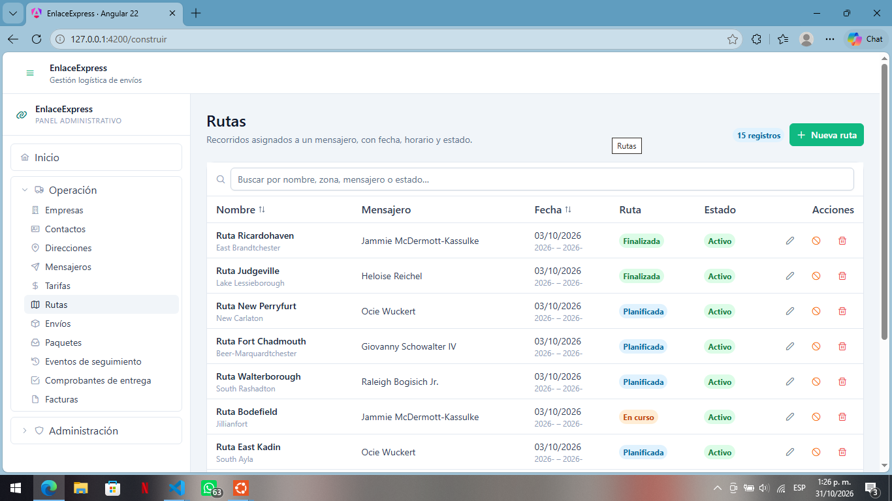

## ISS-09 · CRUD de Invoices

**Particularidades**

- Se construye **antes** que Envíos porque `Shipment.factura_id` apunta a ella.
- `subtotal`, `impuestos` y `total` son DECIMAL. La guía no calcula el total automáticamente: el backend es quien manda y no se documenta una regla; el formulario deja los tres campos editables.
- Cuatro fechas `DATEONLY`: periodo desde/hasta, emisión y pago (opcional).

**Archivos de esta pantalla**

```bash
ng generate component features/invoices/invoice-list --skip-tests --defaults
ng generate component features/invoices/invoice-form --skip-tests --defaults
```

El CLI crea además `invoice-list.spec.ts` y `invoice-form.spec.ts` si no usas `--skip-tests`; las pruebas se tratan en 3.17.

`src/app/features/invoices/invoice-api.ts`

```typescript
import { HttpClient } from '@angular/common/http';
import { Injectable, inject } from '@angular/core';
import { Observable, map } from 'rxjs';
import { environment } from '../../../environments/environment';
import { Invoice, InvoicePayload } from '../../core/models/invoice.model';

/** /invoices — la lista llega en `{ invoices }` y el detalle en `{ invoice }`. */
@Injectable({ providedIn: 'root' })
export class InvoiceApi {
  private readonly http = inject(HttpClient);
  private readonly base = `${environment.apiUrl}/invoices`;

  list(): Observable<Invoice[]> {
    return this.http
      .get<{ invoices: Invoice[] }>(this.base)
      .pipe(map((response) => response.invoices));
  }

  get(id: number): Observable<Invoice> {
    return this.http
      .get<{ invoice: Invoice }>(`${this.base}/${id}`)
      .pipe(map((response) => response.invoice));
  }

  create(payload: InvoicePayload): Observable<Invoice> {
    return this.http
      .post<{ invoice: Invoice }>(this.base, payload)
      .pipe(map((response) => response.invoice));
  }

  update(id: number, payload: Partial<InvoicePayload>): Observable<Invoice> {
    return this.http
      .patch<{ invoice: Invoice }>(`${this.base}/${id}`, payload)
      .pipe(map((response) => response.invoice));
  }

  replace(id: number, payload: InvoicePayload): Observable<Invoice> {
    return this.http
      .put<{ invoice: Invoice }>(`${this.base}/${id}`, payload)
      .pipe(map((response) => response.invoice));
  }

  deactivate(id: number): Observable<unknown> {
    return this.http.patch(`${this.base}/${id}/deactivate`, {});
  }

  remove(id: number): Observable<unknown> {
    return this.http.delete(`${this.base}/${id}`);
  }
}
```

`src/app/features/invoices/invoice-form/invoice-form.ts`

```typescript
import { Component, effect, inject, input, output } from '@angular/core';
import { NonNullableFormBuilder, ReactiveFormsModule, Validators } from '@angular/forms';
import { ButtonModule } from 'primeng/button';
import { InputNumberModule } from 'primeng/inputnumber';
import { InputTextModule } from 'primeng/inputtext';
import { MessageModule } from 'primeng/message';
import { SelectModule } from 'primeng/select';
import { Invoice, InvoicePayload, InvoiceStatus } from '../../../core/models/invoice.model';
import { Company } from '../../../core/models/company.model';
import { toDateInput, toNumberOrNull } from '../../../core/utils/form-values';

/**
 * Formulario de factura, reutilizado para crear y editar.
 *
 * No llama a la API: recibe `invoice` (o `null` para crear) y emite el payload con
 * `saved`. El padre decide entre `POST` y `PATCH` y controla el diálogo.
 */
@Component({
  host: { class: 'block' },
  selector: 'app-invoice-form',
  imports: [MessageModule, ReactiveFormsModule, ButtonModule, InputTextModule, InputNumberModule, SelectModule],
  templateUrl: './invoice-form.html',
  styleUrl: './invoice-form.css',
})
export class InvoiceForm {
  /** Registro a editar. `null` deja el formulario en modo creación. */
  readonly invoice = input<Invoice | null>(null);

  readonly companies = input<Company[]>([]);

  /** Cambia cada vez que el padre abre el diálogo: reinicia el formulario. */
  readonly resetKey = input(0);

  /** Petición en curso: deshabilita el botón y muestra su spinner. */
  readonly saving = input(false);

  readonly saved = output<InvoicePayload>();
  readonly cancelled = output<void>();

  private readonly fb = inject(NonNullableFormBuilder);

  readonly estadoOptions: { label: string; value: InvoiceStatus }[] = [
    { label: 'Pendiente', value: 'pendiente' },
    { label: 'Pagada', value: 'pagada' },
    { label: 'Vencida', value: 'vencida' },
    { label: 'Anulada', value: 'anulada' },
  ];

  readonly activeOptions = [
    { label: 'Activo', value: true },
    { label: 'Inactivo', value: false },
  ];

  readonly form = this.fb.group({
    numero: ['', [Validators.required, Validators.maxLength(40)]],
    empresa_id: [null as number | null, [Validators.required]],
    periodo_desde: ['', [Validators.required]],
    periodo_hasta: ['', [Validators.required]],
    fecha: ['', [Validators.required]],
    estado: ['pendiente' as InvoiceStatus, [Validators.required]],
    subtotal: [null as number | null, [Validators.required, Validators.min(0)]],
    impuestos: [null as number | null, [Validators.min(0)]],
    total: [null as number | null, [Validators.required, Validators.min(0)]],
    fecha_pago: [''],
    is_active: [true],
  });

  constructor() {
    effect(() => {
      const current = this.invoice();
      // `resetKey` se lee a propósito: abrir de nuevo el diálogo debe vaciar el formulario.
      this.resetKey();

      this.form.reset({
        numero: current?.numero ?? '',
        empresa_id: current?.empresa_id ?? null,
        periodo_desde: toDateInput(current?.periodo_desde),
        periodo_hasta: toDateInput(current?.periodo_hasta),
        fecha: toDateInput(current?.fecha),
        estado: current?.estado ?? 'pendiente',
        subtotal: toNumberOrNull(current?.subtotal),
        impuestos: toNumberOrNull(current?.impuestos),
        total: toNumberOrNull(current?.total),
        fecha_pago: toDateInput(current?.fecha_pago),
        is_active: current?.is_active ?? true,
      });

      // `is_active` solo cambia con PATCH /deactivate: al editar no se ofrece.
      if (current) {
        this.form.controls.is_active.disable();
      } else {
        this.form.controls.is_active.enable();
      }
    });
  }

  submit(): void {
    if (this.form.invalid) {
      this.form.markAllAsTouched();
      return;
    }

    const value = this.form.getRawValue();
    const payload: InvoicePayload = {
      numero: value.numero.trim(),
      empresa_id: Number(value.empresa_id),
      periodo_desde: value.periodo_desde,
      periodo_hasta: value.periodo_hasta,
      fecha: value.fecha,
      estado: value.estado,
      subtotal: Number(value.subtotal),
      impuestos: value.impuestos,
      total: Number(value.total),
      fecha_pago: value.fecha_pago || null,
    };

    // `is_active` solo se envía al crear: en edición lo gobierna /deactivate.
    this.saved.emit(this.invoice() ? payload : { ...payload, is_active: value.is_active });
  }
}
```

`src/app/features/invoices/invoice-form/invoice-form.html`

```html
<form [formGroup]="form" (ngSubmit)="submit()" class="space-y-4">
  <div class="grid gap-4 sm:grid-cols-2">
    <div>
      <label for="invoice-numero" class="mb-1 block text-sm font-medium text-slate-700">
        Número <span class="text-red-500">*</span>
      </label>
      <input
        id="invoice-numero"
        pInputText
        formControlName="numero"
        placeholder="FAC-2026-0001"
        class="w-full"
      />
      @if (form.controls.numero.touched && form.controls.numero.invalid) {
        <p-message severity="error" size="small" variant="simple" styleClass="mt-1">
          Este campo es obligatorio (máximo 40 caracteres).
        </p-message>
      }
    </div>

    <div>
      <label for="invoice-empresa-id" class="mb-1 block text-sm font-medium text-slate-700">
        Empresa <span class="text-red-500">*</span>
      </label>
      <p-select
        [fluid]="true"
        inputId="invoice-empresa-id"
        formControlName="empresa_id"
        [options]="companies()"
        optionLabel="razon_social"
        optionValue="id"
        placeholder="Selecciona…"
        [filter]="true"
      />
      @if (form.controls.empresa_id.touched && form.controls.empresa_id.invalid) {
        <p-message severity="error" size="small" variant="simple" styleClass="mt-1">
          Este campo es obligatorio.
        </p-message>
      }
    </div>

    <div>
      <label for="invoice-periodo-desde" class="mb-1 block text-sm font-medium text-slate-700">
        Periodo desde <span class="text-red-500">*</span>
      </label>
      <input id="invoice-periodo-desde" type="date" pInputText formControlName="periodo_desde" class="w-full" />
      @if (form.controls.periodo_desde.touched && form.controls.periodo_desde.invalid) {
        <p-message severity="error" size="small" variant="simple" styleClass="mt-1">
          Este campo es obligatorio.
        </p-message>
      }
    </div>

    <div>
      <label for="invoice-periodo-hasta" class="mb-1 block text-sm font-medium text-slate-700">
        Periodo hasta <span class="text-red-500">*</span>
      </label>
      <input id="invoice-periodo-hasta" type="date" pInputText formControlName="periodo_hasta" class="w-full" />
      @if (form.controls.periodo_hasta.touched && form.controls.periodo_hasta.invalid) {
        <p-message severity="error" size="small" variant="simple" styleClass="mt-1">
          Este campo es obligatorio.
        </p-message>
      }
    </div>

    <div>
      <label for="invoice-fecha" class="mb-1 block text-sm font-medium text-slate-700">
        Fecha de emisión <span class="text-red-500">*</span>
      </label>
      <input id="invoice-fecha" type="date" pInputText formControlName="fecha" class="w-full" />
      @if (form.controls.fecha.touched && form.controls.fecha.invalid) {
        <p-message severity="error" size="small" variant="simple" styleClass="mt-1">
          Este campo es obligatorio.
        </p-message>
      }
    </div>

    <div>
      <label for="invoice-estado" class="mb-1 block text-sm font-medium text-slate-700">
        Estado de la factura <span class="text-red-500">*</span>
      </label>
      <p-select
        [fluid]="true"
        inputId="invoice-estado"
        formControlName="estado"
        [options]="estadoOptions"
        optionLabel="label"
        optionValue="value"
      />
      @if (form.controls.estado.touched && form.controls.estado.invalid) {
        <p-message severity="error" size="small" variant="simple" styleClass="mt-1">
          Este campo es obligatorio.
        </p-message>
      }
    </div>

    <div>
      <label for="invoice-subtotal" class="mb-1 block text-sm font-medium text-slate-700">
        Subtotal <span class="text-red-500">*</span>
      </label>
      <p-inputnumber
        [fluid]="true"
        inputId="invoice-subtotal"
        formControlName="subtotal"
        mode="decimal"
        [min]="0"
        [minFractionDigits]="0"
        [maxFractionDigits]="2"
      />
      @if (form.controls.subtotal.touched && form.controls.subtotal.invalid) {
        <p-message severity="error" size="small" variant="simple" styleClass="mt-1">
          Obligatorio (valor mínimo 0).
        </p-message>
      }
    </div>

    <div>
      <label for="invoice-impuestos" class="mb-1 block text-sm font-medium text-slate-700">
        Impuestos
      </label>
      <p-inputnumber
        [fluid]="true"
        inputId="invoice-impuestos"
        formControlName="impuestos"
        mode="decimal"
        [min]="0"
        [minFractionDigits]="0"
        [maxFractionDigits]="2"
      />
      @if (form.controls.impuestos.touched && form.controls.impuestos.invalid) {
        <p-message severity="error" size="small" variant="simple" styleClass="mt-1">
          Valor fuera de rango (mínimo 0).
        </p-message>
      }
    </div>

    <div>
      <label for="invoice-total" class="mb-1 block text-sm font-medium text-slate-700">
        Total <span class="text-red-500">*</span>
      </label>
      <p-inputnumber
        [fluid]="true"
        inputId="invoice-total"
        formControlName="total"
        mode="decimal"
        [min]="0"
        [minFractionDigits]="0"
        [maxFractionDigits]="2"
      />
      @if (form.controls.total.touched && form.controls.total.invalid) {
        <p-message severity="error" size="small" variant="simple" styleClass="mt-1">
          Obligatorio (valor mínimo 0).
        </p-message>
      }
    </div>

    <div>
      <label for="invoice-fecha-pago" class="mb-1 block text-sm font-medium text-slate-700">
        Fecha de pago
      </label>
      <input id="invoice-fecha-pago" type="date" pInputText formControlName="fecha_pago" class="w-full" />
    </div>

    <div class="sm:col-span-2">
      <label for="invoice-is-active" class="mb-1 block text-sm font-medium text-slate-700">
        Estado
      </label>
      <p-select
        [fluid]="true"
        inputId="invoice-is-active"
        formControlName="is_active"
        [options]="activeOptions"
        optionLabel="label"
        optionValue="value"
      />
      @if (invoice()) {
        <p class="mt-1 text-xs text-slate-500">
          El estado de un registro existente solo cambia con la baja lógica.
        </p>
      }
    </div>
  </div>

  <div class="flex justify-end gap-2 border-t border-slate-100 pt-4">
    <button pButton type="button" severity="secondary" outlined (click)="cancelled.emit()">
      <span pButtonLabel>Cancelar</span>
    </button>
    <button pButton type="submit" [loading]="saving()">
      <i pButtonIcon class="pi pi-check"></i>
      <span pButtonLabel>Guardar</span>
    </button>
  </div>
</form>
```

`src/app/features/invoices/invoice-list/invoice-list.ts`

```typescript
import { CurrencyPipe, DatePipe } from '@angular/common';
import { Component, computed, inject, signal } from '@angular/core';
import { ConfirmationService } from 'primeng/api';
import { ButtonModule } from 'primeng/button';
import { DialogModule } from 'primeng/dialog';
import { InputTextModule } from 'primeng/inputtext';
import { MessageModule } from 'primeng/message';
import { TableModule } from 'primeng/table';
import { TagModule } from 'primeng/tag';
import { TooltipModule } from 'primeng/tooltip';
import { forkJoin } from 'rxjs';
import { Invoice, InvoicePayload } from '../../../core/models/invoice.model';
import { Company } from '../../../core/models/company.model';
import { NotificationService } from '../../../core/services/notification';
import { toApiMessage } from '../../../core/utils/api-error';
import { filterRows } from '../../../core/utils/filter-rows';
import { humanize } from '../../../core/utils/labels';
import { EmptyState } from '../../../shared/ui/empty-state/empty-state';
import { PageHeader } from '../../../shared/ui/page-header/page-header';
import { StatusTag } from '../../../shared/ui/status-tag/status-tag';
import { CompanyApi } from '../../companies/company-api';
import { InvoiceApi } from '../invoice-api';
import { InvoiceForm } from '../invoice-form/invoice-form';

/**
 * Lista de facturas con todas las operaciones del CRUD.
 *
 * Todo el estado vive en signals: la tabla y los contadores se repintan solos y
 * `visibleRows` se recalcula solo cuando cambian `rows()` o `filter()`.
 */
@Component({
  host: { class: 'block' },
  selector: 'app-invoice-list',
  imports: [ButtonModule, CurrencyPipe, DatePipe, DialogModule, EmptyState, InputTextModule, InvoiceForm, MessageModule, PageHeader, StatusTag, TableModule, TagModule, TooltipModule],
  templateUrl: './invoice-list.html',
  styleUrl: './invoice-list.css',
})
export class InvoiceList {
  private readonly api = inject(InvoiceApi);
  private readonly companyApi = inject(CompanyApi);
  private readonly notify = inject(NotificationService);
  private readonly confirmation = inject(ConfirmationService);

  /** Datos del backend (`GET /api/invoices`). */
  readonly rows = signal<Invoice[]>([]);
  readonly companies = signal<Company[]>([]);
  readonly loading = signal(true);
  readonly saving = signal(false);
  readonly error = signal<string | null>(null);
  readonly filter = signal('');

  /** Resultado de aplicar el buscador; `computed` lo memoriza. */
  readonly visibleRows = computed(() =>
    filterRows(this.rows(), this.filter(), (row) => [
      row.numero,
      row.estado,
      this.companyName()(row.empresa_id),
    ]),
  );

  /** `id → razon_social` para mostrar el nombre en la tabla sin buscar en el arreglo por cada fila. */
  readonly companyName = computed(() => {
    const names = new Map<number, string>(this.companies().map((item) => [item.id, String(item.razon_social)]));
    return (id: number | null | undefined) => (id == null ? '—' : (names.get(id) ?? `#${id}`));
  });

  readonly dialogVisible = signal(false);
  readonly editing = signal<Invoice | null>(null);
  readonly resetKey = signal(0);

  readonly title = computed(() => (this.editing() ? 'Editar factura' : 'Nueva factura'));

  protected readonly humanize = humanize;

  protected readonly estadoSeverity: Record<string, 'success' | 'info' | 'warn' | 'danger' | 'secondary'> = {
    pendiente: 'warn',
    pagada: 'success',
    vencida: 'danger',
    anulada: 'secondary',
  };

  constructor() {
    this.load();
  }

  /** `GET /api/invoices`: recarga la tabla y limpia el error anterior. */
  load(): void {
    this.loading.set(true);
    this.error.set(null);

    forkJoin({
      rows: this.api.list(),
      companies: this.companyApi.list(),
    }).subscribe({
      next: ({ rows, companies }) => {
        this.rows.set(rows);
        this.companies.set(companies);
        this.loading.set(false);
      },
      error: (error: unknown) => {
        this.rows.set([]);
        this.error.set(toApiMessage(error));
        this.loading.set(false);
      },
    });
  }

  openCreate(): void {
    this.editing.set(null);
    this.resetKey.update((key) => key + 1);
    this.dialogVisible.set(true);
  }

  openEdit(row: Invoice): void {
    this.editing.set(row);
    this.resetKey.update((key) => key + 1);
    this.dialogVisible.set(true);
  }

  /**
   * El mismo manejador para crear y editar: `editing()` decide el verbo.
   * Tras el éxito se cierra el diálogo y se recarga (el backend es la verdad).
   */
  save(payload: InvoicePayload): void {
    const current = this.editing();
    this.saving.set(true);

    const request = current ? this.api.update(current.id, payload) : this.api.create(payload);

    request.subscribe({
      next: () => {
        this.saving.set(false);
        this.dialogVisible.set(false);
        this.notify.success(current ? 'Factura actualizada' : 'Factura creada');
        this.load();
      },
      error: (error: unknown) => {
        this.saving.set(false);
        this.notify.error('No se pudo guardar', toApiMessage(error));
      },
    });
  }

  /** Baja lógica: `PATCH /:id/deactivate`. */
  deactivate(row: Invoice): void {
    this.confirmation.confirm({
      header: 'Baja lógica',
      message: `¿Desactivar ${'la factura ' + row.numero}? Su estado pasará a inactivo.`,
      icon: 'pi pi-exclamation-triangle',
      acceptLabel: 'Desactivar',
      rejectLabel: 'Cancelar',
      acceptButtonStyleClass: 'p-button-warning',
      accept: () => {
        this.api.deactivate(row.id).subscribe({
          next: () => {
            this.notify.warn('Factura desactivada');
            this.load();
          },
          error: (error: unknown) => {
            this.notify.error('No se pudo desactivar', toApiMessage(error));
          },
        });
      },
    });
  }

  /** Baja física: `DELETE /:id`. No se puede deshacer. */
  remove(row: Invoice): void {
    this.confirmation.confirm({
      header: 'Eliminar definitivamente',
      message: `Se borrará ${'la factura ' + row.numero} de la base de datos. Esta acción no se puede deshacer.`,
      icon: 'pi pi-trash',
      acceptLabel: 'Eliminar',
      rejectLabel: 'Cancelar',
      acceptButtonStyleClass: 'p-button-danger',
      accept: () => {
        this.api.remove(row.id).subscribe({
          next: () => {
            this.notify.success('Factura eliminada');
            this.load();
          },
          error: (error: unknown) => {
            this.notify.error('No se pudo eliminar', toApiMessage(error));
          },
        });
      },
    });
  }
}
```

`src/app/features/invoices/invoice-list/invoice-list.html`

```html
<app-page-header
  title="Facturas"
  subtitle="Facturas emitidas a una empresa por un periodo."
>
  <p-tag [value]="rows().length + ' registros'" severity="info" [rounded]="true" />
  <button pButton type="button" (click)="openCreate()">
    <i pButtonIcon class="pi pi-plus"></i>
    <span pButtonLabel>Nueva factura</span>
  </button>
</app-page-header>

@if (error()) {
  <p-message severity="error" styleClass="mb-4 w-full">
    {{ error() }}
  </p-message>
}

<div class="rounded-xl border border-slate-200 bg-white">
  <p-table
    [value]="visibleRows()"
    [loading]="loading()"
    [paginator]="visibleRows().length > 10"
    [rows]="10"
    dataKey="id"
    tableStyleClass="min-w-3xl"
  >
    <ng-template #caption>
      <div class="flex items-center gap-2">
        <i class="pi pi-search text-slate-400"></i>
        <input
          pInputText
          type="search"
          aria-label="Buscar facturas"
          placeholder="Buscar por número, empresa o estado…"
          [value]="filter()"
          (input)="filter.set($any($event.target).value)"
          class="w-full"
        />
      </div>
      @if (filter()) {
        <p class="mt-2 text-xs text-slate-500">
          {{ visibleRows().length }} de {{ rows().length }} coinciden con «{{ filter() }}».
        </p>
      }
    </ng-template>

    <ng-template #header>
      <tr>
        <th pSortableColumn="numero">
          <div class="flex items-center gap-1">Número <p-sort-icon field="numero" /></div>
        </th>
        <th>Empresa</th>
        <th>Periodo</th>
        <th pSortableColumn="total">
          <div class="flex items-center gap-1">Total <p-sort-icon field="total" /></div>
        </th>
        <th>Factura</th>
        <th>Estado</th>
        <th class="w-40 text-right">Acciones</th>
      </tr>
    </ng-template>

    <ng-template #body let-row>
      <tr>
        <td>
          <p class="font-medium text-slate-800">{{ row.numero }}</p>
          <p class="text-xs text-slate-400">{{ row.fecha | date: 'dd/MM/yyyy' }}</p>
        </td>
        <td>
          <span class="text-sm text-slate-700">{{ companyName()(row.empresa_id) }}</span>
        </td>
        <td>
          <span class="text-sm text-slate-600">{{ row.periodo_desde | date: 'dd/MM/yyyy' }} → {{ row.periodo_hasta | date: 'dd/MM/yyyy' }}</span>
        </td>
        <td>
          {{ row.total | currency: 'COP' : 'symbol' : '1.0-0' }}
        </td>
        <td>
          <p-tag [value]="humanize(row.estado)" [severity]="estadoSeverity[row.estado]" [rounded]="true" />
        </td>
        <td>
          <app-status-tag [isActive]="row.is_active" />
        </td>
        <td>
          <div class="flex justify-end gap-1">
            <button
              pButton
              type="button"
              text
              rounded
              severity="secondary"
              icon="pi pi-pencil"
              aria-label="Editar factura"
              pTooltip="Editar"
              (click)="openEdit(row)"
            ></button>
            <button
              pButton
              type="button"
              text
              rounded
              severity="warn"
              icon="pi pi-ban"
              aria-label="Dar de baja"
              pTooltip="Baja lógica"
              (click)="deactivate(row)"
            ></button>
            <button
              pButton
              type="button"
              text
              rounded
              severity="danger"
              icon="pi pi-trash"
              aria-label="Eliminar factura"
              pTooltip="Eliminar"
              (click)="remove(row)"
            ></button>
          </div>
        </td>
      </tr>
    </ng-template>

    <ng-template #emptymessage>
      <tr>
        <td colspan="7">
          @if (filter()) {
            <app-empty-state
              icon="pi pi-search"
              title="Sin coincidencias"
              message="Ningún registro coincide con la búsqueda. Borra el filtro para ver todos."
            />
          } @else {
            <app-empty-state
              icon="pi pi-file"
              title="Sin registros"
              message="Crea el primero con el botón «Nueva factura» o ejecuta el seeder del backend."
            />
          }
        </td>
      </tr>
    </ng-template>
  </p-table>
</div>

<p-dialog
  [visible]="dialogVisible()"
  (visibleChange)="dialogVisible.set($event)"
  [header]="title()"
  [modal]="true"
  [draggable]="false"
  [resizable]="false"
  [dismissableMask]="true"
  styleClass="w-full max-w-3xl mx-4"
>
  <app-invoice-form
    [invoice]="editing()"
    [companies]="companies()"
    [saving]="saving()"
    [resetKey]="resetKey()"
    (saved)="save($event)"
    (cancelled)="dialogVisible.set(false)"
  />
</p-dialog>
```

Los dos `.css` (`invoice-form.css`, `invoice-list.css`) quedan sin reglas, como los de `layout/` y `shared/ui/`.


## ISS-10 · CRUD de Shipments

**Es la pantalla más grande: 18 campos y 7 listas de referencia.** Sigue siendo el mismo patrón; solo hay más selects.

**Particularidades**

- La ruta `envios` ya existe en `app.routes.ts` desde ISS-02 y apunta a `features/shipments/shipment-list/shipment-list`: esta pantalla es la que ese `loadComponent` estaba esperando, así que **no hay que tocar esa ruta**.
- **Origen filtrado por empresa.** `contacto_origen_id` y `direccion_origen_id` solo ofrecen registros de la empresa elegida (`originContacts`, `originAddresses`, calculados con `toSignal` sobre `empresa_id.valueChanges`). Mientras no haya empresa elegida, esos selects están vacíos. El destino **no** se filtra: el receptor puede pertenecer a otra empresa.
- `mensajero_id`, `ruta_id` y `factura_id` son opcionales: el select trae `[showClear]` para volver a «Sin asignar».
- `numero_guia` es `string` obligatorio. Si el backend lo genera solo, quita ese campo del formulario y de `ShipmentPayload`.
- `costo_calculado` queda editable porque el backend no documenta un endpoint de cotización; si lo calcula él, déjalo solo lectura.
- Fechas `datetime-local`; se convierten a ISO al enviar (`new Date(...).toISOString()`).

**Archivos de esta pantalla**

```bash
ng generate component features/shipments/shipment-list --skip-tests --defaults
ng generate component features/shipments/shipment-form --skip-tests --defaults
```

El CLI crea además `shipment-list.spec.ts` y `shipment-form.spec.ts` si no usas `--skip-tests`; las pruebas se tratan en 3.17.

`src/app/features/shipments/shipment-api.ts`

```typescript
import { HttpClient } from '@angular/common/http';
import { Injectable, inject } from '@angular/core';
import { Observable, map } from 'rxjs';
import { environment } from '../../../environments/environment';
import { Shipment, ShipmentPayload } from '../../core/models/shipment.model';

/** /shipments — la lista llega en `{ shipments }` y el detalle en `{ shipment }`. */
@Injectable({ providedIn: 'root' })
export class ShipmentApi {
  private readonly http = inject(HttpClient);
  private readonly base = `${environment.apiUrl}/shipments`;

  list(): Observable<Shipment[]> {
    return this.http
      .get<{ shipments: Shipment[] }>(this.base)
      .pipe(map((response) => response.shipments));
  }

  get(id: number): Observable<Shipment> {
    return this.http
      .get<{ shipment: Shipment }>(`${this.base}/${id}`)
      .pipe(map((response) => response.shipment));
  }

  create(payload: ShipmentPayload): Observable<Shipment> {
    return this.http
      .post<{ shipment: Shipment }>(this.base, payload)
      .pipe(map((response) => response.shipment));
  }

  update(id: number, payload: Partial<ShipmentPayload>): Observable<Shipment> {
    return this.http
      .patch<{ shipment: Shipment }>(`${this.base}/${id}`, payload)
      .pipe(map((response) => response.shipment));
  }

  replace(id: number, payload: ShipmentPayload): Observable<Shipment> {
    return this.http
      .put<{ shipment: Shipment }>(`${this.base}/${id}`, payload)
      .pipe(map((response) => response.shipment));
  }

  deactivate(id: number): Observable<unknown> {
    return this.http.patch(`${this.base}/${id}/deactivate`, {});
  }

  remove(id: number): Observable<unknown> {
    return this.http.delete(`${this.base}/${id}`);
  }
}
```

`src/app/features/shipments/shipment-form/shipment-form.ts`

```typescript
import { Component, computed, effect, inject, input, output } from '@angular/core';
import { toSignal } from '@angular/core/rxjs-interop';
import { NonNullableFormBuilder, ReactiveFormsModule, Validators } from '@angular/forms';
import { ButtonModule } from 'primeng/button';
import { InputNumberModule } from 'primeng/inputnumber';
import { InputTextModule } from 'primeng/inputtext';
import { MessageModule } from 'primeng/message';
import { SelectModule } from 'primeng/select';
import { Shipment, ShipmentPayload, ShipmentPriority, ShipmentStatus } from '../../../core/models/shipment.model';
import { Company } from '../../../core/models/company.model';
import { Contact } from '../../../core/models/contact.model';
import { Address } from '../../../core/models/address.model';
import { Messenger } from '../../../core/models/messenger.model';
import { Route } from '../../../core/models/route.model';
import { Rate } from '../../../core/models/rate.model';
import { Invoice } from '../../../core/models/invoice.model';
import { fromDateTimeInput, toDateTimeInput, toNumberOrNull } from '../../../core/utils/form-values';

/**
 * Formulario de envío, reutilizado para crear y editar.
 *
 * No llama a la API: recibe `shipment` (o `null` para crear) y emite el payload con
 * `saved`. El padre decide entre `POST` y `PATCH` y controla el diálogo.
 */
@Component({
  host: { class: 'block' },
  selector: 'app-shipment-form',
  imports: [MessageModule, ReactiveFormsModule, ButtonModule, InputTextModule, InputNumberModule, SelectModule],
  templateUrl: './shipment-form.html',
  styleUrl: './shipment-form.css',
})
export class ShipmentForm {
  /** Registro a editar. `null` deja el formulario en modo creación. */
  readonly shipment = input<Shipment | null>(null);

  readonly companies = input<Company[]>([]);
  readonly contacts = input<Contact[]>([]);
  readonly addresses = input<Address[]>([]);
  readonly messengers = input<Messenger[]>([]);
  readonly routes = input<Route[]>([]);
  readonly rates = input<Rate[]>([]);
  readonly invoices = input<Invoice[]>([]);

  /** Cambia cada vez que el padre abre el diálogo: reinicia el formulario. */
  readonly resetKey = input(0);

  /** Petición en curso: deshabilita el botón y muestra su spinner. */
  readonly saving = input(false);

  readonly saved = output<ShipmentPayload>();
  readonly cancelled = output<void>();

  private readonly fb = inject(NonNullableFormBuilder);

  readonly prioridadOptions: { label: string; value: ShipmentPriority }[] = [
    { label: 'Normal', value: 'normal' },
    { label: 'Urgente', value: 'urgente' },
    { label: 'Express', value: 'express' },
  ];

  readonly estadoOptions: { label: string; value: ShipmentStatus }[] = [
    { label: 'Creado', value: 'creado' },
    { label: 'Cotizado', value: 'cotizado' },
    { label: 'Asignado', value: 'asignado' },
    { label: 'En ruta', value: 'en_ruta' },
    { label: 'Entregado', value: 'entregado' },
    { label: 'Con novedad', value: 'con_novedad' },
    { label: 'Cancelado', value: 'cancelado' },
  ];

  readonly activeOptions = [
    { label: 'Activo', value: true },
    { label: 'Inactivo', value: false },
  ];

  readonly form = this.fb.group({
    numero_guia: ['', [Validators.required, Validators.maxLength(40)]],
    empresa_id: [null as number | null, [Validators.required]],
    prioridad: ['normal' as ShipmentPriority, [Validators.required]],
    estado: ['creado' as ShipmentStatus, [Validators.required]],
    contacto_origen_id: [null as number | null, [Validators.required]],
    direccion_origen_id: [null as number | null, [Validators.required]],
    contacto_destino_id: [null as number | null, [Validators.required]],
    direccion_destino_id: [null as number | null, [Validators.required]],
    tarifa_id: [null as number | null, [Validators.required]],
    mensajero_id: [null as number | null],
    ruta_id: [null as number | null],
    factura_id: [null as number | null],
    peso_total_kg: [null as number | null, [Validators.required, Validators.min(0)]],
    valor_declarado: [null as number | null, [Validators.min(0)]],
    costo_calculado: [null as number | null, [Validators.min(0)]],
    fecha_solicitud: ['', [Validators.required]],
    fecha_entrega_estimada: [''],
    fecha_entrega_real: [''],
    is_active: [true],
  });

  /** Empresa elegida en el formulario: filtra los contactos y direcciones de origen. */
  private readonly empresaId = toSignal(this.form.controls.empresa_id.valueChanges, {
    initialValue: null as number | null,
  });

  readonly originContacts = computed(() => {
    const id = this.empresaId();
    return id === null ? [] : this.contacts().filter((contact) => contact.empresa_id === id);
  });

  readonly originAddresses = computed(() => {
    const id = this.empresaId();
    return id === null ? [] : this.addresses().filter((address) => address.empresa_id === id);
  });

  constructor() {
    effect(() => {
      const current = this.shipment();
      // `resetKey` se lee a propósito: abrir de nuevo el diálogo debe vaciar el formulario.
      this.resetKey();

      this.form.reset({
        numero_guia: current?.numero_guia ?? '',
        empresa_id: current?.empresa_id ?? null,
        prioridad: current?.prioridad ?? 'normal',
        estado: current?.estado ?? 'creado',
        contacto_origen_id: current?.contacto_origen_id ?? null,
        direccion_origen_id: current?.direccion_origen_id ?? null,
        contacto_destino_id: current?.contacto_destino_id ?? null,
        direccion_destino_id: current?.direccion_destino_id ?? null,
        tarifa_id: current?.tarifa_id ?? null,
        mensajero_id: current?.mensajero_id ?? null,
        ruta_id: current?.ruta_id ?? null,
        factura_id: current?.factura_id ?? null,
        peso_total_kg: toNumberOrNull(current?.peso_total_kg),
        valor_declarado: toNumberOrNull(current?.valor_declarado),
        costo_calculado: toNumberOrNull(current?.costo_calculado),
        fecha_solicitud: toDateTimeInput(current?.fecha_solicitud),
        fecha_entrega_estimada: toDateTimeInput(current?.fecha_entrega_estimada),
        fecha_entrega_real: toDateTimeInput(current?.fecha_entrega_real),
        is_active: current?.is_active ?? true,
      });

      // `is_active` solo cambia con PATCH /deactivate: al editar no se ofrece.
      if (current) {
        this.form.controls.is_active.disable();
      } else {
        this.form.controls.is_active.enable();
      }
    });
  }

  submit(): void {
    if (this.form.invalid) {
      this.form.markAllAsTouched();
      return;
    }

    const value = this.form.getRawValue();
    const payload: ShipmentPayload = {
      numero_guia: value.numero_guia.trim(),
      empresa_id: Number(value.empresa_id),
      prioridad: value.prioridad,
      estado: value.estado,
      contacto_origen_id: Number(value.contacto_origen_id),
      direccion_origen_id: Number(value.direccion_origen_id),
      contacto_destino_id: Number(value.contacto_destino_id),
      direccion_destino_id: Number(value.direccion_destino_id),
      tarifa_id: Number(value.tarifa_id),
      mensajero_id: value.mensajero_id,
      ruta_id: value.ruta_id,
      factura_id: value.factura_id,
      peso_total_kg: Number(value.peso_total_kg),
      valor_declarado: value.valor_declarado,
      costo_calculado: value.costo_calculado,
      fecha_solicitud: new Date(value.fecha_solicitud).toISOString(),
      fecha_entrega_estimada: fromDateTimeInput(value.fecha_entrega_estimada),
      fecha_entrega_real: fromDateTimeInput(value.fecha_entrega_real),
    };

    // `is_active` solo se envía al crear: en edición lo gobierna /deactivate.
    this.saved.emit(this.shipment() ? payload : { ...payload, is_active: value.is_active });
  }
}
```

`src/app/features/shipments/shipment-form/shipment-form.html`

```html
<form [formGroup]="form" (ngSubmit)="submit()" class="space-y-4">
  <div class="grid gap-4 sm:grid-cols-2">
    <div>
      <label for="shipment-numero-guia" class="mb-1 block text-sm font-medium text-slate-700">
        Número de guía <span class="text-red-500">*</span>
      </label>
      <input
        id="shipment-numero-guia"
        pInputText
        formControlName="numero_guia"
        placeholder="EE-2026-000001"
        class="w-full"
      />
      @if (form.controls.numero_guia.touched && form.controls.numero_guia.invalid) {
        <p-message severity="error" size="small" variant="simple" styleClass="mt-1">
          Este campo es obligatorio (máximo 40 caracteres).
        </p-message>
      }
    </div>

    <div>
      <label for="shipment-empresa-id" class="mb-1 block text-sm font-medium text-slate-700">
        Empresa <span class="text-red-500">*</span>
      </label>
      <p-select
        [fluid]="true"
        inputId="shipment-empresa-id"
        formControlName="empresa_id"
        [options]="companies()"
        optionLabel="razon_social"
        optionValue="id"
        placeholder="Selecciona…"
        [filter]="true"
      />
      @if (form.controls.empresa_id.touched && form.controls.empresa_id.invalid) {
        <p-message severity="error" size="small" variant="simple" styleClass="mt-1">
          Este campo es obligatorio.
        </p-message>
      }
    </div>

    <div>
      <label for="shipment-prioridad" class="mb-1 block text-sm font-medium text-slate-700">
        Prioridad <span class="text-red-500">*</span>
      </label>
      <p-select
        [fluid]="true"
        inputId="shipment-prioridad"
        formControlName="prioridad"
        [options]="prioridadOptions"
        optionLabel="label"
        optionValue="value"
      />
      @if (form.controls.prioridad.touched && form.controls.prioridad.invalid) {
        <p-message severity="error" size="small" variant="simple" styleClass="mt-1">
          Este campo es obligatorio.
        </p-message>
      }
    </div>

    <div>
      <label for="shipment-estado" class="mb-1 block text-sm font-medium text-slate-700">
        Estado del envío <span class="text-red-500">*</span>
      </label>
      <p-select
        [fluid]="true"
        inputId="shipment-estado"
        formControlName="estado"
        [options]="estadoOptions"
        optionLabel="label"
        optionValue="value"
      />
      @if (form.controls.estado.touched && form.controls.estado.invalid) {
        <p-message severity="error" size="small" variant="simple" styleClass="mt-1">
          Este campo es obligatorio.
        </p-message>
      }
    </div>

    <div>
      <label for="shipment-contacto-origen-id" class="mb-1 block text-sm font-medium text-slate-700">
        Contacto de origen <span class="text-red-500">*</span>
      </label>
      <p-select
        [fluid]="true"
        inputId="shipment-contacto-origen-id"
        formControlName="contacto_origen_id"
        [options]="originContacts()"
        optionLabel="nombre"
        optionValue="id"
        placeholder="Selecciona…"
        [filter]="true"
      />
      @if (form.controls.contacto_origen_id.touched && form.controls.contacto_origen_id.invalid) {
        <p-message severity="error" size="small" variant="simple" styleClass="mt-1">
          Este campo es obligatorio.
        </p-message>
      }
      <p class="mt-1 text-xs text-slate-500">Se listan los contactos de la empresa elegida.</p>
    </div>

    <div>
      <label for="shipment-direccion-origen-id" class="mb-1 block text-sm font-medium text-slate-700">
        Dirección de origen <span class="text-red-500">*</span>
      </label>
      <p-select
        [fluid]="true"
        inputId="shipment-direccion-origen-id"
        formControlName="direccion_origen_id"
        [options]="originAddresses()"
        optionLabel="alias"
        optionValue="id"
        placeholder="Selecciona…"
        [filter]="true"
      />
      @if (form.controls.direccion_origen_id.touched && form.controls.direccion_origen_id.invalid) {
        <p-message severity="error" size="small" variant="simple" styleClass="mt-1">
          Este campo es obligatorio.
        </p-message>
      }
      <p class="mt-1 text-xs text-slate-500">Se listan las direcciones de la empresa elegida.</p>
    </div>

    <div>
      <label for="shipment-contacto-destino-id" class="mb-1 block text-sm font-medium text-slate-700">
        Contacto de destino <span class="text-red-500">*</span>
      </label>
      <p-select
        [fluid]="true"
        inputId="shipment-contacto-destino-id"
        formControlName="contacto_destino_id"
        [options]="contacts()"
        optionLabel="nombre"
        optionValue="id"
        placeholder="Selecciona…"
        [filter]="true"
      />
      @if (form.controls.contacto_destino_id.touched && form.controls.contacto_destino_id.invalid) {
        <p-message severity="error" size="small" variant="simple" styleClass="mt-1">
          Este campo es obligatorio.
        </p-message>
      }
    </div>

    <div>
      <label for="shipment-direccion-destino-id" class="mb-1 block text-sm font-medium text-slate-700">
        Dirección de destino <span class="text-red-500">*</span>
      </label>
      <p-select
        [fluid]="true"
        inputId="shipment-direccion-destino-id"
        formControlName="direccion_destino_id"
        [options]="addresses()"
        optionLabel="alias"
        optionValue="id"
        placeholder="Selecciona…"
        [filter]="true"
      />
      @if (form.controls.direccion_destino_id.touched && form.controls.direccion_destino_id.invalid) {
        <p-message severity="error" size="small" variant="simple" styleClass="mt-1">
          Este campo es obligatorio.
        </p-message>
      }
    </div>

    <div>
      <label for="shipment-tarifa-id" class="mb-1 block text-sm font-medium text-slate-700">
        Tarifa <span class="text-red-500">*</span>
      </label>
      <p-select
        [fluid]="true"
        inputId="shipment-tarifa-id"
        formControlName="tarifa_id"
        [options]="rates()"
        optionLabel="nombre"
        optionValue="id"
        placeholder="Selecciona…"
        [filter]="true"
      />
      @if (form.controls.tarifa_id.touched && form.controls.tarifa_id.invalid) {
        <p-message severity="error" size="small" variant="simple" styleClass="mt-1">
          Este campo es obligatorio.
        </p-message>
      }
    </div>

    <div>
      <label for="shipment-mensajero-id" class="mb-1 block text-sm font-medium text-slate-700">
        Mensajero
      </label>
      <p-select
        [fluid]="true"
        inputId="shipment-mensajero-id"
        formControlName="mensajero_id"
        [options]="messengers()"
        optionLabel="nombre"
        optionValue="id"
        placeholder="Sin asignar"
        [filter]="true"
        [showClear]="true"
      />
    </div>

    <div>
      <label for="shipment-ruta-id" class="mb-1 block text-sm font-medium text-slate-700">
        Ruta
      </label>
      <p-select
        [fluid]="true"
        inputId="shipment-ruta-id"
        formControlName="ruta_id"
        [options]="routes()"
        optionLabel="nombre"
        optionValue="id"
        placeholder="Sin asignar"
        [filter]="true"
        [showClear]="true"
      />
    </div>

    <div>
      <label for="shipment-factura-id" class="mb-1 block text-sm font-medium text-slate-700">
        Factura
      </label>
      <p-select
        [fluid]="true"
        inputId="shipment-factura-id"
        formControlName="factura_id"
        [options]="invoices()"
        optionLabel="numero"
        optionValue="id"
        placeholder="Sin asignar"
        [filter]="true"
        [showClear]="true"
      />
    </div>

    <div>
      <label for="shipment-peso-total-kg" class="mb-1 block text-sm font-medium text-slate-700">
        Peso total <span class="text-red-500">*</span>
      </label>
      <p-inputnumber
        [fluid]="true"
        inputId="shipment-peso-total-kg"
        formControlName="peso_total_kg"
        mode="decimal"
        [min]="0"
        suffix=" kg"
        [minFractionDigits]="0"
        [maxFractionDigits]="2"
      />
      @if (form.controls.peso_total_kg.touched && form.controls.peso_total_kg.invalid) {
        <p-message severity="error" size="small" variant="simple" styleClass="mt-1">
          Obligatorio (valor mínimo 0).
        </p-message>
      }
    </div>

    <div>
      <label for="shipment-valor-declarado" class="mb-1 block text-sm font-medium text-slate-700">
        Valor declarado
      </label>
      <p-inputnumber
        [fluid]="true"
        inputId="shipment-valor-declarado"
        formControlName="valor_declarado"
        mode="decimal"
        [min]="0"
        [minFractionDigits]="0"
        [maxFractionDigits]="2"
      />
      @if (form.controls.valor_declarado.touched && form.controls.valor_declarado.invalid) {
        <p-message severity="error" size="small" variant="simple" styleClass="mt-1">
          Valor fuera de rango (mínimo 0).
        </p-message>
      }
    </div>

    <div>
      <label for="shipment-costo-calculado" class="mb-1 block text-sm font-medium text-slate-700">
        Costo calculado
      </label>
      <p-inputnumber
        [fluid]="true"
        inputId="shipment-costo-calculado"
        formControlName="costo_calculado"
        mode="decimal"
        [min]="0"
        [minFractionDigits]="0"
        [maxFractionDigits]="2"
      />
      @if (form.controls.costo_calculado.touched && form.controls.costo_calculado.invalid) {
        <p-message severity="error" size="small" variant="simple" styleClass="mt-1">
          Valor fuera de rango (mínimo 0).
        </p-message>
      }
    </div>

    <div>
      <label for="shipment-fecha-solicitud" class="mb-1 block text-sm font-medium text-slate-700">
        Fecha de solicitud <span class="text-red-500">*</span>
      </label>
      <input id="shipment-fecha-solicitud" type="datetime-local" pInputText formControlName="fecha_solicitud" class="w-full" />
      @if (form.controls.fecha_solicitud.touched && form.controls.fecha_solicitud.invalid) {
        <p-message severity="error" size="small" variant="simple" styleClass="mt-1">
          Este campo es obligatorio.
        </p-message>
      }
    </div>

    <div>
      <label for="shipment-fecha-entrega-estimada" class="mb-1 block text-sm font-medium text-slate-700">
        Entrega estimada
      </label>
      <input id="shipment-fecha-entrega-estimada" type="datetime-local" pInputText formControlName="fecha_entrega_estimada" class="w-full" />
    </div>

    <div>
      <label for="shipment-fecha-entrega-real" class="mb-1 block text-sm font-medium text-slate-700">
        Entrega real
      </label>
      <input id="shipment-fecha-entrega-real" type="datetime-local" pInputText formControlName="fecha_entrega_real" class="w-full" />
    </div>

    <div class="sm:col-span-2">
      <label for="shipment-is-active" class="mb-1 block text-sm font-medium text-slate-700">
        Estado
      </label>
      <p-select
        [fluid]="true"
        inputId="shipment-is-active"
        formControlName="is_active"
        [options]="activeOptions"
        optionLabel="label"
        optionValue="value"
      />
      @if (shipment()) {
        <p class="mt-1 text-xs text-slate-500">
          El estado de un registro existente solo cambia con la baja lógica.
        </p>
      }
    </div>
  </div>

  <div class="flex justify-end gap-2 border-t border-slate-100 pt-4">
    <button pButton type="button" severity="secondary" outlined (click)="cancelled.emit()">
      <span pButtonLabel>Cancelar</span>
    </button>
    <button pButton type="submit" [loading]="saving()">
      <i pButtonIcon class="pi pi-check"></i>
      <span pButtonLabel>Guardar</span>
    </button>
  </div>
</form>
```

`src/app/features/shipments/shipment-list/shipment-list.ts`

```typescript
import { CurrencyPipe, DatePipe } from '@angular/common';
import { Component, computed, inject, signal } from '@angular/core';
import { ConfirmationService } from 'primeng/api';
import { ButtonModule } from 'primeng/button';
import { DialogModule } from 'primeng/dialog';
import { InputTextModule } from 'primeng/inputtext';
import { MessageModule } from 'primeng/message';
import { TableModule } from 'primeng/table';
import { TagModule } from 'primeng/tag';
import { TooltipModule } from 'primeng/tooltip';
import { forkJoin } from 'rxjs';
import { Shipment, ShipmentPayload } from '../../../core/models/shipment.model';
import { Company } from '../../../core/models/company.model';
import { Contact } from '../../../core/models/contact.model';
import { Address } from '../../../core/models/address.model';
import { Messenger } from '../../../core/models/messenger.model';
import { Route } from '../../../core/models/route.model';
import { Rate } from '../../../core/models/rate.model';
import { Invoice } from '../../../core/models/invoice.model';
import { NotificationService } from '../../../core/services/notification';
import { toApiMessage } from '../../../core/utils/api-error';
import { filterRows } from '../../../core/utils/filter-rows';
import { humanize } from '../../../core/utils/labels';
import { EmptyState } from '../../../shared/ui/empty-state/empty-state';
import { PageHeader } from '../../../shared/ui/page-header/page-header';
import { StatusTag } from '../../../shared/ui/status-tag/status-tag';
import { CompanyApi } from '../../companies/company-api';
import { ContactApi } from '../../contacts/contact-api';
import { AddressApi } from '../../addresses/address-api';
import { MessengerApi } from '../../messengers/messenger-api';
import { RouteApi } from '../../routes/route-api';
import { RateApi } from '../../rates/rate-api';
import { InvoiceApi } from '../../invoices/invoice-api';
import { ShipmentApi } from '../shipment-api';
import { ShipmentForm } from '../shipment-form/shipment-form';

/**
 * Lista de envíos con todas las operaciones del CRUD.
 *
 * Todo el estado vive en signals: la tabla y los contadores se repintan solos y
 * `visibleRows` se recalcula solo cuando cambian `rows()` o `filter()`.
 */
@Component({
  host: { class: 'block' },
  selector: 'app-shipment-list',
  imports: [ButtonModule, CurrencyPipe, DatePipe, DialogModule, EmptyState, InputTextModule, MessageModule, PageHeader, ShipmentForm, StatusTag, TableModule, TagModule, TooltipModule],
  templateUrl: './shipment-list.html',
  styleUrl: './shipment-list.css',
})
export class ShipmentList {
  private readonly api = inject(ShipmentApi);
  private readonly companyApi = inject(CompanyApi);
  private readonly contactApi = inject(ContactApi);
  private readonly addressApi = inject(AddressApi);
  private readonly messengerApi = inject(MessengerApi);
  private readonly routeApi = inject(RouteApi);
  private readonly rateApi = inject(RateApi);
  private readonly invoiceApi = inject(InvoiceApi);
  private readonly notify = inject(NotificationService);
  private readonly confirmation = inject(ConfirmationService);

  /** Datos del backend (`GET /api/shipments`). */
  readonly rows = signal<Shipment[]>([]);
  readonly companies = signal<Company[]>([]);
  readonly contacts = signal<Contact[]>([]);
  readonly addresses = signal<Address[]>([]);
  readonly messengers = signal<Messenger[]>([]);
  readonly routes = signal<Route[]>([]);
  readonly rates = signal<Rate[]>([]);
  readonly invoices = signal<Invoice[]>([]);
  readonly loading = signal(true);
  readonly saving = signal(false);
  readonly error = signal<string | null>(null);
  readonly filter = signal('');

  /** Resultado de aplicar el buscador; `computed` lo memoriza. */
  readonly visibleRows = computed(() =>
    filterRows(this.rows(), this.filter(), (row) => [
      row.numero_guia,
      row.prioridad,
      row.estado,
      this.companyName()(row.empresa_id),
      this.messengerName()(row.mensajero_id),
    ]),
  );

  /** `id → razon_social` para mostrar el nombre en la tabla sin buscar en el arreglo por cada fila. */
  readonly companyName = computed(() => {
    const names = new Map<number, string>(this.companies().map((item) => [item.id, String(item.razon_social)]));
    return (id: number | null | undefined) => (id == null ? '—' : (names.get(id) ?? `#${id}`));
  });

  /** `id → nombre` para mostrar el nombre en la tabla sin buscar en el arreglo por cada fila. */
  readonly contactName = computed(() => {
    const names = new Map<number, string>(this.contacts().map((item) => [item.id, String(item.nombre)]));
    return (id: number | null | undefined) => (id == null ? '—' : (names.get(id) ?? `#${id}`));
  });

  /** `id → alias` para mostrar el nombre en la tabla sin buscar en el arreglo por cada fila. */
  readonly addressName = computed(() => {
    const names = new Map<number, string>(this.addresses().map((item) => [item.id, String(item.alias)]));
    return (id: number | null | undefined) => (id == null ? '—' : (names.get(id) ?? `#${id}`));
  });

  /** `id → nombre` para mostrar el nombre en la tabla sin buscar en el arreglo por cada fila. */
  readonly messengerName = computed(() => {
    const names = new Map<number, string>(this.messengers().map((item) => [item.id, String(item.nombre)]));
    return (id: number | null | undefined) => (id == null ? '—' : (names.get(id) ?? `#${id}`));
  });

  /** `id → nombre` para mostrar el nombre en la tabla sin buscar en el arreglo por cada fila. */
  readonly routeName = computed(() => {
    const names = new Map<number, string>(this.routes().map((item) => [item.id, String(item.nombre)]));
    return (id: number | null | undefined) => (id == null ? '—' : (names.get(id) ?? `#${id}`));
  });

  /** `id → nombre` para mostrar el nombre en la tabla sin buscar en el arreglo por cada fila. */
  readonly rateName = computed(() => {
    const names = new Map<number, string>(this.rates().map((item) => [item.id, String(item.nombre)]));
    return (id: number | null | undefined) => (id == null ? '—' : (names.get(id) ?? `#${id}`));
  });

  /** `id → numero` para mostrar el nombre en la tabla sin buscar en el arreglo por cada fila. */
  readonly invoiceName = computed(() => {
    const names = new Map<number, string>(this.invoices().map((item) => [item.id, String(item.numero)]));
    return (id: number | null | undefined) => (id == null ? '—' : (names.get(id) ?? `#${id}`));
  });

  readonly dialogVisible = signal(false);
  readonly editing = signal<Shipment | null>(null);
  readonly resetKey = signal(0);

  readonly title = computed(() => (this.editing() ? 'Editar envío' : 'Nuevo envío'));

  protected readonly humanize = humanize;

  protected readonly estadoSeverity: Record<string, 'success' | 'info' | 'warn' | 'danger' | 'secondary'> = {
    creado: 'secondary',
    cotizado: 'info',
    asignado: 'info',
    en_ruta: 'warn',
    entregado: 'success',
    con_novedad: 'danger',
    cancelado: 'danger',
  };

  protected readonly prioridadSeverity: Record<string, 'success' | 'info' | 'warn' | 'danger' | 'secondary'> = {
    normal: 'secondary',
    urgente: 'warn',
    express: 'danger',
  };

  constructor() {
    this.load();
  }

  /** `GET /api/shipments`: recarga la tabla y limpia el error anterior. */
  load(): void {
    this.loading.set(true);
    this.error.set(null);

    forkJoin({
      rows: this.api.list(),
      companies: this.companyApi.list(),
      contacts: this.contactApi.list(),
      addresses: this.addressApi.list(),
      messengers: this.messengerApi.list(),
      routes: this.routeApi.list(),
      rates: this.rateApi.list(),
      invoices: this.invoiceApi.list(),
    }).subscribe({
      next: ({ rows, companies, contacts, addresses, messengers, routes, rates, invoices }) => {
        this.rows.set(rows);
        this.companies.set(companies);
        this.contacts.set(contacts);
        this.addresses.set(addresses);
        this.messengers.set(messengers);
        this.routes.set(routes);
        this.rates.set(rates);
        this.invoices.set(invoices);
        this.loading.set(false);
      },
      error: (error: unknown) => {
        this.rows.set([]);
        this.error.set(toApiMessage(error));
        this.loading.set(false);
      },
    });
  }

  openCreate(): void {
    this.editing.set(null);
    this.resetKey.update((key) => key + 1);
    this.dialogVisible.set(true);
  }

  openEdit(row: Shipment): void {
    this.editing.set(row);
    this.resetKey.update((key) => key + 1);
    this.dialogVisible.set(true);
  }

  /**
   * El mismo manejador para crear y editar: `editing()` decide el verbo.
   * Tras el éxito se cierra el diálogo y se recarga (el backend es la verdad).
   */
  save(payload: ShipmentPayload): void {
    const current = this.editing();
    this.saving.set(true);

    const request = current ? this.api.update(current.id, payload) : this.api.create(payload);

    request.subscribe({
      next: () => {
        this.saving.set(false);
        this.dialogVisible.set(false);
        this.notify.success(current ? 'Envío actualizado' : 'Envío creado');
        this.load();
      },
      error: (error: unknown) => {
        this.saving.set(false);
        this.notify.error('No se pudo guardar', toApiMessage(error));
      },
    });
  }

  /** Baja lógica: `PATCH /:id/deactivate`. */
  deactivate(row: Shipment): void {
    this.confirmation.confirm({
      header: 'Baja lógica',
      message: `¿Desactivar ${'el envío ' + row.numero_guia}? Su estado pasará a inactivo.`,
      icon: 'pi pi-exclamation-triangle',
      acceptLabel: 'Desactivar',
      rejectLabel: 'Cancelar',
      acceptButtonStyleClass: 'p-button-warning',
      accept: () => {
        this.api.deactivate(row.id).subscribe({
          next: () => {
            this.notify.warn('Envío desactivado');
            this.load();
          },
          error: (error: unknown) => {
            this.notify.error('No se pudo desactivar', toApiMessage(error));
          },
        });
      },
    });
  }

  /** Baja física: `DELETE /:id`. No se puede deshacer. */
  remove(row: Shipment): void {
    this.confirmation.confirm({
      header: 'Eliminar definitivamente',
      message: `Se borrará ${'el envío ' + row.numero_guia} de la base de datos. Esta acción no se puede deshacer.`,
      icon: 'pi pi-trash',
      acceptLabel: 'Eliminar',
      rejectLabel: 'Cancelar',
      acceptButtonStyleClass: 'p-button-danger',
      accept: () => {
        this.api.remove(row.id).subscribe({
          next: () => {
            this.notify.success('Envío eliminado');
            this.load();
          },
          error: (error: unknown) => {
            this.notify.error('No se pudo eliminar', toApiMessage(error));
          },
        });
      },
    });
  }
}
```

`src/app/features/shipments/shipment-list/shipment-list.html`

```html
<app-page-header
  title="Envíos"
  subtitle="Creación, seguimiento y gestión logística de los envíos."
>
  <p-tag [value]="rows().length + ' registros'" severity="info" [rounded]="true" />
  <button pButton type="button" (click)="openCreate()">
    <i pButtonIcon class="pi pi-plus"></i>
    <span pButtonLabel>Nuevo envío</span>
  </button>
</app-page-header>

@if (error()) {
  <p-message severity="error" styleClass="mb-4 w-full">
    {{ error() }}
  </p-message>
}

<div class="rounded-xl border border-slate-200 bg-white">
  <p-table
    [value]="visibleRows()"
    [loading]="loading()"
    [paginator]="visibleRows().length > 10"
    [rows]="10"
    dataKey="id"
    tableStyleClass="min-w-5xl"
  >
    <ng-template #caption>
      <div class="flex items-center gap-2">
        <i class="pi pi-search text-slate-400"></i>
        <input
          pInputText
          type="search"
          aria-label="Buscar envíos"
          placeholder="Buscar por guía, empresa, mensajero, prioridad o estado…"
          [value]="filter()"
          (input)="filter.set($any($event.target).value)"
          class="w-full"
        />
      </div>
      @if (filter()) {
        <p class="mt-2 text-xs text-slate-500">
          {{ visibleRows().length }} de {{ rows().length }} coinciden con «{{ filter() }}».
        </p>
      }
    </ng-template>

    <ng-template #header>
      <tr>
        <th pSortableColumn="numero_guia">
          <div class="flex items-center gap-1">Guía <p-sort-icon field="numero_guia" /></div>
        </th>
        <th>Empresa</th>
        <th>Mensajero</th>
        <th>Prioridad</th>
        <th>Envío</th>
        <th pSortableColumn="costo_calculado">
          <div class="flex items-center gap-1">Costo <p-sort-icon field="costo_calculado" /></div>
        </th>
        <th pSortableColumn="fecha_solicitud">
          <div class="flex items-center gap-1">Solicitud <p-sort-icon field="fecha_solicitud" /></div>
        </th>
        <th>Estado</th>
        <th class="w-40 text-right">Acciones</th>
      </tr>
    </ng-template>

    <ng-template #body let-row>
      <tr>
        <td>
          <p class="font-medium text-slate-800">{{ row.numero_guia }}</p>
          <p class="text-xs text-slate-400">#{{ row.id }}</p>
        </td>
        <td>
          <span class="text-sm text-slate-700">{{ companyName()(row.empresa_id) }}</span>
        </td>
        <td>
          <span class="text-sm text-slate-600">{{ messengerName()(row.mensajero_id) }}</span>
        </td>
        <td>
          <p-tag [value]="humanize(row.prioridad)" [severity]="prioridadSeverity[row.prioridad]" [rounded]="true" />
        </td>
        <td>
          <p-tag [value]="humanize(row.estado)" [severity]="estadoSeverity[row.estado]" [rounded]="true" />
        </td>
        <td>
          {{ row.costo_calculado == null ? '—' : (row.costo_calculado | currency: 'COP' : 'symbol' : '1.0-0') }}
        </td>
        <td>
          <span class="text-sm text-slate-600">{{ row.fecha_solicitud | date: 'dd/MM/yyyy' }}</span>
        </td>
        <td>
          <app-status-tag [isActive]="row.is_active" />
        </td>
        <td>
          <div class="flex justify-end gap-1">
            <button
              pButton
              type="button"
              text
              rounded
              severity="secondary"
              icon="pi pi-pencil"
              aria-label="Editar envío"
              pTooltip="Editar"
              (click)="openEdit(row)"
            ></button>
            <button
              pButton
              type="button"
              text
              rounded
              severity="warn"
              icon="pi pi-ban"
              aria-label="Dar de baja"
              pTooltip="Baja lógica"
              (click)="deactivate(row)"
            ></button>
            <button
              pButton
              type="button"
              text
              rounded
              severity="danger"
              icon="pi pi-trash"
              aria-label="Eliminar envío"
              pTooltip="Eliminar"
              (click)="remove(row)"
            ></button>
          </div>
        </td>
      </tr>
    </ng-template>

    <ng-template #emptymessage>
      <tr>
        <td colspan="9">
          @if (filter()) {
            <app-empty-state
              icon="pi pi-search"
              title="Sin coincidencias"
              message="Ningún registro coincide con la búsqueda. Borra el filtro para ver todos."
            />
          } @else {
            <app-empty-state
              icon="pi pi-box"
              title="Sin registros"
              message="Crea el primero con el botón «Nuevo envío» o ejecuta el seeder del backend."
            />
          }
        </td>
      </tr>
    </ng-template>
  </p-table>
</div>

<p-dialog
  [visible]="dialogVisible()"
  (visibleChange)="dialogVisible.set($event)"
  [header]="title()"
  [modal]="true"
  [draggable]="false"
  [resizable]="false"
  [dismissableMask]="true"
  styleClass="w-full max-w-4xl mx-4"
>
  <app-shipment-form
    [shipment]="editing()"
    [companies]="companies()"
    [contacts]="contacts()"
    [addresses]="addresses()"
    [messengers]="messengers()"
    [routes]="routes()"
    [rates]="rates()"
    [invoices]="invoices()"
    [saving]="saving()"
    [resetKey]="resetKey()"
    (saved)="save($event)"
    (cancelled)="dialogVisible.set(false)"
  />
</p-dialog>
```

Los dos `.css` (`shipment-form.css`, `shipment-list.css`) quedan sin reglas, como los de `layout/` y `shared/ui/`.

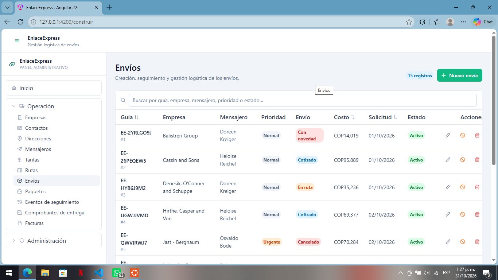

## ISS-11 · CRUD de Packages

**Particularidades**

- `envio_id` es obligatorio y el select muestra el `numero_guia` del envío.
- La propiedad de entrada del formulario se llama `pack`, no `package`: `package` es palabra reservada en modo estricto de JavaScript.
- `es_fragil` es un `p-checkbox` binario; en la tabla aparece como etiqueta «Frágil».

**Archivos de esta pantalla**

```bash
ng generate component features/packages/package-list --skip-tests --defaults
ng generate component features/packages/package-form --skip-tests --defaults
```

El CLI crea además `package-list.spec.ts` y `package-form.spec.ts` si no usas `--skip-tests`; las pruebas se tratan en 3.17.

`src/app/features/packages/package-api.ts`

```typescript
import { HttpClient } from '@angular/common/http';
import { Injectable, inject } from '@angular/core';
import { Observable, map } from 'rxjs';
import { environment } from '../../../environments/environment';
import { Package, PackagePayload } from '../../core/models/package.model';

/** /packages — la lista llega en `{ packages }` y el detalle en `{ package }`. */
@Injectable({ providedIn: 'root' })
export class PackageApi {
  private readonly http = inject(HttpClient);
  private readonly base = `${environment.apiUrl}/packages`;

  list(): Observable<Package[]> {
    return this.http
      .get<{ packages: Package[] }>(this.base)
      .pipe(map((response) => response.packages));
  }

  get(id: number): Observable<Package> {
    return this.http
      .get<{ package: Package }>(`${this.base}/${id}`)
      .pipe(map((response) => response.package));
  }

  create(payload: PackagePayload): Observable<Package> {
    return this.http
      .post<{ package: Package }>(this.base, payload)
      .pipe(map((response) => response.package));
  }

  update(id: number, payload: Partial<PackagePayload>): Observable<Package> {
    return this.http
      .patch<{ package: Package }>(`${this.base}/${id}`, payload)
      .pipe(map((response) => response.package));
  }

  replace(id: number, payload: PackagePayload): Observable<Package> {
    return this.http
      .put<{ package: Package }>(`${this.base}/${id}`, payload)
      .pipe(map((response) => response.package));
  }

  deactivate(id: number): Observable<unknown> {
    return this.http.patch(`${this.base}/${id}/deactivate`, {});
  }

  remove(id: number): Observable<unknown> {
    return this.http.delete(`${this.base}/${id}`);
  }
}
```

`src/app/features/packages/package-form/package-form.ts`

```typescript
import { Component, effect, inject, input, output } from '@angular/core';
import { NonNullableFormBuilder, ReactiveFormsModule, Validators } from '@angular/forms';
import { ButtonModule } from 'primeng/button';
import { CheckboxModule } from 'primeng/checkbox';
import { InputNumberModule } from 'primeng/inputnumber';
import { MessageModule } from 'primeng/message';
import { SelectModule } from 'primeng/select';
import { TextareaModule } from 'primeng/textarea';
import { Package, PackagePayload } from '../../../core/models/package.model';
import { Shipment } from '../../../core/models/shipment.model';
import { toNumberOrNull } from '../../../core/utils/form-values';

/**
 * Formulario de paquete, reutilizado para crear y editar.
 *
 * No llama a la API: recibe `pack` (o `null` para crear) y emite el payload con
 * `saved`. El padre decide entre `POST` y `PATCH` y controla el diálogo.
 */
@Component({
  host: { class: 'block' },
  selector: 'app-package-form',
  imports: [MessageModule, ReactiveFormsModule, ButtonModule, TextareaModule, InputNumberModule, CheckboxModule, SelectModule],
  templateUrl: './package-form.html',
  styleUrl: './package-form.css',
})
export class PackageForm {
  /** Registro a editar. `null` deja el formulario en modo creación. */
  readonly pack = input<Package | null>(null);

  readonly shipments = input<Shipment[]>([]);

  /** Cambia cada vez que el padre abre el diálogo: reinicia el formulario. */
  readonly resetKey = input(0);

  /** Petición en curso: deshabilita el botón y muestra su spinner. */
  readonly saving = input(false);

  readonly saved = output<PackagePayload>();
  readonly cancelled = output<void>();

  private readonly fb = inject(NonNullableFormBuilder);

  readonly activeOptions = [
    { label: 'Activo', value: true },
    { label: 'Inactivo', value: false },
  ];

  readonly form = this.fb.group({
    envio_id: [null as number | null, [Validators.required]],
    descripcion_contenido: ['', [Validators.maxLength(255)]],
    peso_kg: [null as number | null, [Validators.required, Validators.min(0)]],
    valor_declarado: [null as number | null, [Validators.min(0)]],
    alto_cm: [null as number | null, [Validators.min(0)]],
    ancho_cm: [null as number | null, [Validators.min(0)]],
    largo_cm: [null as number | null, [Validators.min(0)]],
    es_fragil: [false],
    is_active: [true],
  });

  constructor() {
    effect(() => {
      const current = this.pack();
      // `resetKey` se lee a propósito: abrir de nuevo el diálogo debe vaciar el formulario.
      this.resetKey();

      this.form.reset({
        envio_id: current?.envio_id ?? null,
        descripcion_contenido: current?.descripcion_contenido ?? '',
        peso_kg: toNumberOrNull(current?.peso_kg),
        valor_declarado: toNumberOrNull(current?.valor_declarado),
        alto_cm: toNumberOrNull(current?.alto_cm),
        ancho_cm: toNumberOrNull(current?.ancho_cm),
        largo_cm: toNumberOrNull(current?.largo_cm),
        es_fragil: current?.es_fragil ?? false,
        is_active: current?.is_active ?? true,
      });

      // `is_active` solo cambia con PATCH /deactivate: al editar no se ofrece.
      if (current) {
        this.form.controls.is_active.disable();
      } else {
        this.form.controls.is_active.enable();
      }
    });
  }

  submit(): void {
    if (this.form.invalid) {
      this.form.markAllAsTouched();
      return;
    }

    const value = this.form.getRawValue();
    const payload: PackagePayload = {
      envio_id: Number(value.envio_id),
      descripcion_contenido: value.descripcion_contenido.trim() || null,
      peso_kg: Number(value.peso_kg),
      valor_declarado: value.valor_declarado,
      alto_cm: value.alto_cm,
      ancho_cm: value.ancho_cm,
      largo_cm: value.largo_cm,
      es_fragil: value.es_fragil,
    };

    // `is_active` solo se envía al crear: en edición lo gobierna /deactivate.
    this.saved.emit(this.pack() ? payload : { ...payload, is_active: value.is_active });
  }
}
```

`src/app/features/packages/package-form/package-form.html`

```html
<form [formGroup]="form" (ngSubmit)="submit()" class="space-y-4">
  <div class="grid gap-4 sm:grid-cols-2">
    <div class="sm:col-span-2">
      <label for="package-envio-id" class="mb-1 block text-sm font-medium text-slate-700">
        Envío <span class="text-red-500">*</span>
      </label>
      <p-select
        [fluid]="true"
        inputId="package-envio-id"
        formControlName="envio_id"
        [options]="shipments()"
        optionLabel="numero_guia"
        optionValue="id"
        placeholder="Selecciona…"
        [filter]="true"
      />
      @if (form.controls.envio_id.touched && form.controls.envio_id.invalid) {
        <p-message severity="error" size="small" variant="simple" styleClass="mt-1">
          Este campo es obligatorio.
        </p-message>
      }
    </div>

    <div class="sm:col-span-2">
      <label for="package-descripcion-contenido" class="mb-1 block text-sm font-medium text-slate-700">
        Descripción del contenido
      </label>
      <textarea
        id="package-descripcion-contenido"
        pTextarea
        formControlName="descripcion_contenido"
        rows="2"
        placeholder="Documentos legales"
        class="w-full"
      ></textarea>
      @if (form.controls.descripcion_contenido.touched && form.controls.descripcion_contenido.invalid) {
        <p-message severity="error" size="small" variant="simple" styleClass="mt-1">
          Máximo 255 caracteres.
        </p-message>
      }
    </div>

    <div>
      <label for="package-peso-kg" class="mb-1 block text-sm font-medium text-slate-700">
        Peso <span class="text-red-500">*</span>
      </label>
      <p-inputnumber
        [fluid]="true"
        inputId="package-peso-kg"
        formControlName="peso_kg"
        mode="decimal"
        [min]="0"
        suffix=" kg"
        [minFractionDigits]="0"
        [maxFractionDigits]="2"
      />
      @if (form.controls.peso_kg.touched && form.controls.peso_kg.invalid) {
        <p-message severity="error" size="small" variant="simple" styleClass="mt-1">
          Obligatorio (valor mínimo 0).
        </p-message>
      }
    </div>

    <div>
      <label for="package-valor-declarado" class="mb-1 block text-sm font-medium text-slate-700">
        Valor declarado
      </label>
      <p-inputnumber
        [fluid]="true"
        inputId="package-valor-declarado"
        formControlName="valor_declarado"
        mode="decimal"
        [min]="0"
        [minFractionDigits]="0"
        [maxFractionDigits]="2"
      />
      @if (form.controls.valor_declarado.touched && form.controls.valor_declarado.invalid) {
        <p-message severity="error" size="small" variant="simple" styleClass="mt-1">
          Valor fuera de rango (mínimo 0).
        </p-message>
      }
    </div>

    <div>
      <label for="package-alto-cm" class="mb-1 block text-sm font-medium text-slate-700">
        Alto
      </label>
      <p-inputnumber
        [fluid]="true"
        inputId="package-alto-cm"
        formControlName="alto_cm"
        mode="decimal"
        [min]="0"
        suffix=" cm"
        [minFractionDigits]="0"
        [maxFractionDigits]="2"
      />
      @if (form.controls.alto_cm.touched && form.controls.alto_cm.invalid) {
        <p-message severity="error" size="small" variant="simple" styleClass="mt-1">
          Valor fuera de rango (mínimo 0).
        </p-message>
      }
    </div>

    <div>
      <label for="package-ancho-cm" class="mb-1 block text-sm font-medium text-slate-700">
        Ancho
      </label>
      <p-inputnumber
        [fluid]="true"
        inputId="package-ancho-cm"
        formControlName="ancho_cm"
        mode="decimal"
        [min]="0"
        suffix=" cm"
        [minFractionDigits]="0"
        [maxFractionDigits]="2"
      />
      @if (form.controls.ancho_cm.touched && form.controls.ancho_cm.invalid) {
        <p-message severity="error" size="small" variant="simple" styleClass="mt-1">
          Valor fuera de rango (mínimo 0).
        </p-message>
      }
    </div>

    <div>
      <label for="package-largo-cm" class="mb-1 block text-sm font-medium text-slate-700">
        Largo
      </label>
      <p-inputnumber
        [fluid]="true"
        inputId="package-largo-cm"
        formControlName="largo_cm"
        mode="decimal"
        [min]="0"
        suffix=" cm"
        [minFractionDigits]="0"
        [maxFractionDigits]="2"
      />
      @if (form.controls.largo_cm.touched && form.controls.largo_cm.invalid) {
        <p-message severity="error" size="small" variant="simple" styleClass="mt-1">
          Valor fuera de rango (mínimo 0).
        </p-message>
      }
    </div>

    <div class="flex items-center gap-2 sm:col-span-2">
      <p-checkbox inputId="package-es-fragil" formControlName="es_fragil" [binary]="true" />
      <label for="package-es-fragil" class="text-sm text-slate-700">Paquete frágil</label>
    </div>

    <div class="sm:col-span-2">
      <label for="package-is-active" class="mb-1 block text-sm font-medium text-slate-700">
        Estado
      </label>
      <p-select
        [fluid]="true"
        inputId="package-is-active"
        formControlName="is_active"
        [options]="activeOptions"
        optionLabel="label"
        optionValue="value"
      />
      @if (pack()) {
        <p class="mt-1 text-xs text-slate-500">
          El estado de un registro existente solo cambia con la baja lógica.
        </p>
      }
    </div>
  </div>

  <div class="flex justify-end gap-2 border-t border-slate-100 pt-4">
    <button pButton type="button" severity="secondary" outlined (click)="cancelled.emit()">
      <span pButtonLabel>Cancelar</span>
    </button>
    <button pButton type="submit" [loading]="saving()">
      <i pButtonIcon class="pi pi-check"></i>
      <span pButtonLabel>Guardar</span>
    </button>
  </div>
</form>
```

`src/app/features/packages/package-list/package-list.ts`

```typescript
import { Component, computed, inject, signal } from '@angular/core';
import { ConfirmationService } from 'primeng/api';
import { ButtonModule } from 'primeng/button';
import { DialogModule } from 'primeng/dialog';
import { InputTextModule } from 'primeng/inputtext';
import { MessageModule } from 'primeng/message';
import { TableModule } from 'primeng/table';
import { TagModule } from 'primeng/tag';
import { TooltipModule } from 'primeng/tooltip';
import { forkJoin } from 'rxjs';
import { Package, PackagePayload } from '../../../core/models/package.model';
import { Shipment } from '../../../core/models/shipment.model';
import { NotificationService } from '../../../core/services/notification';
import { toApiMessage } from '../../../core/utils/api-error';
import { filterRows } from '../../../core/utils/filter-rows';
import { EmptyState } from '../../../shared/ui/empty-state/empty-state';
import { PageHeader } from '../../../shared/ui/page-header/page-header';
import { StatusTag } from '../../../shared/ui/status-tag/status-tag';
import { ShipmentApi } from '../../shipments/shipment-api';
import { PackageApi } from '../package-api';
import { PackageForm } from '../package-form/package-form';

/**
 * Lista de paquetes con todas las operaciones del CRUD.
 *
 * Todo el estado vive en signals: la tabla y los contadores se repintan solos y
 * `visibleRows` se recalcula solo cuando cambian `rows()` o `filter()`.
 */
@Component({
  host: { class: 'block' },
  selector: 'app-package-list',
  imports: [ButtonModule, DialogModule, EmptyState, InputTextModule, MessageModule, PackageForm, PageHeader, StatusTag, TableModule, TagModule, TooltipModule],
  templateUrl: './package-list.html',
  styleUrl: './package-list.css',
})
export class PackageList {
  private readonly api = inject(PackageApi);
  private readonly shipmentApi = inject(ShipmentApi);
  private readonly notify = inject(NotificationService);
  private readonly confirmation = inject(ConfirmationService);

  /** Datos del backend (`GET /api/packages`). */
  readonly rows = signal<Package[]>([]);
  readonly shipments = signal<Shipment[]>([]);
  readonly loading = signal(true);
  readonly saving = signal(false);
  readonly error = signal<string | null>(null);
  readonly filter = signal('');

  /** Resultado de aplicar el buscador; `computed` lo memoriza. */
  readonly visibleRows = computed(() =>
    filterRows(this.rows(), this.filter(), (row) => [
      row.descripcion_contenido,
      this.shipmentName()(row.envio_id),
    ]),
  );

  /** `id → numero_guia` para mostrar el nombre en la tabla sin buscar en el arreglo por cada fila. */
  readonly shipmentName = computed(() => {
    const names = new Map<number, string>(this.shipments().map((item) => [item.id, String(item.numero_guia)]));
    return (id: number | null | undefined) => (id == null ? '—' : (names.get(id) ?? `#${id}`));
  });

  readonly dialogVisible = signal(false);
  readonly editing = signal<Package | null>(null);
  readonly resetKey = signal(0);

  readonly title = computed(() => (this.editing() ? 'Editar paquete' : 'Nuevo paquete'));

  constructor() {
    this.load();
  }

  /** `GET /api/packages`: recarga la tabla y limpia el error anterior. */
  load(): void {
    this.loading.set(true);
    this.error.set(null);

    forkJoin({
      rows: this.api.list(),
      shipments: this.shipmentApi.list(),
    }).subscribe({
      next: ({ rows, shipments }) => {
        this.rows.set(rows);
        this.shipments.set(shipments);
        this.loading.set(false);
      },
      error: (error: unknown) => {
        this.rows.set([]);
        this.error.set(toApiMessage(error));
        this.loading.set(false);
      },
    });
  }

  openCreate(): void {
    this.editing.set(null);
    this.resetKey.update((key) => key + 1);
    this.dialogVisible.set(true);
  }

  openEdit(row: Package): void {
    this.editing.set(row);
    this.resetKey.update((key) => key + 1);
    this.dialogVisible.set(true);
  }

  /**
   * El mismo manejador para crear y editar: `editing()` decide el verbo.
   * Tras el éxito se cierra el diálogo y se recarga (el backend es la verdad).
   */
  save(payload: PackagePayload): void {
    const current = this.editing();
    this.saving.set(true);

    const request = current ? this.api.update(current.id, payload) : this.api.create(payload);

    request.subscribe({
      next: () => {
        this.saving.set(false);
        this.dialogVisible.set(false);
        this.notify.success(current ? 'Paquete actualizado' : 'Paquete creado');
        this.load();
      },
      error: (error: unknown) => {
        this.saving.set(false);
        this.notify.error('No se pudo guardar', toApiMessage(error));
      },
    });
  }

  /** Baja lógica: `PATCH /:id/deactivate`. */
  deactivate(row: Package): void {
    this.confirmation.confirm({
      header: 'Baja lógica',
      message: `¿Desactivar ${'el paquete #' + row.id}? Su estado pasará a inactivo.`,
      icon: 'pi pi-exclamation-triangle',
      acceptLabel: 'Desactivar',
      rejectLabel: 'Cancelar',
      acceptButtonStyleClass: 'p-button-warning',
      accept: () => {
        this.api.deactivate(row.id).subscribe({
          next: () => {
            this.notify.warn('Paquete desactivado');
            this.load();
          },
          error: (error: unknown) => {
            this.notify.error('No se pudo desactivar', toApiMessage(error));
          },
        });
      },
    });
  }

  /** Baja física: `DELETE /:id`. No se puede deshacer. */
  remove(row: Package): void {
    this.confirmation.confirm({
      header: 'Eliminar definitivamente',
      message: `Se borrará ${'el paquete #' + row.id} de la base de datos. Esta acción no se puede deshacer.`,
      icon: 'pi pi-trash',
      acceptLabel: 'Eliminar',
      rejectLabel: 'Cancelar',
      acceptButtonStyleClass: 'p-button-danger',
      accept: () => {
        this.api.remove(row.id).subscribe({
          next: () => {
            this.notify.success('Paquete eliminado');
            this.load();
          },
          error: (error: unknown) => {
            this.notify.error('No se pudo eliminar', toApiMessage(error));
          },
        });
      },
    });
  }
}
```

`src/app/features/packages/package-list/package-list.html`

```html
<app-page-header
  title="Paquetes"
  subtitle="Bultos o artículos incluidos en cada envío."
>
  <p-tag [value]="rows().length + ' registros'" severity="info" [rounded]="true" />
  <button pButton type="button" (click)="openCreate()">
    <i pButtonIcon class="pi pi-plus"></i>
    <span pButtonLabel>Nuevo paquete</span>
  </button>
</app-page-header>

@if (error()) {
  <p-message severity="error" styleClass="mb-4 w-full">
    {{ error() }}
  </p-message>
}

<div class="rounded-xl border border-slate-200 bg-white">
  <p-table
    [value]="visibleRows()"
    [loading]="loading()"
    [paginator]="visibleRows().length > 10"
    [rows]="10"
    dataKey="id"
    tableStyleClass="min-w-3xl"
  >
    <ng-template #caption>
      <div class="flex items-center gap-2">
        <i class="pi pi-search text-slate-400"></i>
        <input
          pInputText
          type="search"
          aria-label="Buscar paquetes"
          placeholder="Buscar por envío o contenido…"
          [value]="filter()"
          (input)="filter.set($any($event.target).value)"
          class="w-full"
        />
      </div>
      @if (filter()) {
        <p class="mt-2 text-xs text-slate-500">
          {{ visibleRows().length }} de {{ rows().length }} coinciden con «{{ filter() }}».
        </p>
      }
    </ng-template>

    <ng-template #header>
      <tr>
        <th>Envío</th>
        <th>Contenido</th>
        <th pSortableColumn="peso_kg">
          <div class="flex items-center gap-1">Peso <p-sort-icon field="peso_kg" /></div>
        </th>
        <th>Medidas</th>
        <th>Frágil</th>
        <th>Estado</th>
        <th class="w-40 text-right">Acciones</th>
      </tr>
    </ng-template>

    <ng-template #body let-row>
      <tr>
        <td>
          <p class="font-medium text-slate-800">{{ shipmentName()(row.envio_id) }}</p>
          <p class="text-xs text-slate-400">Paquete #{{ row.id }}</p>
        </td>
        <td>
          <span class="text-sm text-slate-600">{{ row.descripcion_contenido || '—' }}</span>
        </td>
        <td>
          {{ row.peso_kg }} kg
        </td>
        <td>
          <span class="text-sm text-slate-600">{{ row.largo_cm ?? '—' }} × {{ row.ancho_cm ?? '—' }} × {{ row.alto_cm ?? '—' }} cm</span>
        </td>
        <td>
          @if (row.es_fragil) {
            <p-tag value="Frágil" severity="warn" [rounded]="true" />
          } @else {
            <span class="text-slate-400">—</span>
          }
        </td>
        <td>
          <app-status-tag [isActive]="row.is_active" />
        </td>
        <td>
          <div class="flex justify-end gap-1">
            <button
              pButton
              type="button"
              text
              rounded
              severity="secondary"
              icon="pi pi-pencil"
              aria-label="Editar paquete"
              pTooltip="Editar"
              (click)="openEdit(row)"
            ></button>
            <button
              pButton
              type="button"
              text
              rounded
              severity="warn"
              icon="pi pi-ban"
              aria-label="Dar de baja"
              pTooltip="Baja lógica"
              (click)="deactivate(row)"
            ></button>
            <button
              pButton
              type="button"
              text
              rounded
              severity="danger"
              icon="pi pi-trash"
              aria-label="Eliminar paquete"
              pTooltip="Eliminar"
              (click)="remove(row)"
            ></button>
          </div>
        </td>
      </tr>
    </ng-template>

    <ng-template #emptymessage>
      <tr>
        <td colspan="7">
          @if (filter()) {
            <app-empty-state
              icon="pi pi-search"
              title="Sin coincidencias"
              message="Ningún registro coincide con la búsqueda. Borra el filtro para ver todos."
            />
          } @else {
            <app-empty-state
              icon="pi pi-inbox"
              title="Sin registros"
              message="Crea el primero con el botón «Nuevo paquete» o ejecuta el seeder del backend."
            />
          }
        </td>
      </tr>
    </ng-template>
  </p-table>
</div>

<p-dialog
  [visible]="dialogVisible()"
  (visibleChange)="dialogVisible.set($event)"
  [header]="title()"
  [modal]="true"
  [draggable]="false"
  [resizable]="false"
  [dismissableMask]="true"
  styleClass="w-full max-w-2xl mx-4"
>
  <app-package-form
    [pack]="editing()"
    [shipments]="shipments()"
    [saving]="saving()"
    [resetKey]="resetKey()"
    (saved)="save($event)"
    (cancelled)="dialogVisible.set(false)"
  />
</p-dialog>
```

Los dos `.css` (`package-form.css`, `package-list.css`) quedan sin reglas, como los de `layout/` y `shared/ui/`.

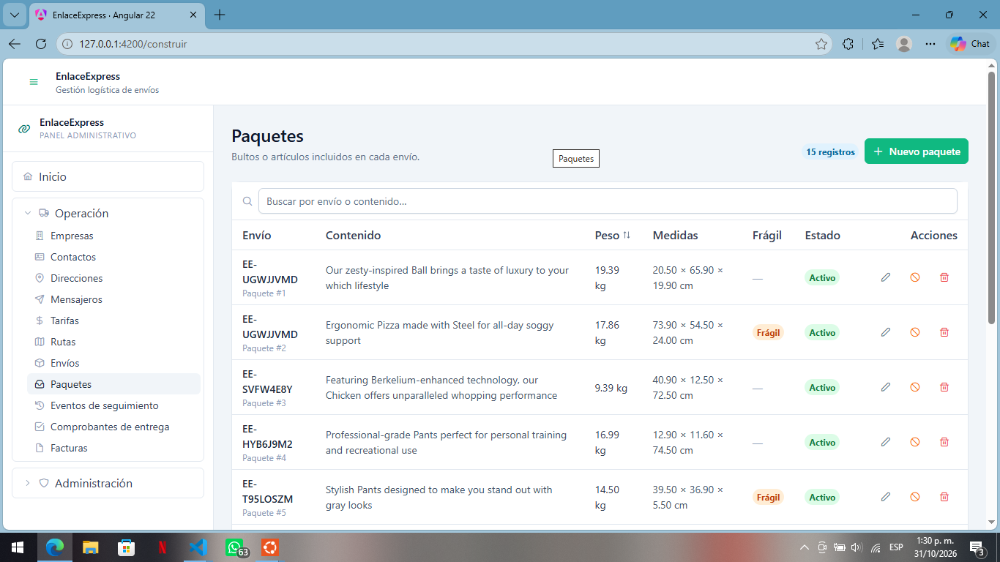

## ISS-12 · CRUD de Tracking_events

**Particularidades**

- Dos selects de referencia: `envio_id` (obligatorio) y `registrado_por_id` (**mensajero**, opcional; no es un usuario).
- `tipo` y `estado` son enums distintos: `estado` expresa la gravedad (`informativo`, `novedad_leve`, `novedad_critica`) y por eso la etiqueta de la tabla se rotula *Gravedad* para no confundirla con `is_active`.
- El recurso se escribe con guion bajo: `/api/tracking_events`.

**Archivos de esta pantalla**

```bash
ng generate component features/tracking-events/tracking-event-list --skip-tests --defaults
ng generate component features/tracking-events/tracking-event-form --skip-tests --defaults
```

El CLI crea además `tracking-event-list.spec.ts` y `tracking-event-form.spec.ts` si no usas `--skip-tests`; las pruebas se tratan en 3.17.

`src/app/features/tracking-events/tracking-event-api.ts`

```typescript
import { HttpClient } from '@angular/common/http';
import { Injectable, inject } from '@angular/core';
import { Observable, map } from 'rxjs';
import { environment } from '../../../environments/environment';
import { TrackingEvent, TrackingEventPayload } from '../../core/models/tracking-event.model';

/** /tracking_events — la lista llega en `{ tracking_events }` y el detalle en `{ tracking_event }`. */
@Injectable({ providedIn: 'root' })
export class TrackingEventApi {
  private readonly http = inject(HttpClient);
  private readonly base = `${environment.apiUrl}/tracking_events`;

  list(): Observable<TrackingEvent[]> {
    return this.http
      .get<{ tracking_events: TrackingEvent[] }>(this.base)
      .pipe(map((response) => response.tracking_events));
  }

  get(id: number): Observable<TrackingEvent> {
    return this.http
      .get<{ tracking_event: TrackingEvent }>(`${this.base}/${id}`)
      .pipe(map((response) => response.tracking_event));
  }

  create(payload: TrackingEventPayload): Observable<TrackingEvent> {
    return this.http
      .post<{ tracking_event: TrackingEvent }>(this.base, payload)
      .pipe(map((response) => response.tracking_event));
  }

  update(id: number, payload: Partial<TrackingEventPayload>): Observable<TrackingEvent> {
    return this.http
      .patch<{ tracking_event: TrackingEvent }>(`${this.base}/${id}`, payload)
      .pipe(map((response) => response.tracking_event));
  }

  replace(id: number, payload: TrackingEventPayload): Observable<TrackingEvent> {
    return this.http
      .put<{ tracking_event: TrackingEvent }>(`${this.base}/${id}`, payload)
      .pipe(map((response) => response.tracking_event));
  }

  deactivate(id: number): Observable<unknown> {
    return this.http.patch(`${this.base}/${id}/deactivate`, {});
  }

  remove(id: number): Observable<unknown> {
    return this.http.delete(`${this.base}/${id}`);
  }
}
```

`src/app/features/tracking-events/tracking-event-form/tracking-event-form.ts`

```typescript
import { Component, effect, inject, input, output } from '@angular/core';
import { NonNullableFormBuilder, ReactiveFormsModule, Validators } from '@angular/forms';
import { ButtonModule } from 'primeng/button';
import { InputTextModule } from 'primeng/inputtext';
import { MessageModule } from 'primeng/message';
import { SelectModule } from 'primeng/select';
import { TextareaModule } from 'primeng/textarea';
import { TrackingEvent, TrackingEventPayload, TrackingEventStatus, TrackingEventType } from '../../../core/models/tracking-event.model';
import { Shipment } from '../../../core/models/shipment.model';
import { Messenger } from '../../../core/models/messenger.model';
import { toDateTimeInput } from '../../../core/utils/form-values';

/**
 * Formulario de evento de seguimiento, reutilizado para crear y editar.
 *
 * No llama a la API: recibe `trackingEvent` (o `null` para crear) y emite el payload con
 * `saved`. El padre decide entre `POST` y `PATCH` y controla el diálogo.
 */
@Component({
  host: { class: 'block' },
  selector: 'app-tracking-event-form',
  imports: [MessageModule, ReactiveFormsModule, ButtonModule, InputTextModule, TextareaModule, SelectModule],
  templateUrl: './tracking-event-form.html',
  styleUrl: './tracking-event-form.css',
})
export class TrackingEventForm {
  /** Registro a editar. `null` deja el formulario en modo creación. */
  readonly trackingEvent = input<TrackingEvent | null>(null);

  readonly shipments = input<Shipment[]>([]);
  readonly messengers = input<Messenger[]>([]);

  /** Cambia cada vez que el padre abre el diálogo: reinicia el formulario. */
  readonly resetKey = input(0);

  /** Petición en curso: deshabilita el botón y muestra su spinner. */
  readonly saving = input(false);

  readonly saved = output<TrackingEventPayload>();
  readonly cancelled = output<void>();

  private readonly fb = inject(NonNullableFormBuilder);

  readonly tipoOptions: { label: string; value: TrackingEventType }[] = [
    { label: 'Recogido', value: 'recogido' },
    { label: 'En tránsito', value: 'en_transito' },
    { label: 'En reparto', value: 'en_reparto' },
    { label: 'Novedad', value: 'novedad' },
    { label: 'Entregado', value: 'entregado' },
    { label: 'Devuelto', value: 'devuelto' },
  ];

  readonly estadoOptions: { label: string; value: TrackingEventStatus }[] = [
    { label: 'Informativo', value: 'informativo' },
    { label: 'Novedad leve', value: 'novedad_leve' },
    { label: 'Novedad crítica', value: 'novedad_critica' },
  ];

  readonly activeOptions = [
    { label: 'Activo', value: true },
    { label: 'Inactivo', value: false },
  ];

  readonly form = this.fb.group({
    envio_id: [null as number | null, [Validators.required]],
    tipo: ['recogido' as TrackingEventType, [Validators.required]],
    estado: ['informativo' as TrackingEventStatus, [Validators.required]],
    fecha: ['', [Validators.required]],
    ubicacion: ['', [Validators.maxLength(200)]],
    registrado_por_id: [null as number | null],
    observaciones: ['', [Validators.maxLength(500)]],
    is_active: [true],
  });

  constructor() {
    effect(() => {
      const current = this.trackingEvent();
      // `resetKey` se lee a propósito: abrir de nuevo el diálogo debe vaciar el formulario.
      this.resetKey();

      this.form.reset({
        envio_id: current?.envio_id ?? null,
        tipo: current?.tipo ?? 'recogido',
        estado: current?.estado ?? 'informativo',
        fecha: toDateTimeInput(current?.fecha),
        ubicacion: current?.ubicacion ?? '',
        registrado_por_id: current?.registrado_por_id ?? null,
        observaciones: current?.observaciones ?? '',
        is_active: current?.is_active ?? true,
      });

      // `is_active` solo cambia con PATCH /deactivate: al editar no se ofrece.
      if (current) {
        this.form.controls.is_active.disable();
      } else {
        this.form.controls.is_active.enable();
      }
    });
  }

  submit(): void {
    if (this.form.invalid) {
      this.form.markAllAsTouched();
      return;
    }

    const value = this.form.getRawValue();
    const payload: TrackingEventPayload = {
      envio_id: Number(value.envio_id),
      tipo: value.tipo,
      estado: value.estado,
      fecha: new Date(value.fecha).toISOString(),
      ubicacion: value.ubicacion.trim() || null,
      registrado_por_id: value.registrado_por_id,
      observaciones: value.observaciones.trim() || null,
    };

    // `is_active` solo se envía al crear: en edición lo gobierna /deactivate.
    this.saved.emit(this.trackingEvent() ? payload : { ...payload, is_active: value.is_active });
  }
}
```

`src/app/features/tracking-events/tracking-event-form/tracking-event-form.html`

```html
<form [formGroup]="form" (ngSubmit)="submit()" class="space-y-4">
  <div class="grid gap-4 sm:grid-cols-2">
    <div class="sm:col-span-2">
      <label for="tracking-event-envio-id" class="mb-1 block text-sm font-medium text-slate-700">
        Envío <span class="text-red-500">*</span>
      </label>
      <p-select
        [fluid]="true"
        inputId="tracking-event-envio-id"
        formControlName="envio_id"
        [options]="shipments()"
        optionLabel="numero_guia"
        optionValue="id"
        placeholder="Selecciona…"
        [filter]="true"
      />
      @if (form.controls.envio_id.touched && form.controls.envio_id.invalid) {
        <p-message severity="error" size="small" variant="simple" styleClass="mt-1">
          Este campo es obligatorio.
        </p-message>
      }
    </div>

    <div>
      <label for="tracking-event-tipo" class="mb-1 block text-sm font-medium text-slate-700">
        Tipo de evento <span class="text-red-500">*</span>
      </label>
      <p-select
        [fluid]="true"
        inputId="tracking-event-tipo"
        formControlName="tipo"
        [options]="tipoOptions"
        optionLabel="label"
        optionValue="value"
      />
      @if (form.controls.tipo.touched && form.controls.tipo.invalid) {
        <p-message severity="error" size="small" variant="simple" styleClass="mt-1">
          Este campo es obligatorio.
        </p-message>
      }
    </div>

    <div>
      <label for="tracking-event-estado" class="mb-1 block text-sm font-medium text-slate-700">
        Gravedad <span class="text-red-500">*</span>
      </label>
      <p-select
        [fluid]="true"
        inputId="tracking-event-estado"
        formControlName="estado"
        [options]="estadoOptions"
        optionLabel="label"
        optionValue="value"
      />
      @if (form.controls.estado.touched && form.controls.estado.invalid) {
        <p-message severity="error" size="small" variant="simple" styleClass="mt-1">
          Este campo es obligatorio.
        </p-message>
      }
    </div>

    <div>
      <label for="tracking-event-fecha" class="mb-1 block text-sm font-medium text-slate-700">
        Fecha y hora <span class="text-red-500">*</span>
      </label>
      <input id="tracking-event-fecha" type="datetime-local" pInputText formControlName="fecha" class="w-full" />
      @if (form.controls.fecha.touched && form.controls.fecha.invalid) {
        <p-message severity="error" size="small" variant="simple" styleClass="mt-1">
          Este campo es obligatorio.
        </p-message>
      }
    </div>

    <div>
      <label for="tracking-event-ubicacion" class="mb-1 block text-sm font-medium text-slate-700">
        Ubicación
      </label>
      <input
        id="tracking-event-ubicacion"
        pInputText
        formControlName="ubicacion"
        placeholder="Centro de distribución Barranquilla"
        class="w-full"
      />
      @if (form.controls.ubicacion.touched && form.controls.ubicacion.invalid) {
        <p-message severity="error" size="small" variant="simple" styleClass="mt-1">
          Máximo 200 caracteres.
        </p-message>
      }
    </div>

    <div class="sm:col-span-2">
      <label for="tracking-event-registrado-por-id" class="mb-1 block text-sm font-medium text-slate-700">
        Registrado por
      </label>
      <p-select
        [fluid]="true"
        inputId="tracking-event-registrado-por-id"
        formControlName="registrado_por_id"
        [options]="messengers()"
        optionLabel="nombre"
        optionValue="id"
        placeholder="Sin asignar"
        [filter]="true"
        [showClear]="true"
      />
    </div>

    <div class="sm:col-span-2">
      <label for="tracking-event-observaciones" class="mb-1 block text-sm font-medium text-slate-700">
        Observaciones
      </label>
      <textarea
        id="tracking-event-observaciones"
        pTextarea
        formControlName="observaciones"
        rows="2"
        placeholder=""
        class="w-full"
      ></textarea>
      @if (form.controls.observaciones.touched && form.controls.observaciones.invalid) {
        <p-message severity="error" size="small" variant="simple" styleClass="mt-1">
          Máximo 500 caracteres.
        </p-message>
      }
    </div>

    <div class="sm:col-span-2">
      <label for="tracking-event-is-active" class="mb-1 block text-sm font-medium text-slate-700">
        Estado
      </label>
      <p-select
        [fluid]="true"
        inputId="tracking-event-is-active"
        formControlName="is_active"
        [options]="activeOptions"
        optionLabel="label"
        optionValue="value"
      />
      @if (trackingEvent()) {
        <p class="mt-1 text-xs text-slate-500">
          El estado de un registro existente solo cambia con la baja lógica.
        </p>
      }
    </div>
  </div>

  <div class="flex justify-end gap-2 border-t border-slate-100 pt-4">
    <button pButton type="button" severity="secondary" outlined (click)="cancelled.emit()">
      <span pButtonLabel>Cancelar</span>
    </button>
    <button pButton type="submit" [loading]="saving()">
      <i pButtonIcon class="pi pi-check"></i>
      <span pButtonLabel>Guardar</span>
    </button>
  </div>
</form>
```

`src/app/features/tracking-events/tracking-event-list/tracking-event-list.ts`

```typescript
import { DatePipe } from '@angular/common';
import { Component, computed, inject, signal } from '@angular/core';
import { ConfirmationService } from 'primeng/api';
import { ButtonModule } from 'primeng/button';
import { DialogModule } from 'primeng/dialog';
import { InputTextModule } from 'primeng/inputtext';
import { MessageModule } from 'primeng/message';
import { TableModule } from 'primeng/table';
import { TagModule } from 'primeng/tag';
import { TooltipModule } from 'primeng/tooltip';
import { forkJoin } from 'rxjs';
import { TrackingEvent, TrackingEventPayload } from '../../../core/models/tracking-event.model';
import { Shipment } from '../../../core/models/shipment.model';
import { Messenger } from '../../../core/models/messenger.model';
import { NotificationService } from '../../../core/services/notification';
import { toApiMessage } from '../../../core/utils/api-error';
import { filterRows } from '../../../core/utils/filter-rows';
import { humanize } from '../../../core/utils/labels';
import { EmptyState } from '../../../shared/ui/empty-state/empty-state';
import { PageHeader } from '../../../shared/ui/page-header/page-header';
import { StatusTag } from '../../../shared/ui/status-tag/status-tag';
import { ShipmentApi } from '../../shipments/shipment-api';
import { MessengerApi } from '../../messengers/messenger-api';
import { TrackingEventApi } from '../tracking-event-api';
import { TrackingEventForm } from '../tracking-event-form/tracking-event-form';

/**
 * Lista de eventos de seguimiento con todas las operaciones del CRUD.
 *
 * Todo el estado vive en signals: la tabla y los contadores se repintan solos y
 * `visibleRows` se recalcula solo cuando cambian `rows()` o `filter()`.
 */
@Component({
  host: { class: 'block' },
  selector: 'app-tracking-event-list',
  imports: [ButtonModule, DatePipe, DialogModule, EmptyState, InputTextModule, MessageModule, PageHeader, StatusTag, TableModule, TagModule, TooltipModule, TrackingEventForm],
  templateUrl: './tracking-event-list.html',
  styleUrl: './tracking-event-list.css',
})
export class TrackingEventList {
  private readonly api = inject(TrackingEventApi);
  private readonly shipmentApi = inject(ShipmentApi);
  private readonly messengerApi = inject(MessengerApi);
  private readonly notify = inject(NotificationService);
  private readonly confirmation = inject(ConfirmationService);

  /** Datos del backend (`GET /api/tracking_events`). */
  readonly rows = signal<TrackingEvent[]>([]);
  readonly shipments = signal<Shipment[]>([]);
  readonly messengers = signal<Messenger[]>([]);
  readonly loading = signal(true);
  readonly saving = signal(false);
  readonly error = signal<string | null>(null);
  readonly filter = signal('');

  /** Resultado de aplicar el buscador; `computed` lo memoriza. */
  readonly visibleRows = computed(() =>
    filterRows(this.rows(), this.filter(), (row) => [
      row.tipo,
      row.ubicacion,
      row.observaciones,
      row.estado,
      this.shipmentName()(row.envio_id),
      this.messengerName()(row.registrado_por_id),
    ]),
  );

  /** `id → numero_guia` para mostrar el nombre en la tabla sin buscar en el arreglo por cada fila. */
  readonly shipmentName = computed(() => {
    const names = new Map<number, string>(this.shipments().map((item) => [item.id, String(item.numero_guia)]));
    return (id: number | null | undefined) => (id == null ? '—' : (names.get(id) ?? `#${id}`));
  });

  /** `id → nombre` para mostrar el nombre en la tabla sin buscar en el arreglo por cada fila. */
  readonly messengerName = computed(() => {
    const names = new Map<number, string>(this.messengers().map((item) => [item.id, String(item.nombre)]));
    return (id: number | null | undefined) => (id == null ? '—' : (names.get(id) ?? `#${id}`));
  });

  readonly dialogVisible = signal(false);
  readonly editing = signal<TrackingEvent | null>(null);
  readonly resetKey = signal(0);

  readonly title = computed(() => (this.editing() ? 'Editar evento de seguimiento' : 'Nuevo evento de seguimiento'));

  protected readonly humanize = humanize;

  protected readonly estadoSeverity: Record<string, 'success' | 'info' | 'warn' | 'danger' | 'secondary'> = {
    informativo: 'info',
    novedad_leve: 'warn',
    novedad_critica: 'danger',
  };

  constructor() {
    this.load();
  }

  /** `GET /api/tracking_events`: recarga la tabla y limpia el error anterior. */
  load(): void {
    this.loading.set(true);
    this.error.set(null);

    forkJoin({
      rows: this.api.list(),
      shipments: this.shipmentApi.list(),
      messengers: this.messengerApi.list(),
    }).subscribe({
      next: ({ rows, shipments, messengers }) => {
        this.rows.set(rows);
        this.shipments.set(shipments);
        this.messengers.set(messengers);
        this.loading.set(false);
      },
      error: (error: unknown) => {
        this.rows.set([]);
        this.error.set(toApiMessage(error));
        this.loading.set(false);
      },
    });
  }

  openCreate(): void {
    this.editing.set(null);
    this.resetKey.update((key) => key + 1);
    this.dialogVisible.set(true);
  }

  openEdit(row: TrackingEvent): void {
    this.editing.set(row);
    this.resetKey.update((key) => key + 1);
    this.dialogVisible.set(true);
  }

  /**
   * El mismo manejador para crear y editar: `editing()` decide el verbo.
   * Tras el éxito se cierra el diálogo y se recarga (el backend es la verdad).
   */
  save(payload: TrackingEventPayload): void {
    const current = this.editing();
    this.saving.set(true);

    const request = current ? this.api.update(current.id, payload) : this.api.create(payload);

    request.subscribe({
      next: () => {
        this.saving.set(false);
        this.dialogVisible.set(false);
        this.notify.success(current ? 'Evento de seguimiento actualizado' : 'Evento de seguimiento creado');
        this.load();
      },
      error: (error: unknown) => {
        this.saving.set(false);
        this.notify.error('No se pudo guardar', toApiMessage(error));
      },
    });
  }

  /** Baja lógica: `PATCH /:id/deactivate`. */
  deactivate(row: TrackingEvent): void {
    this.confirmation.confirm({
      header: 'Baja lógica',
      message: `¿Desactivar ${'el evento #' + row.id}? Su estado pasará a inactivo.`,
      icon: 'pi pi-exclamation-triangle',
      acceptLabel: 'Desactivar',
      rejectLabel: 'Cancelar',
      acceptButtonStyleClass: 'p-button-warning',
      accept: () => {
        this.api.deactivate(row.id).subscribe({
          next: () => {
            this.notify.warn('Evento de seguimiento desactivado');
            this.load();
          },
          error: (error: unknown) => {
            this.notify.error('No se pudo desactivar', toApiMessage(error));
          },
        });
      },
    });
  }

  /** Baja física: `DELETE /:id`. No se puede deshacer. */
  remove(row: TrackingEvent): void {
    this.confirmation.confirm({
      header: 'Eliminar definitivamente',
      message: `Se borrará ${'el evento #' + row.id} de la base de datos. Esta acción no se puede deshacer.`,
      icon: 'pi pi-trash',
      acceptLabel: 'Eliminar',
      rejectLabel: 'Cancelar',
      acceptButtonStyleClass: 'p-button-danger',
      accept: () => {
        this.api.remove(row.id).subscribe({
          next: () => {
            this.notify.success('Evento de seguimiento eliminado');
            this.load();
          },
          error: (error: unknown) => {
            this.notify.error('No se pudo eliminar', toApiMessage(error));
          },
        });
      },
    });
  }
}
```

`src/app/features/tracking-events/tracking-event-list/tracking-event-list.html`

```html
<app-page-header
  title="Eventos de seguimiento"
  subtitle="Hitos, ubicaciones y observaciones registrados sobre cada envío."
>
  <p-tag [value]="rows().length + ' registros'" severity="info" [rounded]="true" />
  <button pButton type="button" (click)="openCreate()">
    <i pButtonIcon class="pi pi-plus"></i>
    <span pButtonLabel>Nuevo evento de seguimiento</span>
  </button>
</app-page-header>

@if (error()) {
  <p-message severity="error" styleClass="mb-4 w-full">
    {{ error() }}
  </p-message>
}

<div class="rounded-xl border border-slate-200 bg-white">
  <p-table
    [value]="visibleRows()"
    [loading]="loading()"
    [paginator]="visibleRows().length > 10"
    [rows]="10"
    dataKey="id"
    tableStyleClass="min-w-4xl"
  >
    <ng-template #caption>
      <div class="flex items-center gap-2">
        <i class="pi pi-search text-slate-400"></i>
        <input
          pInputText
          type="search"
          aria-label="Buscar eventos de seguimiento"
          placeholder="Buscar por envío, tipo, ubicación o mensajero…"
          [value]="filter()"
          (input)="filter.set($any($event.target).value)"
          class="w-full"
        />
      </div>
      @if (filter()) {
        <p class="mt-2 text-xs text-slate-500">
          {{ visibleRows().length }} de {{ rows().length }} coinciden con «{{ filter() }}».
        </p>
      }
    </ng-template>

    <ng-template #header>
      <tr>
        <th>Envío</th>
        <th>Tipo</th>
        <th pSortableColumn="fecha">
          <div class="flex items-center gap-1">Fecha <p-sort-icon field="fecha" /></div>
        </th>
        <th>Ubicación</th>
        <th>Gravedad</th>
        <th>Registrado por</th>
        <th>Estado</th>
        <th class="w-40 text-right">Acciones</th>
      </tr>
    </ng-template>

    <ng-template #body let-row>
      <tr>
        <td>
          <p class="font-medium text-slate-800">{{ shipmentName()(row.envio_id) }}</p>
          <p class="text-xs text-slate-400">Evento #{{ row.id }}</p>
        </td>
        <td>
          <p-tag [value]="humanize(row.tipo)" severity="secondary" [rounded]="true" />
        </td>
        <td>
          <span class="text-sm text-slate-600">{{ row.fecha | date: 'dd/MM/yyyy HH:mm' }}</span>
        </td>
        <td>
          <span class="text-sm text-slate-600">{{ row.ubicacion || '—' }}</span>
        </td>
        <td>
          <p-tag [value]="humanize(row.estado)" [severity]="estadoSeverity[row.estado]" [rounded]="true" />
        </td>
        <td>
          <span class="text-sm text-slate-600">{{ messengerName()(row.registrado_por_id) }}</span>
        </td>
        <td>
          <app-status-tag [isActive]="row.is_active" />
        </td>
        <td>
          <div class="flex justify-end gap-1">
            <button
              pButton
              type="button"
              text
              rounded
              severity="secondary"
              icon="pi pi-pencil"
              aria-label="Editar evento de seguimiento"
              pTooltip="Editar"
              (click)="openEdit(row)"
            ></button>
            <button
              pButton
              type="button"
              text
              rounded
              severity="warn"
              icon="pi pi-ban"
              aria-label="Dar de baja"
              pTooltip="Baja lógica"
              (click)="deactivate(row)"
            ></button>
            <button
              pButton
              type="button"
              text
              rounded
              severity="danger"
              icon="pi pi-trash"
              aria-label="Eliminar evento de seguimiento"
              pTooltip="Eliminar"
              (click)="remove(row)"
            ></button>
          </div>
        </td>
      </tr>
    </ng-template>

    <ng-template #emptymessage>
      <tr>
        <td colspan="8">
          @if (filter()) {
            <app-empty-state
              icon="pi pi-search"
              title="Sin coincidencias"
              message="Ningún registro coincide con la búsqueda. Borra el filtro para ver todos."
            />
          } @else {
            <app-empty-state
              icon="pi pi-history"
              title="Sin registros"
              message="Crea el primero con el botón «Nuevo evento de seguimiento» o ejecuta el seeder del backend."
            />
          }
        </td>
      </tr>
    </ng-template>
  </p-table>
</div>

<p-dialog
  [visible]="dialogVisible()"
  (visibleChange)="dialogVisible.set($event)"
  [header]="title()"
  [modal]="true"
  [draggable]="false"
  [resizable]="false"
  [dismissableMask]="true"
  styleClass="w-full max-w-3xl mx-4"
>
  <app-tracking-event-form
    [trackingEvent]="editing()"
    [shipments]="shipments()"
    [messengers]="messengers()"
    [saving]="saving()"
    [resetKey]="resetKey()"
    (saved)="save($event)"
    (cancelled)="dialogVisible.set(false)"
  />
</p-dialog>
```

Los dos `.css` (`tracking-event-form.css`, `tracking-event-list.css`) quedan sin reglas, como los de `layout/` y `shared/ui/`.

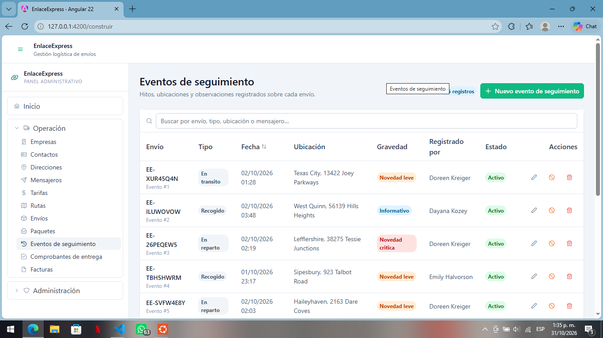

## ISS-13 · CRUD de Delivery_proofs

**Particularidades**

- El modelo admite **un comprobante por envío**: si intentas crear un segundo, el backend rechaza la petición y el mensaje llega como toast («No se pudo guardar»). No hace falta validarlo en la UI.
- `firma_url` y `foto_url` son texto libre. No hay subida de archivos en `api-backend.md`; si el backend la ofrece más adelante, estos dos campos se reemplazan por un componente de carga.
- La geolocalización son dos `p-inputnumber` con 7 decimales.

**Archivos de esta pantalla**

```bash
ng generate component features/delivery-proofs/delivery-proof-list --skip-tests --defaults
ng generate component features/delivery-proofs/delivery-proof-form --skip-tests --defaults
```

El CLI crea además `delivery-proof-list.spec.ts` y `delivery-proof-form.spec.ts` si no usas `--skip-tests`; las pruebas se tratan en 3.17.

`src/app/features/delivery-proofs/delivery-proof-api.ts`

```typescript
import { HttpClient } from '@angular/common/http';
import { Injectable, inject } from '@angular/core';
import { Observable, map } from 'rxjs';
import { environment } from '../../../environments/environment';
import { DeliveryProof, DeliveryProofPayload } from '../../core/models/delivery-proof.model';

/** /delivery_proofs — la lista llega en `{ delivery_proofs }` y el detalle en `{ delivery_proof }`. */
@Injectable({ providedIn: 'root' })
export class DeliveryProofApi {
  private readonly http = inject(HttpClient);
  private readonly base = `${environment.apiUrl}/delivery_proofs`;

  list(): Observable<DeliveryProof[]> {
    return this.http
      .get<{ delivery_proofs: DeliveryProof[] }>(this.base)
      .pipe(map((response) => response.delivery_proofs));
  }

  get(id: number): Observable<DeliveryProof> {
    return this.http
      .get<{ delivery_proof: DeliveryProof }>(`${this.base}/${id}`)
      .pipe(map((response) => response.delivery_proof));
  }

  create(payload: DeliveryProofPayload): Observable<DeliveryProof> {
    return this.http
      .post<{ delivery_proof: DeliveryProof }>(this.base, payload)
      .pipe(map((response) => response.delivery_proof));
  }

  update(id: number, payload: Partial<DeliveryProofPayload>): Observable<DeliveryProof> {
    return this.http
      .patch<{ delivery_proof: DeliveryProof }>(`${this.base}/${id}`, payload)
      .pipe(map((response) => response.delivery_proof));
  }

  replace(id: number, payload: DeliveryProofPayload): Observable<DeliveryProof> {
    return this.http
      .put<{ delivery_proof: DeliveryProof }>(`${this.base}/${id}`, payload)
      .pipe(map((response) => response.delivery_proof));
  }

  deactivate(id: number): Observable<unknown> {
    return this.http.patch(`${this.base}/${id}/deactivate`, {});
  }

  remove(id: number): Observable<unknown> {
    return this.http.delete(`${this.base}/${id}`);
  }
}
```

`src/app/features/delivery-proofs/delivery-proof-form/delivery-proof-form.ts`

```typescript
import { Component, effect, inject, input, output } from '@angular/core';
import { NonNullableFormBuilder, ReactiveFormsModule, Validators } from '@angular/forms';
import { ButtonModule } from 'primeng/button';
import { InputNumberModule } from 'primeng/inputnumber';
import { InputTextModule } from 'primeng/inputtext';
import { MessageModule } from 'primeng/message';
import { SelectModule } from 'primeng/select';
import { TextareaModule } from 'primeng/textarea';
import { DeliveryProof, DeliveryProofPayload, DeliveryProofStatus } from '../../../core/models/delivery-proof.model';
import { Shipment } from '../../../core/models/shipment.model';
import { toDateTimeInput, toNumberOrNull } from '../../../core/utils/form-values';

/**
 * Formulario de comprobante de entrega, reutilizado para crear y editar.
 *
 * No llama a la API: recibe `deliveryProof` (o `null` para crear) y emite el payload con
 * `saved`. El padre decide entre `POST` y `PATCH` y controla el diálogo.
 */
@Component({
  host: { class: 'block' },
  selector: 'app-delivery-proof-form',
  imports: [MessageModule, ReactiveFormsModule, ButtonModule, InputTextModule, TextareaModule, InputNumberModule, SelectModule],
  templateUrl: './delivery-proof-form.html',
  styleUrl: './delivery-proof-form.css',
})
export class DeliveryProofForm {
  /** Registro a editar. `null` deja el formulario en modo creación. */
  readonly deliveryProof = input<DeliveryProof | null>(null);

  readonly shipments = input<Shipment[]>([]);

  /** Cambia cada vez que el padre abre el diálogo: reinicia el formulario. */
  readonly resetKey = input(0);

  /** Petición en curso: deshabilita el botón y muestra su spinner. */
  readonly saving = input(false);

  readonly saved = output<DeliveryProofPayload>();
  readonly cancelled = output<void>();

  private readonly fb = inject(NonNullableFormBuilder);

  readonly estadoOptions: { label: string; value: DeliveryProofStatus }[] = [
    { label: 'Válida', value: 'valida' },
    { label: 'Observada', value: 'observada' },
    { label: 'Rechazada', value: 'rechazada' },
  ];

  readonly activeOptions = [
    { label: 'Activo', value: true },
    { label: 'Inactivo', value: false },
  ];

  readonly form = this.fb.group({
    envio_id: [null as number | null, [Validators.required]],
    fecha_hora: ['', [Validators.required]],
    receptor_nombre: ['', [Validators.required, Validators.maxLength(120)]],
    receptor_documento: ['', [Validators.maxLength(30)]],
    estado: ['valida' as DeliveryProofStatus, [Validators.required]],
    firma_url: ['', [Validators.maxLength(255)]],
    foto_url: ['', [Validators.maxLength(255)]],
    geolocalizacion_lat: [null as number | null, [Validators.min(-90), Validators.max(90)]],
    geolocalizacion_lng: [null as number | null, [Validators.min(-180), Validators.max(180)]],
    observaciones: ['', [Validators.maxLength(500)]],
    is_active: [true],
  });

  constructor() {
    effect(() => {
      const current = this.deliveryProof();
      // `resetKey` se lee a propósito: abrir de nuevo el diálogo debe vaciar el formulario.
      this.resetKey();

      this.form.reset({
        envio_id: current?.envio_id ?? null,
        fecha_hora: toDateTimeInput(current?.fecha_hora),
        receptor_nombre: current?.receptor_nombre ?? '',
        receptor_documento: current?.receptor_documento ?? '',
        estado: current?.estado ?? 'valida',
        firma_url: current?.firma_url ?? '',
        foto_url: current?.foto_url ?? '',
        geolocalizacion_lat: toNumberOrNull(current?.geolocalizacion_lat),
        geolocalizacion_lng: toNumberOrNull(current?.geolocalizacion_lng),
        observaciones: current?.observaciones ?? '',
        is_active: current?.is_active ?? true,
      });

      // `is_active` solo cambia con PATCH /deactivate: al editar no se ofrece.
      if (current) {
        this.form.controls.is_active.disable();
      } else {
        this.form.controls.is_active.enable();
      }
    });
  }

  submit(): void {
    if (this.form.invalid) {
      this.form.markAllAsTouched();
      return;
    }

    const value = this.form.getRawValue();
    const payload: DeliveryProofPayload = {
      envio_id: Number(value.envio_id),
      fecha_hora: new Date(value.fecha_hora).toISOString(),
      receptor_nombre: value.receptor_nombre.trim(),
      receptor_documento: value.receptor_documento.trim() || null,
      estado: value.estado,
      firma_url: value.firma_url.trim() || null,
      foto_url: value.foto_url.trim() || null,
      geolocalizacion_lat: value.geolocalizacion_lat,
      geolocalizacion_lng: value.geolocalizacion_lng,
      observaciones: value.observaciones.trim() || null,
    };

    // `is_active` solo se envía al crear: en edición lo gobierna /deactivate.
    this.saved.emit(this.deliveryProof() ? payload : { ...payload, is_active: value.is_active });
  }
}
```

`src/app/features/delivery-proofs/delivery-proof-form/delivery-proof-form.html`

```html
<form [formGroup]="form" (ngSubmit)="submit()" class="space-y-4">
  <div class="grid gap-4 sm:grid-cols-2">
    <div>
      <label for="delivery-proof-envio-id" class="mb-1 block text-sm font-medium text-slate-700">
        Envío <span class="text-red-500">*</span>
      </label>
      <p-select
        [fluid]="true"
        inputId="delivery-proof-envio-id"
        formControlName="envio_id"
        [options]="shipments()"
        optionLabel="numero_guia"
        optionValue="id"
        placeholder="Selecciona…"
        [filter]="true"
      />
      @if (form.controls.envio_id.touched && form.controls.envio_id.invalid) {
        <p-message severity="error" size="small" variant="simple" styleClass="mt-1">
          Este campo es obligatorio.
        </p-message>
      }
    </div>

    <div>
      <label for="delivery-proof-fecha-hora" class="mb-1 block text-sm font-medium text-slate-700">
        Fecha y hora de entrega <span class="text-red-500">*</span>
      </label>
      <input id="delivery-proof-fecha-hora" type="datetime-local" pInputText formControlName="fecha_hora" class="w-full" />
      @if (form.controls.fecha_hora.touched && form.controls.fecha_hora.invalid) {
        <p-message severity="error" size="small" variant="simple" styleClass="mt-1">
          Este campo es obligatorio.
        </p-message>
      }
    </div>

    <div>
      <label for="delivery-proof-receptor-nombre" class="mb-1 block text-sm font-medium text-slate-700">
        Nombre del receptor <span class="text-red-500">*</span>
      </label>
      <input
        id="delivery-proof-receptor-nombre"
        pInputText
        formControlName="receptor_nombre"
        placeholder="Juan Gómez"
        class="w-full"
      />
      @if (form.controls.receptor_nombre.touched && form.controls.receptor_nombre.invalid) {
        <p-message severity="error" size="small" variant="simple" styleClass="mt-1">
          Este campo es obligatorio (máximo 120 caracteres).
        </p-message>
      }
    </div>

    <div>
      <label for="delivery-proof-receptor-documento" class="mb-1 block text-sm font-medium text-slate-700">
        Documento del receptor
      </label>
      <input
        id="delivery-proof-receptor-documento"
        pInputText
        formControlName="receptor_documento"
        placeholder="1234567890"
        class="w-full"
      />
      @if (form.controls.receptor_documento.touched && form.controls.receptor_documento.invalid) {
        <p-message severity="error" size="small" variant="simple" styleClass="mt-1">
          Máximo 30 caracteres.
        </p-message>
      }
    </div>

    <div class="sm:col-span-2">
      <label for="delivery-proof-estado" class="mb-1 block text-sm font-medium text-slate-700">
        Estado del comprobante <span class="text-red-500">*</span>
      </label>
      <p-select
        [fluid]="true"
        inputId="delivery-proof-estado"
        formControlName="estado"
        [options]="estadoOptions"
        optionLabel="label"
        optionValue="value"
      />
      @if (form.controls.estado.touched && form.controls.estado.invalid) {
        <p-message severity="error" size="small" variant="simple" styleClass="mt-1">
          Este campo es obligatorio.
        </p-message>
      }
    </div>

    <div class="sm:col-span-2">
      <label for="delivery-proof-firma-url" class="mb-1 block text-sm font-medium text-slate-700">
        URL de la firma
      </label>
      <input
        id="delivery-proof-firma-url"
        pInputText
        formControlName="firma_url"
        placeholder="https://…"
        class="w-full"
      />
      @if (form.controls.firma_url.touched && form.controls.firma_url.invalid) {
        <p-message severity="error" size="small" variant="simple" styleClass="mt-1">
          Máximo 255 caracteres.
        </p-message>
      }
    </div>

    <div class="sm:col-span-2">
      <label for="delivery-proof-foto-url" class="mb-1 block text-sm font-medium text-slate-700">
        URL de la foto
      </label>
      <input
        id="delivery-proof-foto-url"
        pInputText
        formControlName="foto_url"
        placeholder="https://…"
        class="w-full"
      />
      @if (form.controls.foto_url.touched && form.controls.foto_url.invalid) {
        <p-message severity="error" size="small" variant="simple" styleClass="mt-1">
          Máximo 255 caracteres.
        </p-message>
      }
    </div>

    <div>
      <label for="delivery-proof-geolocalizacion-lat" class="mb-1 block text-sm font-medium text-slate-700">
        Latitud
      </label>
      <p-inputnumber
        [fluid]="true"
        inputId="delivery-proof-geolocalizacion-lat"
        formControlName="geolocalizacion_lat"
        mode="decimal"
        [min]="-90"
        [max]="90"
        [useGrouping]="false"
        [minFractionDigits]="0"
        [maxFractionDigits]="7"
      />
      @if (form.controls.geolocalizacion_lat.touched && form.controls.geolocalizacion_lat.invalid) {
        <p-message severity="error" size="small" variant="simple" styleClass="mt-1">
          Valor fuera de rango (mínimo -90, máximo 90).
        </p-message>
      }
    </div>

    <div>
      <label for="delivery-proof-geolocalizacion-lng" class="mb-1 block text-sm font-medium text-slate-700">
        Longitud
      </label>
      <p-inputnumber
        [fluid]="true"
        inputId="delivery-proof-geolocalizacion-lng"
        formControlName="geolocalizacion_lng"
        mode="decimal"
        [min]="-180"
        [max]="180"
        [useGrouping]="false"
        [minFractionDigits]="0"
        [maxFractionDigits]="7"
      />
      @if (form.controls.geolocalizacion_lng.touched && form.controls.geolocalizacion_lng.invalid) {
        <p-message severity="error" size="small" variant="simple" styleClass="mt-1">
          Valor fuera de rango (mínimo -180, máximo 180).
        </p-message>
      }
    </div>

    <div class="sm:col-span-2">
      <label for="delivery-proof-observaciones" class="mb-1 block text-sm font-medium text-slate-700">
        Observaciones
      </label>
      <textarea
        id="delivery-proof-observaciones"
        pTextarea
        formControlName="observaciones"
        rows="2"
        placeholder=""
        class="w-full"
      ></textarea>
      @if (form.controls.observaciones.touched && form.controls.observaciones.invalid) {
        <p-message severity="error" size="small" variant="simple" styleClass="mt-1">
          Máximo 500 caracteres.
        </p-message>
      }
    </div>

    <div class="sm:col-span-2">
      <label for="delivery-proof-is-active" class="mb-1 block text-sm font-medium text-slate-700">
        Estado
      </label>
      <p-select
        [fluid]="true"
        inputId="delivery-proof-is-active"
        formControlName="is_active"
        [options]="activeOptions"
        optionLabel="label"
        optionValue="value"
      />
      @if (deliveryProof()) {
        <p class="mt-1 text-xs text-slate-500">
          El estado de un registro existente solo cambia con la baja lógica.
        </p>
      }
    </div>
  </div>

  <div class="flex justify-end gap-2 border-t border-slate-100 pt-4">
    <button pButton type="button" severity="secondary" outlined (click)="cancelled.emit()">
      <span pButtonLabel>Cancelar</span>
    </button>
    <button pButton type="submit" [loading]="saving()">
      <i pButtonIcon class="pi pi-check"></i>
      <span pButtonLabel>Guardar</span>
    </button>
  </div>
</form>
```

`src/app/features/delivery-proofs/delivery-proof-list/delivery-proof-list.ts`

```typescript
import { DatePipe } from '@angular/common';
import { Component, computed, inject, signal } from '@angular/core';
import { ConfirmationService } from 'primeng/api';
import { ButtonModule } from 'primeng/button';
import { DialogModule } from 'primeng/dialog';
import { InputTextModule } from 'primeng/inputtext';
import { MessageModule } from 'primeng/message';
import { TableModule } from 'primeng/table';
import { TagModule } from 'primeng/tag';
import { TooltipModule } from 'primeng/tooltip';
import { forkJoin } from 'rxjs';
import { DeliveryProof, DeliveryProofPayload } from '../../../core/models/delivery-proof.model';
import { Shipment } from '../../../core/models/shipment.model';
import { NotificationService } from '../../../core/services/notification';
import { toApiMessage } from '../../../core/utils/api-error';
import { filterRows } from '../../../core/utils/filter-rows';
import { humanize } from '../../../core/utils/labels';
import { EmptyState } from '../../../shared/ui/empty-state/empty-state';
import { PageHeader } from '../../../shared/ui/page-header/page-header';
import { StatusTag } from '../../../shared/ui/status-tag/status-tag';
import { ShipmentApi } from '../../shipments/shipment-api';
import { DeliveryProofApi } from '../delivery-proof-api';
import { DeliveryProofForm } from '../delivery-proof-form/delivery-proof-form';

/**
 * Lista de comprobantes de entrega con todas las operaciones del CRUD.
 *
 * Todo el estado vive en signals: la tabla y los contadores se repintan solos y
 * `visibleRows` se recalcula solo cuando cambian `rows()` o `filter()`.
 */
@Component({
  host: { class: 'block' },
  selector: 'app-delivery-proof-list',
  imports: [ButtonModule, DatePipe, DeliveryProofForm, DialogModule, EmptyState, InputTextModule, MessageModule, PageHeader, StatusTag, TableModule, TagModule, TooltipModule],
  templateUrl: './delivery-proof-list.html',
  styleUrl: './delivery-proof-list.css',
})
export class DeliveryProofList {
  private readonly api = inject(DeliveryProofApi);
  private readonly shipmentApi = inject(ShipmentApi);
  private readonly notify = inject(NotificationService);
  private readonly confirmation = inject(ConfirmationService);

  /** Datos del backend (`GET /api/delivery_proofs`). */
  readonly rows = signal<DeliveryProof[]>([]);
  readonly shipments = signal<Shipment[]>([]);
  readonly loading = signal(true);
  readonly saving = signal(false);
  readonly error = signal<string | null>(null);
  readonly filter = signal('');

  /** Resultado de aplicar el buscador; `computed` lo memoriza. */
  readonly visibleRows = computed(() =>
    filterRows(this.rows(), this.filter(), (row) => [
      row.receptor_nombre,
      row.receptor_documento,
      row.estado,
      this.shipmentName()(row.envio_id),
    ]),
  );

  /** `id → numero_guia` para mostrar el nombre en la tabla sin buscar en el arreglo por cada fila. */
  readonly shipmentName = computed(() => {
    const names = new Map<number, string>(this.shipments().map((item) => [item.id, String(item.numero_guia)]));
    return (id: number | null | undefined) => (id == null ? '—' : (names.get(id) ?? `#${id}`));
  });

  readonly dialogVisible = signal(false);
  readonly editing = signal<DeliveryProof | null>(null);
  readonly resetKey = signal(0);

  readonly title = computed(() => (this.editing() ? 'Editar comprobante de entrega' : 'Nuevo comprobante de entrega'));

  protected readonly humanize = humanize;

  protected readonly estadoSeverity: Record<string, 'success' | 'info' | 'warn' | 'danger' | 'secondary'> = {
    valida: 'success',
    observada: 'warn',
    rechazada: 'danger',
  };

  constructor() {
    this.load();
  }

  /** `GET /api/delivery_proofs`: recarga la tabla y limpia el error anterior. */
  load(): void {
    this.loading.set(true);
    this.error.set(null);

    forkJoin({
      rows: this.api.list(),
      shipments: this.shipmentApi.list(),
    }).subscribe({
      next: ({ rows, shipments }) => {
        this.rows.set(rows);
        this.shipments.set(shipments);
        this.loading.set(false);
      },
      error: (error: unknown) => {
        this.rows.set([]);
        this.error.set(toApiMessage(error));
        this.loading.set(false);
      },
    });
  }

  openCreate(): void {
    this.editing.set(null);
    this.resetKey.update((key) => key + 1);
    this.dialogVisible.set(true);
  }

  openEdit(row: DeliveryProof): void {
    this.editing.set(row);
    this.resetKey.update((key) => key + 1);
    this.dialogVisible.set(true);
  }

  /**
   * El mismo manejador para crear y editar: `editing()` decide el verbo.
   * Tras el éxito se cierra el diálogo y se recarga (el backend es la verdad).
   */
  save(payload: DeliveryProofPayload): void {
    const current = this.editing();
    this.saving.set(true);

    const request = current ? this.api.update(current.id, payload) : this.api.create(payload);

    request.subscribe({
      next: () => {
        this.saving.set(false);
        this.dialogVisible.set(false);
        this.notify.success(current ? 'Comprobante de entrega actualizado' : 'Comprobante de entrega creado');
        this.load();
      },
      error: (error: unknown) => {
        this.saving.set(false);
        this.notify.error('No se pudo guardar', toApiMessage(error));
      },
    });
  }

  /** Baja lógica: `PATCH /:id/deactivate`. */
  deactivate(row: DeliveryProof): void {
    this.confirmation.confirm({
      header: 'Baja lógica',
      message: `¿Desactivar ${'el comprobante #' + row.id}? Su estado pasará a inactivo.`,
      icon: 'pi pi-exclamation-triangle',
      acceptLabel: 'Desactivar',
      rejectLabel: 'Cancelar',
      acceptButtonStyleClass: 'p-button-warning',
      accept: () => {
        this.api.deactivate(row.id).subscribe({
          next: () => {
            this.notify.warn('Comprobante de entrega desactivado');
            this.load();
          },
          error: (error: unknown) => {
            this.notify.error('No se pudo desactivar', toApiMessage(error));
          },
        });
      },
    });
  }

  /** Baja física: `DELETE /:id`. No se puede deshacer. */
  remove(row: DeliveryProof): void {
    this.confirmation.confirm({
      header: 'Eliminar definitivamente',
      message: `Se borrará ${'el comprobante #' + row.id} de la base de datos. Esta acción no se puede deshacer.`,
      icon: 'pi pi-trash',
      acceptLabel: 'Eliminar',
      rejectLabel: 'Cancelar',
      acceptButtonStyleClass: 'p-button-danger',
      accept: () => {
        this.api.remove(row.id).subscribe({
          next: () => {
            this.notify.success('Comprobante de entrega eliminado');
            this.load();
          },
          error: (error: unknown) => {
            this.notify.error('No se pudo eliminar', toApiMessage(error));
          },
        });
      },
    });
  }
}
```

`src/app/features/delivery-proofs/delivery-proof-list/delivery-proof-list.html`

```html
<app-page-header
  title="Comprobantes de entrega"
  subtitle="Evidencia de entrega de cada envío: receptor, firma, foto y geolocalización."
>
  <p-tag [value]="rows().length + ' registros'" severity="info" [rounded]="true" />
  <button pButton type="button" (click)="openCreate()">
    <i pButtonIcon class="pi pi-plus"></i>
    <span pButtonLabel>Nuevo comprobante de entrega</span>
  </button>
</app-page-header>

@if (error()) {
  <p-message severity="error" styleClass="mb-4 w-full">
    {{ error() }}
  </p-message>
}

<div class="rounded-xl border border-slate-200 bg-white">
  <p-table
    [value]="visibleRows()"
    [loading]="loading()"
    [paginator]="visibleRows().length > 10"
    [rows]="10"
    dataKey="id"
    tableStyleClass="min-w-3xl"
  >
    <ng-template #caption>
      <div class="flex items-center gap-2">
        <i class="pi pi-search text-slate-400"></i>
        <input
          pInputText
          type="search"
          aria-label="Buscar comprobantes de entrega"
          placeholder="Buscar por envío, receptor, documento o estado…"
          [value]="filter()"
          (input)="filter.set($any($event.target).value)"
          class="w-full"
        />
      </div>
      @if (filter()) {
        <p class="mt-2 text-xs text-slate-500">
          {{ visibleRows().length }} de {{ rows().length }} coinciden con «{{ filter() }}».
        </p>
      }
    </ng-template>

    <ng-template #header>
      <tr>
        <th>Envío</th>
        <th>Receptor</th>
        <th pSortableColumn="fecha_hora">
          <div class="flex items-center gap-1">Fecha <p-sort-icon field="fecha_hora" /></div>
        </th>
        <th>Comprobante</th>
        <th>Estado</th>
        <th class="w-40 text-right">Acciones</th>
      </tr>
    </ng-template>

    <ng-template #body let-row>
      <tr>
        <td>
          <p class="font-medium text-slate-800">{{ shipmentName()(row.envio_id) }}</p>
          <p class="text-xs text-slate-400">Comprobante #{{ row.id }}</p>
        </td>
        <td>
          <p class="text-sm text-slate-700">{{ row.receptor_nombre }}</p>
          <p class="text-xs text-slate-400">{{ row.receptor_documento || 'Sin documento' }}</p>
        </td>
        <td>
          <span class="text-sm text-slate-600">{{ row.fecha_hora | date: 'dd/MM/yyyy HH:mm' }}</span>
        </td>
        <td>
          <p-tag [value]="humanize(row.estado)" [severity]="estadoSeverity[row.estado]" [rounded]="true" />
        </td>
        <td>
          <app-status-tag [isActive]="row.is_active" />
        </td>
        <td>
          <div class="flex justify-end gap-1">
            <button
              pButton
              type="button"
              text
              rounded
              severity="secondary"
              icon="pi pi-pencil"
              aria-label="Editar comprobante de entrega"
              pTooltip="Editar"
              (click)="openEdit(row)"
            ></button>
            <button
              pButton
              type="button"
              text
              rounded
              severity="warn"
              icon="pi pi-ban"
              aria-label="Dar de baja"
              pTooltip="Baja lógica"
              (click)="deactivate(row)"
            ></button>
            <button
              pButton
              type="button"
              text
              rounded
              severity="danger"
              icon="pi pi-trash"
              aria-label="Eliminar comprobante de entrega"
              pTooltip="Eliminar"
              (click)="remove(row)"
            ></button>
          </div>
        </td>
      </tr>
    </ng-template>

    <ng-template #emptymessage>
      <tr>
        <td colspan="6">
          @if (filter()) {
            <app-empty-state
              icon="pi pi-search"
              title="Sin coincidencias"
              message="Ningún registro coincide con la búsqueda. Borra el filtro para ver todos."
            />
          } @else {
            <app-empty-state
              icon="pi pi-check-square"
              title="Sin registros"
              message="Crea el primero con el botón «Nuevo comprobante de entrega» o ejecuta el seeder del backend."
            />
          }
        </td>
      </tr>
    </ng-template>
  </p-table>
</div>

<p-dialog
  [visible]="dialogVisible()"
  (visibleChange)="dialogVisible.set($event)"
  [header]="title()"
  [modal]="true"
  [draggable]="false"
  [resizable]="false"
  [dismissableMask]="true"
  styleClass="w-full max-w-3xl mx-4"
>
  <app-delivery-proof-form
    [deliveryProof]="editing()"
    [shipments]="shipments()"
    [saving]="saving()"
    [resetKey]="resetKey()"
    (saved)="save($event)"
    (cancelled)="dialogVisible.set(false)"
  />
</p-dialog>
```

Los dos `.css` (`delivery-proof-form.css`, `delivery-proof-list.css`) quedan sin reglas, como los de `layout/` y `shared/ui/`.

### 3.15 Rutas de Angular

Todas son hijas de `Shell`, así que el Header, el Aside y el Footer se montan una sola vez y solo cambia el contenido central. `app.routes.ts` conserva `construir`, la redirección de `''` a `envios` y el comodín, tal como quedó en ISS-02; **solo cambia la lista `children`**:

`src/app/app.routes.ts`

```typescript
import { Routes } from '@angular/router';

export const routes: Routes = [
  {
    path: 'construir',
    loadComponent: () =>
      import('./features/construir/construir').then((m) => m.Construir),
  },
  {
    path: '',
    loadComponent: () => import('./layout/shell/shell').then((m) => m.Shell),
    children: [
      // La primera pantalla de negocio es la redirección por defecto.
      // ISS-07 añadirá aquí un resumen logístico derivado de datos permitidos.
      { path: '', pathMatch: 'full', redirectTo: 'envios' },

      {
        path: 'empresas',
        title: 'Empresas · EnlaceExpress',
        loadComponent: () =>
          import('./features/companies/company-list/company-list').then((m) => m.CompanyList),
      },
      {
        path: 'contactos',
        title: 'Contactos · EnlaceExpress',
        loadComponent: () =>
          import('./features/contacts/contact-list/contact-list').then((m) => m.ContactList),
      },
      {
        path: 'direcciones',
        title: 'Direcciones · EnlaceExpress',
        loadComponent: () =>
          import('./features/addresses/address-list/address-list').then((m) => m.AddressList),
      },
      {
        path: 'mensajeros',
        title: 'Mensajeros · EnlaceExpress',
        loadComponent: () =>
          import('./features/messengers/messenger-list/messenger-list').then((m) => m.MessengerList),
      },
      {
        path: 'tarifas',
        title: 'Tarifas · EnlaceExpress',
        loadComponent: () =>
          import('./features/rates/rate-list/rate-list').then((m) => m.RateList),
      },
      {
        path: 'rutas',
        title: 'Rutas · EnlaceExpress',
        loadComponent: () =>
          import('./features/routes/route-list/route-list').then((m) => m.RouteList),
      },
      {
        path: 'envios',
        title: 'Envíos · EnlaceExpress',
        loadComponent: () =>
          import('./features/shipments/shipment-list/shipment-list').then((m) => m.ShipmentList),
      },
      {
        path: 'paquetes',
        title: 'Paquetes · EnlaceExpress',
        loadComponent: () =>
          import('./features/packages/package-list/package-list').then((m) => m.PackageList),
      },
      {
        path: 'eventos-seguimiento',
        title: 'Eventos de seguimiento · EnlaceExpress',
        loadComponent: () =>
          import('./features/tracking-events/tracking-event-list/tracking-event-list').then((m) => m.TrackingEventList),
      },
      {
        path: 'comprobantes-entrega',
        title: 'Comprobantes de entrega · EnlaceExpress',
        loadComponent: () =>
          import('./features/delivery-proofs/delivery-proof-list/delivery-proof-list').then((m) => m.DeliveryProofList),
      },
      {
        path: 'facturas',
        title: 'Facturas · EnlaceExpress',
        loadComponent: () =>
          import('./features/invoices/invoice-list/invoice-list').then((m) => m.InvoiceList),
      },
    ],
  },
  { path: '**', redirectTo: 'construir' },
];
```

`loadComponent` mantiene cada pantalla en su propio chunk diferido: el bundle inicial no crece al añadir las 11.

### 3.16 Menú: solo se conectan las entradas que ya existen

El menú de `Construir` (ISS-01B) ya define la estructura: grupo **Operación** con las 11 entidades y grupo **Administración** con 6. Esa estructura, sus etiquetas y sus iconos **no se cambian**. En `Shell` solo se sustituye el menú provisional de ISS-02 (`Envíos` y `Prototipo`) por el mismo grupo *Operación*, con `routerLink` en lugar de `command`:

`src/app/layout/shell/shell.ts` — únicamente el arreglo `items`:

```typescript
  /** Mismas entradas, etiquetas e iconos que el menú de `Construir`; aquí navegan de verdad. */
  readonly items: MenuItem[] = [
    {
      label: 'Operación',
      icon: 'pi pi-truck',
      items: [
        { label: 'Empresas', icon: 'pi pi-building', routerLink: '/empresas' },
        { label: 'Contactos', icon: 'pi pi-id-card', routerLink: '/contactos' },
        { label: 'Direcciones', icon: 'pi pi-map-marker', routerLink: '/direcciones' },
        { label: 'Mensajeros', icon: 'pi pi-send', routerLink: '/mensajeros' },
        { label: 'Tarifas', icon: 'pi pi-dollar', routerLink: '/tarifas' },
        { label: 'Rutas', icon: 'pi pi-map', routerLink: '/rutas' },
        { label: 'Envíos', icon: 'pi pi-box', routerLink: '/envios' },
        { label: 'Paquetes', icon: 'pi pi-inbox', routerLink: '/paquetes' },
        { label: 'Eventos de seguimiento', icon: 'pi pi-history', routerLink: '/eventos-seguimiento' },
        { label: 'Comprobantes de entrega', icon: 'pi pi-check-square', routerLink: '/comprobantes-entrega' },
        { label: 'Facturas', icon: 'pi pi-file', routerLink: '/facturas' },
      ],
    },
    { label: 'Prototipo', icon: 'pi pi-desktop', routerLink: '/construir' },
  ];
```

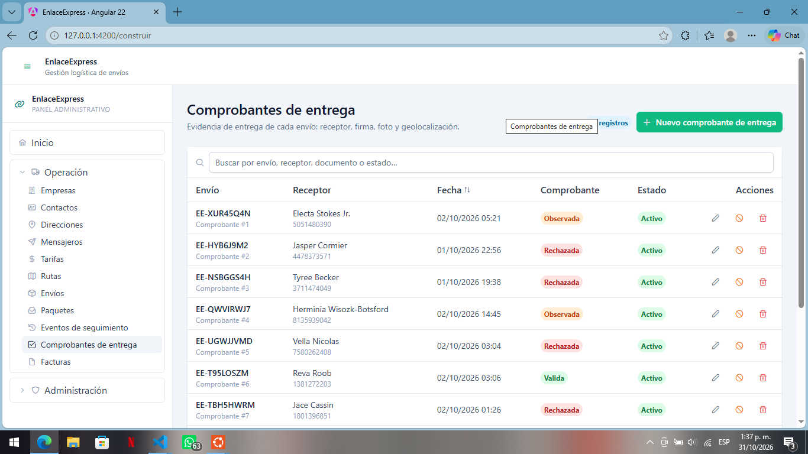

Las peticiones se simulan con `HttpTestingController`: se verifica el verbo, la URL y el cuerpo, sin backend ni base de datos. Se escribe el juego completo para **Empresas** (la entidad de referencia); en las otras diez se copian los mismos casos cambiando clase, URL y payload.

| Archivo | Qué comprueba | Casos |
|---|---|---|
| `core/utils/filter-rows.spec.ts` | Copia sin término, mayúsculas, null, sin coincidencias, recorte | 5 |
| `core/utils/form-values.spec.ts` | Normalización de DECIMAL y de fechas | 3 |
| `features/companies/company-form/company-form.spec.ts` | Validación, payload de alta, modo edición, `resetKey` | 4 |
| `features/companies/company-list/company-list.spec.ts` | Carga, error, filtro, crear, editar, baja lógica, baja física | 7 |
| `features/<recurso>/<recurso>-form` y `-list` (resto) | Réplica de los dos anteriores | 4 + 7 por entidad |

`src/app/features/companies/company-form/company-form.spec.ts`

```typescript
import { TestBed } from '@angular/core/testing';
import { Company, CompanyPayload } from '../../../core/models/company.model';
import { CompanyForm } from './company-form';

const EMPRESA: Company = {
  id: 1,
  nit: '900123456',
  razon_social: 'Tienda La Esquina',
  contacto_principal_id: null,
  direccion_facturacion_id: null,
  is_active: true,
};

describe('CompanyForm', () => {
  beforeEach(async () => {
    await TestBed.configureTestingModule({ imports: [CompanyForm] }).compileComponents();
  });

  async function crearFormulario(empresa: Company | null = null) {
    const fixture = TestBed.createComponent(CompanyForm);
    fixture.componentRef.setInput('company', empresa);
    await fixture.whenStable();

    const emitidos: CompanyPayload[] = [];
    fixture.componentInstance.saved.subscribe((payload) => emitidos.push(payload));
    return { fixture, formulario: fixture.componentInstance, emitidos };
  }

  it('should not emit while NIT and razón social are empty', async () => {
    const { formulario, emitidos } = await crearFormulario();

    formulario.submit();

    expect(formulario.form.invalid).toBe(true);
    expect(emitidos).toEqual([]);
  });

  it('should emit a trimmed payload with is_active when creating', async () => {
    const { formulario, emitidos } = await crearFormulario();

    formulario.form.patchValue({ nit: ' 900111222 ', razon_social: 'Nueva SAS' });
    formulario.submit();

    expect(emitidos).toEqual([{ nit: '900111222', razon_social: 'Nueva SAS', is_active: true }]);
  });

  it('should load the company, disable is_active and omit it when editing', async () => {
    const { formulario, emitidos } = await crearFormulario(EMPRESA);

    expect(formulario.form.controls.razon_social.value).toBe('Tienda La Esquina');
    expect(formulario.form.controls.is_active.disabled).toBe(true);

    formulario.form.patchValue({ razon_social: 'La Esquina SAS' });
    formulario.submit();

    expect(emitidos).toEqual([
      {
        nit: '900123456',
        razon_social: 'La Esquina SAS',
        contacto_principal_id: null,
        direccion_facturacion_id: null,
      },
    ]);
  });

  it('should clear the form when resetKey changes', async () => {
    const { fixture, formulario } = await crearFormulario();

    formulario.form.patchValue({ razon_social: 'Borrador' });
    fixture.componentRef.setInput('resetKey', 1);
    await fixture.whenStable();

    expect(formulario.form.controls.razon_social.value).toBe('');
  });
});
```

`src/app/features/companies/company-list/company-list.spec.ts`

```typescript
import { provideHttpClient } from '@angular/common/http';
import { HttpTestingController, provideHttpClientTesting } from '@angular/common/http/testing';
import { TestBed } from '@angular/core/testing';
import { ConfirmationService, MessageService } from 'primeng/api';
import { vi } from 'vitest';
import { environment } from '../../../../environments/environment';
import { Company } from '../../../core/models/company.model';
import { CompanyList } from './company-list';

const API = environment.apiUrl;
const EMPRESAS: Company[] = [
  { id: 1, nit: '900123456', razon_social: 'Tienda La Esquina', contacto_principal_id: null, direccion_facturacion_id: null, is_active: true },
  { id: 2, nit: '900987654', razon_social: 'Distribuidora La Costa', contacto_principal_id: null, direccion_facturacion_id: null, is_active: true },
];

describe('CompanyList', () => {
  let http: HttpTestingController;

  beforeEach(async () => {
    await TestBed.configureTestingModule({
      imports: [CompanyList],
      providers: [provideHttpClient(), provideHttpClientTesting(), MessageService, ConfirmationService],
    }).compileComponents();
    http = TestBed.inject(HttpTestingController);
  });

  afterEach(() => http.verify());

  /** `load()` pide las tres tablas en paralelo (forkJoin): hay que responder las tres. */
  function responderCarga(empresas: Company[] = EMPRESAS): void {
    http.expectOne(`${API}/companies`).flush({ companies: empresas });
    http.expectOne(`${API}/contacts`).flush({ contacts: [] });
    http.expectOne(`${API}/address`).flush({ addresses: [] });
  }

  async function crearLista() {
    const fixture = TestBed.createComponent(CompanyList);
    responderCarga(); // el constructor ya lanzó load()
    await fixture.whenStable();
    return { fixture, lista: fixture.componentInstance };
  }

  function aceptarConfirmacion(): void {
    const confirmation = TestBed.inject(ConfirmationService);
    // `confirm` devuelve el servicio (es encadenable): el espía debe devolverlo.
    vi.spyOn(confirmation, 'confirm').mockImplementation((datos) => {
      datos.accept?.();
      return confirmation;
    });
  }

  it('should load the companies on creation', async () => {
    const { lista } = await crearLista();

    expect(lista.rows()).toEqual(EMPRESAS);
    expect(lista.loading()).toBe(false);
    expect(lista.error()).toBeNull();
  });

  it('should show the backend error and clear the rows when the load fails', async () => {
    const fixture = TestBed.createComponent(CompanyList);
    http
      .expectOne(`${API}/companies`)
      .flush({ error: 'Missing Bearer token' }, { status: 401, statusText: 'Unauthorized' });
    await fixture.whenStable();

    expect(fixture.componentInstance.rows()).toEqual([]);
    expect(fixture.componentInstance.error()).toBe('Missing Bearer token');
  });

  it('should filter locally without calling the API', async () => {
    const { lista } = await crearLista();

    lista.filter.set('costa');

    expect(lista.visibleRows()).toEqual([EMPRESAS[1]]);
  });

  it('should POST a new company and reload', async () => {
    const { lista } = await crearLista();

    lista.openCreate();
    lista.save({ nit: '900555666', razon_social: 'Nueva SAS', is_active: true });

    const alta = http.expectOne(`${API}/companies`);
    expect(alta.request.method).toBe('POST');
    expect(alta.request.body).toEqual({ nit: '900555666', razon_social: 'Nueva SAS', is_active: true });
    alta.flush({ companies: EMPRESAS[0] });

    responderCarga();
  });

  it('should PATCH the edited company and send no is_active', async () => {
    const { lista } = await crearLista();

    lista.openEdit(EMPRESAS[0]);
    lista.save({ nit: '900123456', razon_social: 'La Esquina SAS' });

    const cambio = http.expectOne(`${API}/companies/1`);
    expect(cambio.request.method).toBe('PATCH');
    expect(cambio.request.body).toEqual({ nit: '900123456', razon_social: 'La Esquina SAS' });
    cambio.flush({ companies: EMPRESAS[0] });

    responderCarga();
  });

  it('should call deactivate after the confirmation is accepted', async () => {
    const { lista } = await crearLista();
    aceptarConfirmacion();

    lista.deactivate(EMPRESAS[0]);

    const baja = http.expectOne(`${API}/companies/1/deactivate`);
    expect(baja.request.method).toBe('PATCH');
    baja.flush({ message: 'Company deactivated' });

    responderCarga(EMPRESAS.slice(1));
  });

  it('should DELETE after the confirmation is accepted', async () => {
    const { lista } = await crearLista();
    aceptarConfirmacion();

    lista.remove(EMPRESAS[0]);

    const borrado = http.expectOne(`${API}/companies/1`);
    expect(borrado.request.method).toBe('DELETE');
    borrado.flush(null, { status: 204, statusText: 'No Content' });

    responderCarga(EMPRESAS.slice(1));
  });
});
```

## Fase II: Auth con RBAC — ISS-14 — Autenticación JWT, perfil y permisos efectivos

### 4.2 Activar Fase II

En ambos archivos de entorno:

```typescript
export const environment = {
  production: false, // true en environment.ts
  appName: 'EnlaceExpress',
  apiUrl: 'http://localhost:4000/api',
  requireAuth: true,
};
```

### 14.3 Modelos de sesión

```bash
cat > src/app/core/models/auth.model.ts <<'EOF'
import { HttpMethod } from './resource.model';
import { User } from './user.model';

/** POST /api/sesion/login — `identifier` acepta username o email. */
export interface LoginRequest {
  identifier: string;
  password: string;
}

/** Respuesta de login y refresh: SOLO el par de tokens. */
export interface SessionTokens {
  access_token: string;
  token_type: 'Bearer';
  expires_in: number;
  refresh_token: string;
  refresh_expires_in: number;
}

/** GET /api/sesion/perfil */
export interface ProfilePayload {
  user: User;
}

/** Una fila de role_users → roles → resource_roles → resources (todo activo). */
export interface EffectivePermission {
  resource_id: number;
  method: HttpMethod;
  path: string;
  description: string | null;
  role_id: number;
  role_name: string;
}

/** GET /api/permisos · GET /api/usuarios/:id/permisos */
export interface PermissionsPayload {
  permissions: EffectivePermission[];
}

/** Estado compuesto que mantiene SessionStore. */
export interface AccessPayload {
  user: User;
  permissions: EffectivePermission[];
}
EOF
```

### 14.3A Generar interceptores funcionales

```bash
ng generate interceptor core/interceptors/auth --functional --skip-tests --defaults
ng generate interceptor core/interceptors/error --functional --skip-tests --defaults
```

Generan `auth-interceptor.ts` y `error-interceptor.ts`. Reemplaza el passthrough del CLI por la implementación de esta ISS antes de registrarlos. No se usa ng generate service para interceptores. 

### 14.4 En app.config.ts, añade imports encima de export const appConfig:

```typescript
import { provideHttpClient, withInterceptors } from '@angular/common/http';
import { authInterceptor } from './core/interceptors/auth-interceptor';
import { errorInterceptor } from './core/interceptors/error-interceptor';
```

Dentro de `providers`, debajo de `provideBrowserGlobalErrorListeners():`

```typescript
// El orden importa: auth añade el Bearer y reintenta; error traduce fallos.
provideHttpClient(withInterceptors([authInterceptor, errorInterceptor])),
```

```
Componente → authInterceptor (añade token, reintenta 401)
           → errorInterceptor (toast de 403/500/offline)
           → HttpBackend → Express
```

### 14.5 SessionStore

```bash
cat > src/app/core/services/session-store.ts <<'EOF'
import { Injectable, computed, signal } from '@angular/core';
import { environment } from '../../../environments/environment';
import { AccessPayload, EffectivePermission, SessionTokens } from '../models/auth.model';
import { HttpMethod, Resource } from '../models/resource.model';
import { Role } from '../models/role.model';
import { User } from '../models/user.model';

const STORAGE_KEY = 'storelab.session.v1';

interface PersistedSession {
  accessToken: string;
  refreshToken: string;
  user: User | null;
  permissions: EffectivePermission[];
}

/**
 * Única fuente de verdad de la sesión en el cliente.
 * Todo se expone como signals de solo lectura y se deriva con computed().
 *
 * Contrato del backend `app-storelab-express-ii`:
 *  - `POST /api/sesion/login`  → solo tokens.
 *  - `GET  /api/sesion/perfil` → `{ user }`.
 *  - `GET  /api/permisos`      → `{ permissions: EffectivePermission[] }`.
 *
 * Seguridad: el backend sigue siendo la autoridad. `can()` solo decide qué
 * pintar en la UI; aunque se fuerce el menú, Express responde 401/403.
 */
@Injectable({ providedIn: 'root' })
export class SessionStore {
  /**
   * Mitad frontal del interruptor de fases.
   * - `false`: guards permisivos, directiva siempre visible, sin `Bearer`.
   * - `true`: Fase II. Debe emparejarse con `AUTH_ENABLED=true` en el backend.
   * La autoridad real sigue siendo Express; esto solo decide qué pintar.
   */
  readonly authEnabled = environment.requireAuth;

  private readonly _accessToken = signal<string | null>(null);
  private readonly _refreshToken = signal<string | null>(null);
  private readonly _user = signal<User | null>(null);
  private readonly _permissions = signal<EffectivePermission[]>([]);

  readonly accessToken = this._accessToken.asReadonly();
  readonly refreshToken = this._refreshToken.asReadonly();
  readonly user = this._user.asReadonly();
  readonly permissions = this._permissions.asReadonly();

  readonly isAuthenticated = computed(() => this._accessToken() !== null);

  /** Roles derivados de los permisos efectivos (role_name único). */
  readonly roleNames = computed(() =>
    [...new Set(this._permissions().map((permission) => permission.role_name))].sort(),
  );

  /**
   * `Role[]` derivado para las plantillas que ya consumían `session.roles()`.
   * No hay endpoint de roles propio del usuario: el rol llega en cada permiso.
   */
  readonly roles = computed<Role[]>(() => {
    const byId = new Map<number, Role>();
    for (const permission of this._permissions()) {
      if (!byId.has(permission.role_id)) {
        byId.set(permission.role_id, {
          id: permission.role_id,
          name: permission.role_name,
          description: null,
          status: 'active',
        });
      }
    }
    return [...byId.values()];
  });

  /**
   * `Resource[]` derivado de los permisos efectivos.
   * Se conserva la forma de `Resource` para reutilizar tablas y `can()`.
   */
  readonly resources = computed<Resource[]>(() =>
    this._permissions().map((permission) => ({
      id: permission.resource_id,
      method: permission.method,
      path: permission.path,
      description: permission.description,
      status: 'active' as const,
    })),
  );

  /** Set de strings "MÉTODO /api/ruta" para consultas O(1) en la UI. */
  readonly permissionsIndex = computed(
    () => new Set(this._permissions().map((item) => `${item.method} ${item.path}`)),
  );

  readonly permissionCount = computed(() => this._permissions().length);

  constructor() {
    this.restore();
  }

  /** Login y refresh comparten la misma forma: solo tokens. */
  setTokens(tokens: SessionTokens): void {
    this._accessToken.set(tokens.access_token);
    this._refreshToken.set(tokens.refresh_token);
    this.persist();
  }

  /** Perfil + permisos efectivos (login y "Actualizar permisos"). */
  setAccess(access: AccessPayload): void {
    this._user.set(access.user);
    this._permissions.set(access.permissions ?? []);
    this.persist();
  }

  clear(): void {
    this._accessToken.set(null);
    this._refreshToken.set(null);
    this._user.set(null);
    this._permissions.set([]);
    try {
      localStorage.removeItem(STORAGE_KEY);
    } catch {
      /* almacenamiento no disponible */
    }
  }

  /**
   * ¿La sesión tiene un permiso concreto?
   * - Sin auth (fase I) siempre permite.
   * - Compara `MÉTODO` y `path`; soporta `:id` del catálogo Resource.
   */
  can(method: HttpMethod | string, path: string): boolean {
    if (!this.authEnabled) {
      return true;
    }
    const verb = method.toUpperCase();
    const requestPath = path.split('?')[0];
    return this._permissions().some(
      (permission) =>
        permission.method === verb && pathMatches(permission.path, requestPath),
    );
  }

  canPermission(permission: string): boolean {
    if (!this.authEnabled) {
      return true;
    }
    const separator = permission.indexOf(' ');
    if (separator < 0) {
      return false;
    }
    return this.can(permission.slice(0, separator), permission.slice(separator + 1));
  }

  hasRole(name: string): boolean {
    return this.roleNames().includes(name.toUpperCase());
  }

  private restore(): void {
    try {
      const raw = localStorage.getItem(STORAGE_KEY);
      if (!raw) {
        return;
      }
      const data = JSON.parse(raw) as PersistedSession;
      // Sesiones guardadas por una versión anterior (roles/resources) no sirven.
      if (!Array.isArray(data.permissions)) {
        this.clear();
        return;
      }
      this._accessToken.set(data.accessToken ?? null);
      this._refreshToken.set(data.refreshToken ?? null);
      this._user.set(data.user ?? null);
      this._permissions.set(data.permissions ?? []);
    } catch {
      this.clear();
    }
  }

  private persist(): void {
    const data: PersistedSession = {
      accessToken: this._accessToken() ?? '',
      refreshToken: this._refreshToken() ?? '',
      user: this._user(),
      permissions: this._permissions(),
    };
    try {
      localStorage.setItem(STORAGE_KEY, JSON.stringify(data));
    } catch {
      /* modo privado o cuota llena: la sesión sigue en memoria */
    }
  }
}

/** `/api/usuarios/:id` debe reconocer `/api/usuarios/7`. */
function pathMatches(pattern: string, path: string): boolean {
  const escaped = pattern
    .replace(/[.*+?^${}()|[\]\\]/g, '\\$&')
    .replace(/\/:[^/]+/g, '/[^/]+');
  return new RegExp(`^${escaped}$`).test(path);
}
EOF
```

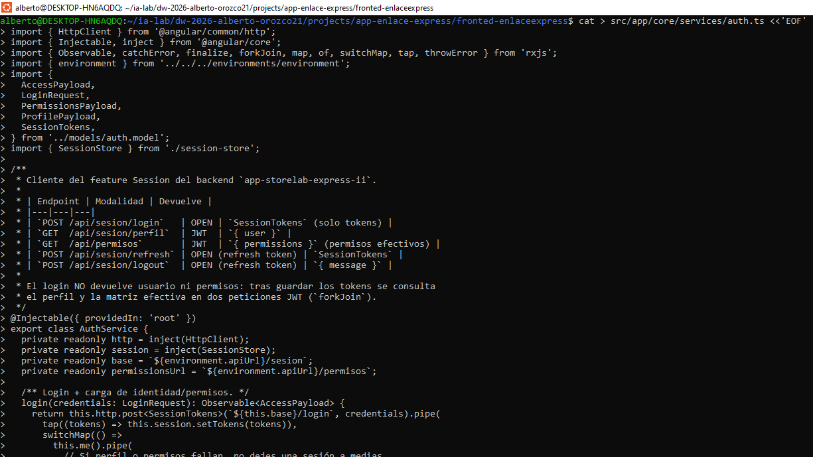

El archivo real incluye `restore()` y `persist()` completos. Lo esencial: persistimos permissions, no roles ni resources, porque los últimos se derivan con computed.

### 14.6 AuthService

```bash
cat > src/app/core/services/auth.ts <<'EOF'
import { HttpClient } from '@angular/common/http';
import { Injectable, inject } from '@angular/core';
import { Observable, catchError, finalize, forkJoin, map, of, switchMap, tap, throwError } from 'rxjs';
import { environment } from '../../../environments/environment';
import {
  AccessPayload,
  LoginRequest,
  PermissionsPayload,
  ProfilePayload,
  SessionTokens,
} from '../models/auth.model';
import { SessionStore } from './session-store';

/**
 * Cliente del feature Session del backend `app-storelab-express-ii`.
 *
 * | Endpoint | Modalidad | Devuelve |
 * |---|---|---|
 * | `POST /api/sesion/login`   | OPEN | `SessionTokens` (solo tokens) |
 * | `GET  /api/sesion/perfil`  | JWT  | `{ user }` |
 * | `GET  /api/permisos`       | JWT  | `{ permissions }` (permisos efectivos) |
 * | `POST /api/sesion/refresh` | OPEN (refresh token) | `SessionTokens` |
 * | `POST /api/sesion/logout`  | OPEN (refresh token) | `{ message }` |
 *
 * El login NO devuelve usuario ni permisos: tras guardar los tokens se consulta
 * el perfil y la matriz efectiva en dos peticiones JWT (`forkJoin`).
 */
@Injectable({ providedIn: 'root' })
export class AuthService {
  private readonly http = inject(HttpClient);
  private readonly session = inject(SessionStore);
  private readonly base = `${environment.apiUrl}/sesion`;
  private readonly permissionsUrl = `${environment.apiUrl}/permisos`;

  /** Login + carga de identidad/permisos. */
  login(credentials: LoginRequest): Observable<AccessPayload> {
    return this.http.post<SessionTokens>(`${this.base}/login`, credentials).pipe(
      tap((tokens) => this.session.setTokens(tokens)),
      switchMap(() =>
        this.me().pipe(
          // Si perfil o permisos fallan, no dejes una sesión a medias.
          catchError((error: unknown) => {
            this.session.clear();
            return throwError(() => error);
          }),
        ),
      ),
    );
  }

  /**
   * `GET /api/sesion/perfil` + `GET /api/permisos`.
   * Se usa tras el login y en "Actualizar permisos" del menú.
   */
  me(): Observable<AccessPayload> {
    return forkJoin({
      profile: this.http.get<ProfilePayload>(`${this.base}/perfil`),
      permissions: this.http.get<PermissionsPayload>(this.permissionsUrl),
    }).pipe(
      map(({ profile, permissions }) => ({
        user: profile.user,
        permissions: permissions.permissions,
      })),
      tap((access) => this.session.setAccess(access)),
    );
  }

  /** Renueva el par de tokens; el refresh token anterior queda rotado. */
  refresh(): Observable<SessionTokens> {
    const refresh_token = this.session.refreshToken();
    if (!refresh_token) {
      return throwError(() => new Error('No hay refresh token en la sesión'));
    }
    return this.http
      .post<SessionTokens>(`${this.base}/refresh`, { refresh_token })
      .pipe(tap((tokens) => this.session.setTokens(tokens)));
  }

  /**
   * Cierra la sesión del refresh token presentado. Siempre limpia el estado
   * local, aunque el backend no responda (por ejemplo, si ya expiró).
   */
  logout(): Observable<unknown> {
    const refresh_token = this.session.refreshToken();
    return this.http.post(`${this.base}/logout`, { refresh_token }).pipe(
      catchError(() => of(null)),
      finalize(() => this.session.clear()),
    );
  }
}
EOF
```

`switchMap` tras el login

tap guarda los tokens, pero `switchMap(() => this.me())` encadena la carga del perfil y los permisos. `login()` no emite hasta que `me()` responde: el componente navega al dashboard con la sesión completa, sin parpadeos ni menús vacíos.

### 14.7 Interceptor con refresh single-flight

```bash
cat > src/app/core/interceptors/auth-interceptor.ts <<'EOF'
import { HttpErrorResponse, HttpInterceptorFn } from '@angular/common/http';
import { inject } from '@angular/core';
import { Router } from '@angular/router';
import { Observable, catchError, finalize, shareReplay, switchMap, throwError } from 'rxjs';
import { environment } from '../../../environments/environment';
import { SessionTokens } from '../models/auth.model';
import { AuthService } from '../services/auth';
import { SessionStore } from '../services/session-store';

/**
 * Una sola renovación en vuelo para todas las peticiones concurrentes.
 * Si 3 peticiones reciben 401 a la vez, solo se llama una vez a /sesion/refresh.
 */
let refreshInFlight: Observable<SessionTokens> | null = null;

export const authInterceptor: HttpInterceptorFn = (req, next) => {
  const session = inject(SessionStore);
  const auth = inject(AuthService);
  const router = inject(Router);

  // OPEN: login, refresh y logout llevan credencial en el cuerpo, no Bearer.
  const isPublicAuthCall =
    req.url.includes('/sesion/login') ||
    req.url.includes('/sesion/refresh') ||
    req.url.includes('/sesion/logout');

  const accessToken = session.accessToken();

  const request =
    accessToken && !isPublicAuthCall
      ? req.clone({ setHeaders: { Authorization: `Bearer ${accessToken}` } })
      : req;

  return next(request).pipe(
    catchError((error: unknown) => {
      if (!(error instanceof HttpErrorResponse) || error.status !== 401 || isPublicAuthCall) {
        return throwError(() => error);
      }

      // Fase I: no hay refresh ni login; se propaga el error tal cual.
      if (!environment.requireAuth) {
        return throwError(() => error);
      }

      if (!session.refreshToken()) {
        redirectToLogin(session, router);
        return throwError(() => error);
      }

      refreshInFlight ??= auth.refresh().pipe(
        catchError((refreshError: unknown) => {
          redirectToLogin(session, router);
          return throwError(() => refreshError);
        }),
        finalize(() => {
          refreshInFlight = null;
        }),
        shareReplay({ bufferSize: 1, refCount: false }),
      );

      // Reintenta la petición original con el access renovado.
      return refreshInFlight.pipe(
        switchMap(() => {
          const renewed = session.accessToken();
          const retried = req.clone({
            setHeaders: renewed ? { Authorization: `Bearer ${renewed}` } : {},
          });
          return next(retried);
        }),
      );
    }),
  );
};

function redirectToLogin(session: SessionStore, router: Router): void {
  session.clear();
  const returnUrl = router.url.startsWith('/login') ? '/dashboard' : router.url;
  void router.navigate(['/login'], { queryParams: { returnUrl } });
}
EOF
```

### 14.8 Login

```bash
ng generate component features/auth/login --skip-tests --defaults
```

```typescript
readonly form = this.fb.group({
  identifier: ['', [Validators.required]],
  password: ['', [Validators.required]],
});

submit(): void {
  if (this.form.invalid) {
    this.form.markAllAsTouched();
    return;
  }
  this.loading.set(true);
  this.error.set(null);

  const { identifier, password } = this.form.getRawValue();
  // `identifier` acepta username o email; el backend deduce device_info del User-Agent.
  this.auth.login({ identifier, password }).subscribe({
    next: () => {
      const requested = this.route.snapshot.queryParamMap.get('returnUrl') ?? '/dashboard';
      const returnUrl =
        requested.startsWith('/') && !requested.startsWith('/login') ? requested : '/dashboard';
      void this.router.navigateByUrl(returnUrl);
    },
    error: (error: unknown) => {
      this.loading.set(false);
      this.error.set(toApiMessage(error));
    },
  });
}
```

returnUrl: abrir la URL pedida después del login
Si el usuario entra a /ventas sin sesión, authGuard lo manda a /login?returnUrl=/ventas. El login lee ese parámetro y navega ahí. La validación startsWith('/') evita open redirects a dominios externos.

### 14.9 Perfil y logout

```bash
ng generate component features/auth/profile --skip-tests --defaults
ng generate component features/auth/forbidden --skip-tests --defaults
```

Profile muestra usuario, roles y permisos efectivos, y permite:

- Refrescar desde el backend → AuthService.me() (/perfil + /permisos).
- Salir → POST /api/sesion/logout y limpieza local.

```typescript
refresh(): void {
  this.refreshing.set(true);
  this.auth.me().subscribe({
    next: () => {
      this.refreshing.set(false);
      this.notify.success('Sesión sincronizada', 'Perfil y permisos recargados.');
    },
    error: () => this.refreshing.set(false),
  });
}

logout(): void {
  this.auth.logout().subscribe({
    next: () => {
      this.notify.info('Sesión cerrada');
      void this.router.navigate(['/login']);
    },
  });
}
```

auth.logout() limpia la sesión incluso si el backend falla (finalize). Es deliberado: el usuario debe poder salir aunque el servidor esté caído.

### 14.10 Rutas de Fase II

Debajo de los imports en `app.routes.ts`:

```typescript
import { authGuard } from './core/guards/auth-guard';
import { guestGuard } from './core/guards/guest-guard';

{
  path: 'login',
  title: 'Iniciar sesión · StoreLab',
  canActivate: [guestGuard],
  loadComponent: () => import('./features/auth/login/login').then((m) => m.Login),
},
{
  path: '',
  canActivate: [authGuard],
  loadComponent: () => import('./layout/shell/shell').then((m) => m.Shell),
  children: [ /* … */ ],
},
```

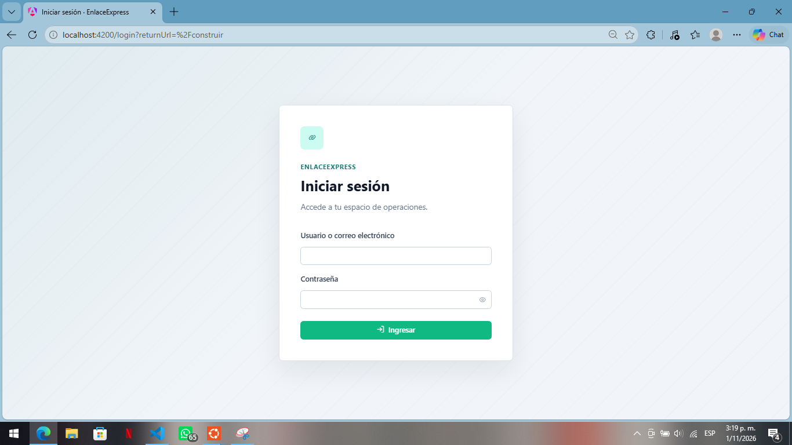

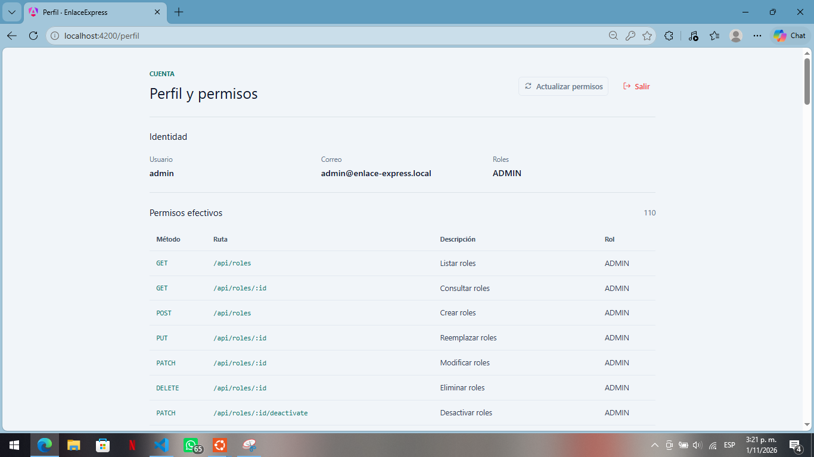

## Fase II: Auth con RBAC — ISS-15 — Guards y RBAC en las pantallas Business

Antes de construir: Autorización por capas
Comprueba authGuard, luego permissionGuard, después menú filtrado y botones. NAV y computed permanecen en Shell; Aside solo presenta items.

**Objetivo**

Convertir la autenticación en autorización visible:

> Fase II · bloque 2 de 3 — Protección del Business. Esta ISS no reescribe las pantallas de Fase I (clientes, tipos, productos, ventas, detalle). Solo añade canActivate/data a sus rutas, envuelve sus botones con *appHasPermission y filtra el menú. Los formularios de administración RBAC llegan en ISS-10.

- authGuard: sin sesión → /login.
- guestGuard: con sesión → no volver al login.
- permissionGuard: sin la concesión de la ruta → /forbidden.
- *appHasPermission: oculta botones de escritura.
- Menú lateral calculado con computed() según SessionStore.

> Principio: todo esto es UX, no seguridad. El backend vuelve a validar con authenticate + authorize. Un usuario puede forzar la URL o el DOM; el backend responde 401/403 y el errorInterceptor muestra el toast.

La fuente de verdad en el cliente es `SessionStore.permissions()`, cargada desde `GET /api/permisos`. No hay permisos hardcodeados por rol.

> Modo laboratorio. authGuard, guestGuard y permissionGuard consultan environment.requireAuth; con false dejan pasar. authOnlyGuard consulta SessionStore.authEnabled (su copia) y hace lo contrario: cierra /perfil y /admin/*. Solo tiene sentido junto con AUTH_ENABLED=false en el .env del backend, que abre las 5 rutas de negocio. Con las banderas desemparejadas la UI no se bloquea pero la API responde 401

### 15.0 Generar guards y directiva

```bash
ng generate guard core/guards/auth --functional --implements=CanActivate --skip-tests --defaults
ng generate guard core/guards/guest --functional --implements=CanActivate --skip-tests --defaults
ng generate guard core/guards/permission --functional --implements=CanActivate --skip-tests --defaults
ng generate directive shared/directives/has-permission --skip-tests --defaults
```

El separador de guard genera auth-guard.ts, guest-guard.ts y permission-guard.ts, que coinciden con sus imports. Si los creaste al conectar las rutas de ISS-08, completa sus cuerpos sin volver a generarlos. La directiva se genera antes de añadir sus imports a los componentes. El CLI crea la estructura; el comportamiento de permisos se implementa después.

### 15.1 authGuard

```bash
mkdir -p src/app/core/guards
cat > src/app/core/guards/auth-guard.ts <<'EOF'
import { inject } from '@angular/core';
import { CanActivateFn, Router } from '@angular/router';
import { environment } from '../../../environments/environment';
import { SessionStore } from '../services/session-store';

/** ¿Quién eres? Si no hay access token, a /login con returnUrl. */
export const authGuard: CanActivateFn = (_route, state) => {
  const session = inject(SessionStore);
  const router = inject(Router);

  if (!environment.requireAuth || session.isAuthenticated()) {
    return true;
  }

  return router.createUrlTree(['/login'], { queryParams: { returnUrl: state.url } });
};
EOF
```

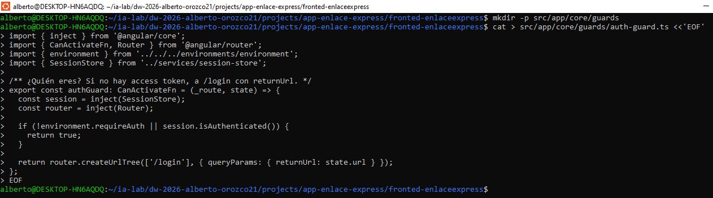

createUrlTree es preferible a router.navigate dentro de un guard: el Router evalúa la redirección antes de activar el componente, sin parpadeos.

### 15.2 guestGuard

```bash
cat > src/app/core/guards/guest-guard.ts <<'EOF'
import { inject } from '@angular/core';
import { CanActivateFn, Router } from '@angular/router';
import { environment } from '../../../environments/environment';
import { SessionStore } from '../services/session-store';

/** Un usuario ya autenticado no necesita volver a /login. */
export const guestGuard: CanActivateFn = () => {
  const session = inject(SessionStore);
  const router = inject(Router);

  if (!environment.requireAuth || !session.isAuthenticated()) {
    return true;
  }

  return router.createUrlTree(['/dashboard']);
};
EOF
```

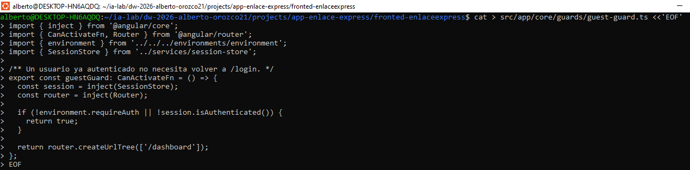

### 15.3 permissionGuard

```bash
cat > src/app/core/guards/permission-guard.ts <<'EOF'
import { inject } from '@angular/core';
import { CanActivateFn, Router } from '@angular/router';
import { environment } from '../../../environments/environment';
import { SessionStore } from '../services/session-store';

/**
 * ¿Qué puedes hacer? Se declara en la ruta:
 *   data: { permission: 'GET /api/clientes' }
 * Es una ayuda visual; Express vuelve a validar con Auth.authorize.
 */
export const permissionGuard: CanActivateFn = (route) => {
  const session = inject(SessionStore);
  const router = inject(Router);

  if (!environment.requireAuth) {
    return true;
  }

  const permission = route.data?.['permission'] as string | undefined;
  if (!permission || session.canPermission(permission)) {
    return true;
  }

  return router.createUrlTree(['/forbidden'], {
    queryParams: { permission },
  });
};
EOF
```

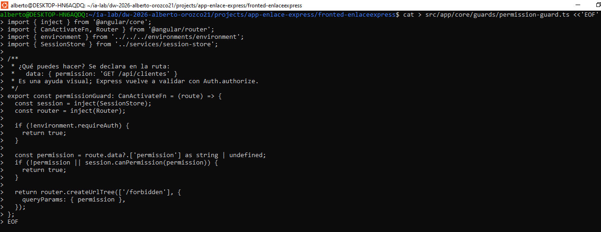

Cómo se evalúa canPermission

```
canPermission('GET /api/clientes/7')
```

- Separa verbo (GET) y ruta (/api/clientes/7).
- Recorre permissions() (cada fila trae method y path patrón).
- Casa /api/clientes/:id con /api/clientes/7 mediante regex anclada.
- Deny by default: si ninguna fila coincide, devuelve false.

`authOnlyGuard:` **pantallas que no existen en la Fase I**

La administración RBAC y el perfil no tienen sentido sin sesión: el backend los mantiene con JWT aunque el frontend esté en modo laboratorio. Este guard evita ofrecer pantallas que responderían 401.

```typescript
import { inject } from '@angular/core';
import { CanActivateFn, Router } from '@angular/router';
import { SessionStore } from '../services/session-store';

export const authOnlyGuard: CanActivateFn = () => {
  const session = inject(SessionStore);
  const router = inject(Router);

  if (session.authEnabled) {
    return true;
  }

  return router.createUrlTree(['/dashboard']);
};
```

Se aplica antes de permissionGuard en /perfil y en las cinco rutas /admin/*:

```typescript
{
  path: 'admin/usuarios',
  canActivate: [authOnlyGuard, permissionGuard],
  data: { permission: 'GET /api/usuarios' },
  loadComponent: () => import('./features/admin/users/user-list/user-list').then((m) => m.UserList),
},
```

El Shell usa la misma condición para no pintar el grupo Seguridad del menú (authOnly: true en NAV). Así el modo laboratorio se ve como la Fase I real: Operación + Prototipo.

authOnlyGuard lee SessionStore.authEnabled, que es la copia de environment.requireAuth que ya consume el Shell. Los otros guards leen el environment directamente; ambas fuentes valen lo mismo y el test lo verifica.

### 15.4 Matriz de rutas de Fase II

Encima de cada loadComponent de las rutas ya existentes (las de Fase I), añade canActivate y data:

|Ruta	|Permiso|
|-------|-------|
|/clientes	|GET /api/clientes|
|/tipos-producto|	GET /api/tipos-producto|
|/productos|	GET /api/productos|
|/ventas|	GET /api/ventas|
|/ventas/nueva	|POST /api/ventas|
|/detalle-ventas|	GET /api/detalle-ventas|
|/dashboard	|GET /api/ventas|

Las rutas /admin/* no se declaran aquí: sus componentes se crean en ISS-16. Al declararlas allí, se les pone el mismo permissionGuard y su data:

|Ruta	|Permiso|	Se declara en|
|-------|-----|---------------|
|/admin/usuarios|GET /api/usuarios|	ISS-10|
|/admin/roles|	GET /api/roles|	ISS-10|
|/admin/recursos|	GET /api/recursos	|ISS-10|
|/admin/asignaciones|	GET /api/asignaciones-rol	|ISS-10|
|/admin/permisos|	GET /api/concesiones-rol	|ISS-10|

Ejemplo completo (la ruta de clientes ya existe desde ISS-03):

```
{
  path: 'clientes',
  title: 'Clientes · StoreLab',
  canActivate: [permissionGuard],
  data: { permission: 'GET /api/clientes' },
  loadComponent: () =>
    import('./features/clients/client-list/client-list').then((m) => m.ClientList),
},
```

`/perfil` y `/forbidden` no llevan `permissionGuard`: todo usuario autenticado debe poder ver su sesión y la pantalla de acceso denegado.

### 15.5 Directiva *appHasPermission

Conservada como ampliación en ISS-02; créala ahora si seguiste el recorrido básico. Su fuente es SessionStore.canPermission():

```html
<ng-container *appHasPermission="'POST /api/clientes'">
  <button pButton label="Nuevo cliente" icon="pi pi-plus"></button>
</ng-container>
```

Permisos exactos por acción (pantallas de Fase I)

```html
<ng-container *appHasPermission="'PATCH /api/clientes/:id'">…</ng-container>
<ng-container *appHasPermission="'DELETE /api/clientes/:id'">…</ng-container>
```

### 15.6 Menú lateral con computed

Catálogo de rutas y permisos en `src/app/layout/shell/nav.config.ts` (NAV). El Shell filtra cada grupo con `SessionStore.canPermission()` y oculta Seguridad cuando `authEnabled` es false (modo laboratorio).

```typescript
readonly navGroups = computed<MenuItem[]>(() =>
  NAV.filter((group) => !group.authOnly || this.session.authEnabled)
    .map((group) => ({
    label: group.label,
    items: group.items
      .filter((item) => !item.permission || this.session.canPermission(item.permission))
      .map<MenuItem>((item) => ({
        label: item.label,
        icon: item.icon,
        routerLink: item.routerLink,
        routerLinkActiveOptions: { exact: item.routerLink === '/ventas' },
      })),
  })).filter((group) => (group.items?.length ?? 0) > 0),
);
```

computed se recalcula cuando cambia permissions(). Después de AuthService.me(), el menú se ajusta sin recargar la página.

**Topbar y menú de usuario**

- Avatar con iniciales (computed).
- Tag con roles (roleLabel, derivado de roleNames()).
- Menú popup: Mi sesión, Actualizar permisos, Cerrar sesión.
- p-toast y p-confirmdialog globales en el shell.

> Error clásico: `<p-menu #userMenu [model]="userMenu()">` hace que la referencia de plantilla #userMenu tape el método userMenu() y Angular reporte Type 'Menu' has no call signatures. Usa #userMenuPanel.

### 15.7 /forbidden: explicar el 403

Forbidden lee permission del query param y lo muestra:

```typescript
readonly permission = this.route.snapshot.queryParamMap.get('permission');
```

```html
@if (permission) {
  <div class="rounded-xl bg-slate-900 px-4 py-3">
    <p class="text-[11px] uppercase text-slate-400">Permiso requerido</p>
    <code class="text-sm text-emerald-300">{{ permission }}</code>
  </div>
}
```

Esto convierte un “no puedo entrar” en una pista accionable: pide a un admin que cree la fila en resource_roles (pantalla /admin/permisos).

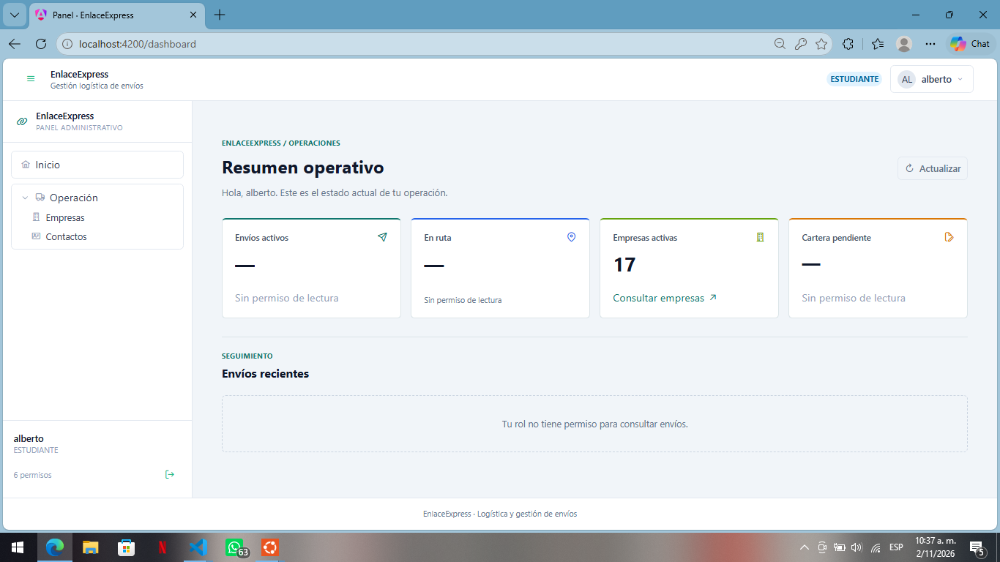

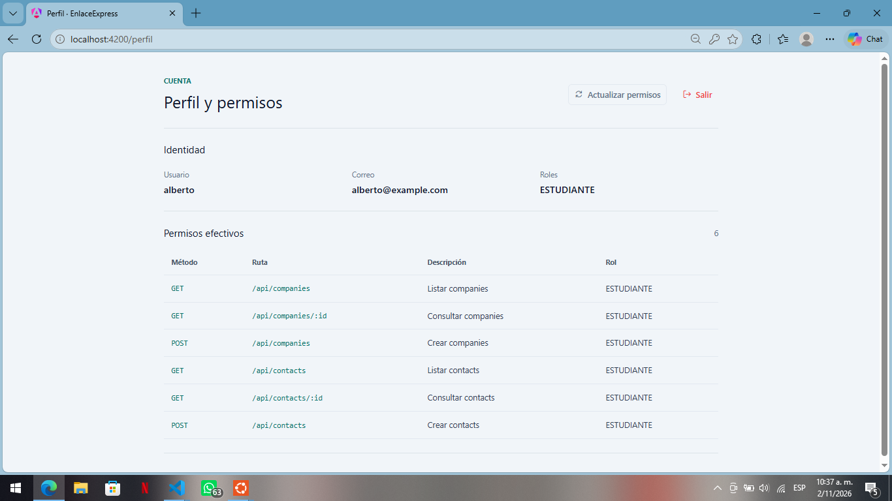

## Fase II: Auth con RBAC — ISS-16 — Formularios de las entidades Auth

Convención visual: mantener PrimeNG Aura para controles y tablas, Tailwind para layout y los componentes compartidos `PageHeader`, `EmptyState` y `StatusTag`. Los formularios se presentan en diálogos, como en las listas de negocio. No añadir PrimeFlex ni estilos propios cuando las utilidades existentes resuelvan el layout.

Antes de construir: completar el menú admin en el shell existente
Las entidades comparten la ruta `/dashboard`: `Construir` conmuta la sección activa y `Aside` muestra el menú. Añade componentes standalone dentro de `features/admin`, registra cada sección en `Construir` y conserva `HasPermission` en cada acción.

**Objetivo**
Construir las pantallas que administran el modelo de autorización de EnlaceExpress:

> Fase II · bloque 3 de 3 — Administración RBAC. El frontend ya tiene los modelos y servicios API para User, Role, Resource, RoleUser y ResourceRole; esta ISS añade sus vistas y formularios. No se crean rutas `/admin/*`: las secciones viven bajo el shell actual en `/dashboard`. `refresh_tokens` no tiene pantalla; las sesiones siguen siendo responsabilidad de la cuenta autenticada.

```
User ──< role_users >── Role ──< resource_roles >── Resource
              (status active)          (status active)      (method + path)
```

**Cinco pantallas:**

| Sección del menú | Entidad | Endpoint | Respuesta de lista | Permiso de lectura |
| --- | --- | --- | --- | --- |
| Usuarios | User | `/api/usuarios` | `{ users }` | `GET /api/usuarios` |
| Roles | Role | `/api/roles` | `{ roles }` | `GET /api/roles` |
| Recursos | Resource | `/api/recursos` | `{ resources }` | `GET /api/recursos` |
| Asignaciones de rol | RoleUser | `/api/asignaciones-rol` | `{ assignments }` | `GET /api/asignaciones-rol` |
| Concesiones de recursos | ResourceRole | `/api/concesiones-rol` | `{ grants }` | `GET /api/concesiones-rol` |

### 16.1 Regla de oro del RBAC

Un usuario puede ejecutar MÉTODO /ruta si y solo si existe la cadena:

- role_users con user_id = usuario, status = active.
- roles con status = active.
- resource_roles con ese role_id, status = active.
- resources con el path y method exactos, status = active.

Si cualquier eslabón está inactivo, el backend responde 403 (deny by default). La UI replica esta lógica en SessionStore.canPermission() con los permisos efectivos que devuelve GET /api/permisos.

### 16.2 Componentes

Implementar las listas en `src/app/features/admin/users/user-list`, `roles/role-list`, `resources/resource-list`, `role-users/role-user-list` y `resource-roles/resource-role-list`. Cada lista contiene su formulario en un `p-dialog`, siguiendo el patrón existente de las pantallas de negocio. Los servicios `*-api.ts` ya existen y se reutilizan.

### 16.3 Usuarios

**Servicio**

```typescript
@Injectable({ providedIn: 'root' })
export class UserApi {
  private readonly http = inject(HttpClient);
  private readonly base = `${environment.apiUrl}/usuarios`;

  list(): Observable<User[]> { /* GET { users } */ }
  get(id: number): Observable<User> { /* GET { user } */ }
  create(payload: CreateUserPayload): Observable<User> { /* POST { user } */ }
  update(id: number, payload: PatchUserPayload): Observable<User> { /* PATCH */ }
  permissions(id: number): Observable<EffectivePermission[]> { /* GET /:id/permisos */ }
  changePassword(id: number, payload: { current_password: string; new_password: string }): Observable<unknown> {
    /* PATCH /:id/password */
  }
  deactivate(id: number): Observable<unknown> { /* PATCH /:id/deactivate */ }
  remove(id: number): Observable<unknown> { /* DELETE /:id */ }
}
```

`GET /api/usuarios/:id/permisos`
Devuelve la evaluación efectiva del usuario, con la misma consulta que usa authorize:

```json
{
  "permissions": [
    {
      "resource_id": 1,
      "method": "GET",
      "path": "/api/companies",
      "description": "Listar empresas",
      "role_id": 2,
      "role_name": "SELLER"
    }
  ]
}
```

La lista de usuarios tiene un botón “Ver permisos” que abre un diálogo. Los roles se derivan en el cliente (role_id + role_name únicos); no hay endpoint /access en este backend.

```typescript
readonly access = signal<EffectivePermission[]>([]);
readonly accessUser = signal<User | null>(null);

readonly accessRoles = computed(() => {
  const byId = new Map<number, string>();
  for (const permission of this.access()) {
    byId.set(permission.role_id, permission.role_name);
  }
  return [...byId.entries()].map(([id, name]) => ({ id, name }));
});
```

Es la forma más rápida de diagnosticar un 403.

**Formulario de usuario**

```typescript
readonly form = this.fb.group({
  username: ['', [Validators.required, Validators.minLength(3)]],
  email: ['', [Validators.required, Validators.email]],
  password: ['', [Validators.required, Validators.minLength(8)]],
  avatar: [''],
  status: ['active' as Status, [Validators.required]],
});
```

CreateUserDto acepta password y status; en cambio PATCH /api/usuarios/:id (`PatchUserDto = Partial<UpdateUserDto>`) solo acepta username, email y avatar. Por eso la UI muestra contraseña y estado solo al crear:

```typescript
if (current) {
  password.clearValidators();
  password.disable();
  this.form.controls.status.disable();
} else {
  password.setValidators([Validators.required, Validators.minLength(8)]);
  password.enable();
  this.form.controls.status.enable();
}
```

Y al emitir:

```typescript
const current = this.editing();
const payload: PatchUserPayload = {
  username: value.username.trim(),
  email: value.email.trim(),
  avatar: value.avatar.trim() || null,
};

// password + status solo existen en el alta
if (current) {
  this.api.update(current.id, payload);
} else {
  const createPayload: CreateUserPayload = { ...payload, status: value.status, password: value.password };
  this.api.create(createPayload);
}
```

> No envíes password ni status en el PATCH. El backend los ignora en el contrato, pero el repositorio recibiría el objeto crudo y podría rehashear la contraseña sin verificar la actual. El estado se cambia con /deactivate.

**Cambio de contraseña**

PATCH /api/usuarios/:id/password exige current_password del propio usuario (defensa en profundidad). No es una acción de “admin resetea a otro”: es la operación de autoservicio. El formulario de administración no la ofrece; si la expones, hazlo para el usuario autenticado (session.user()?.id).

```typescript
this.api.changePassword(user.id, {
  current_password: 'Actual123!',
  new_password: 'Nueva123!',
});
```

Protección contra auto-bloqueo

```typescript
isSelf(user: User): boolean {
  return this.session.user()?.id === user.id;
}
```

En la plantilla:

```html
<button
  pButton
  text
  rounded
  severity="danger"
  icon="pi pi-trash"
  [disabled]="isSelf(user)"
  pTooltip="No puedes eliminar tu propio usuario"
></button>
```

### 16.4 Roles

**Servicio RoleApi:**

```
list(): Observable<Role[]>          // GET { roles }
create(payload: RolePayload)        // POST { role }
update(id, payload)                 // PATCH { role }
deactivate(id)                      // PATCH /:id/deactivate
remove(id)                          // DELETE /:id
```

**Formulario:**

```typescript
readonly form = this.fb.group({
  name: ['', [Validators.required, Validators.maxLength(60)]],
  description: [''],
  status: ['active' as Status, [Validators.required]],
});
```

status solo se envía en el alta: PATCH /api/roles/:id no lo acepta y el estado se cambia con PATCH /:id/deactivate.

El backend normaliza name a MAYÚSCULAS (ADMIN, SELLER, BUYER). El seeder crea ADMIN y SELLER; si creas roles nuevos, usa mayúsculas para que la UI y las concesiones coincidan. No renombres un rol con asignaciones activas sin revisar role_users.

El nombre del rol no autoriza nada. Un ADMIN sin filas activas en resource_roles no puede ejecutar ninguna operación.

### 16.5 Recursos HTTP

Resource es el catálogo de capacidades. El par (path, method) es único.

**Servicio**

```typescript
@Injectable({ providedIn: 'root' })
export class ResourceApi {
  private readonly base = `${environment.apiUrl}/recursos`;

  list(): Observable<Resource[]> { /* GET { resources } */ }
  get(id: number): Observable<Resource> { /* GET { resource } */ }
  create(payload: ResourcePayload): Observable<Resource> { /* POST */ }
  update(id: number, payload: Partial<ResourcePayload>): Observable<Resource> { /* PATCH */ }
  deactivate(id: number): Observable<unknown> { /* PATCH /:id/deactivate */ }
  remove(id: number): Observable<unknown> { /* DELETE /:id */ }
}
```

El backend sí expone DELETE /api/recursos/:id. Úsalo con cuidado: rompe las filas históricas de resource_roles que apunten al resource. Para el día a día, prefiere PATCH /:id/deactivate.

**Formulario y validación de path**

```typescript
readonly form = this.fb.group({
  path: ['', [Validators.required, Validators.pattern(/^\/.*$/)]],
  method: ['GET' as HttpMethod, [Validators.required]],
  description: [''],
  status: ['active' as Status, [Validators.required]],
});
```

status solo se envía en el alta: PATCH /api/recursos/:id no lo acepta y el estado se cambia con PATCH /:id/deactivate.

path debe empezar por /. Para rutas con parámetro usa :id:

```
/api/shipments
/api/shipments/:id
/api/shipments/:id/deactivate
```

El backend normaliza el verbo a mayúsculas y la ruta (sin barra final, sin //).

El listado muestra contadores por método con un computed:

```typescript
readonly countsByMethod = computed(() => {
  const counts = new Map<string, number>();
  for (const row of this.rows()) {
    counts.set(row.method, (counts.get(row.method) ?? 0) + 1);
  }
  return counts;
});
```

**Filtro por método**

p-select de PrimeNG 22 no tiene input value; se usa ngModel:

```html
<p-select [fluid]="true"
  [options]="methods"
  optionLabel="label"
  optionValue="value"
  [ngModel]="methodFilter()"
  (onChange)="methodFilter.set($event.value)"
/>
```

Y en el componente:

```typescript
readonly visibleRows = computed(() => {
  const method = this.methodFilter();
  const filtered = filterRows(this.rows(), this.filter(), (row) => [
    row.path,
    row.description,
    row.method,
  ]);
  return method ? filtered.filter((row) => row.method === method) : filtered;
});
```

### 16.6 Asignaciones usuario ↔ rol

**RoleUserApi:**

```
list(): Observable<RoleUser[]>              // GET { assignments }
create(payload): Observable<RoleUser>       // POST { assignment }
deactivate(id): Observable<unknown>         // PATCH /:id/deactivate
reactivate(id): Observable<unknown>         // PATCH /:id/reactivate
```

GET `/api/asignaciones-rol` lista asignaciones activas. No hay DELETE físico: retirar es baja lógica y reactivar, cuando se dispone de una fila inactiva, es `PATCH /:id/reactivate`. POST puede restaurar una asignación existente según el contrato del backend; la UI debe permitir volver a asignar el mismo par usuario-rol.

**Pantalla**

- Filtros por usuario y por rol (computed local).
- Diálogo “Asignar rol” con dos p-select y [ngModel].
- Tabla con avatar, username, email, rol y fecha.
- Botón “Retirar rol” → PATCH /api/asignaciones-rol/:id/deactivate.

```typescript
readonly visibleRows = computed(() => {
  const user = this.userFilter();
  const role = this.roleFilter();
  return this.rows().filter(
    (row) => (!user || row.user_id === user.id) && (!role || row.role_id === role.id),
  );
});

readonly canSave = computed(() => !!this.selectedUser() && !!this.selectedRole());
```

```html
<p-select [fluid]="true"
  [options]="users()"
  optionLabel="username"
  [filter]="true"
  filterBy="username,email"
  [ngModel]="selectedUser()"
  (ngModelChange)="selectedUser.set($event)"
/>
```

**Advertencia de bloqueo**


Si quitas el último role_user de un administrador, nadie podrá administrar el RBAC. En el laboratorio:

- Crea un segundo usuario admin.
- Asígnale el rol ADMIN.
- Verifica con Ver permisos que tiene GET /api/usuarios.
- Solo entonces modifica el primero.

### 16.7 Concesiones rol ↔ recurso

**ResourceRoleApi:**

```
list(filters?: { role_id?: number; resource_id?: number }): Observable<ResourceRole[]>
create(payload: ResourceRolePayload): Observable<ResourceRole>   // { grant }
deactivate(id): Observable<unknown>                              // PATCH /:id/deactivate
reactivate(id): Observable<unknown>                              // PATCH /:id/reactivate
```

GET /api/concesiones-rol acepta ?role_id= y ?resource_id=. La respuesta es { grants }; el POST responde { message, grant }.

**Pantalla**

Filtro por rol y búsqueda de path/método.
Diálogo “Conceder permiso” con p-select de roles y de resources.
El p-select de resources usa templates para mostrar método + path:

```html
<p-select [fluid]="true"
  [options]="resources()"
  [filter]="true"
  filterBy="path,method"
  [ngModel]="selectedResource()"
  (ngModelChange)="selectedResource.set($event)"
>
  <ng-template #selectedItem let-resource>
    <span class="flex items-center gap-2">
      <p-tag [value]="resource.method" [severity]="methodSeverity(resource.method)" [rounded]="true" />
      <code class="text-xs">{{ resource.path }}</code>
    </span>
  </ng-template>
  <ng-template #item let-resource>
    <span class="flex items-center gap-2">
      <p-tag [value]="resource.method" [severity]="methodSeverity(resource.method)" [rounded]="true" />
      <code class="text-xs">{{ resource.path }}</code>
    </span>
  </ng-template>
</p-select>
```

selectedItem e item son templates de PrimeNG 22, pero se declaran como variables (#selectedItem, #item): Select los busca con contentChild("selectedItem"). Con pTemplate se ignoran y el select muestra [object Object] porque el resource no tiene un label plano. Es el mismo cambio que sufrió Table (PARCHE de ISS-03).

**Semáforo de métodos**

```typescript
methodSeverity(method: HttpMethod | undefined) {
  switch (method) {
    case 'GET': return 'info';
    case 'POST': return 'success';
    case 'PUT':
    case 'PATCH': return 'warn';
    case 'DELETE': return 'danger';
    default: return 'secondary';
  }
}
```

### 16.8 Integración del menú

Las secciones se registran en el catálogo de navegación de `Construir` con su permiso `GET` correspondiente. El grupo Seguridad solo se muestra si `SessionStore.authEnabled` es true; cada opción se filtra con `SessionStore.canPermission()`. `seleccionar()` vuelve a comprobar ambos requisitos y dirige a `/forbidden` con el permiso requerido cuando no se cumple.

Las acciones de escritura usan `HasPermission`:

| Acción | Permiso |
| --- | --- |
| Crear usuario, rol, recurso, asignación o concesión | `POST` sobre su endpoint base |
| Editar usuario, rol o recurso | `PATCH` sobre `/:id` |
| Desactivar entidad | `PATCH` sobre `/:id/deactivate` |
| Eliminar usuario, rol o recurso | `DELETE` sobre `/:id` |
| Ver permisos efectivos de usuario | `GET /api/usuarios/:id/permisos` |
| Reactivar asignación o concesión | `PATCH` sobre `/:id/reactivate` |

Las comprobaciones de interfaz son UX; el backend sigue siendo la autoridad y responde 401/403. No se habilita el cambio de contraseña de otro usuario desde administración: el endpoint exige la contraseña actual y corresponde a autoservicio.

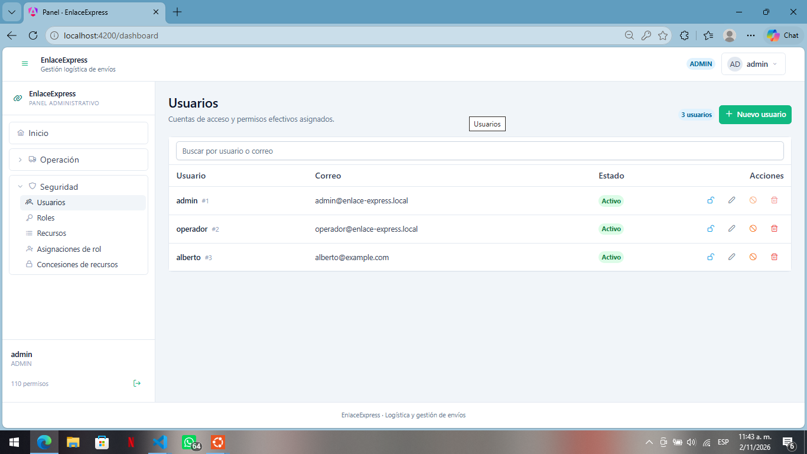