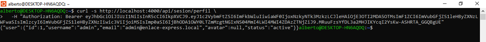

# Bitacora de creación del frontned en Angular

## ISS-00 · Requisitos previos

**Objetivo**

- Dejar el equipo listo para construir el frontend: Node, npm, Angular CLI, navegador, backend Express corriendo y base de datos sembrada. Al terminar este ISS no se ha escrito código de Angular todavía; solo se comprueba el entorno.


### 0.1 Versiones del laboratorio

| Herramienta | Versión usada | Verificación |
|-------------|---------------|--------------|
|Node.js |	22 LTS o superior (lab: 24.x)|	node -v|
|npm |	10 o superior	|npm -v|
|Angular CLI |	22.x	|npx @angular/cli version|
|Backend |Express 5 + Sequelize 6	|curl http://localhost:4000/api/sesion/perfil|
|Navegador |Chrome / Edge / Firefox actual|	Abrir http://localhost:4200|

```bash
node -v
npm -v
npx @angular/cli@22 version
```


### 0.2 Backend en marcha

El frontend no funciona solo: consume la API en `http://localhost:4000/api`. Levanta el backend correcto:

```bash
cd ~/ia-lab/dw-2026-alberto-orozco21/projects/app-enlace-express/backend-express/
npm run db:seed
npm run dev
```


### Comprobación de la matriz de permisos>

```bash
curl -i http://localhost:4000/api/companies
```

- 401 Unauthorized → el backend está protegido (estado final). Correcto.
- 200 con { "clients": [...] } → backend en Fase I (sin middlewares).
- ECONNREFUSED → el backend no está escuchando en el puerto 4000.


### 0.3 Login y permisos

El login del backend devuelve solo el par de tokens. El perfil y los permisos se piden aparte:

1. **Login (OPEN)**

```bash
curl -s -X POST http://localhost:4000/api/sesion/login \
  -H "Content-Type: application/json" \
  -d '{"identifier":"admin","password":"Admin123!"}'
```


2. **Perfil (JWT)**
curl -s http://localhost:4000/api/sesion/perfil \
  -H "Authorization: Bearer $TOKEN"



3. **Permisos efectivos (JWT)**
curl -s http://localhost:4000/api/permisos \
  -H "Authorization: Bearer $TOKEN"


### 0.4 Credenciales del seeder

|Usuario| Password |Rol	|Permisos |
|-------|----------|----|---------|
|admin|	Admin123! |ADMIN |110 recursos |
|operador| Operador123	|OPERADOR	|0 recursos |

### 0.5 Navegador y herramientas

- Abre DevTools (F12) → Console y Network. En cada ISS comprobarás que las peticiones llevan Authorization: Bearer ....
- Instala Angular DevTools (opcional) para inspeccionar componentes y signals.
- Desactiva bloqueadores que intercepten localhost si el login falla sin motivo.

### 0.6 Estructura de trabajo

El proyecto se crea dentro de la carpeta existente:

```
~/ia-lab/dw-2026-alberto-orozco21/projects/app-enlace-express/
```

No se debe crear una subcarpeta adicional. En ISS-01 se explica el comando exacto (`ng new frontend-enlace-express --directory .`) y porque `ng new .` falla en Angular CLI 22.

### Criterios de aceptación (ISS-00)

- [X] node -v ≥ 22 y npm -v ≥ 10.

- [X] npx @angular/cli@22 version muestra Angular CLI 22.x.

- [X] npm run db:seed && npm run dev del backend app-storelab-express-ii deja el puerto 4000 escuchando.

- [X] POST /api/sesion/login con admin / Admin123! devuelve access_token y refresh_token.

- [X] GET /api/permisos con ese token devuelve permissions (58 para admin).

- [X] La carpeta front-storelab-express-ii existe y está vacía (o solo contiene archivos de configuración del repositorio).

### Comprobación final

```bash
# 1. Versiones
node -v && npm -v && ng version

# 2. Backend vivo
curl -s -o /dev/null -w "HTTP %{http_code}\n" http://localhost:4000/api/companies

# 3. Login + permisos
TOKEN=$(curl -s -X POST http://localhost:4000/api/sesion/login \
  -H "Content-Type: application/json" \
  -d '{"identifier":"alberto","password":"12345678"}' \
  | grep -o '"access_token":"[^"]*' | cut -d'"' -f4)

curl -s http://localhost:4000/api/permisos \
  -H "Authorization: Bearer $TOKEN" | head -c 300
```

